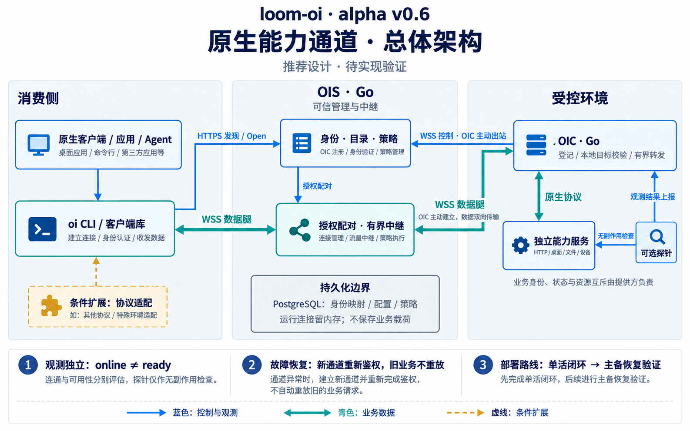
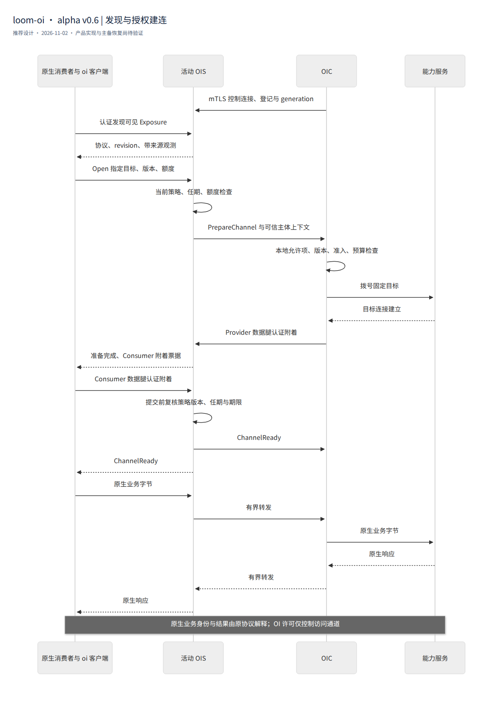
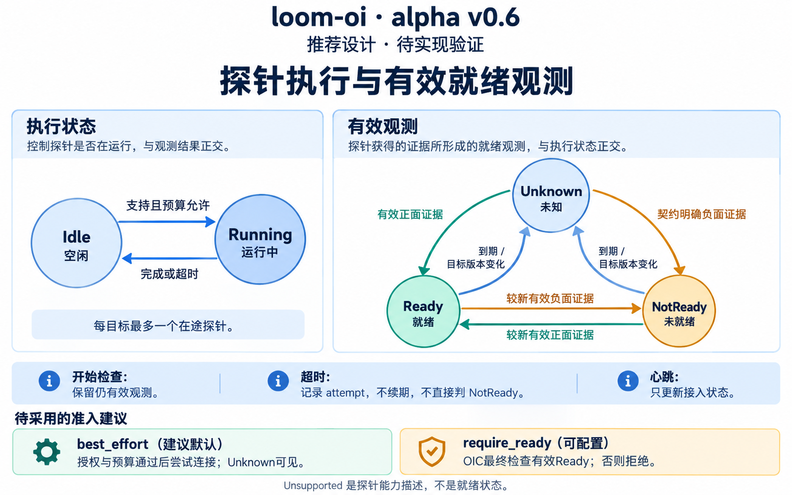
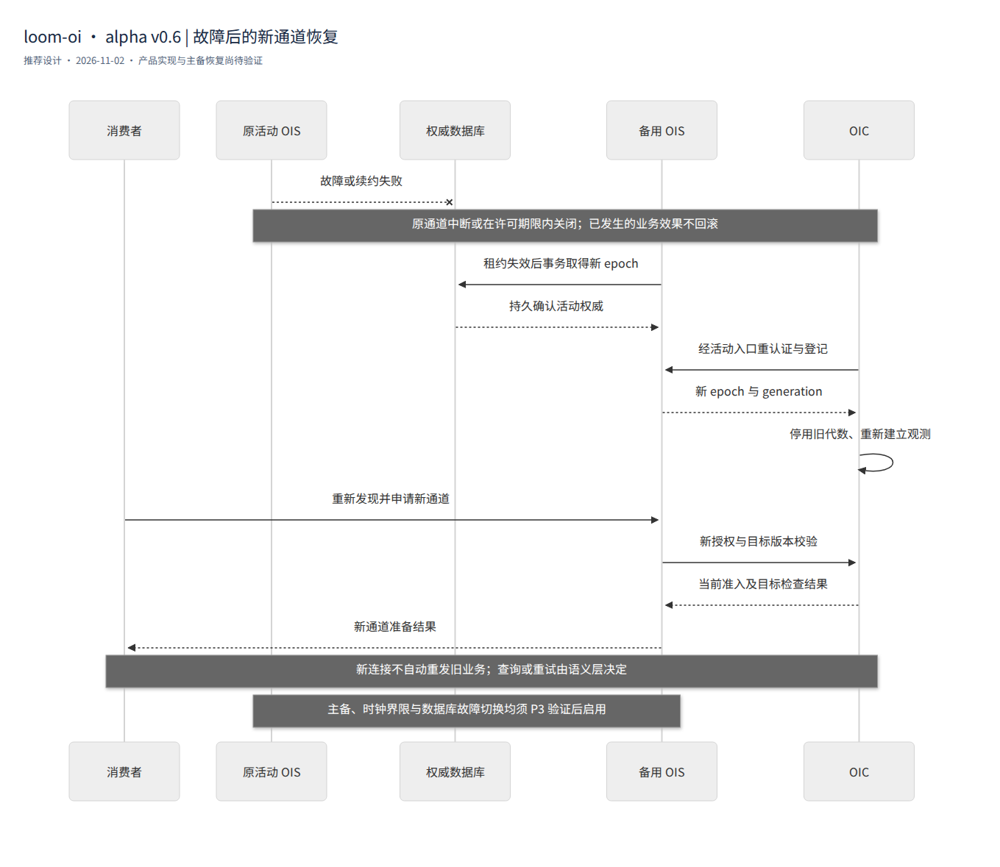
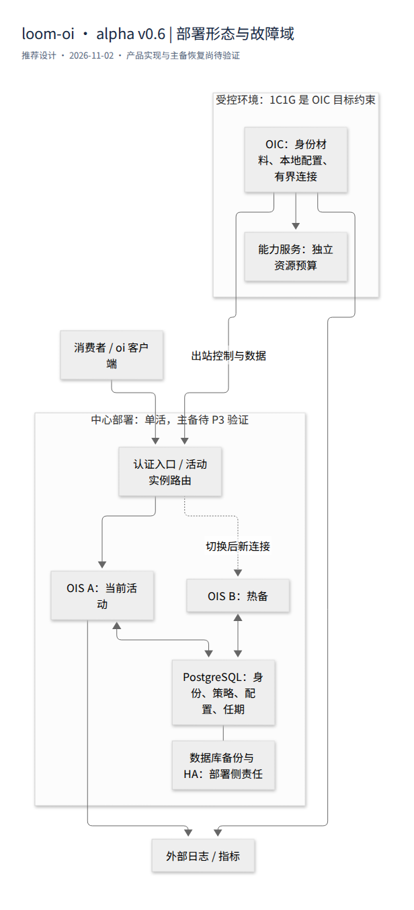
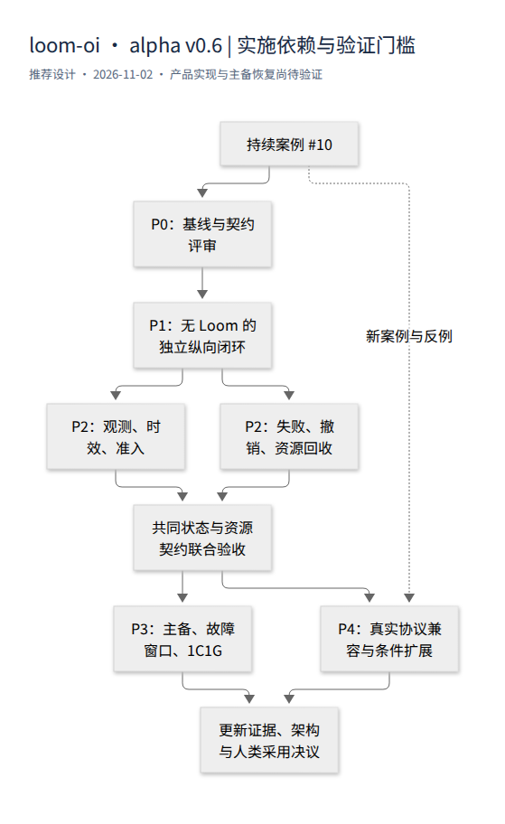

# loom-oi 架构与实现方案 · alpha v0.6

2026-11-02 · 分支alpha · 基于c5e2907与当前案例收束的**推荐实现方案**。

本版把已有建议收束为一条可实施路线：**Go统一核心，能力目录与原生通道作为基础消费方式，OIC主动出站连接可信OIS中继，观测与业务语义分责；先实现单活闭环，再验证同一协议下的主备恢复。** 本文是当前架构评审入口；不是产品已经实现、全部实验通过或人类已经接受每个技术选择的声明。

用户在[#10的新回复](https://github.com/wyw-ai/loom-oi/issues/10#issuecomment-6564017519)明确案例持续收纳、按现有案例设计，发生实质变化时再评审。因此不再把“案例全部齐全”作为出方案的前提。新增案例改变边界时按§13重开受影响的判断。

## 导航与图册

[收束选择](#choices) · [整体架构](#overview) · [对象](#objects) · [接入与登记](#registration) · [授权与调用](#open) · [观测](#observation) · [故障恢复](#failure) · [部署与存储](#deployment) · [场景覆盖](#coverage) · [实施路径](#delivery) · [证据与评审](#review)

图册包含ImageGen专业绘制的总体导览，以及六张精确技术视图；[图册](diagrams/README.md)提供图片、技术图SVG/Mermaid源文件和生成提示词。全部对应本版方案，条件扩展或恢复路径不表示已经实现。

## 1. 本版采用哪些推荐

“采用”在此指本版方案内部的一致选择，最终产品采用仍待人类评审。没有将互相冲突的A/B/C、R/D/H同时塞进首版。

| 编号 | 本版明确选择 | 依据、代价与改选条件 |
| --- | --- | --- |
| B01 产品基础 | A：目录、访问授权、受控原生通道；配套CLI/客户端库 | 当前跳板机、独立HTTP/设备服务可作为设计输入，核心不拥有Agent上下文。消费者承担原协议；若真实消费者必须统一工具入口，增外置适配而非暗改通道语义 |
| B02 网络路径 | R：OIC主动出站至可信OIS，双向数据经过中继；首版不做P2P/双路径 | 先覆盖可出站但不可入站的环境；代价是中心带宽、信任和故障域。内网高带宽、中心不可读、失联持续访问成为硬需求时重评D/H |
| B03 核心实现 | OIS、OIC、配套CLI使用Go，共享版本化协议类型 | 沿用C06工程推荐，不依赖Loom技术栈；无语言性能实证。硬资源/嵌入/团队维护证据可触发Rust改选 |
| B04 通信基线 | 管理/发现使用HTTPS JSON API；接入控制用独立WSS；每个业务通道使用独立WSS数据连接 | 易明确控制与数据生命周期，避免首版自写复杂多路复用；代价是连接/TLS开销，1C1G容量需实测。QUIC保留为可测替换点 |
| B05 对象 | Access登记、Exposure暴露项；连接generation、配置revision分别变化 | 不把机器、进程、能力、业务会话混成Node；不强制Provider/Workload层。需要托管/迁移时再扩对象 |
| B06 生命周期 | 能力由提供方或既有进程管理器运行；OIC管理接入、连接和观测任务 | OIC不负责任意业务服务重启；stdio由显式桥接组件拥有子进程，不自动演变为通用调度器 |
| B07 状态与失败 | 分层观测；探针执行与有效观测正交；通道不跨失败边界隐式重放 | C01/C03有窄反例支持；完整状态机、独立发布和端到端失败契约仍待实现验证 |
| B08 持久化与恢复 | OIS使用PostgreSQL保存配置/策略/身份映射；运行连接留内存。目标为单活OIS+热备，首先验证单实例恢复 | PostgreSQL及主备是本轮为可用性目标提出的具体工程选择，非实验选出的赢家。增加中心部署成本，OIC不运行数据库；多活/业务无损迁移不进入本版 |
| B09 消费扩展 | 预留原生客户端和外置协议适配的稳定接口；首版不默认建设统一Invoke平台 | 避免为了未知消费者承担全协议版本/取消/错误映射。B/C触发条件保留在§10，扩展需要单独兼容验收 |

本版新增的HTTPS/WSS、认证细节、PostgreSQL和主备机制均为**设计提案**。它们给实现提供确定入口，不能借用Python实验冒充选型实证。

## 2. 整体职责与端到端链条

本图已校对数据路径、控制发起方向与责任边界；[精确技术拓扑](diagrams/01-overview.svg)保留外部监控等细节，[绘图说明与提示词](diagrams/imagegen-overview.md)可追溯生成和修订。

| 角色/模块 | 拥有的责任 | 明确边界 |
| --- | --- | --- |
| 消费者：脚本、应用、Agent | 选择能力、使用原协议、解释业务结果及恢复 | 不要求先注册成能力提供节点；Agent Session留在上层 |
| `oi` CLI / 客户端库 | 发现、Open、认证数据附着、受控本地转发、传输诊断 | 不替消费者生成业务调用，不猜业务是否执行 |
| OIS API/目录/策略 | 主体认证、目录过滤、策略/版本校验、访问协调 | 目录可见不等于获得访问许可；不把能力登记当工具业务实现 |
| OIS中继 | 将获准消费者数据腿与OIC数据腿配对，限流/关闭/审计元数据 | 同一ois程序中的模块；首版不拆独立中继产品，不保存业务载荷 |
| OIC | 本地配置、注册、受控目标拨号、二次约束校验、观测归约、资源限额 | 只接受本地允许目标；不接受调用者任意URL，不拥有服务业务状态 |
| 能力提供方 | 原生协议、业务副作用、资源互斥、业务认证、结果查询 | 桌面/文件/设备隔离由实际执行者保证；OI通道分离不能替代 |
| 可选协议组件 | 明确支持的probe、stdio桥接或消费适配 | 有独立版本/权限/成本；不能以“可选”为由默认纳入首版 |

完整链条为：管理员登记信任与本地允许项 → OIC认证出站 → 登记Access/Exposure → 消费者发现 → OIS授权 → OIC核验并拨号 → 两条数据腿配对 → 原生协议通信 → 观测独立发布 → 结束/故障清理 → 必要时重新鉴权建新通道。

## 3. 对象、版本和数据所有者

以下为内部/接口草图名；不再用未收敛的Node/Workload决定实现层级。

| 对象 | 建议最小字段 | 所有者与变化规则 |
| --- | --- | --- |
| Access | `access_id, credential_ref, enabled, labels` | OIS保存身份及管理许可；同一OIC重连保持ID。连接状态不写成业务状态 |
| Exposure | `exposure_id, access_id, revision, protocol, capability_description, target_ref, probe_spec, admission_mode, limits` | 本地配置为目标地址权威；OIS仅接受该Access有权登记的描述。修改目标/协议/安全约束增加revision；远端不能绕过本地允许项 |
| Policy | `policy_version, subject, exposure_selector, actions, limits, enabled` | OIS持久保存。首版actions限定discover/open；业务操作权限由提供方或懂协议的适配器判断 |
| AccessConnection | `access_id, leader_epoch, generation, heartbeat, state` | OIS当前活动实例授予连接代数；OIC只接受当前控制连接的命令。旧清理只能清自己generation |
| Channel | `channel_id, subject, exposure_id, revision, policy_version, epoch, generation, limits, expires_at, state` | 当前活动OIS与OIC持有临时状态；不跨故障持久恢复数据流，不等于业务Session |
| Observation | `exposure_id, revision, generation, probe_contract, sample_seq, observed_at, validity, result, reason, source` | OIC归约本地/协议观察；OIS保存可过期快照，不拥有业务真相 |

`leader_epoch`区分活动OIS任期，`generation`区分同一Access的接入连接，`revision`区分目标配置，`sample_seq`区分同一观测源的样本。这四者不得相互替代。客户端自填ID、时间或版本都不构成授权。

两个关键例子：同一OIC的桌面服务停机，不移除另一HTTP暴露项；相同exposure_id换目标后提升revision，旧通道关闭或失效，不能把原许可悄悄转给新目标。已有服务重启可能不可观测，OI不捏造服务实例代数。

## 4. 路径一：配置、认证与接入登记

1. 管理者在OIS建立Access记录，绑定受信客户端证书身份和可登记范围；在OIC配置本地Exposure允许清单。首版不做自动发现整台机器或远程执行任意配置命令。
2. OIC通过WSS控制端点主动出站，使用mTLS身份认证。证书由部署侧CA提供；服务端把已验证证书身份映射到Access，不信任JSON中的主体名称。CA签发、轮换和吊销是明确部署职责，不另造OI PKI平台。
3. OIS核对Access启用状态、当前活动任期和协议版本，分配generation。OIC上报描述与revision；不上传本地凭证明文。暴露项的管理许可与本地允许项取交集。
4. 认证成功后交换心跳/登记变更/观测/PrepareChannel/Revoke。控制流有独立连接、消息大小和调度预算，业务数据不通过控制JSON队列。
5. 重连带退避和抖动，重新认证、全量对账，再更新目录；不会因心跳恢复就把所有能力标Ready。旧generation命令/清理拒绝；新任期建立时旧通道按§8处理。

消费者建议使用有期限、可吊销、仅存摘要的服务访问令牌，经HTTPS提交；管理权限使用独立身份和动作范围。人类SSO/OIDC为可扩展认证入口，不是首个闭环强依赖。原生服务的API key/证书仍由消费方或获准协议组件管理，OI令牌不能自动转换成提供方凭证。

## 5. 路径二：发现、授权、建连与原生调用

### 5.1 API与通道契约草图

| 接口 | 输入/输出 | 关键校验 |
| --- | --- | --- |
| `GET /v1/exposures` | 已认证主体的可见描述、revision、协议及观测来源 | 分页/过滤有界；不返回本地秘密地址/凭证；不是访问许可 |
| `POST /v1/channels` | exposure_id、expected_revision、请求额度、client_request_id → channel_id或明确拒绝 | 当前策略、活动任期、Access在线、本地允许目标、额度和准入策略 |
| 控制消息`PrepareChannel` | subject、目标/版本、epoch/generation、额度、准备时限 | 经当前认证控制连接送达；OIC二次核对，不接受任意目标URL |
| `WSS /v1/channels/{id}/attach` | 两个角色分别附着：consumer/provider | 双方各有身份认证及短时一次性票据，绑定角色/主体/通道/任期/目标版本；票据不放URL查询串 |
| `GET /v1/channels/{id}` | 本主体可见传输阶段/失败原因 | 仅短期运行状态；不是业务执行账本；过期/故障后可返回unknown/not-found |
| `DELETE /v1/channels/{id}` | 关闭通道、释放资源 | 所有者/管理权限校验；关闭不表示业务取消成功 |

`client_request_id`只对同一活动任期内的Open协调进行有界去重，重复使用须参数一致；没有持久Exactly-once保证。控制面故障后客户端不自动恢复旧数据；需要重新发现与Open。

### 5.2 数据路径的具体实现

OIC先在本地预算内校验并拨号，消费者与OIC各建立一条出站WSS数据连接到同一活动OIS。两腿在短时准备窗口内配齐，OIC确认目标/版本仍有效；OIS在提交Open状态前重新核对policy_version、任期与期限，才发`ChannelReady`。OIC只对当前代数/目标版本仍有效的通道转发，并发变更导致准备失败或关闭旧绑定。未Ready不转交调用方载荷；超时、任一腿失败或策略改变，清理双方和本地socket。TCP连接本身也可能触发提供方行为，因此“未转交载荷”仍不能通用宣称“业务未执行”。

WSS承载OI数据封装而非MCP或HTTP业务封装：使用经子协议协商的`oi.tunnel.v1`；二进制message携带类型与有界payload，初版只需`DATA/FIN/ABORT`。`FIN`是OI的单向流结束指令，不是WebSocket Close；两方向都结束才正常关闭，异常使用ABORT。必须测试半关闭、帧分片、背压和截断；不直接把WebSocket消息边界暴露成目标TCP流边界。[RFC 6455](https://www.rfc-editor.org/rfc/rfc6455.html)说明WebSocket自身消息/控制帧和关闭机制，OI封装是本项目待实现协议。

每业务通道独立数据连接，避免首版实现自定义跨业务流复用；仍共享CPU/进程/网卡，不等于故障隔离。关闭默认数据压缩，限制完整消息解码大小和每腿缓冲，禁止为完整业务响应做无界聚合。若连接成本成为已测瓶颈，再比较有界多路复用或QUIC，不能先凭感觉切换。

### 5.3 消费体验与信任边界

配套`oi`提供discover/connect及库接口。优先用权限受控的Unix socket/Windows命名管道或直接流API给同一用户的原生客户端；只支持TCP的客户端可显式启用loopback转发，单机其他用户可达风险必须在部署配置中处理，不能把127.0.0.1当用户隔离。停止CLI必须关闭转发与通道。

通道不改原生Host/SNI/Origin、重定向和业务凭证；原生客户端必须能配置代理/连接地址并保留服务身份。若做不到，进入显式协议适配兼容范围，不能宣传“任意MCP/HTTPS客户端零改造”。分段TLS意味着可信OIS可看到其终止后的内容；需要中继不可读时可由原生协议端到端加密并校验提供方，或触发专门的端到端通道评审。

## 6. 路径三：观测、就绪与监控

### 6.1 状态不能压成一个online

接入在线、目标可达、业务就绪、资源忙分别记录。`probe_support=Unsupported`是能力描述；`Idle/Running`是任务执行状态；`Unknown/Ready/NotReady`是有期限的就绪判断。探针只能是明确允许、无副作用且预算内的检查；未经授权不得用任意shell或昂贵业务调用充当健康检查。

OIC保存最近attempt和最近有效样本。周期检查开始不清除仍有效观测；超时/权限不足写attempt原因，不伪造NotReady、不续期；较新的契约明确正/负证据替换旧判断。到期、目标revision改变或来源失效后Unknown。接入重建时保守将远端快照置Unknown，重新校验后发布。心跳只更新接入状态。

OIC使用进程内单调时钟计算有效期，sample_seq在对应源/generation内递增；observed_at仅用于审计，不凭跨主机墙钟比较先后。OIS推送缓存仅作带来源的目录展示；严格准入最终在OIC检查当前有效观测。若OIS需对一次主动查询给出保守剩余期，使用回应中的剩余期减去本次查询完整RTT，不能把传输延迟算成新增有效期；无可靠时效界限的被动快照不用于严格准入。

### 6.2 本版准入默认

推荐Exposure缺省采用`best_effort`：在授权和资源约束通过后尝试连接，明确展示Unknown，不宣称就绪保证。若配置`require_ready`，OIC只在当前目标存在有效Ready证据时允许Open；不支持探针或证据不足返回`ReadinessRequired`。这是根据当前异构案例提出的默认，用户尚未接受此产品取舍；连接尝试的副作用仍由提供方契约说明。

执行采用每目标最多一个在途探针、全局并发/排队有界、带抖动周期、结果完成即独立发布。发布不能等待同轮全部探针；遥测导出不能阻塞授权和撤销。这是C02驱动的设计目标，LAB-001没有验证实际发布、饱和公平性或整个状态机。

### 6.3 监控和资源预算

| 信号 | OI直接负责 | 不能据此冒充 |
| --- | --- | --- |
| 目录/控制 | 登记、重连、版本冲突、Open拒绝原因、控制耗时 | 业务可用性 |
| 通道 | 活跃数、字节、缓冲占用、背压、关闭原因 | 工具调用数、业务成功或token成本 |
| 探针 | 调度等待、attempt耗时/结果、有效样本年龄、unsupported | 未实现的资源健康 |
| 提供方信号 | 接收带来源/版本的业务和资源报告 | OI独立测得的业务真相 |

本地计数/结构化诊断为基础，可选exporter交外部监控；不内置时序数据库。指标标签限制为有限结果/协议类别，详细目标与关联ID放受控查询/日志。导出拥塞有丢弃计数，不能增长无界队列；数据缓冲、TLS/WS解码、探针、日志各自计入内存。

资源起点用配置而非SLO硬编码：流数上限N、每腿缓冲B、全局缓冲G、probe并发P、最大消息F、Open准备时限T、观测有效期V与关闭时限均需明确。估算`流缓冲 ≤ min(G, 2×N×B)`仅包含应用流缓冲，不含TLS/runtime/内核/元数据。具体默认值由首个预注册容量实验确定；1C1G约束OIC所在机器，不能让OI占满整机内存。

## 7. 路径四：中断、撤销与业务结果

Channel状态建议为`Preparing → Open → Closing → Closed`，准备失败直接Closed；closed只代表本地传输生命周期，不是业务完成。错误至少区分`Unauthenticated/Denied/RevisionMismatch/AccessOffline/ReadinessRequired/ResourceExhausted/TargetConnectFailed/PrepareTimeout/ChannelInterrupted`。不暴露内部秘密或伪造业务错误码。

| 触发 | OI行为 | 消费者仍需知道 |
| --- | --- | --- |
| 授权或目标版本失败 | 不创建/终止本次准备，清理预留额度 | 不推断其他尝试的业务状态 |
| 一条数据腿未到/拨号失败 | 到期释放全部准备资源，返回具体传输原因 | 无业务载荷转交也不证明连接无副作用 |
| 提供方效果已发生、响应丢失 | 上报ChannelInterrupted及可核实阶段，关闭通道 | 业务结果可能未知，不能盲重试 |
| 用户关闭/策略撤销 | 停止新数据、关闭关联腿和本地socket，记录确认/超时 | 已执行副作用不可回滚；原生Cancel需独立协议保证 |
| 版本变化或更高epoch/generation | 拒绝旧命令，关闭旧绑定，清理只针对旧代数 | 不把旧许可转给新目标 |

重建路径必须重新鉴权，不能跨失败边界隐式重发旧业务载荷。原生消费者/适配器只有在自身协议具备幂等、已验证去重或查询契约时决定恢复。不重放不等于端到端At-most-once或Exactly-once；可靠传输内部重传是另一层，不被本规则禁用。LAB-002仅验证内存计数效果后的响应丢失反例，没有验证OI路径或持久去重。

撤销采用主动通知加有限许可期限：OIS收到策略撤销后停止新Open/续权并请求OIC关闭；若通知不可达，OIC在本地许可到期关闭。许可信任链、时限和可接受撤销窗口必须作为部署配置与验收对象；本版不承诺网络分区下即时撤销。原生长流可能被截断，业务恢复由源/消费者决定。

## 8. 路径五：持久化、重启与主备恢复

### 8.1 一套存储模型，两阶段部署

本版建议OIS从单实例闭环开始即采用PostgreSQL，以免把本地数据库行为当作后续共享权威；第一阶段部署一个OIS与数据库，第二阶段再启用OIS主备和入口切换。单实例不是生产HA达标状态。OIC仅保存本地配置、身份材料和有限诊断，不运行PostgreSQL。

比较代价：纯内存配置缺少管理变更与重启恢复的持久基础；SQLite单机部署更轻，但后续主备需要另解共享权威与迁移；PostgreSQL增加独立服务、备份和连接池成本，却可让单实例与主备沿用同一持久模型。本版基于可用性演进目标推荐后者，尚无数据库对比实验。若实际部署要求OIS也必须单文件离线运行，或中心维护成本不可接受，应重评SQLite与主备范围。

持久数据：Access身份映射/启停、批准的Exposure描述及revision、Policy版本、管理变更审计、单活任期/租约元数据。临时数据：socket、channel配对票据、缓冲、有效连接路由、观察快照；重启后全部重新建立，旧Ready不能从数据库复活。密钥由部署侧保护，OIS不持久化原生业务载荷或业务Session。

PostgreSQL事务/条件更新用于管理修改的版本冲突和单活权威记录；[官方锁机制](https://www.postgresql.org/docs/18/explicit-locking.html)只保证对应数据库操作，不能自动隔离网络流或提供方副作用。模式迁移版本化，备份/恢复覆盖配置和身份映射；数据恢复后必须确保旧epoch不能重新成为可接受任期。

### 8.2 主备的具体约束

目标是同一时刻一个活动OIS对外受理Open/接入/续权，热备保持就绪但不接业务；首版不做按Access分片的多活目录。入口只把新连接路由到有效活动实例；WebSocket存量连接不迁移。

建议数据库事务维护唯一活动任期：持有者、递增epoch与到期时间；抢占只在租约已失效或受控移交后成立。应用使用带保守余量的本地期限自我停用，续约失败停止新授权/续权，逾期停止转发。所有Channel许可不得超过活动任期的安全期限。不能仅用“拿到数据库锁”宣称旧实例已停止发送。

OIC在接受更高epoch/generation时原子停用旧控制连接及其通道；每次控制/转发动作检查当前代数和本地许可期限。暂停/恢复的进程不得因旧内存状态继续转发；已经交付到操作系统/提供方的字节不可能借fencing回滚。不同OIC指向同一真实资源仍需资源提供方自己的互斥。

主备启用前必须验证：任期递增持久性、数据库故障切换是否回退已确认epoch、租约时钟/漂移和进程长暂停、旧实例复活、入口切换、OIC双连接竞争、部分分区。若数据库不能保证所需单写权威或界限，停止切换/新授权，不能以可用性优先制造双主。算法与窗口尚未实测，P3未过不得宣称生产HA。

### 8.3 故障恢复保证

OIS故障 → 当前通道中断或在许可期限内关闭 → 活动权威切换 → OIC退避后重认证/登记 → 新generation和Unknown观测 → 重新探测/按准入策略Open → 新通道。提供方业务状态不随该过程清零，旧请求不重发。

可用性目标分层度量：控制API可用、建连成功、通道恢复时间、提供方响应、业务结果确认。OIS主备依赖数据库和入口本身可用，[数据库复制/故障切换](https://www.postgresql.org/docs/18/high-availability.html)须由部署方案覆盖；多放一个OIS副本不能消除这些故障点。没有实验支持的RTO/RPO、99.9%或尾延迟数字不写成承诺。

## 9. 当前案例怎样落入同一架构

案例状态分为原始诉求、AI推演、实验夹具，均不冒充真实已接入客户。具体来源见[场景资料](../proposals/consumer-scenarios.md)与[证据台账](../../kb/evidence.md)。

| 案例 | 本版接入/消费方式 | 局部新增责任 | 何种变化触发重新评审 |
| --- | --- | --- | --- |
| 1C1G跳板机HTTP诊断 | OIC登记TCP目标，CLI/库建通道，原生HTTP客户端使用 | 本地凭证/目标约束；可选HTTP ready探针 | OIC预算不达标、客户端不能配置原生连接 |
| 远端HTTP/SaaS | 有权限的OIC连接固定允许目标，消费者保持原协议 | 域名解析/目标重绑定约束，服务凭证归消费侧或显式组件 | 动态任意URL代理、中心操作级策略成为需求 |
| MCP HTTP | 通道只搬运数据，协议版本/认证/Origin与会话由原生两端处理 | 必须用真实客户端验证代理与身份保持 | 客户端只有统一工具入口，或无法保持原生身份 |
| stdio/CLI | 外部桥接组件启动子进程并暴露受控网络入口 | 子进程所有权、stderr诊断、退出/取消和凭证归桥接组件 | 要求OIC直接安装/托管任意程序，应重新定义生命周期产品 |
| 桌面/文件能力 | 独立服务暴露，OIC登记，资源状态带来源 | 提供方保证桌面/文件的并发与权限 | 要求跨不同服务入口强互斥或会话隔离 |
| 手机/设备网关 | 网关可作为服务，设备目标按独立Exposure/描述区分 | 网关在线与设备在线分开；按键不重放 | 要求设备漂移、多路径合并、离线排队执行 |
| 长流/事件源 | 有界流与明确断流，原生游标/重订阅由源和消费者处理 | 慢消费背压及丢弃必须按源契约 | OI被要求持久可靠投递、自动业务回放 |
| 重型推理/批处理 | 外部服务处理加载/队列/设备；OIC只连接/有限观测 | busy/accepting由提供方声明，无昂贵隐式探针 | 要求OI承担GPU/任务调度或批任务恢复 |

## 10. 扩展边界与备选的启动条件

- **消费侧适配C**：真实消费者不能使用原协议，但可部署组件时，组件复用客户端库，对外暴露明确版本的MCP等接口；独立定义流/取消/错误/身份映射。关闭组件不影响基础通道。尚未默认排入首版。
- **统一网关B**：消费者必须平台统一Invoke/操作级治理，且可承担协议矩阵时，单独评审为产品责任变化，不只给核心添加一个handler。
- **直连D/双路径H**：有带宽/时延/中心不可信或失联继续访问证据时再进入；需同等授权/撤销/目标绑定和不重放保证，不能只测打洞成功率。
- **托管/嵌入/动态插件**：当前能力优先外部进程与协议接入；新案例证明需要进程生命周期或ABI时再改变OIC职责并重算资源/语言成本。

## 11. 按依赖组织实现，而不是按Issue编号开工

| 阶段 | 实现范围 | 可检查出口 / 尚未执行 |
| --- | --- | --- |
| P0 契约与设计评审 | 确认本版基线，版本/错误/身份/准入/限额草图和源案例对应 | 保留未接受取舍；输出测试契约。不是要求#10永久停止收案例 |
| P1 独立纵向闭环 | Go OIS/OIC/CLI、PostgreSQL元数据、TLS身份、注册/发现/Open、双数据腿、原生只读HTTP | 无Loom/LLM依赖；权限拒绝/目标替换/准备超时可见；清理资源；不宣称HA或MCP兼容 |
| P2 观测与失败正确性 | attempt/有效观测、准入模式、有界探针/发布/遥测、流控、半关闭、撤销与有限许可 | LAB-001/002机制转为真实OI路径测试；旧generation/过期/乱序/响应丢失/慢消费/控制延迟验证 |
| P3 恢复与部署质量 | 主备/epoch与数据库权威、断网/长暂停、备份恢复、1C1G负载及平台构建 | 验证失效窗口和资源上限；明确RTO/RPO范围。未通过前不得启用HA承诺 |
| P4 案例兼容与条件扩展 | 真实MCP HTTP、stdio桥接、设备/长流；只实现有案例支持的适配 | 提供方/消费者版本、身份/流/取消矩阵；触发条件满足才扩C/B/D/H |

P1完成后P2可分解为观测和传输两个实现任务，但必须在同一失败/资源契约下联合验收；P4可先采集案例和做协议调查，完整兼容结论仍依赖实际通道实现。没有指定成员、工期或关闭现有Issue。

建议代码组织（未来实现草图，目录尚未创建）：

| 路径 | 单一职责 |
| --- | --- |
| `cmd/ois`、`cmd/oic`、`cmd/oi` | 三个入口；同一Go module/协议版本，不耦合Loom |
| `internal/protocol` | JSON控制消息、隧道封装、版本/错误；无业务Schema |
| `internal/ois/{identity,catalog,policy,relay,store,leadership}` | OIS职责，明确持久/临时边界 |
| `internal/oic/{config,registration,target,observation,relay}` | 本地允许目标、连接与观测 |
| `internal/client` | CLI复用发现/Open/数据附着；公共SDK待API稳定再提取 |
| `internal/telemetry`、`tests/integration` | 有界监测、真实路径故障验证 |
| `experiments` | 保留预注册、原始记录和综合分析，不能以文档测试代替产品测试 |

## 12. 证据、变化与尚待采用的内容

| 来源 | 本版实际使用 | 不能支持 |
| --- | --- | --- |
| H1/H6 | OI独立，不接Loom；#9保持已关闭边界 | 任何具体协议/数据库/语言已获批准 |
| H4/H5 | 纳入探针/监测/多类节点，可用性/维护/扩展驱动Go建议 | 全场景兼容与HA已经通过 |
| H7：#10新回复 | 案例持续收纳，本版按已有物料给确定推荐，不再等待齐全 | 已确认首批真实客户，或已经接受A/R全部实现 |
| C01/C02、LAB-001 | 拆online/ready、执行/观测；有界独立调度目标 | 实际状态发布、TTL/时钟、生产公平性 |
| C03、LAB-002 | 不跨失败边界隐式重放；恢复通道和业务分责 | OI实现、持久去重或Exactly-once |
| C04–C06、场景推演 | 分责、对象维度、Go推荐与成本核算范围 | 语言/传输/数据库性能赢家 |
| 本轮工程推导 | HTTPS/WSS、双数据腿、认证/票据、PostgreSQL、单活主备及实施顺序 | 这些是可评审新细化，不是新增实验数据 |

本版不新增实验run，也不改旧原始数据。相较v0.5，变化是从并列候选收束为A/R/Go的建议基线、补齐协议/持久化/恢复路径，并把#10从一次性前置改为持续案例入口。原候选和实验推论保留追溯，现行实现建议以本文为准。

需要人类评审的核心取舍集中为：是否采用该基线及中心信任/带宽代价；是否接受best_effort缺省及可配置严格就绪；是否接受OIS中心数据库成本与“恢复新通道、不恢复在途业务”的可用性边界。具体参数可以在上述边界内按实验迭代，不把每个字段都变成新的方向审批。

## 13. 持续案例与变更触发

#10保持open，工作态为“持续收纳 / 待接受案例”；每条案例记录来源、消费方/提供方、协议/部署/资源/失败要求、已验证程度、受影响B编号。新增案例能在现有边界内映射时补兼容和测试；不能映射时记录反例并提出增量方案。

“量变引起质变”按设计影响判断，不设任意案例数量阈值：消费形态、信任边界、可用性承诺、生命周期所有权、目标身份/资源隔离、核心资源预算中任一需要改变，就发起对应架构评审，给旧/新链条、证据、成本与迁移影响。不会因为案例尚在收集而暂停当前设计，也不会把收束稿自动提升为最终Accepted。

后续实验继续按仓库既有闭环自动完成数据核验、综合分析、结论/方案修订、图文/Issue/KB同步与远端核验。[实验后流程](../../.agents/skills/architecture-evidence-lab/references/post-round.md)保持有效。
