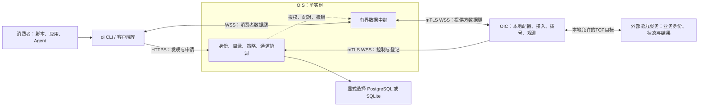

# loom-oi 整体架构

loom-oi让消费者在明确权限和失败边界内，发现并连接分散环境中的受控能力。整体目标见[项目理念](../concept/loom-oi.md)，部署、配置与命令见[运行手册](../product/operations.md)。本页说明共同职责与关键行为契约；已有实现不等于正式验收完成，也不构成生产容量、可用性或任意协议兼容承诺。

## 1. 当前形态：受控目录与可信中继

当前采用R路径：OIC主动出站连接受信OIS，消费者与OIC分别建立数据连接，由OIS配对中继。控制与业务数据使用独立连接；当前OIS在同一进程中承载目录、策略、协调和中继，以两个TLS监听器区分消费/管理入口与OIC接入入口。

消费者不必登记为OIC，也不依赖Loom。核心与CLI使用Go；外部服务按其原生协议接入，可以独立选择语言、部署和升级方式。相同受支持传输接入新业务，不要求OI增加该业务SDK。

分段TLS意味着可信中继可以看到其终止后的载荷。需要中继不可读时，由原生协议另做端到端加密并校验服务身份；不能将当前通道称为默认端到端保密。

## 2. 职责与状态所有权

| 参与方 | 负责 | 不负责 |
| --- | --- | --- |
| OIS | 身份与策略、授权过滤目录、通道配对和撤销、有界中继、管理元数据与审计 | 解析命令、托管业务任务、推断业务成功、恢复旧字节流 |
| OIC | 本地目标允许项、认证出站、登记、目标拨号、字节转发、有限健康观测 | 安装或启动业务、任意远程shell、设备调度、业务持久化 |
| 消费者与客户端 | 选择明确目标、发现/Open/附着、使用原生协议、解释业务结果 | 凭通道成功证明操作完成，凭断线判断操作未执行 |
| 能力提供方 | 业务认证、操作权限、进程/会话/资源、结果查询及安全重试 | 将这些责任交给通道令牌或连接ID |

OI拥有有界、可失效重建的连接状态，不能称为“完全无状态”。业务会话、操作账本、设备锁、工作区、事件游标和模型上下文留在外部服务。重建OI连接不等于恢复业务。

## 3. 对象、版本与准确目标

| 对象或版本 | 含义 |
| --- | --- |
| Access | OIC的接入身份，不强制等同一台机器、Pod或进程 |
| Exposure | `<access_id>/<name>`标识的暴露项；实际目标来自OIC本地配置 |
| Channel | 一次获准连接，绑定消费者凭证、Access、Exposure、版本、代数与许可；不是业务session |
| `epoch` | OIS启动与恢复的权威代数 |
| `generation` | 同一Access的一次控制接入；旧连接的清理不得作用于新代 |
| `revision` | 规范化目标地址、允许网段、传输和业务协议标签的内容标识 |
| `observation_revision` / `contract_digest` | 独立健康契约版本与摘要；不能代替目标revision |
| `sample_seq` / `update_seq` | 同一观测绑定内的样本与状态更新次序，不跨来源或代数比较 |

每次Open固定主体、凭证、目标和适用版本。A到B1的连接不能因B1失败、重连或共享连接池而改投B2。修改目标使旧绑定失效；仅改描述或准入模式不打断已Running流。观测配置另按第6节处理。

独立端点分别登记Exposure；同一服务里的tab、任务等句柄由原生协议管理；共享桌面或设备的互斥由实际执行入口保证。多个Exposure、OIC、Channel或进程都不能凭空创造资源隔离。Pod同名替换也不能让旧任务静默迁往新实例。

## 4. 认证、授权与连接建立

消费者和管理员分别使用对应scope的Bearer令牌；OIC通过TLS 1.3客户端证书认证，OIS将证书SPKI指纹映射到已启用Access。管理令牌不能用于Open，消费令牌不能调用管理接口。令牌明文和私钥不进入数据库或日志。

目标唯一权威是OIC本地配置，消费者与OIS不能提交任意目标地址。主机名目标须有允许网段；在预算内解析后只直拨允许的IP，避免再次解析改变目的地。通道不改写业务Host/SNI/Origin或凭证；原生客户端不能保持身份语义时，需要显式外部适配。

一次新连接按以下链路进行：

1. 消费者发现获准Exposure，提交目标与预期revision。可见不等于有Open权限。
2. OIS检查凭证、策略、目标、当前接入及额度；对控制v2执行本地健康预检。预检不拨目标，也不创建数据票据。
3. 预检成功后重新核对可能变化的授权与绑定，创建Preparing通道和有期限、一次性的两角色票据。OIC再核本地许可并拨号，两端分别附着。
4. 两腿齐全后进行最终健康检查；OIS保留提交权，再核权限、目标、代数及原期限，才依次向提供方腿和消费者腿排入READY。
5. OIC与客户端收到适用READY并完成本地放行检查后，才开始传递业务载荷。TCP拨号本身可能触发服务行为，零业务载荷不等于零副作用。

票据绑定角色、Channel、目标、代数和对应凭证，只通过响应、控制消息及附着请求头传递，不放URL。票据消费是原子的一次操作，过期、旧代或错角色不能复活连接。

总准备期限从新操作取得检查槽开始，预检、拨号、附着与最终检查共享该期限，各子期限取剩余预算中的更小值，不逐阶段续期。同主体、同请求ID和相同参数可合并在途Open并返回同一Channel；参数冲突拒绝。此幂等映射只在内存中有界保留，不提供跨重启的业务Exactly-once。

## 5. 数据转发、失败与撤销

Channel由OIS协调为`Preparing → Open → Closing → Closed`；准备失败可直接Closed。状态提交与撤销有明确先后，关闭、释放额度和迟到回调不得重复生效。

数据协议为`oi.tunnel.v1`，使用READY、DATA、FIN和ABORT。DATA是原生字节流，不把WebSocket消息边界当作业务消息；每方向最多一条在途DATA，上限F，写不出就停止读取来源形成背压，不增加无界应用队列。

FIN只结束一个方向，保留半关闭和剩余数据排空；两个方向正常完成才记Completed。ABORT或未正常结束的断腿中止整个Channel，向TCP目标传播异常关闭，不能把截断伪装为正常EOF。Completed也只说明传输完成。

权限撤销、凭证失效、目标或接入代数改变，使受影响的Preparing通道关闭、Open通道进入Closing；管理变更返回后，受影响通道不能仍停在Preparing/Open。实际连接按关闭预算回收，已转发字节无法撤回。

OIC只在有限许可内转发；许可用本地单调时间并扣保守余量。控制断线停止新准备，存量流不能无限续权；控制重连使旧代通道失效。超期、撤销、IDLE或真实读写错误的首终态不能被迟到成功覆盖，清理期限不因后续通知、排空或join重起。

OI不在失败后隐式重放业务字节，也不把关闭通道当作业务取消确认。执行成功后响应丢失时结果仍可能未知；查询、幂等、持久去重和安全重试必须由业务协议提供。

## 6. 健康观测、准入与导出

### 观测与目录

每个Exposure可由本地管理员配置一个HTTP(S) GET探针；未配置则Unsupported/Unknown。只访问明确允许的地址，验证TLS，拒绝重定向、环境代理、query与任意命令，不提供业务正文匹配或复杂业务鉴权。健康端点无副作用是部署前提，GET成功本身不证明这一点。

探针attempt与有效sample分开：只有明确配置的正/负状态码产生Ready/NotReady；超时、网络或解析错误只更新attempt，不把目标改判NotReady，也不延长旧样本。有效期从请求发起的本地单调时点计算，到期后当前状态Unknown，历史样本仍可保留展示。

probe或CA内容改变时，独立观测版本递增，旧样本、检查和尚未本地放行的准备失效；已进入Running的流保持。目标、授权和许可变化仍按原关闭规则执行。重连不把旧样本换成新generation复活。

OIC合并状态变化通知；OIS通过带独立标识的查询读取现有快照，不触发新probe。目录剩余期扣除完整查询RTT和本地经过时间，不能比较跨主机墙钟或从重复回应重启TTL。查询、检查和结果都必须匹配完整身份/版本/来源绑定；冲突拒绝，已失效请求的迟到回应不能修改新工作。

### Commit-Snapshot准入

默认`best_effort`接受有效Ready，也允许对明确Unknown状态作有界尝试；`require_ready`需要有效Ready。有效NotReady两模式都拒绝；检查超时或无法获得可靠决定是ReadinessCheckFailed，两模式都不能将其降为Unknown放行。

OIC成功处理final check的时刻固定本次健康决定。之后的新NotReady影响后续Open，不反改该决定；这不保证READY到达或业务开始时服务仍健康。OIS提交前仍独立复核权限、目标、代数及固定检查/准备期限；严格模式还须有扣除完整检查RTT后的正样本剩余期。

本地观测配置取消先于OIC放行时，必须关闭准备且不转发目标载荷；取消通知可能晚于OIS发出的READY，因此消费者可能先见READY再见ABORT。OIC放行前也检查冻结决定的本地期限。健康决定不冻结授权，不能绕过目标变化、撤销或许可到期。

控制协议使用`oi.control.v2`；新OIS可接受旧v1 OIC，但其就绪始终Unknown，严格模式拒绝。新OIC不能自动降级到v1跳过安全语义。HTTP仍为`/v1`，数据仍为`tunnel.v1`；旧消费者可能只能把新增ABORT识别为通用错误，不保证任意混合版本具有完整诊断能力。

### 调度与导出

probe、待办、目录query、检查、HTTP等待者及控制写都受固定容量和期限限制。慢源不能无限占据队列；到期周期工作保留为待办并按既有顺序轮转。观测发布与关键控制分开调度，不能让遥测拥塞阻断撤销或给子操作续期。

指标采用Export-Pull：默认关闭，只在显式回环诊断端口提供Prometheus文本。并发抓取最多2个，完整响应最多64 KiB，单次写期限200 ms；槽满429，内容超限503。网络写不持状态锁，标签只有有限枚举，不包含实体ID、URL或秘密。计数属于进程，重启归零；合并的最新状态不构成可靠监控历史，配置数值不是生产SLO。

## 7. 数据连接的活性与背压

数据腿的PING/PONG使用每连接一个worker和有界控制载荷，读取方不会同步等待PONG取得写锁。合法DATA正在传递或有明确所有者的有界DATA待办时，不把背压误判为连接死亡，也不积累空闲心跳失败。

OIS按固定节拍观察数据腿；连续两个没有有效活动或响应的空闲窗口后关闭，即使PING尚未写出。控制写排队本身不是连接存活证据，真实控制写错误仍立即进入关闭路径。新的活性判断与PONG不改变原IDLE更新规则；合法DATA仍按原规则更新IDLE，但不能延长许可或关闭总期限。

正常结束仍需排空DATA与FIN；控制worker随实际连接关闭而回收，不提前截断尾部。实现使用仓库内固定的WebSocket小补丁，保持控制会话默认行为及既有数据线格式。旧端可能仍因同步PONG或旧心跳策略中断，混合版本不保证同等背压存活能力；OI也不会为此重放业务。

## 8. 双后端与恢复

PostgreSQL和SQLite实现同一管理存储契约，配置显式选择后端。当前两者都以单OIS实例运行：SQLite使用本地磁盘、WAL和进程文件锁；PostgreSQL使用专用连接持有advisory锁。锁保证互斥，不等于选主或HA；PG故障绝不自动切换到SQLite。

持久数据包括Access/证书映射、令牌摘要、策略及配置版本、注册快照、审计、模式版本与epoch。Channel、票据、generation、幂等映射和有效观测不持久恢复，业务载荷与业务会话不进核心数据库。

授权读取内存快照；管理变更通过有界串行写入，将版本检查、变更与审计作为一个事务，成功后同步快照。写队列满拒绝，不无界等待。存储不可用时拒绝新Open与管理写；登记可保留内存最新状态待补写，已有流仍按许可、正常结束和其他失败规则运行。

启动先取得单实例锁、检查模式与耐久设置、推进epoch并加载快照，再开放监听。重启使旧票据、Channel与接入代数失效，OIC重新认证登记，观测重新建立。数据库回退后推进epoch不能恢复备份点之后丢失的撤销。

备份、恢复、模式迁移和后端迁移都是显式操作，不自动升级或双写。恢复后先进入拒绝新Open的维护模式，核对并补回丢失的撤销后再开放。后端迁移停机导出、校验并事务导入空目标，失败保留原库。数据操作已完成但关闭失败时，保留已完成结果并报告清理错误；这不表示事务回滚，也不应盲目重跑。具体步骤见[运行手册](../product/operations.md)。

## 9. 应用与扩展边界

- **远程执行**：OI可连接已有SSH或其他执行服务；原生服务继续负责业务身份、argv/script、cwd、进程、输出和结果查询。固定两台机器只需SSH时，不必为了包装命令引入OI。
- **应用与设备控制**：明确设备、桌面/应用实例和权限；共享键鼠或设备须由实际动作入口互斥。旧动作未静止、或旧执行者仍能继续操作时，不得仅凭锁TTL到期交接。独立服务与服务内句柄不强制使用统一业务锁协议。
- **宿主与Pod**：外部部署系统拥有实例和工作区。OIC接近获准端点部署，但不获得集群遍历、Pod调度或任意kubectl权限；实例替换不能恢复未知任务。
- **未来Loom或外部适配器**：通过同一消费接口接入，自行拥有工作流、模型、记忆、事件与业务账本。OI不是Agent平台、事件总线或统一Invoke执行器。

直连D、按策略选择新通道路径的H、跨路径存量迁移、连接池、主备和中继池都不是当前支持承诺。R仍是基线；H只保留新Open选择与准备阶段有界回退的研究边界，授权拒绝不能靠换路绕过。已开流中断后重新授权建新通道，不假装无损迁移。

是否改变部署，应由真实路径、实际中继字节、控制负担与故障目标决定；拆进程不减少必经中继流量，也不消除数据库、入口或主机故障。目标资源、真实客户端组合与生产恢复能力仍须验证，不能从语言选择、单个示例或局部通过外推。
