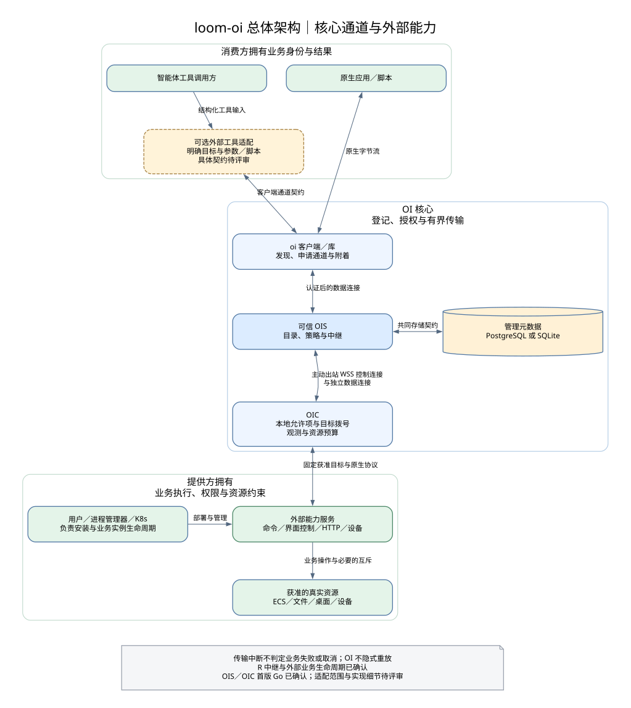
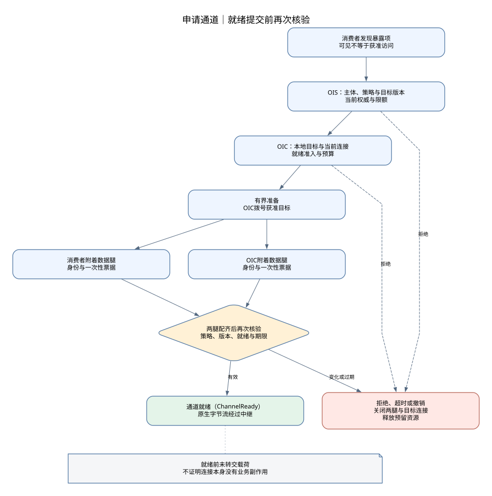
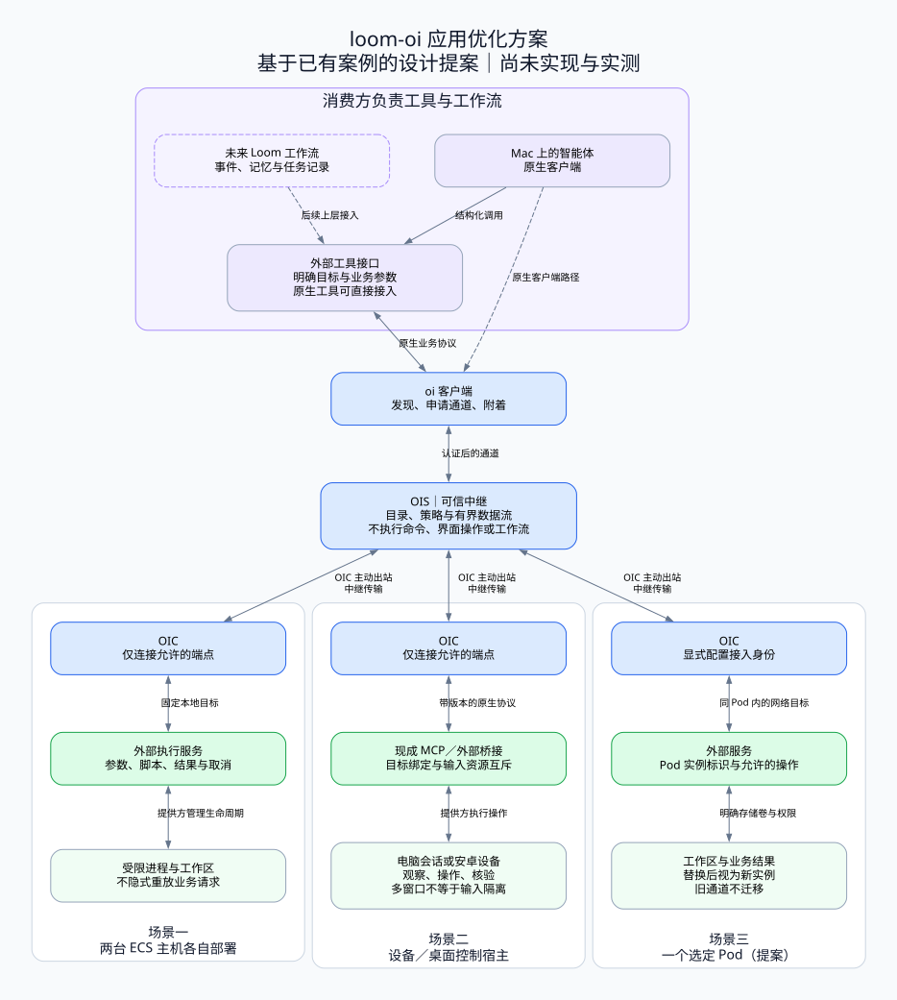
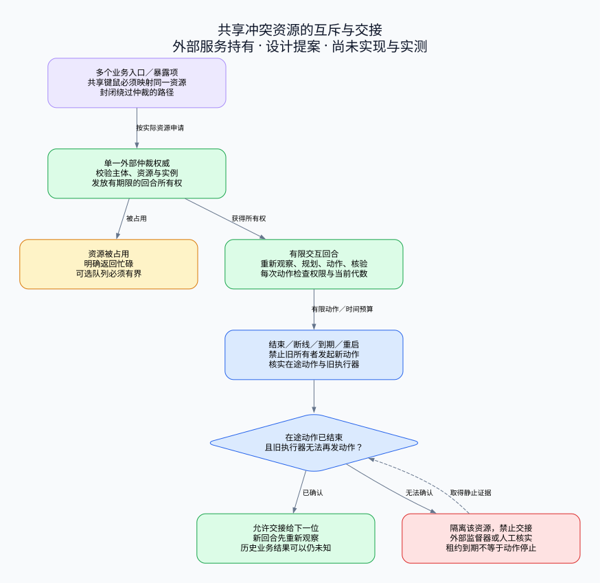
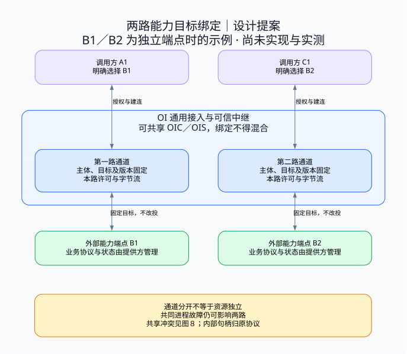
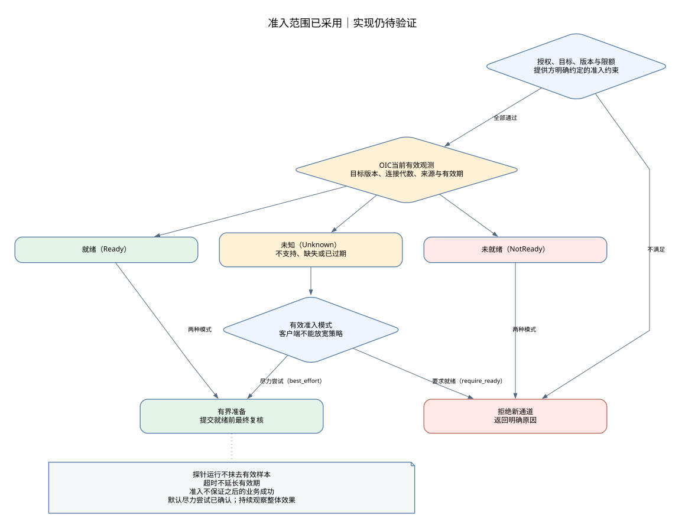
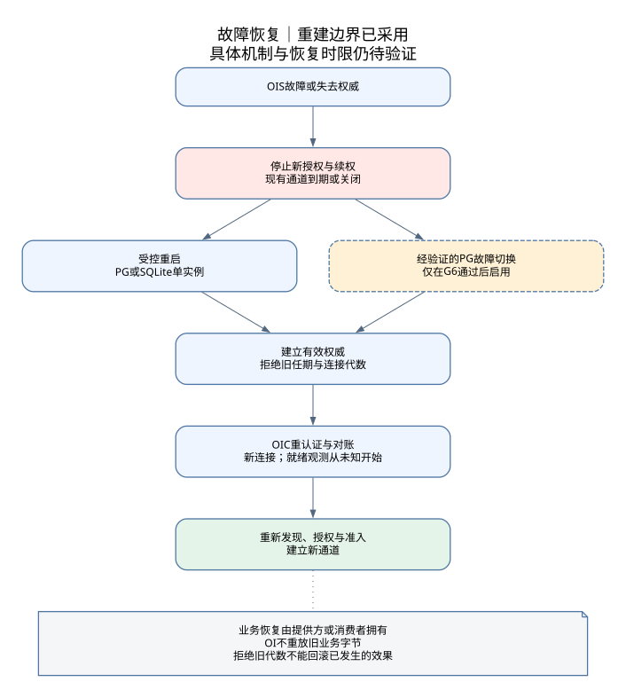
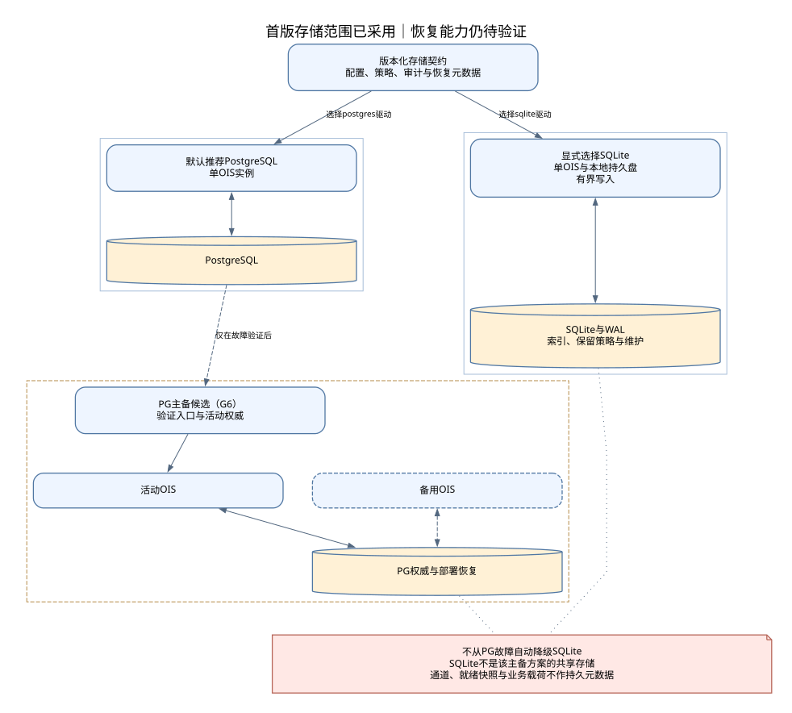
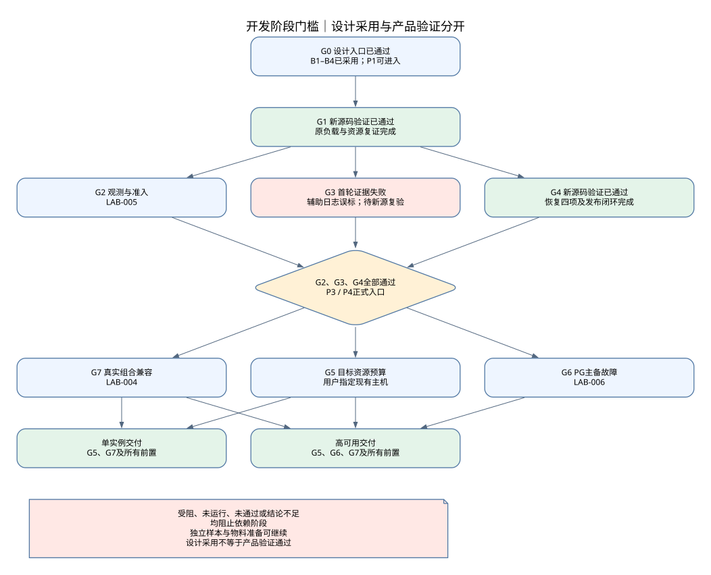

# loom-oi 架构与实现方案 · alpha v0.7

2026-11-03 · 分支alpha · 当前共同契约；应用机制见[应用方案](../designs/application-paths.md)，变更追踪见[DISC索引](../changes/README.md)；项目主体见[整体理念](../concept/loom-oi.md)，最新整合见[DISC-004](../changes/DISC-004.md)。**职责边界、可信中继和双数据库要求已确认；OIS/OIC首版Go已由H12确认；H13已确认业务状态外置、准确绑定与运行状态重建；准入默认及具体实现细节分别评审。**

本版把已有建议收束为一条可实施路线：**Go统一核心，能力目录与原生通道作为基础消费方式，OIC主动出站连接可信OIS中继，观测与业务语义分责；先实现单活闭环，再验证同一协议下的主备恢复。** 本文是当前架构评审入口。H8确认R中继及PG/SQLite要求，H9明确OI不实例化业务功能节点，H10要求实验门槛阻止越级；具体契约为本轮细化提案，产品实现和实验未完成。

用户在[#10的新回复](https://github.com/wyw-ai/loom-oi/issues/10#issuecomment-6564017519)明确案例持续收纳、按现有案例设计，发生实质变化时再评审。因此不再把“案例全部齐全”作为出方案的前提。新增案例改变边界时按§13重开受影响的判断。

## 导航与图册

[收束选择](#choices) · [整体架构](#overview) · [对象](#objects) · [接入与登记](#registration) · [授权与调用](#open) · [观测](#observation) · [故障恢复](#failure) · [部署与存储](#deployment) · [场景覆盖](#coverage) · [实施路径](#delivery) · [证据与评审](#review)

本版共同架构、应用路径、通道研究及项目概念图使用Graphviz专业矢量布局，由可编辑DOT源确定节点和连线；[v0.7图册](diagrams/v0.7/README.md)记录生成与校对。旧ImageGen图见[v0.6的Git历史图册](https://github.com/wyw-ai/loom-oi/blob/d4ea1fbd9f388e63476473bd3687b7a1344b2a39/docs/architecture/diagrams/README.md)，不能用其中PG单后端或全部待确认标记覆盖最新决定。当前图1–11统一中文，保留组件/协议与必要代码标识；准确绑定/状态重建的已采用范围与仍待验证的部署细节分开标注。

## 0. 从项目理念推导架构

loom-oi负责让消费者在权限和失败边界内发现、连接分散环境的受控能力。完整理念与责任边界以[项目概念](../concept/loom-oi.md)为准；这里将其落到共同架构。它并非OIS、OIC和数据库的集合，也不把所有业务托管进核心。

| 项目承诺 | 架构支撑 | 必须共同成立的约束 |
| --- | --- | --- |
| 找到且准确连接获准能力 | Access/Exposure、目录、Open与客户端 | 可见不等于授权；目标/主体/版本不能在附着与换路中改变 |
| 让受控环境可接入 | OIC本地允许项、控制连接、路径策略 | 外部部署拥有实例；R基线覆盖主动出站，D/H可达性独立验证 |
| 失败可解释且资源有界 | 观测、最终准入、期限、取消、诊断和预算 | 通道成功不证明业务成功；断流不重放；控制/两端/转发计总代价 |
| 允许差异化部署 | 共用权威与状态契约、后端及模块边界 | 进程/主机是部署维度，拆分不产生新策略权威或自动HA |

推导顺序为用户结果→共同能力/契约→路径策略→负载与故障域→部署；再反向检查所选机制组合能否兑现这些承诺。每轮局部讨论必须回写这张整体关系及对应正文，不能靠新增组件名单完成收束。图11展示概念关系；图1展示当前R实现基线，两者用途不同。尚无产品实现。

## 1. 本版采用哪些推荐

以下分开记录已确认边界与待评审细节；H8确认R，H12另行确认OIS/OIC首版Go；两者均不批准全部协议参数或HA承诺。

| 编号 | 本版明确选择 | 依据、代价与改选条件 |
| --- | --- | --- |
| B01 产品基础 | 已确认：OI不实例化功能节点；建议A目录、访问授权、原生通道与CLI/库 | 当前跳板机、独立HTTP/设备服务可作为设计输入，核心不拥有Agent上下文。消费者承担原协议；若真实消费者必须统一工具入口，增外置适配而非暗改通道语义 |
| B02 网络路径 | H8已确认R：OIC主动出站至可信OIS，双向数据经过中继；当前首个实现/对照仍为R | 同一通道主问题内研究D/H对负载与可用性的影响，研究不先要求采用H；完整路径/部署提案由#15评审。尚未采用或实现P2P、双路径或存量迁移 |
| B03 核心实现 | H12已确认OIS/OIC首版Go；CLI使用Go及共享协议类型仍为建议 | [ADR-001](../decisions/ADR-001-core-language.md)限定采用范围；不依赖Loom技术栈，无语言性能实证。新证据触发重评，不自动改选 |
| B04 通信基线 | 管理/发现使用HTTPS JSON API；接入控制用独立WSS；每个传输Channel使用独立WSS数据连接 | 易明确控制与数据生命周期，避免首版自写复杂多路复用；代价是连接/TLS开销，1C1G容量需实测。QUIC保留为可测替换点 |
| B05 对象 | Access登记、Exposure暴露项；连接generation、配置revision分别变化 | 不把机器、进程、能力、业务会话混成Node；不强制Provider/Workload层。功能实例/托管归外部系统；若要改变本边界须新的明确决议 |
| B06 生命周期 | 能力由提供方或既有进程管理器运行；OIC管理接入、连接和观测任务 | OIC不负责任意业务服务重启；stdio桥接在OI之外由业务方启动并拥有子进程；核心无业务spawn/install API |
| B07 状态与失败 | H13确认业务状态外置、准确绑定与运行状态重建；分层观测；探针执行与有效观测正交；通道不跨失败边界隐式重放 | C01/C03有窄反例支持；完整状态机、独立发布和端到端失败契约仍待实现验证 |
| B08 持久化与恢复 | H8要求双后端：默认推荐PostgreSQL，无PG部署可显式选择SQLite；共享管理契约。运行连接留内存 | SQLite首版单实例本地盘；PG主备为另行验证的部署能力。不可因PG故障自动切SQLite；OIC无中心数据库。双后端与HA尚无实测 |
| B09 消费扩展 | 预留原生客户端和外置协议适配的稳定接口；首版不默认建设统一Invoke平台 | 避免为了未知消费者承担全协议版本/取消/错误映射。B/C触发条件保留在§10，扩展需要单独兼容验收 |

HTTPS/WSS、认证细节、双数据库适配机制、准入默认和主备算法仍为**设计提案**；多数据库支持要求与R中继边界已有H8确认。它们给实现提供确定入口，不能借用Python实验冒充选型实证。

## 2. 整体职责与端到端链条

本图明确外部业务所有者、OI控制/数据职责及可替换存储；图源和逐图核对见[v0.7图册](diagrams/v0.7/README.md)。

| 角色/模块 | 拥有的责任 | 明确边界 |
| --- | --- | --- |
| 消费者：脚本、应用、Agent | 选择能力、使用原协议、解释业务结果及恢复 | 不要求先注册成能力提供节点；Agent Session留在上层 |
| `oi` CLI / 客户端库 | 发现、Open、认证数据附着、受控本地转发、传输诊断 | 不替消费者生成业务调用，不猜业务是否执行 |
| OIS API/目录/策略 | 主体认证、目录过滤、策略/版本校验、访问协调 | 目录可见不等于获得访问许可；不把能力登记当工具业务实现 |
| OIS中继 | 将获准消费者数据腿与OIC数据腿配对，限流/关闭/审计元数据 | R对照先用同一ois进程内分模块/预算；完整路径与条件性部署见[§8.4](#control-relay)，不保存业务载荷 |
| OIC | 本地配置、注册、受控目标拨号、二次约束校验、观测归约、资源限额 | 只接受本地允许目标；不接受调用者任意URL，不拥有服务业务状态 |
| 能力提供方 | 原生协议、业务副作用、资源互斥、业务认证、结果查询 | 桌面/文件/设备隔离由实际执行者保证；OI通道分离不能替代 |
| 可选协议组件 | 明确支持的probe、stdio桥接或消费适配 | 有独立版本/权限/成本；不能以“可选”为由默认纳入首版 |

完整链条为：管理员登记信任与本地允许项 → OIC认证出站 → 登记Access/Exposure → 消费者发现 → OIS授权 → OIC核验并拨号 → 两条数据腿配对 → 原生协议通信 → 观测独立发布 → 结束/故障清理 → 必要时重新鉴权建新通道。

### 2.1 K1：登记功能不等于创建功能实例

[H9原回复](https://github.com/wyw-ai/loom-oi/issues/3#issuecomment-6564999241)明确：computer use由用户自行实现或使用，OI提供通道和功能登记。这里的“功能节点”是业务系统的实例，不新增OI的Workload调度对象。

| 操作 | OI责任 | 外部责任/失败语义 |
| --- | --- | --- |
| 安装、启动computer-use服务 | 无此业务API | 用户、systemd、容器或业务平台负责；启动失败不能让OI偷偷兜底安装 |
| 登记Exposure | 校验登记身份、描述版本、本地目标允许项；提供发现和访问策略 | 提供方声明能力与原生接口；描述中的动作不等于OI执行器或已验证可用性 |
| 建立通道 | 校验discover/open授权、准入、额度，连接固定目标 | computer-use服务校验其业务凭证、桌面会话、截图/点击权限及资源互斥 |
| 能力离线/禁用/删除 | 更新可见性、拒绝新Open、关闭绑定；保留可追溯原因 | 不等于杀死业务进程、删除用户数据或撤回已完成的点击 |
| stdio工具 | 可连接外部bridge登记的固定网络目标 | bridge由用户独立部署，拥有子进程、取消与凭证；OI不接收远程任意command |

推荐登记对象包含`protocol, descriptor_schema, descriptor_version, descriptor_ref/digest, target_ref, probe_contract`。描述是有界、版本化元数据；凭证、可执行脚本、安装命令不进入能力描述。OI验证结构/大小/归属，业务字段的真实性由提供方和兼容测试确定。描述变更涉及目标/权限时提升revision，旧通道不能悄悄转移。

**computer-use正常链**：用户启动服务并限制其OS权限→本地OIC登记允许目标/描述→消费者发现该Exposure→Open→原生协议登录并发起截图/点击→服务处理业务结果；OI只报告通道和带来源的状态。**反例**：服务未启动时，OIC虽在线仍可能目标拨号失败；同一桌面被两个客户端竞争时，两个独立通道不提供桌面互斥。这两项分别由OI给出传输诊断、业务服务实施互斥。

嵌入OIC SDK也只建立注册/通道能力，宿主进程仍是业务实例所有者。可维护示例/外部适配，但不把示例成为核心必装模块。与“核心内置computer-use插件并由OIS创建实例”相比，本方案牺牲一站式安装体验，换取明确业务边界及独立升级；后者不属于本次已确认范围。

K1已确认的是不耦合业务实例化；本节字段、CLI体验、描述规范及外置适配接口仍待评审，不能把边界确认升级为所有细节已采用。

### 2.2 同一内核接入不同业务（待评审）

[#13最新回复](https://github.com/wyw-ai/loom-oi/issues/13#issuecomment-6586567010)重申能力端解耦。Access是接入身份，不与主机/Pod强制一对一；Exposure是可连接的暴露接口，不等于一个工具、进程或互斥资源。不同业务使用同一受支持传输时，应只换外部服务、配置/描述及revision，不增加OI业务SDK或重新编译核心。图7的三份OIC是同一种通用组件的部署；Pod/Node类比只借鉴应用与基础抽象分离，不引入OI调度器。

建议分开`transport_profile`（OI支持的传输约束）和`protocol/descriptor`（由业务两端解释的协议/能力描述）；未知安全关键传输/版本拒绝，未知业务扩展只作有界元数据。核心检查描述外壳，不根据工具名自动加载业务插件。通用可达probe或带契约的提供方报告与业务SDK分开；不支持时Unknown，不能为每种能力强加内置probe。外部参考例可独立移除，是否维护仍属R1。

首个目标限定已支持的TCP字节流；UDP、多播、进程启动、透明Host/SNI/Origin改写不因“通用”而自动支持。stdio需外部bridge，原生客户端与业务认证/会话自行兼容。V09以同传输换两类业务并核对相同OI二进制/依赖为验收，尚未运行。[本轮详细回应](../changes/DISC-001.md#feedback13)说明取舍、替代与正常/失败链。

## 3. 对象、版本和数据所有者

以下为内部/接口草图名；不再用未收敛的Node/Workload决定实现层级。

| 对象 | 建议最小字段 | 所有者与变化规则 |
| --- | --- | --- |
| Access | `access_id, credential_ref, enabled, labels` | OIS保存身份及管理许可；同一OIC重连保持ID。连接状态不写成业务状态 |
| Exposure | `exposure_id, access_id, revision, transport_profile, protocol, capability_description, target_ref, probe_spec, admission_mode, limits` | 本地配置为目标地址权威；OIS仅接受该Access有权登记的描述。修改目标/协议/安全约束增加revision；远端不能绕过本地允许项 |
| Policy | `policy_version, subject, exposure_selector, actions, limits, enabled` | OIS持久保存。首版actions限定discover/open；业务操作权限由提供方或懂协议的适配器判断 |
| AccessConnection | `access_id, leader_epoch, generation, heartbeat, state` | OIS当前活动实例授予连接代数；OIC只接受当前控制连接的命令。旧清理只能清自己generation |
| Channel | `channel_id, subject, exposure_id, revision, policy_version, epoch, generation, limits, expires_at, state` | 当前活动OIS与OIC持有临时状态；不跨故障持久恢复数据流，不等于业务Session |
| Observation | `exposure_id, revision, generation, probe_contract, sample_seq, observed_at, validity, result, reason, source` | OIC归约本地/协议观察；OIS保存可过期快照，不拥有业务真相 |

`leader_epoch`区分活动OIS任期，`generation`区分同一Access的接入连接，`revision`区分目标配置，`sample_seq`区分同一观测源的样本。这四者不得相互替代。客户端自填ID、时间或版本都不构成授权。

两个关键例子：同一OIC的桌面服务停机，不移除另一HTTP暴露项；相同exposure_id换目标后提升revision，旧通道关闭或失效，不能把原许可悄悄转给新目标。已有服务重启可能不可观测，OI不捏造服务实例代数。

### 3.1 OIC的状态所有权与重建边界（R5方向已采用）

[H13 / ADR-002](../decisions/ADR-002-state-and-binding.md)已确认以下方向；字段/数值与K2不随之全部采用，详设归R6。**业务状态外置；连接运行有状态、有界且可丢弃重建。** 不用“完全无状态”描述OIC，也不要求本地业务数据库。

| 状态 | 所有者 | 重启/失效行为 |
| --- | --- | --- |
| 身份凭证、允许项、配置版本 | 部署方安全保存/注入；OIS管理许可 | 重新读取、认证、对账；拒绝旧revision覆盖当前配置 |
| epoch/generation、控制连接、票据/许可、Channel、socket、双向FIN状态、缓冲/额度 | OIC/OIS各自临时运行状态 | 旧绑定失效，新认证后建新通道；不保存/恢复业务载荷 |
| probe任务、有效样本/TTL/序号 | OIC有界运行状态 | 重启Unknown，不能复用旧Ready；心跳恢复不替代观测 |
| MCP会话、命令进程、设备互斥、工作区/结果 | 外部业务服务、适配器、消费者 | OIC重启不清空或接管；是否恢复由原业务契约判断 |

控制版本/认证、代数和许可、DATA/FIN/ABORT、半关闭/背压属于OI约束；MCP握手/会话及操作结果属于原协议。两者不能因数据走同一通道就合并。原生会话失效可由两端重新初始化，OI不能将其业务重试自动化。无损跨重启续流与当前可丢弃状态目标冲突，需另评；V10用于验证，未实现。

## 4. 路径一：配置、认证与接入登记

1. 管理者在OIS建立Access记录，绑定受信客户端证书身份和可登记范围；在OIC配置本地Exposure允许清单。首版不做自动发现整台机器或远程执行任意配置命令。
2. OIC通过WSS控制端点主动出站，使用mTLS身份认证。证书由部署侧CA提供；服务端把已验证证书身份映射到Access，不信任JSON中的主体名称。CA签发、轮换和吊销是明确部署职责，不另造OI PKI平台。
3. OIS核对Access启用状态、当前活动任期和协议版本，分配generation。OIC上报描述与revision；不上传本地凭证明文。暴露项的管理许可与本地允许项取交集。
4. 认证成功后交换心跳/登记变更/观测/PrepareChannel/Revoke。控制流有独立连接、消息大小和调度预算，业务数据不通过控制JSON队列。
5. 重连带退避和抖动，重新认证、全量对账，再更新目录；不会因心跳恢复就把所有能力标Ready。旧generation命令/清理拒绝；新任期建立时旧通道按§8处理。

消费者建议使用有期限、可吊销、仅存摘要的服务访问令牌，经HTTPS提交；管理权限使用独立身份和动作范围。人类SSO/OIDC为可扩展认证入口，不是首个闭环强依赖。原生服务的API key/证书仍由消费方或获准协议组件管理，OI令牌不能自动转换成提供方凭证。

## 5. 路径二：发现、授权、建连与原生调用

### 5.1 API与通道契约草图

| 接口 | 输入/输出 | 关键校验 |
| --- | --- | --- |
| `GET /v1/exposures` | 已认证主体的可见描述、revision、协议及观测来源 | 分页/过滤有界；不返回本地秘密地址/凭证；不是访问许可 |
| `POST /v1/channels` | exposure_id、expected_revision、请求额度、client_request_id → channel_id或明确拒绝 | 当前策略、活动任期、Access在线、本地允许目标、额度和准入策略 |
| 控制消息`PrepareChannel` | subject、目标/版本、epoch/generation、额度、准备时限 | 经当前认证控制连接送达；OIC二次核对，不接受任意目标URL |
| `WSS /v1/channels/{id}/attach` | 两个角色分别附着：consumer/provider | 双方各有身份认证及短时一次性票据，绑定角色/主体/通道/任期/目标版本；票据不放URL查询串 |
| `GET /v1/channels/{id}` | 本主体可见传输阶段/失败原因 | 仅短期运行状态；不是业务执行账本；过期/故障后可返回unknown/not-found |
| `DELETE /v1/channels/{id}` | 关闭通道、释放资源 | 所有者/管理权限校验；关闭不表示业务取消成功 |

`client_request_id`只对同一活动任期内的Open协调进行有界去重，重复使用须参数一致；没有持久Exactly-once保证。控制面故障后客户端不自动恢复旧数据；需要重新发现与Open。

### 5.2 数据路径的具体实现

OIC先在本地预算内校验并拨号，消费者与OIC各建立一条出站WSS数据连接到同一活动OIS。两腿在短时准备窗口内配齐，OIC确认目标/版本仍有效；OIS在提交Open状态前重新核对policy_version、任期与期限，才发`ChannelReady`。OIC只对当前代数/目标版本仍有效的通道转发，并发变更导致准备失败或关闭旧绑定。未Ready不转交调用方载荷；超时、任一腿失败或策略改变，清理双方和本地socket。TCP连接本身也可能触发提供方行为，因此“未转交载荷”仍不能通用宣称“业务未执行”。

WSS承载OI数据封装而非MCP或HTTP业务封装：使用经子协议协商的`oi.tunnel.v1`；二进制message携带类型与有界payload，初版只需`DATA/FIN/ABORT`。`FIN`是OI的单向流结束指令，不是WebSocket Close；两方向都结束才正常关闭，异常使用ABORT。必须测试半关闭、帧分片、背压和截断；不直接把WebSocket消息边界暴露成目标TCP流边界。[RFC 6455](https://www.rfc-editor.org/rfc/rfc6455.html)说明WebSocket自身消息/控制帧和关闭机制，OI封装是本项目待实现协议。

每个传输Channel独立数据连接，避免首版实现自定义跨流复用；这不是按Agent Session分配连接或资源。一个业务会话可能需要多条流，一条流可承载原协议允许的多次交互；仍共享CPU/进程/网卡，不等于故障隔离。关闭默认数据压缩，限制完整消息解码大小和每腿缓冲，禁止为完整业务响应做无界聚合。若连接成本成为已测瓶颈，再比较有界多路复用或QUIC，不能先凭感觉切换。

### 5.3 消费体验与信任边界

配套`oi`提供discover/connect及库接口。优先用权限受控的Unix socket/Windows命名管道或直接流API给同一用户的原生客户端；只支持TCP的客户端可显式启用loopback转发，单机其他用户可达风险必须在部署配置中处理，不能把127.0.0.1当用户隔离。停止CLI必须关闭转发与通道。

通道不改原生Host/SNI/Origin、重定向和业务凭证；原生客户端必须能配置代理/连接地址并保留服务身份。若做不到，进入显式协议适配兼容范围，不能宣传“任意MCP/HTTPS客户端零改造”。分段TLS意味着可信OIS可看到其终止后的内容；需要中继不可读时可由原生协议端到端加密并校验提供方，或触发专门的端到端通道评审。

### 5.4 外部工具与远程执行链（评审中）

PDF中Mac→两台ECS的经历与“包装工具/只打通道”的讨论共同约束方案：[原话、推导、示例与备选](../designs/application-paths.md#remote-exec)。推荐Mac侧外部工具服务＋ECS侧业务执行服务＋原有OI原生通道。Agent明确选择目标别名，适配器绑定Exposure/revision；执行服务校验业务凭证、程序、cwd与预算，分别接收argv或显式script。OI客户端/OIS/OIC不解析这些业务字段，不提供exec/spawn。

建议项目维护一个有限的外部参考例及契约，作为可选、独立部署的应用切片，具体维护与实施范围待本轮确认；不默认进入核心发行物。两台机器仅需SSH且访问需求已满足时，外部SSH工具包装可能足够。对比必须分开工具表示收益与OI发现/授权/连接收益，不以去掉命令前缀证明OI提升Agent质量。

外部服务拥有操作ID、进程和业务结果；未持久化去重/查询时，效果后断线只能报告未知。关闭通道不保证停止进程，重连不重发。每次显式cwd/env，不偷偷引入持续shell/PTY；完整消费侧契约见[模块规格](../modules/client/README.md)。

### 5.5 应用控制、Pod与未来harness如何复用同一内核

| 应用链 / 讨论依据 | 具体机制与状态所有者 | 反例及当前内核要求 |
| --- | --- | --- |
| 应用粒度控制 / D04 | 复用现成PC/Android MCP；外部服务绑定设备、桌面会话、应用与实例，observe→act→再观察；共享前台按桌面会话串行，同手机默认按设备串行 | 两Exposure共享万能端点不等于权限/输入隔离；业务服务复核操作权限/实例并持有互斥。OIC在线不冒充应用可操作 |
| 宿主机/Pod / D05 | 主机OIC登记允许本地服务；首个选定Pod共置OIC与业务服务，部署方给身份/端点；文件共享需要明确卷与权限 | 同名新UID不是原实例；旧通道不迁移，重新发现/授权。业务工作区/制品/任务结果由外部系统保存 |
| Loom managed agent、记忆/事件/serverless / D05/D07 | 上层保存事件游标/任务账本，模型建议与确定性许可分离，再经OI调外部执行服务；模型可替换 | 旧事件+新Pod+未知执行不能靠重连恢复；OI不成为模型授权源或可靠事件总线。H1当前不做Loom集成不变 |

应用细节、输入输出与替代布局见[DISC-001应用方案](../changes/DISC-001.md)。这些是评审中细化；不证明真实MCP兼容、设备并行或集群资源收益。公共协议和K2不因新增应用名就自动冻结；首批真实组合及外部参考例归本轮确认入口，跨模块准入细节归#3，条件归#11。

### 5.6 共享冲突资源的仲裁与安全交接（R2 评审中）

本节只适用于下节第三类共享冲突资源，不是所有Exposure的准入条件。该类首个应用组合优先用现成服务的可验证仲裁；没有则外置适配器补齐，不由OI持锁。共享前台PC按受控环境/桌面会话实例、手机默认按设备实例确定资源键；多个Exposure/OIC/业务入口必须汇入同一权威。允许绕过的原始端点或人类共用桌面会破坏保证；需封闭旁路、受控独占会话或明确降低支持范围。

采用有预算的交互回合：获取主体/资源/实例绑定的所有权→重新观察→有限规划/动作→核验→确认无在途动作后释放。每次执行检查当前令牌/代数、实例、期限和业务权限；争用默认Busy，若业务端配置队列则有界，获准后重新观察。断线/超时只使旧所有者停止新动作；**只有确认在途动作结束/停止，且旧执行器已停止或后续动作会被执行端拒绝，才交接**。否则隔离，不能以TTL到期或重启后空锁表判断空闲。

结果未知与资源仍可能执行分开：前者在静止确认及重新观察后可交接，业务结果仍未知；后者保持隔离。首轮单一外部仲裁不做自动多副本接管；更复杂接管需要执行端实际拒绝旧代数及故障验证。单Exposure限一个Channel不满足上述条件。完整接口草图、失败推演、替代和V04双入口/迟到/重启验证见[共享冲突资源方案](../designs/application-paths.md#arbitration-detail)，目前没有互斥实现或实测。

### 5.7 两路目标、三类资源与连接成本（准确绑定已采用；组合与成本待验证）

10月31日15:45–16:19讨论既担心A1→B1、C1→B2被混成全B1，也提出按负载冗余而不按业务session分连接。[原文与历史收束](../evidence/alpha-origin-review-001.md)说明B1/B2未被严格定义，图9只是它们为独立端点时的设计解释。

**每次Open固定主体、Access、Exposure/revision、当前代数、许可与Channel；载荷只交给本次获准目标。** 同一OIC/OIS或未来承载池不合并两路身份、目标、权限和字节流。B1失败只报告该路失败，不改投同名/同类型B2、不自动重放；共同OIC/OIS进程退出仍可影响两路，独立socket不承诺进程/宿主隔离。撤销范围按实际许可依赖处理，不能以“另一条流”绕过共同失效。

| 真实资源 | 推荐路径与所有者 | 明确限制 |
| --- | --- | --- |
| 独立可寻址服务/工作面 | 部署者拥有B1/B2，分别登记Exposure；消费者选定获准目标 | 可分别并发的前提是资源确实独立；两端口不证明桌面独立 |
| 同一服务内的tab/任务/句柄 | 原协议两端持有业务ID、权限与映射，OI传原生流 | OI不建立Agent Session→资源表；多通道不会创造内部工作面 |
| 同一共享冲突桌面/设备 | 提供方串行/拒绝或提供独立资源；确需共享时按§5.6外部仲裁 | lease/observe/act仅为此组合的外部候选，不是OI通用业务协议 |

SDK/CLI可接入独立能力网络：其价值是登记、发现、授权和跨环境主动出站；固定两机只需SSH工具时可不引入OI。today聚合服务拥有新闻源、调度、去重、状态，可以整体发布一个Exposure，也可由业务组合多个来源；OI不因此增加Workload编排。能力可以独立部署/升级，不代表OI必须托管其生命周期。

H8已确认可信中继R；原始“点对点”不能撤销后来的选择。端到端目标绑定在R中仍必须成立，物理直连/混合路线保留原触发条件。当前WSS按传输Open建数据腿，不按业务session分配。未来底层连接池可按负载复用，但必须保留逐Channel边界、取消/额度/公平与故障范围；原例“5个”非默认参数，断线不自动迁移旧字节重放。首版保持独立WSS提案，真实测量逻辑流数、连接数、CPU/内存/握手成本后再选，未增加池化实现范围。

V09验证同内核换业务及双目标不串路，V04对照三类资源，V10分别检查单腿和共同进程故障；成本沿LAB-003。均未运行，C01/C03既有窄证据不证明隔离/池化性能。#13承载R1/R2/R5确认，#3/#4承接共同契约，#11承接条件。

## 6. 路径三：观测、就绪与监控

### 6.1 状态不能压成一个online

接入在线、目标可达、业务就绪、资源忙分别记录。`probe_support=Unsupported`是能力描述；`Idle/Running`是任务执行状态；`Unknown/Ready/NotReady`是有期限的就绪判断。探针只能是明确允许、无副作用且预算内的检查；未经授权不得用任意shell或昂贵业务调用充当健康检查。

OIC保存最近attempt和最近有效样本。周期检查开始不清除仍有效观测；超时/权限不足写attempt原因，不伪造NotReady、不续期；较新的契约明确正/负证据替换旧判断。到期、目标revision改变或来源失效后Unknown。接入重建时保守将远端快照置Unknown，重新校验后发布。心跳只更新接入状态。

OIC使用进程内单调时钟计算有效期，sample_seq在对应源/generation内递增；observed_at仅用于审计，不凭跨主机墙钟比较先后。OIS推送缓存仅作带来源的目录展示；严格准入最终在OIC检查当前有效观测。若OIS需对一次主动查询给出保守剩余期，使用回应中的剩余期减去本次查询完整RTT，不能把传输延迟算成新增有效期；无可靠时效界限的被动快照不用于严格准入。

### 6.2 K2：缺少就绪证据时如何准入

H9要求详细说明，**尚未批准默认策略**。推荐继续使用`best_effort`作为Exposure缺省，但细化为“无就绪保证地尝试”，而不是绕过已知故障；`require_ready`为严格模式。**本版收紧旧稿歧义：有效NotReady在两模式都拒绝。** Unknown才形成两模式的差异。

共同硬条件必须先通过：主体/策略允许、当前epoch/generation/revision、本地目标允许项、Access在线、资源额度、提供方显式拒绝接入约束。客户端可请求更严格策略，不能把服务器/本地要求降级；有效模式取各层要求的更严格者。

| OIC当前就绪证据 | best_effort（建议缺省） | require_ready | 消费方看到的含义 |
| --- | --- | --- | --- |
| 有效Ready，来源/版本匹配 | 允许继续准备与拨号 | 允许继续准备与拨号 | 只在准入时有证据，不保证随后业务成功 |
| 有效NotReady | 拒绝`TargetNotReady` | 拒绝`TargetNotReady` | 已有明确负证据；不得降为Unknown以绕过 |
| Unknown：无探针/unsupported/过期/来源失效 | 允许有界连接尝试，返回`readiness=unknown`及原因 | 拒绝`ReadinessRequired` | best_effort不承诺Ready；unsupported不是服务故障 |
| 正在探测且旧Ready仍有效 | 按旧有效Ready处理 | 按旧有效Ready处理 | Running不是就绪结果，不必每次探测暂停服务 |
| 最新attempt超时，旧样本仍有效 | 使用未过期有效样本，保留attempt超时 | 同左；无有效Ready则拒绝 | 超时不自动抹掉旧证据，也不刷新TTL |
| 当前提供方明确拒绝接入或OI额度耗尽 | 拒绝；`AdmissionDenied`/`ResourceExhausted` | 同左 | `busy`提示本身不是隐式拒绝；只有约定的有效接入约束才是硬门槛 |

**检查时序**：OIS做权限/版本等预检→OIC核验本地当前观测→有界准备/拨号→发Ready之前再次核验授权、revision、准入证据及预算。严格模式若此时Ready过期，释放双方预留并拒绝；两模式若出现新的有效NotReady也拒绝。观测判断和通道状态提交由同一版本化状态机顺序处理，但提交后业务随时可能变化，不能承诺无TOCTOU风险。不能用陈旧OIS缓存代替该判断。

本版准入规则仅决定新通道；Open后的就绪变化更新观测并影响后续Open，不默认杀死正在使用的业务长流。权限撤销、目标变更和有限许可到期仍按§7关闭，与健康变化区分。严格就绪不是持续健康保证。

可配置等待Ready的有界窗口，超时明确拒绝；默认不隐式等待，也不发探针外的试运行业务。探针只需证明约定的业务就绪，不能据TCP可达或一次成功推导任意操作可用。连接本身可能触发副作用，两模式都不承诺未Ready等于未执行。

正常例：无健康接口的固定HTTP服务，管理员允许best_effort，访问可尝试且显示Unknown。严格例：模型仍加载、当前NotReady，两模式均拒绝；待可信Ready后才尝试。反例：刚建立通道服务就退出，原Ready仍不能保证业务完成。待人类决定的是上述默认/负证据规则是否符合产品预期，而非再次确认每个状态名。

替代为全部默认require_ready：证据要求一致，但无探针服务必须先补契约或显式改策略。暂不增加“已知NotReady也强行尝试”的第三模式；真实诊断场景需要时单独讨论权限与风险，不借best_effort隐式放行。

每目标最多一个在途探针、全局并发/排队有界、带抖动周期，结果独立发布；遥测不得阻塞授权/撤销。该实现及整张准入表在G2/LAB-005验收，LAB-001不能替代。

### 6.3 监控和资源预算

| 信号 | OI直接负责 | 不能据此冒充 |
| --- | --- | --- |
| 目录/控制 | 登记、重连、版本冲突、Open拒绝原因、控制耗时 | 业务可用性 |
| 通道 | 活跃数、字节、缓冲占用、背压、关闭原因 | 工具调用数、业务成功或token成本 |
| 探针 | 调度等待、attempt耗时/结果、有效样本年龄、unsupported | 未实现的资源健康 |
| 提供方信号 | 接收带来源/版本的业务和资源报告 | OI独立测得的业务真相 |

本地计数/结构化诊断为基础，可选exporter交外部监控；不内置时序数据库。指标标签限制为有限结果/协议类别，详细目标与关联ID放受控查询/日志。导出拥塞有丢弃计数，不能增长无界队列；数据缓冲、TLS/WS解码、探针、日志各自计入内存。

资源起点用配置而非SLO硬编码：流数上限N、每腿缓冲B、全局缓冲G、probe并发P、最大消息F、Open准备时限T、观测有效期V与关闭时限均需明确。估算`流缓冲 ≤ min(G, 2×N×B)`仅包含应用流缓冲，不含TLS/runtime/内核/元数据。具体默认值由首个预注册容量实验确定；1C1G约束OIC所在机器，不能让OI占满整机内存。

## 7. 路径四：中断、撤销与业务结果

Channel状态建议为`Preparing → Open → Closing → Closed`，准备失败直接Closed；closed只代表本地传输生命周期，不是业务完成。错误至少区分`Unauthenticated/Denied/RevisionMismatch/AccessOffline/TargetNotReady/ReadinessRequired/AdmissionDenied/ResourceExhausted/TargetConnectFailed/PrepareTimeout/ChannelInterrupted`。不暴露内部秘密或伪造业务错误码。

| 触发 | OI行为 | 消费者仍需知道 |
| --- | --- | --- |
| 授权或目标版本失败 | 不创建/终止本次准备，清理预留额度 | 不推断其他尝试的业务状态 |
| 一条数据腿未到/拨号失败 | 到期释放全部准备资源，返回具体传输原因 | 无业务载荷转交也不证明连接无副作用 |
| 提供方效果已发生、响应丢失 | 上报ChannelInterrupted及可核实阶段，关闭通道 | 业务结果可能未知，不能盲重试 |
| 用户关闭/策略撤销 | 停止新数据、关闭关联腿和本地socket，记录确认/超时 | 已执行副作用不可回滚；原生Cancel需独立协议保证 |
| 版本变化或更高epoch/generation | 拒绝旧命令，关闭旧绑定，清理只针对旧代数 | 不把旧许可转给新目标 |

重建路径必须重新鉴权，不能跨失败边界隐式重发旧业务载荷。原生消费者/适配器只有在自身协议具备幂等、已验证去重或查询契约时决定恢复。不重放不等于端到端At-most-once或Exactly-once；可靠传输内部重传是另一层，不被本规则禁用。LAB-002仅验证内存计数效果后的响应丢失反例，没有验证OI路径或持久去重。

撤销采用主动通知加有限许可期限：OIS收到策略撤销后停止新Open/续权并请求OIC关闭；若通知不可达，OIC在本地许可到期关闭。许可信任链、时限和可接受撤销窗口必须作为部署配置与验收对象；本版不承诺网络分区下即时撤销。原生长流可能被截断，业务恢复由源/消费者决定。

## 8. 路径五：持久化、重启与主备恢复

### 8.1 K4：共同存储契约与两个部署后端

[H8](https://github.com/wyw-ai/loom-oi/issues/4#issuecomment-6564934039)已要求默认推荐PostgreSQL，无PG环境支持SQLite。本轮推荐显式`store.driver=postgres|sqlite`，初始化向导可给建议，启动后绑定持久实例ID/后端/模式版本。**PG连接失败必须报不可用，不能自动创建SQLite空库切换权威。** 从“无PG部署选SQLite”不推出“PG故障自动降级SQLite”。

持久对象为Access/身份映射、Exposure描述与revision、Policy及版本、管理审计、schema版本/存储实例ID、恢复任期；临时对象为socket、Channel/一次性票据、路由、探针有效快照和缓冲。业务载荷、Agent Session、完整监测时序不进核心数据库；重启后Ready须重新观测。

| 抽象契约（实现草图） | 共同保证 | 后端差异与失败 |
| --- | --- | --- |
| `ApplyConfig(expected_version, changes, audit)` | 配置、版本与审计引用在事务内成功或失败；冲突不覆盖新值 | PG/SQLite分别实现事务/条件更新；上层只依赖Conflict/Unavailable等统一错误 |
| `ListExposures(filter, cursor, limit)` | 有界页与稳定排序，所有权过滤明确 | SQL/索引各自优化；不要求SQL字符串一致或全量载入 |
| `RevokePolicy(expected_version)` | 提交后停止新Open/续权；通知失败仍由有限许可兜底 | 数据库提交不能证明所有网络流已停止 |
| `Backup/Restore/Migrate` | 记录实例/模式版本、校验对象和权限、恢复后拒绝旧连接/许可 | 各后端独立工具；恢复不带回Channel/Ready；失败留原权威不切换 |
| `AcquireLeadership/Renew` | 只在明确支持并验证的部署模式提供 | PG主备候选；SQLite首版返回Unsupported，不能因共用Store接口伪造HA支持 |

SQLite首版限定单OIS、持久本地文件系统；启动互斥和数据库写入由同一进程控制。PG也先完成单实例路径，主备为G6之后的额外能力。WAL依赖同主机共享内存，不适合把文件放到跨主机网络共享来实现热备，见[SQLite WAL](https://www.sqlite.org/wal.html)。这是支持范围建议，不宣称SQLite永远不能做复制方案。

SQLite不是将PG SQL替换占位符：统一API/数据不变量，分别维护迁移和驱动，实现同一组契约测试。新增后端不进入首版承诺；SQLite→PG采用停管理写入、版本化导出、目标事务导入、对象/权限校验、显式切换配置及重认证的维护流程。出现校验失败保持原库；切换后回滚要另定数据回迁，不能继续双写。跨后端热切换与零停机迁移不承诺。

### 8.1.1 SQLite规模与性能控制

“文件大”不是唯一诊断：必须分开看主库有效页/空闲页、WAL、索引命中、长事务、磁盘与读取延迟。以下为可验证的项目方案，尚无性能实测。

| 问题 | 建议机制 | 验证与失败处理 |
| --- | --- | --- |
| 元数据与审计无限增长 | 元数据有大小/数量限制；审计按明确保留策略分批导出/删除，核心库不存业务载荷与时序样本 | 审计保留期尚待配置；导出失败不静默删除，容量不足时拒绝对应管理写入并告警 |
| 目录读取扫描全表 | 按实际过滤与排序建复合索引、游标分页；检查EXPLAIN QUERY PLAN | 用增长数据集与冷热读取验证，不能承诺“大文件必慢”或“加索引必达标”；[查询规划依据](https://www.sqlite.org/queryplanner.html) |
| 写竞争与长事务 | 有界单写队列、短事务、明确busy等待/超时；数据库操作不占住控制循环 | 对照并发管理变更、慢读取、检查点；超限报StoreBusy，不无限重试或阻塞撤销 |
| WAL积累 | 监测WAL大小/帧及检查点进度，限制长读取，低峰维护；繁忙时记录未完成 | WAL检查点受读事务影响；不把journal_size_limit当硬盘配额，不在每次请求强制TRUNCATE；[WAL依据](https://www.sqlite.org/wal.html) |
| 删除后文件不缩小 | 建库时选择并验证incremental auto_vacuum，低峰分批回收；既有库迁移单独安排 | 回收依赖模式和空闲页，不能保证每次删除立刻缩小；按版本执行optimize维护统计；[PRAGMA依据](https://www.sqlite.org/pragma.html) |
| 备份/恢复或磁盘耗尽 | 使用在线备份API或已验证停机一致性备份，恢复做完整性/权限/对象校验 | 不只复制运行中的.db忽略WAL；记录恢复时间与数据损失边界；[备份依据](https://www.sqlite.org/backup.html) |

初版倾向WAL与保守耐久性配置，具体驱动/PRAGMA必须固定版本、执行后读回并验证，不能仅凭设置语句无报错判断生效。构建需记录实际SQLite引擎版本与来源，包含WAL-reset修复（官方列出3.51.3及部分回补版本，见[修复说明](https://www.sqlite.org/releaselog/3_51_3.html)）；这不是指定使用最新版或宣布依赖安全性已完成审计。

LAB-006按PG/SQLite分别测并发版本冲突、重启/备份恢复、容量增长与权限一致性；增加SQLite长读阻挡检查点、写拥塞、维护中断、磁盘不足的对照。用相同逻辑数据与业务契约，性能允许后端各有预算；没有实验就不填吞吐/容量承诺。

### 8.2 主备的具体约束

本节仅为PostgreSQL部署的待验证主备提案；SQLite单实例不启用此路径。目标是同一时刻一个活动OIS对外受理Open/接入/续权，热备保持就绪但不接业务；首版不做按Access分片的多活目录。入口只把新连接路由到有效活动实例；WebSocket存量连接不迁移。

建议数据库事务维护唯一活动任期：持有者、递增epoch与到期时间；抢占只在租约已失效或受控移交后成立。应用使用带保守余量的本地期限自我停用，续约失败停止新授权/续权，逾期停止转发。所有Channel许可不得超过活动任期的安全期限。不能仅用“拿到数据库锁”宣称旧实例已停止发送。

OIC在接受更高epoch/generation时原子停用旧控制连接及其通道；每次控制/转发动作检查当前代数和本地许可期限。暂停/恢复的进程不得因旧内存状态继续转发；已经交付到操作系统/提供方的字节不可能借fencing回滚。不同OIC指向同一真实资源仍需资源提供方自己的互斥。

主备启用前必须验证：任期递增持久性、数据库故障切换是否回退已确认epoch、租约时钟/漂移和进程长暂停、旧实例复活、入口切换、OIC双连接竞争、部分分区。若数据库不能保证所需单写权威或界限，停止切换/新授权，不能以可用性优先制造双主。算法与窗口尚未实测，P3未过不得宣称生产HA。

### 8.3 故障恢复保证

OIS故障 → 当前通道中断或在许可期限内关闭 → 单实例受控重启（PG/SQLite）或经验证的PG活动权威切换 → OIC退避后重认证/登记 → 新generation和Unknown观测 → 重新探测/按准入策略Open → 新通道。提供方业务状态不随该过程清零，旧请求不重发。

可用性目标分层度量：控制API可用、建连成功、通道恢复时间、提供方响应、业务结果确认。OIS主备依赖数据库和入口本身可用，[数据库复制/故障切换](https://www.postgresql.org/docs/18/high-availability.html)须由部署方案覆盖；多放一个OIS副本不能消除这些故障点。没有实验支持的RTO/RPO、99.9%或尾延迟数字不写成承诺。

### 8.4 通道路径、实际负载与部署边界

[DISC-004](../changes/DISC-004.md)修正上一轮先问“拆不拆进程”、再把换路另列未来方向的倒序。主问题是：在准确绑定、可撤销访问、资源有界和失败可解释的共同承诺下，怎样降低端到端连接成本及中心依赖。P2P/中继选择、准备失败回退和新通道换路是其中的研究维度；所选路径决定实际中继字节，再推导进程/主机布置。

H8的可信中继R继续作为首个实现和实验对照，R下单进程分模块/预算是最低复杂度起点，**不再作为与路径策略割裂的先行确认目标**。完整候选H保留R兜底，仅在策略和拓扑允许时为新Open选择D，并在共同授权仍有效时允许准备阶段有界回退。获准主体/目标/代数与最终准入不因直连省略；权限撤销、目标失效或有效NotReady不能靠回退绕过。已经打开的通道失败后关闭，由消费者新Open；存量流无损迁移M是有额外状态/成本的条件性备选，不默认纳入首版。

先比较真实拓扑中R/H的建连、撤销、端到端时延及OIS/OIC/客户端总成本，再判断A同进程、B同机拆分、C跨机池是否必要。拆进程不减少必经中继字节，不解除控制/数据库权威故障；所有方案都要有界准备/活动连接、缓冲和有限许可。路径研究与R纵向切片可以并行，不要求穷尽P2P才继续，也不要求先采用H才研究。

唯一详细方案见[端到端通道设计](../designs/ois-control-relay.md)，研究依赖见[图10](diagrams/v0.7/10-control-relay.svg)。[#15](https://github.com/wyw-ai/loom-oi/issues/15)承接完整路径/负载/部署提案；#3提供准入/目标共同契约，#4提供权威/恢复契约，#8/#11承接资源输入和真实验证。H、M、拆分接口均是未采用提案；当前§5的R公共消息并未因此添加已实现协议字段。无新增产品数据或HA承诺。

## 9. 当前案例怎样落入同一架构

案例状态分为原始诉求、AI推演、实验夹具，均不冒充真实已接入客户。具体来源见[场景资料](../proposals/consumer-scenarios.md)与[证据台账](../../kb/evidence.md)。

| 案例 | 本版接入/消费方式 | 局部新增责任 | 何种变化触发重新评审 |
| --- | --- | --- | --- |
| 1C1G跳板机HTTP诊断 | OIC登记TCP目标，CLI/库建通道，原生HTTP客户端使用 | 本地凭证/目标约束；可选HTTP ready探针 | OIC预算不达标、客户端不能配置原生连接 |
| 远端HTTP/SaaS | 有权限的OIC连接固定允许目标，消费者保持原协议 | 域名解析/目标重绑定约束，服务凭证归消费侧或显式组件 | 动态任意URL代理、中心操作级策略成为需求 |
| MCP HTTP | 通道只搬运数据，协议版本/认证/Origin与会话由原生两端处理 | 必须用真实客户端验证代理与身份保持 | 客户端只有统一工具入口，或无法保持原生身份 |
| stdio/CLI | 外部桥接组件启动子进程并暴露受控网络入口 | 子进程所有权、stderr诊断、退出/取消和凭证归桥接组件 | 要求OIC直接安装/托管任意程序，应重新定义生命周期产品 |
| 桌面/文件能力 | 独立服务暴露，OIC登记，资源状态带来源 | 提供方保证桌面/文件的并发与权限 | 要求跨不同服务入口强互斥或会话隔离 |
| Mac→ECS工具消费（SC09） | 外部结构化工具→客户端→通道→外部执行服务；核心无exec | 目标/argv/script与业务权限由外部组件定义；未知结果不重发 | 真实消费者不能部署组件、工具需持续shell/PTY或OI被要求管理执行账本 |
| 宿主机/Pod接入（SC10） | 接近允许目标部署OIC，具体粒度待真实拓扑验证 | 外部K8s/进程管理器拥有实例；不给OIC默认集群管理权限 | 必须由OI调度Pod、自动发现/托管业务或跨资源强隔离 |
| 手机/设备网关 | 网关可作为服务，设备目标按独立Exposure/描述区分 | 网关在线与设备在线分开；按键不重放 | 要求设备漂移、多路径合并、离线排队执行 |
| 长流/事件源 | 有界流与明确断流，原生游标/重订阅由源和消费者处理 | 慢消费背压及丢弃必须按源契约 | OI被要求持久可靠投递、自动业务回放 |
| 重型推理/批处理 | 外部服务处理加载/队列/设备；OIC只连接/有限观测 | busy/accepting由提供方声明，无昂贵隐式探针 | 要求OI承担GPU/任务调度或批任务恢复 |

## 10. 扩展边界与备选的启动条件

- **消费侧适配C**：真实消费者不能使用原协议，但可部署组件时，组件复用客户端库，对外暴露明确版本的MCP等接口；独立定义流/取消/错误/身份映射。关闭组件不影响基础通道。尚未默认排入首版。
- **统一网关B**：消费者必须平台统一Invoke/操作级治理，且可承担协议矩阵时，单独评审为产品责任变化，不只给核心添加一个handler。
- **直连D/双路径H**：已纳入#15通道负载/可用性主问题的研究比较，实施仍待完整方案确认及适用门槛；保持同等授权/撤销/目标绑定和不重放保证。R仍为当前实现基线，研究不等于已选H；存量迁移M另有必要性与状态成本，不以打洞成功代替端到端验证。
- **托管/嵌入/动态插件**：当前能力优先外部进程与协议接入；新案例证明需要进程生命周期或ABI时再改变OIC职责并重算资源/语言成本。

## 11. 按依赖组织实现，而不是按Issue编号开工

| 阶段 | 实现范围 | 可检查出口 / 尚未执行 |
| --- | --- | --- |
| P0 契约与设计评审 | 不实例化业务能力、R已确认；Go和R5边界已确认；准入/双后端细节与CLI/驱动待评审 | G0未通过，不能宣告进入已批准P1；设计、测试准备可继续 |
| P1 独立纵向闭环 | OIS/OIC（Go已采用）及CLI（具体实现仍评审）、PG/SQLite同契约元数据、TLS身份、注册/发现/Open、双数据腿、原生只读HTTP | 无Loom/LLM依赖；权限拒绝/目标替换/准备超时可见；清理资源；不宣称HA或MCP兼容 |
| P2 观测与失败正确性 | attempt/有效观测、准入模式、有界探针/发布/遥测、流控、半关闭、撤销与有限许可 | LAB-001/002机制转为真实OI路径测试；旧generation/过期/乱序/响应丢失/慢消费/控制延迟验证 |
| P3 恢复与部署质量 | 主备/epoch与数据库权威、断网/长暂停、备份恢复、1C1G负载及平台构建 | 验证失效窗口和资源上限；明确RTO/RPO范围。未通过前不得启用HA承诺 |
| P4 案例兼容与条件扩展 | 真实MCP HTTP、stdio桥接、设备/长流；只实现有案例支持的适配 | 提供方/消费者版本、身份/流/取消矩阵；触发条件满足才扩C/B/D/H |

P1完成后P2可分解为观测和传输两个实现任务，但必须在同一失败/资源契约下联合验收；P4可先采集案例和做协议调查，完整兼容结论仍依赖实际通道实现。未指定成员或工期；本轮已按用户授权归档已收束Issue，剩余验证见[归属表](../alpha-issues.md#remaining)。

### 11.1 实验阻挡墙与阶段出口

[H10](https://github.com/wyw-ai/loom-oi/issues/11#issuecomment-6565021708)要求随着实现到关键节点分别实验，未通过不得草率进入下一阶段。[门槛台账](../../experiments/gates.json)和[执行规则](../../experiments/GATES.md)将条件就绪、实验结果、阶段放行分开；#11持续承接阻塞。

P1入口检查G0；P2入口要求G1；P3/P4正式进入要求G2/G3/G4。真实案例收集、契约设计及隔离原型准备可以提前，但不计作下一阶段通过；P4不依赖PG主备成功，避免无关实验阻塞单实例兼容。单实例交付需G5资源与G7真实兼容，HA承诺额外需G6。每个门槛只放行记录的版本/环境/支持范围，默认不放行。

门槛已通过必须有预注册判定、原始run、核验、综合分析、受影响产物与评审记录，测试失败、受阻、未运行、结论不足均阻止依赖阶段；修改范围不得把失败重命名为通过。明确暂缓可记录范围退出，但本轮不创建豁免捷径。检查器校验记录/依赖和证据文件指纹，不代替结果审阅，也没有后台自动执行器。

当前G0–G7均未通过；LAB-001/002只支持机制反例，不满足G2/G3的真实实现出口。未新增产品实验、没有阶段被放行。

建议代码组织（未来实现草图，目录尚未创建）：

| 路径 | 单一职责 |
| --- | --- |
| `cmd/ois`、`cmd/oic`、`cmd/oi` | 三个入口；同一Go module/协议版本，不耦合Loom |
| `internal/protocol` | JSON控制消息、隧道封装、版本/错误；无业务Schema |
| `internal/ois/{identity,catalog,policy,relay,store,leadership}`及`store/{postgres,sqlite}` | OIS职责，明确持久/临时边界 |
| `internal/oic/{config,registration,target,observation,relay}` | 本地允许目标、连接与观测 |
| `internal/client` | CLI复用发现/Open/数据附着；公共SDK待API稳定再提取 |
| `internal/telemetry`、`tests/integration` | 有界监测、真实路径故障验证 |
| `experiments` | 保留预注册、原始记录和综合分析，不能以文档测试代替产品测试 |

## 12. 证据、变化与尚待采用的内容

| 来源 | 本版实际使用 | 不能支持 |
| --- | --- | --- |
| H1/H6 | OI独立，不接Loom；#9保持已关闭边界 | 任何具体协议/数据库/语言已获批准 |
| H4/H5 | 纳入探针/监测/多类节点，可用性/维护/扩展驱动Go建议 | 全场景兼容与HA已经通过 |
| H7：#10新回复 | 案例持续收纳，本版按已有物料给确定推荐，不再等待齐全 | 已确认首批真实客户，或已经接受A/R全部实现 |
| C01/C02、LAB-001 | 拆online/ready、执行/观测；有界独立调度目标 | 实际状态发布、TTL/时钟、生产公平性 |
| C03、LAB-002 | 不跨失败边界隐式重放；恢复通道和业务分责 | OI实现、持久去重或Exactly-once |
| C04–C06、场景推演 | 分责、对象维度、Go推荐与成本核算范围 | 语言/传输/数据库性能赢家 |
| 本轮工程推导 | K1契约、K2矩阵、双后端适配/SQLite维护、PG主备与阶段门槛 | 这些是可评审新细化，不是新增实验数据 |

本版不新增实验run，也不改旧原始数据。相较v0.6，明确功能登记/实例化分责，细化准入矩阵和最终检查，落实PG/SQLite与非自动降级，绑定G0–G7实验出口。官方资料证明数据库机制，不能替代OI实现或目标部署数据。

| 最新来源 | 已确认范围 | 本轮处理 / 仍待决定 |
| --- | --- | --- |
| H8：[#4](https://github.com/wyw-ai/loom-oi/issues/4#issuecomment-6564934039) | R按推荐；默认PG、无PG环境支持SQLite并优化 | §8双后端/维护/迁移方案；具体HA与恢复承诺仍待确认 |
| H9：[#3](https://github.com/wyw-ai/loom-oi/issues/3#issuecomment-6564999241) | 不耦合业务实例化；要求K1/K2细化 | §2.1职责/案例；§6.2矩阵；K2默认和细节尚未接受 |
| H10：[#11](https://github.com/wyw-ai/loom-oi/issues/11#issuecomment-6565021708) | 实验按实现节点推进，未过阻止依赖阶段 | G0–G7、检查命令与技能联动；当前无门槛通过 |
| H13：[#13](https://github.com/wyw-ai/loom-oi/issues/13#issuecomment-6596770259) | R5三项边界已采用；R1/R2准备实验物料 | ADR-002限定范围；[物料包](../../experiments/materials/README.md)已编制，真实产品/环境仍缺；字段/K2及全部应用支持未批准 |

活跃入口：#3细节与准入、#4存储/恢复、#8语言采用后的资源验证、#11实验条件及阻挡墙、#13应用物料与结果、#15控制/中继部署边界。K3不再重复请求决定；K1已确认的职责边界不能因另一个案例退回旧的内置业务插件路线。具体参数可在边界内实验迭代。

## 13. 持续案例与变更触发

按用户最新“仅保留关键决策”指令，#10归档，持续收纳机制迁入[案例台账](../proposals/consumer-scenarios.md#7-持续案例台账)，由#3承接产品评审并联动#4/#8。每条案例记录来源、消费方/提供方、协议/部署/资源/失败要求、已验证程度、受影响B编号。新增案例能在现有边界内映射时补兼容和测试；不能映射时记录反例并提出增量方案。

“量变引起质变”按设计影响判断，不设任意案例数量阈值：消费形态、信任边界、可用性承诺、生命周期所有权、目标身份/资源隔离、核心资源预算中任一需要改变，就发起对应架构评审，给旧/新链条、证据、成本与迁移影响。不会因为案例尚在收集而暂停当前设计，也不会把收束稿自动提升为最终已采用。

后续实验继续按仓库既有闭环自动完成数据核验、综合分析、结论/方案修订、图文/Issue/KB同步与远端核验。[实验后流程](../../.agents/skills/architecture-evidence-lab/references/post-round.md)保持有效。

从DISC-001起，每轮讨论融合都提交相关开发者确认Issue，即使只是确认现有边界内的新增案例或保持结论；具体采用范围按需求ID记录。此前“边界质变触发评审”仍用于判断重开哪项技术选择，但不免除每轮确认提交义务。共同规范见[SDD](../sdd/README.md)。
