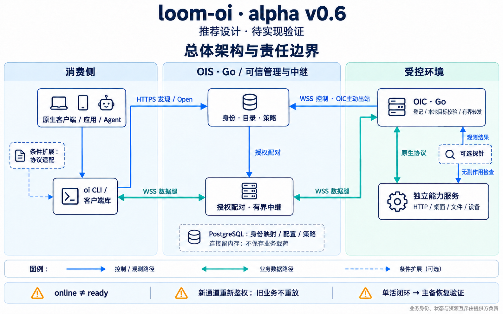
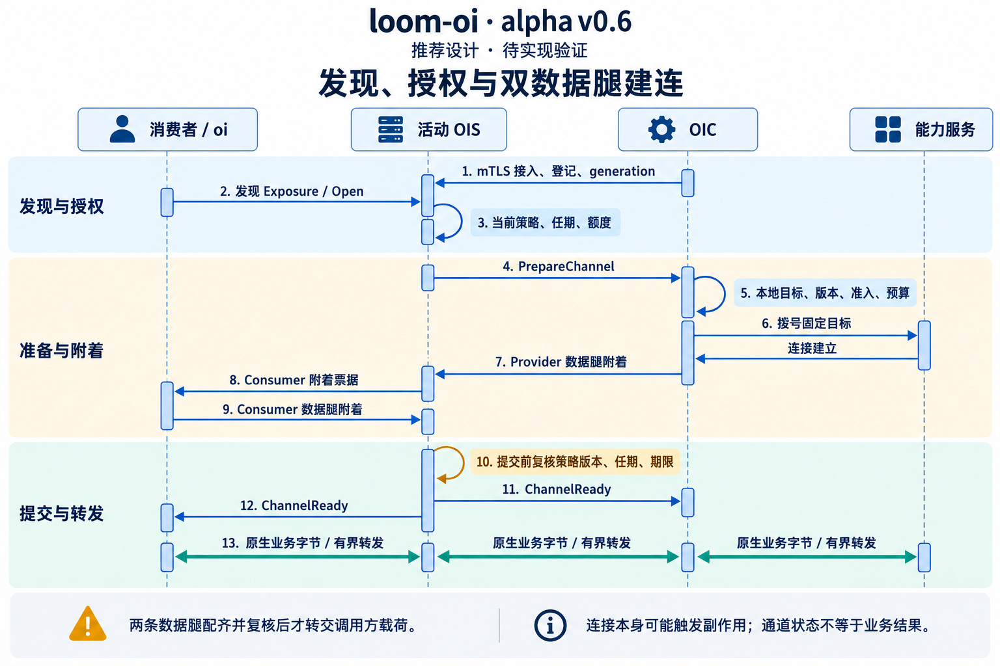
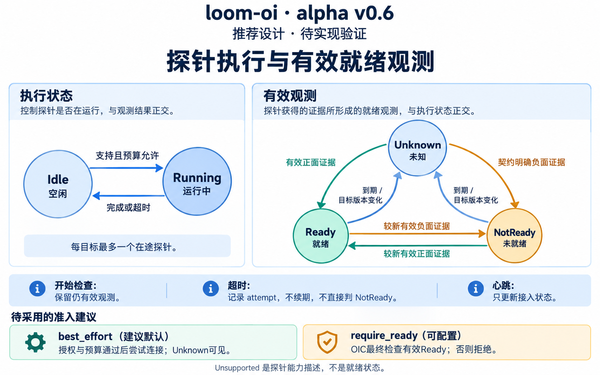
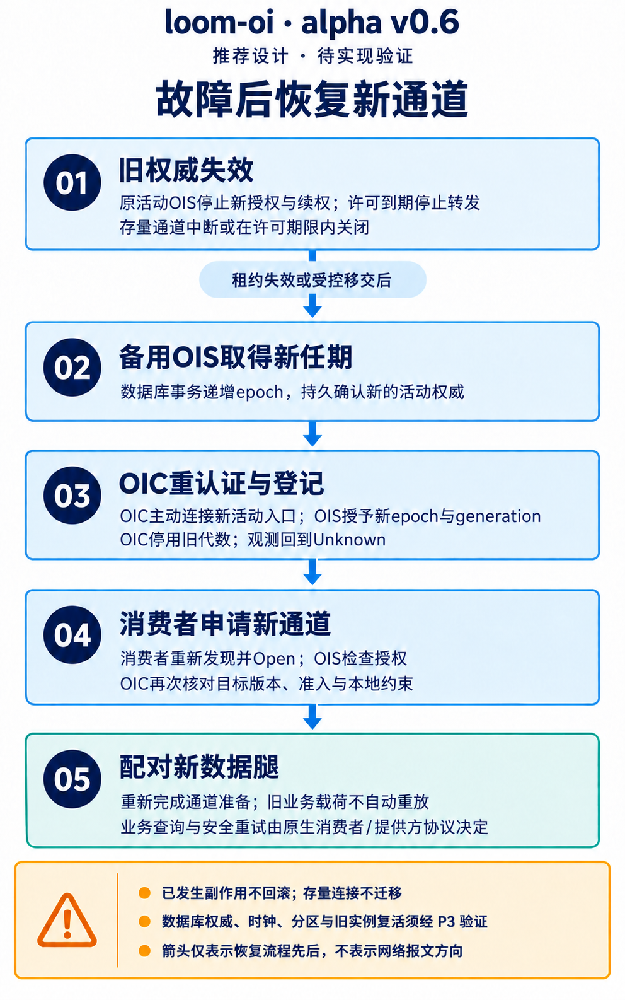
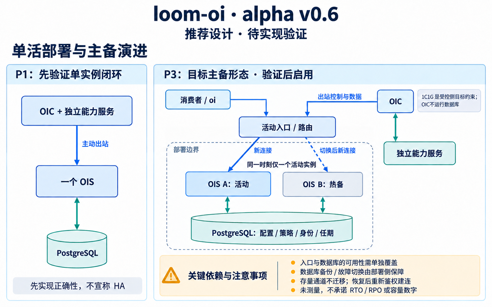
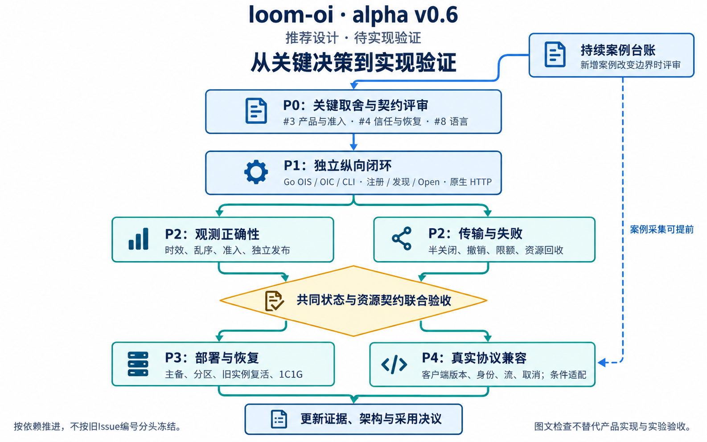

# alpha v0.6 架构图册 · 全量专业重绘

本轮六张当前架构图均使用内置 **ImageGen** 重新生成，并逐张核对当前[架构文档](../alpha-v0.6.md)的角色、连接、状态、故障和依赖。图示是推荐设计，不代表已经实现或被最终采用。

| 图 | 当前图片 | 文字化结构定义 |
| --- | --- | --- |
| 1 总体职责与信任边界 | [PNG](01-overview.png) | [结构](01-overview.mmd) |
| 2 发现、授权与双数据腿 | [PNG](02-open-sequence.png) | [时序](02-open-sequence.mmd) |
| 3 执行与有效观测 | [PNG](03-observation-state.png) | [转换定义](03-observation-state.mmd) |
| 4 故障后的新通道恢复 | [PNG](04-recovery-sequence.png) | [交互参考](04-recovery-sequence.mmd) |
| 5 单活部署与主备演进 | [PNG](05-deployment.png) | [依赖定义](05-deployment.mmd) |
| 6 关键决策与实施依赖 | [PNG](06-delivery-dependencies.png) | [依赖定义](06-delivery-dependencies.mmd) |

[逐图校对与修订记录](imagegen-review.md) · [完整生成/修订提示词](imagegen-prompts.json) · [哈希清单](manifest.json)。所有PNG均为实际ImageGen输出；没有把栅格包装成可编辑SVG。mmd保留为语义参考与后续核对材料，不是本轮图片的渲染来源。旧PNG/SVG保留在Git历史，当前正文仅引用本轮六张图片。

## 1. 总体职责

## 2. 授权建连

## 3. 观测状态

## 4. 故障恢复

## 5. 部署形态

## 6. 实施依赖

