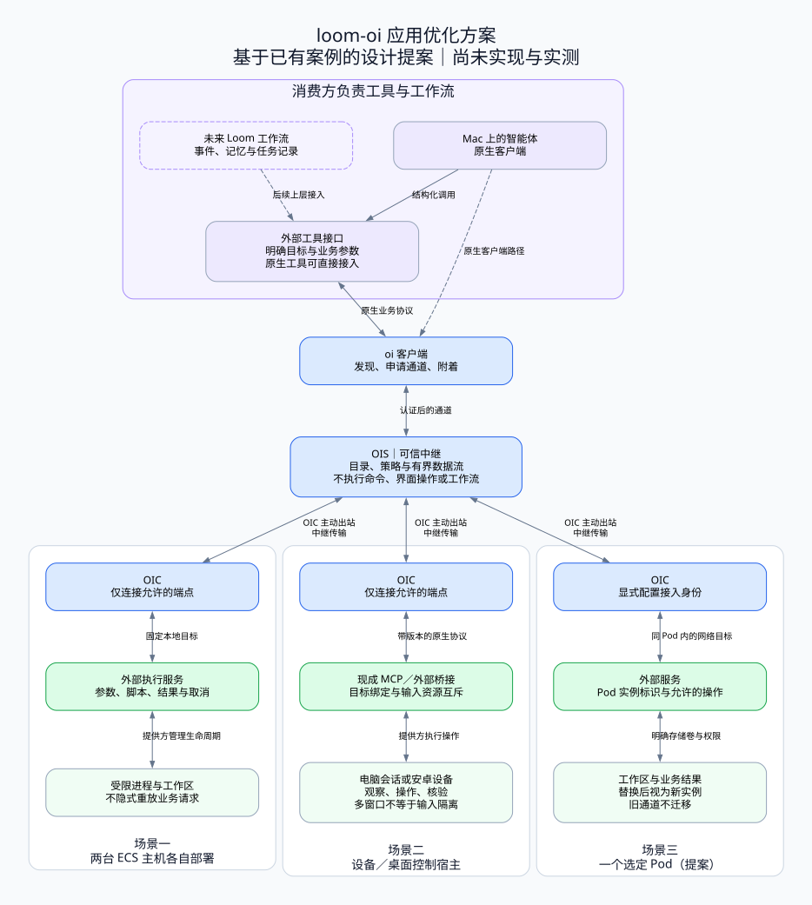
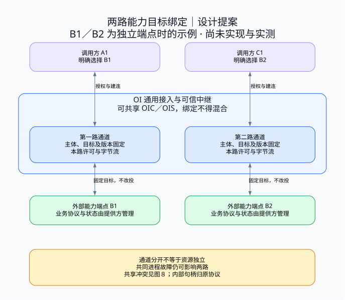

# DISC-001 r4：能力目标绑定、资源责任与应用方案

2026-11-03（香港时间）· alpha · Review / 产品采用Pending / 产品验证NotRun。本轮基线：`50ae2b8acf4fb206aad3b2796509ef2900e9f1ff`。r4回溯10月31日原文并与#13综合；r2的PDF蒸馏和r3状态分析继续沿用，不创建新探索主题。当前确认入口：[#13应用方案确认](https://github.com/wyw-ai/loom-oi/issues/13)。

**推荐方案：在Mac/Agent侧提供明确目标的工具入口，在ECS、桌面/设备控制宿主和选定Pod侧运行各自业务服务；OI负责发现、授权与原生连接。先用“两台ECS中的一次明确目标命令”形成可验证切片，再用“一个应用的一次观察—操作”验证非命令业务，最后验证Pod替换与上层流程。** OI不安装这些业务服务、不替它们执行命令或维持会话；“工具体验”和“通道能力”共同构成应用，但由不同组件承担。

本稿已展开部署、调用示例、正常/失败链、备选、实施切片及验证条件；不是待研究问题清单。示例ID/路径/接口均为设计用虚构值，未声称已有可运行产品。开发者确认的是这些设计取舍，非再次批准整理文档。



图7将已有案例转为使用loom-oi的改进方案，并非已验证的优化结果：ECS链把目标/参数工具化与OI发现/授权分开；应用链明确业务互斥；Pod链明确实例替换后的重新绑定。2026-11-03按W13将图示说明改为中文，专名保留，拓扑与待确认状态不变。

<a id="origin-review"></a>
## r4原始讨论回溯：目标关系、传输复用与资源责任

已找回10月31日15:45:18“点对点，内容你是不需要管理的”至16:19:13的today首版讨论，原Markdown L1204–1693；本轮连续读取L1050–1769并核对前文。它与11月2日PDF是不同材料。[完整回溯](../evidence/alpha-origin-review-001.md)记录原文定位、v2/v3/v0.6/v0.7演进及证据限制。

**r3的偏差是先将问题收成共享桌面的仲裁，未充分回答A1→B1、C1→B2被混成全B1的担心。** B1/B2在原文没有严格对象定义，不能擅自当作两个桌面或进程。现在推荐先保留明确目标，再按真实资源区分三条路径：

| 实际情况 | 应用方案 | OI责任与限制 |
| --- | --- | --- |
| 独立可寻址服务/工作面 | 外部部署B1/B2，分别登记Exposure；A/C分别选择获准目标 | 每次Open固定主体、Access、Exposure/revision、代数、许可与Channel；不因复用而把两路混到B1。两个端口不证明资源独立 |
| 同一服务内的tab/任务/资源句柄 | 原协议两端维护和校验业务ID | OI不解析ID、不维护Agent Session→资源表；多开通道不会创造内部资源 |
| 同一真实冲突桌面/设备 | 提供方串行、拒绝或提供独立工作面；确需共享时用外部有限回合仲裁 | r3的静止后交接仅适用于此类；不要求所有能力实现lease/observe/act协议 |

正常链：A显式选择B1、C选择B2→分别授权/拨号→两端按各自原协议执行。B1失败则本路失败，不自动改投同名/同类型B2，也不重放旧载荷。反例：两Exposure背后同一桌面仍冲突；同一OIC进程退出也可能中断两路，不能由独立Channel推出物理隔离。

15:52提出“按负载如开5个连接，而非每session分一个”，因此必须分开**业务会话、逻辑Channel、底层连接与真实资源**。当前独立WSS数据腿按传输Open建立，不按Agent Session分配；同一流可包含原协议多次交互，一个业务会话也可有多条流。将来底层连接池必须保留逐Channel的身份/目标/字节流及取消、额度、故障边界；不能把5当默认值或断线后自动续传重放。首版保持现有独立WSS提案，真实成本触发再比较池化，未批准新增实现。

早期P2P既涉及直连拓扑，也涉及端到端关系。后续H8已明确采用可信中继R，故本轮不以旧句撤销它；R同样必须保留上述绑定。SDK/CLI是能力网络的接入形态，不能据此把产品等同“仅SDK”。today的聚合服务自行维护新闻源/状态，可作为独立Exposure，或由业务组合多个来源；OI不承担内容聚合或Workload调度。固定两机且SSH已够用时保留轻量工具基线，发现/权限/跨环境接入的新增价值和成本需单独验证。

V04补独立资源/服务内句柄/共享冲突三类对照；V09补A1/B1与C1/B2目标配对、取消和重配不串路；V10区分单数据腿与共享进程故障，连接成本沿LAB-003。既有C01/C03只支持就绪/未知结果反例，不支持资源隔离或连接池性能。本轮无新实验，五项需求仍Pending。具体确认是R1目标/外部能力边界、R2三类资源路径、R5会话与传输状态分层；保留#3/#4原决议范围。



<a id="feedback13"></a>
## r3回应基础（r4按资源条件收窄）：解耦、协议状态与应用互斥

来源：[plumeink在#13的三项诉求](https://github.com/wyw-ai/loom-oi/issues/13#issuecomment-6586567010)，2026-11-03 03:34（香港时间）；处理基线`f71aa61af176b0bef8dbed123d1819b31a05d292`。本轮读取该回复及#3的H9原文，沿用r2的PDF蒸馏，不宣称重新阅读PDF或运行实验。下面是回应及规格草案，尚未获得方案采用；用户重申的能力端解耦要求沿H9执行。

### 一、可以解耦，但要给出“不需要随业务修改”的接口边界

你的要求不仅是“不要替用户启动服务”，还包括**OI不因能力从命令执行换成computer use就增加专用实现依赖**。旧图把三种业务和三份OIC并列，容易误读为三种专用OIC；本轮明确它们是同一通用接入端的不同部署。

推荐保留两个最小抽象：**Access表示受控接入身份，Exposure表示获准连接的暴露接口**。一个Access可以登记多个Exposure；一台主机可按不同信任域部署多个Access，一个Access也可连接管理者明确允许的多个端点。Exposure不等于业务进程、工具、Pod或互斥资源；一个MCP端点可包含多个工具，反过来多个端点也可能操作同一桌面。

Pod/Node类比可借鉴“基础设施对象不写死具体应用”的方向，不照搬成OI的调度与容器生命周期：Kubernetes的Pod确实是可部署单位，Node承载运行服务，而OI当前只承诺登记与连接。现在增设一层名为Node/Pod的对象不会自动实现解耦；只有后续确需独立管理资源归属/拓扑时再评估对象层次。

| 边界 | OI通用契约（建议） | 能力方/消费方自行解释 |
| --- | --- | --- |
| 登记 | 身份、Exposure/revision、固定target_ref、传输类型、额度、版本化描述外壳 | 能力描述中的工具/参数/设备、业务协议版本与操作权限 |
| 建连 | discover/open、授权、原生有序字节流、期限/背压/清理、传输原因 | exec、截图/点击、模型调用、业务会话与结果 |
| 观测 | 有限通用可达检查或带来源/有效期的提供方就绪报告；无契约则Unknown | 如何判断模型加载、桌面可操作、设备繁忙；不要求核心导入业务SDK |
| 部署 | 同一OIC发行物＋本地配置；可选注册/通道SDK | 安装、启动、升级、业务驱动、stdio桥接及持久账本 |

具体例子：把`target_ref=svc-a`从命令服务改为一个符合已支持传输的HTTP服务，只调整本地允许项、描述和revision；消费者换自己的工具协议。**不应修改OIS/OIC代码、加入exec/UI SDK，或要求OI理解argv。** 改目标必须使旧绑定失效，不能在同一许可内偷换服务。新增UDP等未支持传输则不是“只换业务”，需要独立传输设计；通用不等于支持任意协议。

描述扩展有大小/结构边界，未知业务命名空间可原样展示；安全关键传输、版本和许可字段不认识时拒绝，不把所有未知字段都当可忽略。目录中的动作名不是OI的执行API，也不是业务权限凭证。原生客户端仍可绕过外部工具适配器直接使用通道。

**取舍**：推荐通用内核＋外部能力生态。与核心业务插件相比，少一站式安装体验，多由提供方维护适配/鉴权；换取业务独立升级。有限Linux示例仍可选、可单独移除，不能成为核心构建/启动/测试的强依赖；是否由项目维护仍是R1的待确认范围。验收新增V09：用两个不同业务但相同传输的服务替换接入，核对相同OI二进制与依赖清单，核心无需业务变更；失败则收窄解耦承诺。

### 二、协议必须有约束；OIC应“业务无状态”，不能称为完全无状态

当前方案已有认证、连接代数、通道、预算和观测，它们本身就是状态。**推荐目标是：业务状态不归OIC，运行状态有界且可丢弃重建，无需OIC本地业务数据库；不承诺重启后旧连接无损续用。** 无状态不应成为抹掉撤销、背压或目标版本校验的口号。

| 层 | 约束与所有者 | 对状态的影响 |
| --- | --- | --- |
| OI控制协议 | OIS/OIC协商版本，认证身份，绑定epoch/generation/revision，限制消息大小、准备/许可时限和错误 | OIC必须保留当前连接与许可；不兼容版本拒绝，旧代命令不能影响新连接 |
| OI数据传输 | 当前提案为WSS承载DATA/FIN/ABORT，有序字节流、单向结束、背压和有界缓冲；首个目标限定支持的TCP流 | 必须跟踪两向关闭与缓冲；UDP/多播、自动代理重写、任意stdio启动不在透明承诺内 |
| 提供方协议 | HTTP/MCP等的握手、Host/SNI/Origin、认证、会话与业务取消仍由两端或显式外部适配负责 | MCP可有会话，但不要求OIC解析/持有MCP会话表；字节被转发不等于业务协议已适配 |

登记建议把`transport_profile`与业务`protocol/descriptor`分开：前者决定OI能否传输，后者让消费者选择兼容协议，不触发OIC业务插件。字段名和版本协商仍为#3/R5草案，非既有产品API。MCP以明确的2025-11-25版本为参考，其中stdio涉及客户端启动子进程，Streamable HTTP可维护会话；这些职责不能被“改成网络连接”自动消除。

| 状态类别 | 保存/恢复责任 | OIC重启时 |
| --- | --- | --- |
| 身份凭证、本地允许项及配置版本 | 部署方安全保存/注入，OIS保存管理许可；不是无配置运行 | 重新读取并与当前权威对账；拒绝旧revision覆盖新值 |
| 控制连接、generation、短时票据/许可、Channel、socket、缓冲/额度、probe任务/样本 | OIC进程内有界运行状态；有相应OIS侧状态 | 全部失效；重认证获新代数、观测从Unknown开始，再建新通道；不恢复旧载荷/Ready |
| 工作区、MCP会话、命令进程、操作结果、设备锁 | 提供方/外部适配器/消费者持有 | OIC重启既不能清空它们，也不能证明它们仍可恢复；业务按自己的查询/重连契约处理 |

正常链是“配置→认证/对账→新通道→业务握手”；反例是点击已发生时OIC重启：旧Channel消失，业务结果可能未知，桌面锁不能随之释放，重连不能自动重放点击。若要求旧TCP/业务流无损跨重启，则要新增恢复/持久化机制与成本，和当前可丢弃运行状态目标冲突；本轮不作该承诺。另一个更瘦的替代是取消主动probe只接收报告，但仍消除不了连接与许可状态，且降低就绪证据覆盖。

### 三、链B已有责任分配，尚无互斥实现；本轮补到可执行契约

r2已有“共享桌面/设备串行、旧动作未停不交接”的建议，**没有已实现的锁服务或真实并发实验**。本节仅针对共享冲突资源；独立资源和服务内句柄先按r4分类。对共享组合推荐：优先复用控制服务自身可验证的仲裁；缺能力时在业务侧放一个独立适配器/仲裁器，位于所有实际动作入口之前。首个组合用单一仲裁权威，不先建设分布式锁集群。OIC只通道转发，不解释/授予业务锁。

1. **按真实资源统一键。** PC用受控环境＋桌面会话实例；手机默认用设备实例。两个应用窗口、多个Exposure、两个OIC或不同协议入口共享键鼠时，必须映射同一键。键由提供方确定，不能让调用者任选一个锁名规避。批量多设备操作先排除出首轮，避免隐式多锁死锁。
2. **锁住有限交互回合。** 在取得所有权后重新观察，再由同一所有者完成有限的“观察→规划→动作→核验”。只锁单次点击会让别的消费者在观察后切走焦点。建议`try_acquire(resource, expected_instance, budget)`返回绑定调用主体、资源、实例和代数的不可猜令牌；争用默认明确Busy及重试提示，不在OI中悄悄排队。业务方若需队列，必须有上限/等待期限，获准后重新观察。
3. **每次动作核验。** 示例`act(lease, instance, observation, operation_id, action)`由仲裁器核对当前所有者、期限、目标窗口/实例、观察前提和业务权限，底层执行器只接受该权威允许的动作。令牌不能仅检查一次便让旧worker无限运行；旧代数/过期令牌的迟到动作拒绝。一个回合设置动作数、耗时和模型思考预算，不能用无限续租霸占桌面；超限后停止新动作并进入清理。
4. **资源静止后才交接。** 正常release须确认该回合没有在途动作。断线、租约到期、取消超时、worker退出或仲裁器重启：先禁止旧所有者新动作，确认在途动作结束/停止且旧执行器不能再发动作，再重新观察，才给下一位。TTL到期本身不是停止证明；做不到就隔离该资源并返回“状态待核实”，由外部监督器/人工处置。
5. **所有入口服从同一权威。** 原始MCP、调试端口、第二个桥接/管理员自动化不能绕过仲裁；做不到就明确该组合不具备互斥保证。有人类直接操作的桌面也不能仅靠应用锁保证，应使用受控独占会话或降低承诺并检测干扰。多个控制服务同时握有设备句柄时必须汇聚同一仲裁或先限制为一个，不给每个OIC各加一把锁。

上述方法名是外部接口草图，可映射已有服务的等价能力，**不是新增OI API**。最小业务状态为资源实例/仲裁代数、所有者与期限、在途动作和结果引用；与OIC状态分开。若无法保证仲裁器重启时在途动作已结束且旧worker不能再发动作，资源从隔离状态起步，不从“空锁表＝空闲”起步。首轮不提供自动多副本接管；未来要接管，必须有执行端实际拒绝旧代动作的机制，仅在数据库更新一列代数无效。

**正常推演**：A取得桌面回合并观察→B通过另一Exposure申请同一资源得到Busy→A动作完成、核验并释放→B获得新回合后重新观察。**失败推演**：A点击后响应丢失且OIC断线→A结果未知；若服务能证明动作已完成且旧worker不能再发动作，核实当前桌面后可以交接，历史结果仍未知；若不能证明静止则隔离。这样区分“结果未知”与“仍可能执行”，避免既不安全交接又永久锁死所有未知结果。

为什么不只在OI限制每Exposure一个Channel：同一桌面可被多个Exposure访问，一个Channel也可承载并发业务请求，通道终止还不保证动作停止，锁域和执行时点均不匹配。真正独立的设备/桌面会话可以分别并行；后台应用级并行要有驱动能力证据才能缩小资源域。代价是共享桌面吞吐受限、模型思考占用回合；优先用有限回合和真实隔离扩大并行，不能凭窗口数量承诺并发。

### 本轮收束、验证与确认范围

| 诉求 | 本轮结论/建议 | 可反驳的验证与归属 |
| --- | --- | --- |
| 能力端解耦 | 保持H9，并补“同一内核、通用登记/传输、可独立移除业务示例”的机制；R1外部示例维护范围未确认 | V09替换不同业务、相同支持传输，核对OI二进制/依赖不变；#3字段、#13应用，#11条件 |
| 协议/无状态 | R5新增待评审契约：承认必要运行状态，配置可恢复、业务状态外置，重启不续旧通道 | V10旧代命令/旧票据/过期样本拒绝，半关闭/背压、重启后重认证与业务会话分责；G1/G2/G3、真实组合G7 |
| 互斥 | R2细化：单一外部仲裁、真实资源域、有限交互回合、静止后交接 | V04扩展双入口/双Exposure、动作跨期、失联迟到、仲裁重启、目标替换与绕过路径；相同资源实际动作区间不得重叠 |

V04/V09/V10均Blocked：缺实际OI/控制服务/执行器、可复现实例与隔离故障环境；未生成run或晋级实验门槛。代码接口、锁域收窄、断线/重启保证都需真实链验证，纸面走查只检查逻辑。C01/C03旧机制证据不证明这里的互斥实现。

建议确认两个具体取舍：①R1/R5按通用接入及“业务无状态、连接有状态”推进，外部参考例可独立选做；②R2仅在首轮共享冲突组合采用外部单一仲裁和有限交互回合，不能证明静止时隔离，不做自动多副本交接。接受职责边界不等于批准这些细节或放行产品实施。R3语言、R4方法及#4存储/恢复无新采用；本轮只完成回应预处理与规格同步，不关闭或分派Issue。

机制参考（2026-11-03回源）：[Kubernetes Pods](https://kubernetes.io/docs/concepts/workloads/pods/)、[Nodes](https://kubernetes.io/docs/concepts/architecture/nodes/)、[MCP 2025-11-25传输/会话](https://modelcontextprotocol.io/specification/2025-11-25/basic/transports)。它们核对类比和协议事实，通用接口与仲裁方案为本项目推导，不是这些规范对OI的验证。


## 1. r2重做背景与保留边界

用户本次指出旧[#12](https://github.com/wyw-ai/loom-oi/issues/12)看不出讨论被展开为应用方案，并要求改进技能、重做材料、关闭失效单。这个反馈成立：旧单虽提到SSH/设备/Pod，却把主要篇幅用于确认治理制度，应用细节分散到链接；未来Loom/门判断讨论被过早排除，未推导对当前设计的要求。检查器测试、375处链接和一次只读技能任务不能证明交付满足这一目标。

旧#12作为**失效交付反面案例**关闭，非completed。完整旧稿由[Git历史](https://github.com/wyw-ai/loom-oi/blob/08e0611f5ec55825d1001dc9ea974b1087d77224/docs/changes/DISC-001.md)保存。本稿替代其当前评审地位；#3/#4/#8/#11中已有有效问题和人类评论继续有效，不以否定#12为由批量关闭。H1独立性、H8可信中继/双数据库、H9业务实例化边界、H10实验阻挡墙均保留。

<a id="sources"></a>
## 2. 原始讨论形成了哪些相互关联的问题

来源为《[已脱敏]-73dc649d124d0d8914d3698a0254eadc.pdf》，6页、头部标90条消息，5,153,710字节，SHA-256 `2c0304ef6c4c93a11fdacf557e37c1aac6bd2466b92196211ed44c3bad43bc86`。r2时重新提取全文并查看六页；r4沿用该记录，未再次读取PDF，重复上传不增加证据权重。消息日期2026-11-02，导出没有时区；页码从1起。脱敏标签不推断GitHub审批身份。以下必要短摘录保留讨论中的修正过程，不把原话直接升级为需求/技术事实。

| 来源 | 原话/位置及讨论推进 | 蒸馏出的诉求与矛盾 | 本轮展开 |
| --- | --- | --- | --- |
| D01 | p5 21:09–21:12：Mac经SSH控制两台ECS；“执行质量明显没有本地…bash的效果好”；“我猜”前缀和包裹引号致错；“最好还是包装成工具” | Agent应直接表达目标和任务，不每次手写远程调用包装；原因只是猜测，不能把质量问题全归于SSH | §3明确目标工具、两端部署、输入/结果、对照与替代 |
| D02 | p5–6 21:19–21:28：“只打通道”“不管业务”→担心“一万种工具…一万种封装”→回应“可以不坐在loomoi里面”→“效果还是得做出一版” | 工具化与轻内核并非二选一；共同接口应止于连接，业务工具可在外部独立演进 | §3把外部工具/执行服务与OI拆开；不是仅说“不做业务” |
| D04 | p1 00:38–04:16：“一个窗口只打开一个app”“按键精灵+应用粒度，暴露工具”；现成MCP可提供；担心逐步操作/多任务回复慢。p3 14:00提出PC替代，称ADB可后台/多设备 | 想控制的是应用工作面，不只是机器；通道并发不等于UI并行；应先复用现有操作端再决定新增包装 | §4设备/应用绑定、互斥域、动作循环、PC/Android取舍与时延拆解 |
| D05 | p1–2 10:57–11:06：k8s/虚拟手机集群、宿主机/Pod接入OIC；之后Loom managed agent、记忆/事件/serverless；先远控，再跨机器开发部署，“理想情况” | 同一Agent需使用异构、会变化的执行位置；远控是上层平台的连接前置，不等于OI需要拥有调度/记忆 | §5接入布局/Pod身份；§6完整未来流程及当前接口启示 |
| D07 | p2 11:01–11:02希望Jev类模型统一决策；13:27–13:32反对其承担关键决策，提出规范1–10的“门”与流程设计 | 统一决策模型与分层门判断是实质分歧；模型名称/能力未核验，但控制流程问题有架构价值 | §6比较两种流程，推荐确定性约束+模型建议+外部执行记录，不把模型变成授权源 |
| D03 | p3–4 14:14–14:41：删旧v0.6；概念说明是什么/谁使用；顶层架构；docs/modules/oic、ois；局部调整“不破坏其他的决策”；需要SDD避免反复手搓prompt | 分层是为了局部变更可推理，不是为了多建目录；模块详细设计也不应把未选型事项伪装成定稿 | §7用PC替换Android和Pod重建两例演示影响分析 |
| D06 | p2 13:52：“不出意外大概oi是用go做了” | Go倾向需要与明确选型区分；业务服务栈与OI核心栈可解耦 | §7保留Go推荐及#8，不据聊天自动接受 |

过滤：开头语气/记忆闲聊、附和、重复引用、两条撤回XML；不猜撤回内容。p3风险截图只证明讨论出现兼容/平台风险提示，不证明来源、版本、封禁概率或PC一定可用。它使我们把具体微信组合留在真实版本验证，而不是否定应用控制本身。旧v0.6文件已经删除，当前核对保留Git历史，不重复做清理工作。

<a id="remote-exec"></a>
## 3. 应用链A：Mac上的Agent操作两台ECS

### 3.1 把问题拆到能解决的位置

D01有四个可能混在一起的原因：外层SSH字符串/引号、目标选择、远端cwd/依赖差异、模型规划错误。工具封装主要改变第一项，并能显式呈现第二/三项；OI主要改变发现、准入、可达路径。两者都不能保证模型规划正确。D02要求不为每种业务污染OI，因此推荐**一个外部远程执行契约＋OI连接接口**，不是OIS统一exec。

### 3.2 部署及调用草图

| 位置 | 组件与职责 | 不新增的责任 |
| --- | --- | --- |
| Mac/Agent进程侧 | 用户部署的工具服务/适配器，持有获准目标别名→Exposure/revision映射，向Agent暴露exec_argv与exec_script，调用oi客户端 | 不把别名映射当授权；不要求消费者注册成OIC |
| ECS-A / ECS-B | 各自低权限业务执行服务，接收结构化请求，校验程序/cwd/业务凭证/预算并管理进程；由用户或现有进程管理器启动 | 不由OIC安装或spawn业务；不默认暴露无限权限shell |
| ECS侧OIC | 只登记执行服务的固定允许目标；主动连接OIS | 不解析命令，不接受消费者任意IP/URL |
| OIS | 按subject、Exposure/revision和policy建立通道，传输/清理 | 不保存命令账本，不把传输关闭映射为业务完成 |

推荐Agent看到稳定目标别名及其环境摘要，调用必须显式带目标；不建立“上次选过所以这次默认”的隐含全局目标。别名解析后绑定本次Exposure/revision，变更时重新发现/授权，不能把ECS-A请求静默送到B。

以下为**外部工具设计输入**，不是已存在CLI、OIS API或运行记录：

```json
{"tool":"exec_argv","target":"ecs-a-dev","expected_revision":7,
 "program":"/usr/bin/printf","argv":["%s\\n","hello world","a'b","$HOME"],
 "cwd":"/srv/work/demo","timeout_ms":5000,"max_output_bytes":4096}
```

预期：提供方直接进程API接收四个参数，其中`$HOME`为字面量，不经`sh -c`拼接；`printf`程序自身解释格式参数中的反斜线不等于shell展开。传输序列化由工具实现完成，模型仍需生成正确的结构化输入，不能承诺“再无反斜线”。目标程序/OS的参数规则必须按实际平台验证。

需要管道/变量/重定向时用显式`exec_script(target, shell, script, cwd, budget)`；脚本作为一个数据字段传递，由目标指定shell解释，仍有脚本自己的引号语义。每次调用显式cwd/env引用，不假定上次`cd`或环境修改继续生效；持续会话、PTY和文件传输只在真实任务证明需要时另扩外部协议。

正常链：Agent选择ecs-a-dev→工具解析并核对目标描述/revision→oi发现/Open/附着→执行服务验证业务身份和允许范围→接收参数/启动程序→返回`operation_id, execution_state, exit_code, stdout/stderr, truncated, target_instance`→工具向Agent展示结果。字段为建议，输出有界，秘密不进入OI诊断日志。

### 3.3 失败处理与具体代价

- 请求还未得到提供方可验证的拒绝/结果就断线：报告`transport_interrupted + execution_unknown`，不是“失败所以未执行”。OI重连只建立新通道，不自动重发命令。
- 提供方支持持久操作查询时，可用同一业务operation_id查询；重复请求需要其契约中的持久去重/参数一致性。首个切片可以不承诺这些能力，但必须明确结果未知且停住重试。仅有随机ID没有Exactly-once。
- 取消请求无确认：显示`cancel_requested/result_unknown`，不能用关闭通道证明进程停止。提供方负责进程树、超时与输出预算；OI只负责自己的连接资源。
- 模型把目标选成ecs-b：序列化完全正确也会做错事。工具必须返回/展示实际目标身份，提供方权限限制仍独立有效；参数对照不能证明选目标问题解决。

| 路线 | 能解决什么 | 成本、适用与本轮建议 |
| --- | --- | --- |
| A0：已有SSH＋外部工具封装 | 把SSH字符串生成移入确定性代码，可能已经改善体验 | 两台固定机器且访问已满足时最小；保留为基线。不能把包装收益计入OI收益；远端shell参数仍需明确协议 |
| A1：同样工具/执行服务＋OI通道（推荐目标路线） | 除工具表面外，统一目标发现、授权和主动出站接入；不改业务服务栈 | 增加两端服务配置、OIC/OIS、凭证/版本及中继成本。若没有共享目录/访问需求，A0可能更划算 |
| B：OI内建执行网关 | 一处统一工具和生命周期 | 将权限、shell、任务恢复纳入核心，违反H9；本轮不采用，不能借“参考工具”偷偷实现 |

**首个切片建议**：先读文件/运行参数观察器；沿相同任务做SSH封装、结构化直连、结构化经OI三组对照。若后两者都改善而OI无额外收益，就只认工具设计有效。部署任务随后由外部专用部署能力处理制品/批准/回滚；不从“远端运行bash”推出安全生产部署已经成立。

<a id="app-control"></a>
## 4. 应用链B：把应用工作面作为工具目标

### 4.1 从“一个窗口一个app”推导对象与隔离

D04的真正消费对象是**某个设备/桌面会话里的某个应用工作面**。推荐优先接入讨论中提及的现成MCP，取得真实版本和传输方式后复用其工具；仅当它缺少目标绑定/互斥/结果契约时，在业务侧补适配。没有获取代码前不宣称现成MCP具有以下能力。

外部控制服务维护`device_id + desktop_session + app_id + window_handle + instance_epoch`及操作权限，给每个授权边界一个业务端点或强制子目标鉴权；Exposure可以映射单应用，也可映射有细粒度鉴权的网关。**仅给共享万能控制端点贴两个不同Exposure标签并不能隔离两个应用。** OI的discover/open权限不会自动变成“只许点击A窗口”。

部署：PC或Android控制宿主上运行外部MCP/bridge与OIC；设备侧无需必装OIC。原生网络服务可经通道使用；stdio服务由外部bridge拥有子进程和会话映射。实际客户端若不能保持Host/SNI/Origin/业务认证，需明确适配，不能直接宣称任意MCP可透明转发。MCP版本及握手必须锁定实际组合。

### 4.2 具体动作循环与并发

以下为共享冲突输入域的一个外部接口候选；独立服务/资源及服务内部句柄路径见r4回溯，不要求所有能力实现这些方法。

在非生产演示应用中验证“读取当前界面→输入一段文本→确认目标未变→执行一次按钮操作→读取结果”：

1. 工具选择`desktop-lab/demo-app`；服务核对设备/用户会话/应用实例，再按真实输入资源取得排他执行权。
2. `observe(target)`返回带目标实例与观测编号的界面；敏感图像留业务链，OI不索引画面。
3. Agent提交`act(target, expected_instance, observation_id, action, deadline)`。服务复核前台/窗口身份与观测是否仍适用；变化则拒绝并要求重观察。编号只是关联，不能消除观察和动作间的竞态，执行时仍须校验。
4. 服务执行一次动作并重新观察；返回结果或不确定，释放执行权。对业务副作用是否完成，以应用可验证状态/回执为准，不能用坐标点击已发送冒充完成。

上述方法名是外部接口建议，不要求现成MCP重命名；能映射其已有等价能力即可。没有这些能力就降低支持承诺，而不是让OI补业务判断。

**互斥域推荐**：同一PC共享前台/键鼠时按桌面会话串行；同一手机默认按设备串行。不同物理/虚拟输入域才可并行；只有经验证的后台窗口操作能力才缩小到应用锁。多个窗口、多个OIC或多个Channel本身都不增加真实隔离。超时或断线后，服务在确认旧动作终止/回收前不得把输入域交给下一个操作者；否则必须标Busy/Unknown并隔离待查，不能仅靠锁TTL过期宣称安全。

**故障例**：A的点击已发生、响应丢失，B正等待操作同一桌面。服务保留A的未知结果，阻止无条件重放和提前交接；查询应用状态或确认执行器已静止后，重新观察再安排B。OI只能报告通道中断，不拥有这把业务锁。

### 4.3 速度与平台路线

逐步工具链延迟可拆为`发现/建连 + 排队 + Σ(网络往返 + 采集 + 模型决策 + 动作/应用响应)`，这是分析模型，没有填入测量数字。OI只影响其中网络/连接部分，不能凭通道并行承诺多任务回复更快。

推荐先复用现成控制端测量各段时间；同一输入域保留串行安全，不用增加通道来掩盖争用。若模型/往返占主导，再在外部服务加入有限、可中断且带前置条件的动作序列；代价是更多业务耦合和部分完成语义，禁止失败后整批盲重试。

| 候选 | 价值与约束 | 推荐条件 |
| --- | --- | --- |
| PC现成MCP | 讨论称已支持，可能降低初次接入工作；前台焦点/桌面共享需验证 | 优先取得样本，用演示应用做一个工作面；不是确认微信PC兼容 |
| Android控制服务＋ADB | 设备选择可按序列号明确；后台/应用能力依具体操作实现，不从“ADB”名称外推 | 已有设备和真实工具组合时作为第二条路径；不能把截图中的风险规避当目标 |
| 每窗口独立环境/设备池 | 可扩大真实并行域 | 资源/启动/账户成本更高；待实测排队和隔离需求触发，不先造全量手机集群 |

这条链要求当前架构保持“通道/业务状态分离”“外部目标身份和互斥”“描述不等于权限”，不是只在案例表增加一行手机/PC。

<a id="fleet"></a>
## 5. 应用链C：宿主机与Pod接入，支撑远端开发部署

D05说“宿主机、pod等等都接入oic”，可有不同部署解释；不能默认OIC安装一次便拥有整个集群操作权。

| 布局 | 目标/状态所有权 | 取舍 |
| --- | --- | --- |
| 一台宿主机一个OIC，列出固定本机服务 | 宿主管理员给本地允许项；执行服务拥有工作区/进程 | 推荐主机基线，少驻留进程；共享OIC故障域，需要服务级权限 |
| 选定Pod内OIC与业务服务共置 | 部署系统给短期身份/允许端点；Pod生命周期决定实例 | 推荐首个Pod切片；可连接同Pod网络端点，访问文件仍需显式共享卷/权限。每Pod资源与凭证运维成本更高 |
| 节点/命名空间集中网关访问多个Pod | 外部网关维护允许目标与Kubernetes身份映射 | 常驻成本可能低，但权限/网络可达/实例变化复杂；仅当规模数据支持时采用，不让OIC自由遍历Pod或执行任意kubectl |

**具体接入例**（设计草图）：主机工作区执行服务登记`host-dev/tools`；一个开发Pod提供的执行/HTTP服务登记`dev/ns-demo/pod-uid-123/tools`。消费方选择业务目标，OI仍只处理Access/Exposure；集群、namespace、Pod UID在外部描述和平台映射中，不新增核心K8s调度对象。

正常：部署系统启动业务服务与OIC，按允许范围登记→Agent在目录选择这个实例→Open固定revision→业务服务在自己的工作区执行构建→将制品和业务状态交回上层。部署另由获授权外部部署服务处理，Kubernetes RBAC/业务权限不由OI令牌自动获得。

**Pod替换反例**：同名Pod销毁，创建不同UID的新Pod。推荐实例绑定Exposure或显式新revision；旧Channel关闭/失效，旧操作结果留在原业务执行记录，不能自动迁往新Pod再执行。稳定“dev-worker”别名若由上层维护，重绑定后需要重新发现/授权及任务策略，不得把旧连接悄悄指向新工作区。OI不能保证已消失Pod的临时文件/任务日志恢复；需要保留的制品/操作记录由外部卷/对象存储/任务服务保证。

**当前结论**：主机基线＋一个选定Pod是足够区分身份/生命周期问题的试点；本轮不承诺建设K8s集群、调度手机池或全集群自动发现。它们不是无关事项：实例替换、描述版本、目标授权范围和回收规则必须现在设计正确，否则未来harness会依赖错误的“机器永远不变”假设。

<a id="harness"></a>
## 6. 未来Loom/门判断：不进首版内核，但当轮推导接缝

D05/D07不是已经确定的模型方案；“Jev”未有准确产品/版本，“不出幻觉”没有证据。仍可分析两种应用结构：

- **集中模型决定全部动作**：事件直接给模型，由模型挑目标/命令并执行。链路短，但把身份、权限、重试和事实判断混为一次模型输出，难以解释失败或约束范围。
- **推荐：显式工作流＋模型建议＋确定性约束＋外部执行记录**：业务状态先形成事实输入，规则检查身份/许可/版本/预算；模型提出动作或处理模糊条件，关键缺证据记Unknown并暂停该依赖；执行器只接获准动作。代价是工作流、任务状态和错误处理设计更多，仍不能保证模型判断正确。

设计例：外部事件服务收到`build_requested(workspace, commit)`→Loom记录任务/所需事实→规则核对工作区与允许目标，模型生成构建计划→上层选择Exposure并经OI访问外部构建工具→工具返回制品摘要/结果或未知→Loom任务账本记录→记忆/事件服务接收业务回执→部署步骤按自己的批准/制品校验继续。断线时停在未知，先查提供方业务结果；不靠OI通道ID当持久任务ID，也不重复提交部署。

记忆、事件、serverless可以各自作为外部服务经OI连接：它们自行拥有存储、消费游标、投递/幂等、函数生命周期。**OI不因此变成事件总线、工作流引擎或managed-agent平台。** H1当前不做Loom集成仍保留；这里做接口约束推导，不创建新的探索分支或实现任务。

当前需要保留的接缝：稳定但版本明确的目标引用；描述/业务协议版本；传输错误与业务结果分开；可关联诊断但不默认采集敏感业务载荷；调用方自己的授权主体。现在无需引入Agent Session、Jev模型ID、记忆对象或工作流数据库到OI。首个验收用普通独立客户端走同样连接，不依赖Loom才能证明OI可用。

<a id="layers"></a>
## 7. 文档分层和语言讨论如何落到这次方案

D03的分层已经有目录；本轮补的是用途：

| 变化例 | 应修改 | 不应被静默改变 |
| --- | --- | --- |
| 从Android后台操作换为PC共享前台 | 应用方案§4、消费侧目标/互斥契约、提供方描述与真实组合验证；若权限/目标改变则revision变化 | OIS仍传原生流；PG/SQLite、Go倾向、H9边界不因此重选 |
| 一个Pod被同名新实例替换 | §5身份映射、OIC允许项/版本和旧通道清理验收，外部任务结果保存 | OIS不新增Pod调度或业务重放，不把集群UID等同于Access generation |
| 工具先增加只读模式，后增加部署动作 | 外部业务权限/回执/验收与调用侧支持矩阵，影响时更新Exposure契约 | 不能以原“可Open”批准新业务动作，亦不默认修改存储后端 |

概念页回答是什么、谁用、价值；架构维护共同边界；模块页写责任/接口/失败；应用方案维护为什么这样组合。未定选型标Review，不阻止局部设计，也不把模块目录存在说成规格冻结。

D06的Go倾向保留在#8。当前仍推荐Go统一OI核心，理由沿已有功能/维护分析；上述执行服务、MCP、设备工具、Loom可以独立选语言。没有新增语言实测，也没有把某一设备SDK的语言强加给OIC。

<a id="requirements"></a>
## 8. 本轮建议、确认与实现切片

**建议优先远程工具链A，再应用链B，再Pod生命周期链C。** 理由：A直接对应明确经历且可用固定程序客观观察参数；B验证OI面对真实协议与共享业务状态时是否仍保持边界；C检验目标更换及长期上层流程。这是应用验证的优先顺序，不替代架构P1的独立原生只读HTTP闭环或跳过G0–G7。若现成MCP和设备已先到位、ECS样本未到位，可以先B；这只是验证顺序建议，不批准实现或把缺少样本写成已提供。

| 稳定需求ID | 本轮具体确认 | 推荐/替代及后果 | 归属 |
| --- | --- | --- | --- |
| DISC-001-R1 | 是否按§3采用外部工具/执行服务＋OI；是否由项目维护一个最小外部参考例 | 推荐仅维护一个有限Linux命令参考例及契约，非核心内置功能；可选只定义契约由业务方实现，成本更低但兼容材料更依赖提供方 | 本轮应用确认入口；共用契约#3 |
| DISC-001-R2 | 是否接受§4应用/资源域与§5主机＋单Pod布局，第一组合选什么 | 推荐现成MCP＋演示应用，先核实独立端点/内部句柄/共享冲突；仅真实共享输入域串行，再扩设备；Pod先共置，规模证据后评集中网关 | 本轮应用确认入口；字段/准入#3，条件#11 |
| DISC-001-R5 | 是否按本轮回应采用通用传输/业务描述分层和OIC状态/重启边界 | 推荐业务状态外置、连接运行状态有界可重建；不承诺无损续流；具体字段与#3共同评审 | #13及#3；条件#11 |
| DISC-001-R3 | Go倾向是否成为首版统一核心选择 | 推荐保持Go；也可先批准最小同契约对比，不强制完整双实现 | #8 |
| DISC-001-R4 | §7分层影响分析及内容优先交付的具体做法是否需要调整 | 本次技能/文档修正已授权完成；每轮Issue纪律不重复征求。细则可评审，不以治理待确认挡住独立设计 | 本轮入口附项，不再另建治理主单 |

§6为R2的未来接口约束分析，未新增Loom集成/模型路线实施要求；不需要开发者先决定Jev才能选当前OI工具链。R1/R2可分项回复接受、带条件接受、改为替代或暂缓；不要把对单个例子的认可推广为三条链全部可交付。

<a id="validation"></a>
## 9. 验证设计：什么结果能改变推荐

| ID / 对照 | 观察与预期判定 | 实际状态/缺口 |
| --- | --- | --- |
| V01 参数/环境 | 同一固定任务比较SSH封装、结构化直连、同工具经OI；目标实际记录argv/cwd；空参数/空格/单双引号/Unicode/换行等逐项相等，脚本模式单独评价 | Blocked：实际两端工具/目标、OI未具备；没有把JSON草图当运行 |
| V02 失败/取消/替换 | 效果后丢响应、取消无确认、目标revision变更；不得未知误报未执行、无条件重发或旧请求改投新实例 | Blocked：真实提供方/OI实现与隔离故障条件；LAB-004/G3 |
| V03 Agent质量 | 相同模型/任务/环境/预算，随机顺序，运行前确定样本/阈值；分别计参数表示、选错目标、环境差异、任务完成与耗时 | Blocked：任务原件/日志/目标/模型配置；若A0足够或改进来自工具而非OI，缩小OI价值主张 |
| V04 应用/设备 | 分别检查独立资源、服务内部句柄和共享冲突资源；共享组合固定版本；同一输入域两个消费者争用、窗口切换/重开、设备离线、效果后断线；增加双入口/双Exposure争用、动作跨期、迟到命令、仲裁重启与旁路；按本轮回应核对实际动作不重叠、静止后交接及未知结果；分段测时 | Blocked：真实MCP/设备/演示应用；若后台独立输入可证实才缩小互斥域；LAB-004/G7 |
| V09 解耦替换 | 不同业务使用同一支持传输；OI二进制/依赖不变，变更仅配置/描述/revision，拒绝任意目标及未知传输；A1只到B1、C1只到B2，取消/重配/旧代通知不串路 | Blocked；缺实际实现/两业务样本，G1/G7 |
| V10 状态/重建 | 拒绝旧generation/票据/过期样本；半关闭/有界背压；重启后新认证/通道且不恢复业务锁或重发；区分单腿与共同进程故障，不按业务session分配资源 | Blocked；G1/G2/G3、真实协议组合G7 |
| V05 语言/资源 | 沿用LAB-003同契约目标预算及明确批准的比较范围 | Blocked；本次讨论不是新语言样本 |
| V08 Pod实例 | 同名不同UID替换、旧通道/任务结果处理、重新授权；外部持久结果和OI临时状态分别检查 | Blocked：测试集群/部署/实现与可清理环境；LAB-004/G7、实际传输G3 |
| V06 文档记录 | 来源/Issue/文件/图/指纹与版本闭环；只证明记录一致性 | 结果见§10 |
| V07 内容与技能 | 原PDF对照方案；独立任务只给原始材料/基线/新技能，评审Issue正文里的应用机制和主要线程 | 结果见§10；不证明用户已接受 |

原实验raw、ITER、G0–G7不变；没有运行产品实验或重新统计旧数据。先提出可评审方案不等于豁免实验。任务顺序：已授权的方案/图/技能/Issue重做→明确R1/R2范围与#3/#4/#8相关G0→纵向实现→对应阶段验证；条件准备可独立进行。

<a id="delivery"></a>
## 10. r2交付记录与r3预处理增量

以下为r2交付记录，r3没有重复PDF/技能独立任务：r2产物为本应用方案、直接承载机制的替代Issue、当前架构/模块/案例/KB增量、应用路径图，以及内容优先的技能修订。旧#12保留原文并标失效，关闭不记解决。r2交付时R1–R4仍Pending；r3增加R5后五项仍Pending，旧确认范围保持。

- 原件：重提全文并逐页查看六页，核对D01–D07、不同意见与后续修正；没有用旧摘要代替原件。
- 内容走查：Issue #13直接包含四条应用链，具体目标/输入示例、状态所有者、失效路径和替代；逐项对应原PDF主要线程。应用顺序与P1/G0–G7分开，未修改已有技术采用。
- 独立技能任务：只提供原PDF、固定08e0611架构/决策和修订技能，不提供主流程方案；返回的Issue草稿覆盖ECS、应用/设备、Pod和未来harness/Jev分歧，给出参数示例、响应丢失、互斥、实例替换与事件重投处理。主流程核对其原文定位和边界；仅说明本次技能任务的表现，不等于产品实测或用户认可。
- 视觉：新增图7使用Graphviz确定性矢量布局，实际渲染并查看；修正初稿跨子图rank错位与标题穿线。原图1–6源/输出未改。
- 记录检查：技能格式、JSON/相对链接/锚点/图哈希、review及Pending阻挡实施在本次交付核对；检查器和原9项单测代码未改，不用既有测试数证明内容质量。提交前这些记录检查与远端回读分别执行。
- 实验：目录、raw、ITER和gates未改；V01–V05/V08均Blocked。旧#12以not_planned关闭，原文保留；#3/#8/#11只更新本轮承接，不关闭或分派。

r3完成三项诉求的回应预处理：更新图7通用接入边界，新增图8业务资源交接；同步概念/架构/OIC与OIS模块、#13/#3/#11、KB和需求指纹。R1–R5保持Pending，V09/V10新增Blocked；原实验raw/ITER/gates不变。记录检查和视觉校对仅验证本轮文档交付。

<a id="references"></a>
## 11. 一手机制依据及边界

以下2026-11-03读取；用于核对机制，不证明用户现有环境兼容。除MCP显式版本页外均为访问当日官方文档，实际试验需另锁定实现版本。

- [OpenSSH ssh(1)](https://man.openbsd.org/ssh.1)：命令的附加参数以空格组合后发送远端；因此本地argv数组不自动成为远端无损exec契约。它不证明D01失误的实际原因。
- [MCP 2025-11-25 transports](https://modelcontextprotocol.io/specification/2025-11-25/basic/transports)：stdio涉及客户端子进程，Streamable HTTP为网络服务；用于说明bridge/身份边界。此为明确参考版本，不称其最新，也不在未知客户端版本上套用兼容承诺。
- [Android adb](https://developer.android.com/tools/adb)：设备选择有序列号/-s机制；不据此认定所有应用后台控制或并发都成立。
- [Kubernetes Pod lifecycle](https://kubernetes.io/docs/concepts/workloads/pods/pod-lifecycle/)与[Pods](https://kubernetes.io/docs/concepts/workloads/pods/)：同名替换Pod具有不同UID；同Pod共享网络而文件访问需对应卷/权限。实例绑定与外部任务记录是本项目设计推论。

## r4交付记录

回读原Markdown指定区段及前后文，核对固定历史提案和H8/#13回复，形成[完整回溯](../evidence/alpha-origin-review-001.md)。新增图9明确独立端点时的两路绑定，图7/8收窄仲裁范围；联动概念、架构、模块、KB和#13/#3/#4/#11。图1–6、技能代码、实验raw/ITER/gates不变；本轮不复跑r2独立技能任务。review与记录/视觉检查验证文档一致性，不代表实现或采用，产品验证仍Blocked。
