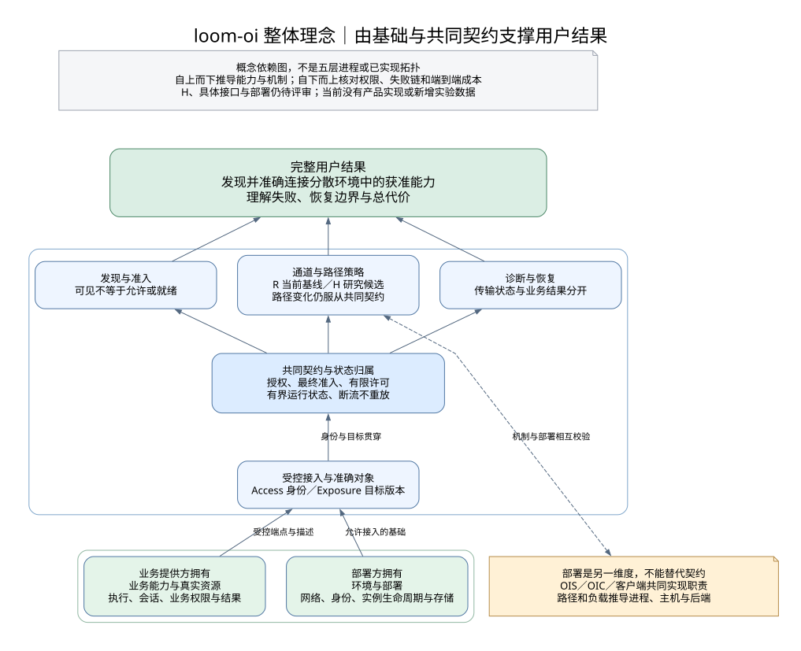

# loom-oi：整体理念与概念模型

loom-oi是**让消费者在明确权限和失败边界内，发现并连接分散环境中受控能力的接入与连接系统**。它作为一个项目主体对这条完整体验负责；OIS、OIC、客户端、通道和数据库是实现该职责的分工。项目价值不由仓库目录或组件数量定义，也不由某一种传输和进程部署固定。

2026-11-03：依据[本轮整体性修正](../changes/DISC-004.md)整合当前概念，细化表述待评审。H1独立性、H8可信中继/双后端、H9业务实例外置、H12 Go与H13状态/绑定边界继续有效；本页不扩大这些原确认，也不宣布产品已实现。技术参数和协议只在[共同架构](../architecture/alpha-v0.7.md)定义。

## 1. 为谁解决什么

能力提供方已经拥有服务、设备、主机或容器，并决定允许哪些能力被访问；消费者是脚本、应用或Agent，需要找到并访问一个**明确且获准的目标**。部署管理方维护接入信任、目录、策略和运行预算。消费者不必是Loom，也不必登记为OIC；未来Loom是一个可独立接入的上层系统。

例如Mac访问两台ECS：原执行服务拥有命令、权限和结果；loom-oi统一获准目标的发现、授权、跨环境接入和传输诊断，让调用方明确选ECS-A或ECS-B。仅需固定两机SSH且没有统一接入诉求时，SSH封装可能更经济；OI的新增部署成本必须通过真实场景说明价值，不能把所有远程工具收益都归于OI。

项目追求三个共同结果：**接对目标并守住授权；在环境约束内建立可解释的连接；让能力提供方和消费者能独立演进。** 覆盖何种网络、原生协议、平台和资源规模由支持范围与验证决定，不把“通用”写成无条件兼容。

## 2. 项目承诺与责任边界

| 使用者需要的结果 | loom-oi负责的能力与约束 | 外部系统仍负责什么 |
| --- | --- | --- |
| 能找到获准暴露的目标 | 登记、按权限发现、明确目标与配置版本 | 提供方创建服务实例，保证业务描述真实 |
| 每次访问有明确去向与许可 | 从申请、准备到数据转发保持主体/目标绑定；本地约束与管理许可共同生效 | 原生服务的业务身份和操作级权限，不由通道令牌替代 |
| 能在支持环境内连接 | 协调通道、选择允许的路径、限额与诊断；当前已选R中继作为首版基线 | 网络/证书等部署前提，具体业务协议与适配 |
| 能理解当前可用与失败边界 | 分开接入在线、目标可达、就绪观测与传输阶段；有限许可、可重建运行状态 | 业务成功、任务恢复、持久去重、取消确认与副作用回滚 |
| 多种能力能复用同一接入内核 | 相同受支持传输更换业务不强迫OI增加该业务SDK | 服务内部会话、桌面/设备互斥、工作区和业务资源生命周期 |

表中是项目职责与设计承诺，现有实现/实验不足以证明它们已交付。目录可见不等于访问获准；获准不等于就绪；通道打开不等于业务成功。任意设计若把这些判断合并，必须回到此处说明新的产品责任并重新评审。

## 3. 从基础到使用体验的概念模型

| 推导层次（自下而上） | 本层提供什么 | 上层不能凭空增加什么 |
| --- | --- | --- |
| 外部基础 | 能力服务、网络与部署信任；明确目标、身份和本地允许项 | 未部署的能力、任意网络可达或无条件平台兼容 |
| 接入与对象 | Access接入身份、Exposure暴露目标/版本；它们不强制等同主机、Pod或进程 | 业务实例的启动/托管权、真实资源隔离 |
| 共同连接契约 | 主体/目标/许可绑定、准入、有限资源、失效与重建 | 无损续流、已执行动作的回滚或永久离线授权 |
| 访问与路径策略 | 发现、申请和诊断；在契约内研究R、直连D及双路径H | 路径改变后的权限绕过、未知请求重放或隐含目标替换 |
| 消费体验 | 原生客户端/库或可选外部工具适配，向使用者呈现一致目标与传输边界 | 把业务结果未知显示为失败后可安全重试 |

这是概念和保证的推导关系，不要求五层进程、五个服务或一次性实现所有路径。观测、审计、资源预算贯穿各层；进程、主机、数据库和网络入口是**部署维度**，不能替代能力/契约维度。

OIC实施受控环境接入和本地约束；OIS组织目录、策略与通道协调，当前R路径还承担中继；客户端承担消费侧接入。这些分工共同服务上面的项目结果。以后中继拆成进程或直连加入时，先检查共同语义是否仍成立，再改变组件和部署。

## 4. 所有局部方案必须共同满足的边界

- **主体和目标连续**：发现、Open、附着与转发不得换掉获准主体、Exposure/版本或数据归属；共享进程/连接池也不能串路。
- **授权连续且可终止**：路径和部署改变不能弱化本地允许项、策略撤销及有限许可；明确权威和失联边界，不用旧缓存无限授权。
- **状态按所有者分离**：OI拥有有界运行状态和管理元数据，业务服务拥有执行/会话/真实资源；恢复OI连接不等于恢复业务。
- **局部成功不冒充整体保证**：连上、Ready、单组件吞吐、独立socket或多进程都不单独证明业务成功、资源隔离或系统高可用。
- **总代价可解释**：路径决定哪些字节经过中继，负载和故障目标再影响模块/进程/主机；统计端到端、控制及双方接入成本，不能只优化OIS的一张图。

这是对现有边界的整合及推导检查，具体契约中的提案仍需原确认入口评审。它们不允许AI借“整体最优”越过已采用范围或新增业务托管职责。

## 5. 讨论如何回到同一个项目

从用户结果向下问“需要哪些能力、对象、路径与部署”，再从实际机制向上问“共同故障、权限、版本与预算下还能否兑现原结果”。如果不能，应修正局部建议或明确请求修改项目承诺；不能靠补一张总图把冲突包装成整体方案。

本轮通道主线的具体落地是：[端到端通道方案](../designs/ois-control-relay.md)。P2P/中继选择与切换粒度属于其中的研究变量，先分析它怎样改变经中继的流量、信任和失败范围，再推导中继承载及部署；首版R基线不因此撤销。#15负责该共同取舍，#3/#4/#8/#11提供共同准入、恢复、资源及验证条件，不把同一条因果链拆成互不相干的结论。

每轮在[DISC](../changes/README.md)记录项目承诺/共同契约的保持或改变、上下游影响、端到端反例与证据局限，按[SDD项目收束规则](../sdd/README.md#project-convergence)回写当前权威。概念、架构、模块和应用互相约束；索引只带路，不维护第二套项目答案。

进一步阅读：[OIC](oic.md)、[OIS](ois.md)、[应用设计](../designs/application-paths.md)、[人类决定台账](../../kb/decisions.md)。
