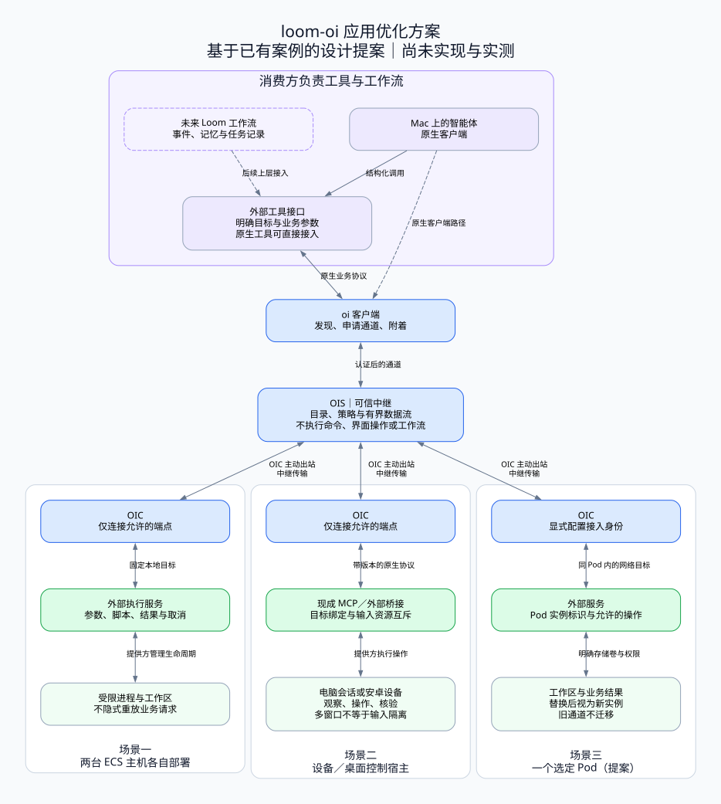

# 通过 loom-oi 使用远端能力

当前应用设计 · Review。职责边界遵循H1/H8/H9，OIS/OIC语言遵循H12；应用组合、参考例和具体协议/资源契约仍待[#13](https://github.com/wyw-ai/loom-oi/issues/13)确认。来源与稳定需求/验证ID见[DISC-001](../changes/DISC-001.md)，共同协议以[架构](../architecture/alpha-v0.7.md)为准；此页只维护外部应用机制。

[远程执行](#remote-exec) · [应用控制](#app-control) · [主机与Pod](#fleet) · [未来流程](#harness) · [共享资源详细交接](#arbitration-detail)

先分清能力目标与真实资源：独立可寻址B1/B2各登记Exposure；服务内部tab/任务句柄由原协议两端管理；只有同一共享冲突资源才需仲裁。不要求所有业务实现统一lease/observe/act。每次Open准确绑定与故障范围见[架构§5.7](../architecture/alpha-v0.7.md#target-binding)。当前方案的原文回溯见[证据报告](../evidence/alpha-origin-review-001.md)。



<a id="remote-exec"></a>
## 1. 应用链A：Mac上的Agent操作两台ECS

### 1.1 把问题拆到能解决的位置

D01有四个可能混在一起的原因：外层SSH字符串/引号、目标选择、远端cwd/依赖差异、模型规划错误。工具封装主要改变第一项，并能显式呈现第二/三项；OI主要改变发现、准入、可达路径。两者都不能保证模型规划正确。D02要求不为每种业务污染OI，因此推荐**一个外部远程执行契约＋OI连接接口**，不是OIS统一exec。

### 1.2 部署及调用草图

| 位置 | 组件与职责 | 不新增的责任 |
| --- | --- | --- |
| Mac/Agent进程侧 | 用户部署的工具服务/适配器，持有获准目标别名→Exposure/revision映射，向Agent暴露exec_argv与exec_script，调用oi客户端 | 不把别名映射当授权；不要求消费者注册成OIC |
| ECS-A / ECS-B | 各自低权限业务执行服务，接收结构化请求，校验程序/cwd/业务凭证/预算并管理进程；由用户或现有进程管理器启动 | 不由OIC安装或spawn业务；不默认暴露无限权限shell |
| ECS侧OIC | 只登记执行服务的固定允许目标；主动连接OIS | 不解析命令，不接受消费者任意IP/URL |
| OIS | 按subject、Exposure/revision和policy建立通道，传输/清理 | 不保存命令账本，不把传输关闭映射为业务完成 |

推荐Agent看到稳定目标别名及其环境摘要，调用必须显式带目标；不建立“上次选过所以这次默认”的隐含全局目标。别名解析后绑定本次Exposure/revision，变更时重新发现/授权，不能把ECS-A请求静默送到B。

以下为**外部工具设计输入**，不是已存在CLI、OIS API或运行记录：

```json
{"tool":"exec_argv","target":"ecs-a-dev","expected_revision":7,
 "program":"/usr/bin/printf","argv":["%s\\n","hello world","a'b","$HOME"],
 "cwd":"/srv/work/demo","timeout_ms":5000,"max_output_bytes":4096}
```

预期：提供方直接进程API接收四个参数，其中`$HOME`为字面量，不经`sh -c`拼接；`printf`程序自身解释格式参数中的反斜线不等于shell展开。传输序列化由工具实现完成，模型仍需生成正确的结构化输入，不能承诺“再无反斜线”。目标程序/OS的参数规则必须按实际平台验证。

需要管道/变量/重定向时用显式`exec_script(target, shell, script, cwd, budget)`；脚本作为一个数据字段传递，由目标指定shell解释，仍有脚本自己的引号语义。每次调用显式cwd/env引用，不假定上次`cd`或环境修改继续生效；持续会话、PTY和文件传输只在真实任务证明需要时另扩外部协议。

正常链：Agent选择ecs-a-dev→工具解析并核对目标描述/revision→oi发现/Open/附着→执行服务验证业务身份和允许范围→接收参数/启动程序→返回`operation_id, execution_state, exit_code, stdout/stderr, truncated, target_instance`→工具向Agent展示结果。字段为建议，输出有界，秘密不进入OI诊断日志。

### 1.3 失败处理与具体代价

- 请求还未得到提供方可验证的拒绝/结果就断线：报告`transport_interrupted + execution_unknown`，不是“失败所以未执行”。OI重连只建立新通道，不自动重发命令。
- 提供方支持持久操作查询时，可用同一业务operation_id查询；重复请求需要其契约中的持久去重/参数一致性。首个切片可以不承诺这些能力，但必须明确结果未知且停住重试。仅有随机ID没有Exactly-once。
- 取消请求无确认：显示`cancel_requested/result_unknown`，不能用关闭通道证明进程停止。提供方负责进程树、超时与输出预算；OI只负责自己的连接资源。
- 模型把目标选成ecs-b：序列化完全正确也会做错事。工具必须返回/展示实际目标身份，提供方权限限制仍独立有效；参数对照不能证明选目标问题解决。

| 路线 | 能解决什么 | 成本、适用与本轮建议 |
| --- | --- | --- |
| A0：已有SSH＋外部工具封装 | 把SSH字符串生成移入确定性代码，可能已经改善体验 | 两台固定机器且访问已满足时最小；保留为基线。不能把包装收益计入OI收益；远端shell参数仍需明确协议 |
| A1：同样工具/执行服务＋OI通道（推荐目标路线） | 除工具表面外，统一目标发现、授权和主动出站接入；不改业务服务栈 | 增加两端服务配置、OIC/OIS、凭证/版本及中继成本。若没有共享目录/访问需求，A0可能更划算 |
| B：OI内建执行网关 | 一处统一工具和生命周期 | 将权限、shell、任务恢复纳入核心，违反H9；本轮不采用，不能借“参考工具”偷偷实现 |

**首个切片建议**：先读文件/运行参数观察器；沿相同任务做SSH封装、结构化直连、结构化经OI三组对照。若后两者都改善而OI无额外收益，就只认工具设计有效。部署任务随后由外部专用部署能力处理制品/批准/回滚；不从“远端运行bash”推出安全生产部署已经成立。

<a id="app-control"></a>
## 2. 应用链B：把应用工作面作为工具目标

### 2.1 从“一个窗口一个app”推导对象与隔离

D04的真正消费对象是**某个设备/桌面会话里的某个应用工作面**。推荐优先接入讨论中提及的现成MCP，取得真实版本和传输方式后复用其工具；仅当它缺少目标绑定/互斥/结果契约时，在业务侧补适配。没有获取代码前不宣称现成MCP具有以下能力。

外部控制服务维护`device_id + desktop_session + app_id + window_handle + instance_epoch`及操作权限，给每个授权边界一个业务端点或强制子目标鉴权；Exposure可以映射单应用，也可映射有细粒度鉴权的网关。**仅给共享万能控制端点贴两个不同Exposure标签并不能隔离两个应用。** OI的discover/open权限不会自动变成“只许点击A窗口”。

部署：PC或Android控制宿主上运行外部MCP/bridge与OIC；设备侧无需必装OIC。原生网络服务可经通道使用；stdio服务由外部bridge拥有子进程和会话映射。实际客户端若不能保持Host/SNI/Origin/业务认证，需明确适配，不能直接宣称任意MCP可透明转发。MCP版本及握手必须锁定实际组合。

### 2.2 具体动作循环与并发

以下为共享冲突输入域的一个外部接口候选；独立服务/资源及服务内部句柄路径见r4回溯，不要求所有能力实现这些方法。

在非生产演示应用中验证“读取当前界面→输入一段文本→确认目标未变→执行一次按钮操作→读取结果”：

1. 工具选择`desktop-lab/demo-app`；服务核对设备/用户会话/应用实例，再按真实输入资源取得排他执行权。
2. `observe(target)`返回带目标实例与观测编号的界面；敏感图像留业务链，OI不索引画面。
3. Agent提交`act(target, expected_instance, observation_id, action, deadline)`。服务复核前台/窗口身份与观测是否仍适用；变化则拒绝并要求重观察。编号只是关联，不能消除观察和动作间的竞态，执行时仍须校验。
4. 服务执行一次动作并重新观察；返回结果或不确定，释放执行权。对业务副作用是否完成，以应用可验证状态/回执为准，不能用坐标点击已发送冒充完成。

上述方法名是外部接口建议，不要求现成MCP重命名；能映射其已有等价能力即可。没有这些能力就降低支持承诺，而不是让OI补业务判断。

**互斥域推荐**：同一PC共享前台/键鼠时按桌面会话串行；同一手机默认按设备串行。不同物理/虚拟输入域才可并行；只有经验证的后台窗口操作能力才缩小到应用锁。多个窗口、多个OIC或多个Channel本身都不增加真实隔离。超时或断线后，服务在确认旧动作终止/回收前不得把输入域交给下一个操作者；否则必须标Busy/Unknown并隔离待查，不能仅靠锁TTL过期宣称安全。

**故障例**：A的点击已发生、响应丢失，B正等待操作同一桌面。服务保留A的未知结果，阻止无条件重放和提前交接；查询应用状态或确认执行器已静止后，重新观察再安排B。OI只能报告通道中断，不拥有这把业务锁。

### 2.3 速度与平台路线

逐步工具链延迟可拆为`发现/建连 + 排队 + Σ(网络往返 + 采集 + 模型决策 + 动作/应用响应)`，这是分析模型，没有填入测量数字。OI只影响其中网络/连接部分，不能凭通道并行承诺多任务回复更快。

推荐先复用现成控制端测量各段时间；同一输入域保留串行安全，不用增加通道来掩盖争用。若模型/往返占主导，再在外部服务加入有限、可中断且带前置条件的动作序列；代价是更多业务耦合和部分完成语义，禁止失败后整批盲重试。

| 候选 | 价值与约束 | 推荐条件 |
| --- | --- | --- |
| PC现成MCP | 讨论称已支持，可能降低初次接入工作；前台焦点/桌面共享需验证 | 优先取得样本，用演示应用做一个工作面；不是确认微信PC兼容 |
| Android控制服务＋ADB | 设备选择可按序列号明确；后台/应用能力依具体操作实现，不从“ADB”名称外推 | 已有设备和真实工具组合时作为第二条路径；不能把截图中的风险规避当目标 |
| 每窗口独立环境/设备池 | 可扩大真实并行域 | 资源/启动/账户成本更高；待实测排队和隔离需求触发，不先造全量手机集群 |

这条链要求当前架构保持“通道/业务状态分离”“外部目标身份和互斥”“描述不等于权限”，不是只在案例表增加一行手机/PC。

<a id="fleet"></a>
## 3. 应用链C：宿主机与Pod接入，支撑远端开发部署

D05说“宿主机、pod等等都接入oic”，可有不同部署解释；不能默认OIC安装一次便拥有整个集群操作权。

| 布局 | 目标/状态所有权 | 取舍 |
| --- | --- | --- |
| 一台宿主机一个OIC，列出固定本机服务 | 宿主管理员给本地允许项；执行服务拥有工作区/进程 | 推荐主机基线，少驻留进程；共享OIC故障域，需要服务级权限 |
| 选定Pod内OIC与业务服务共置 | 部署系统给短期身份/允许端点；Pod生命周期决定实例 | 推荐首个Pod切片；可连接同Pod网络端点，访问文件仍需显式共享卷/权限。每Pod资源与凭证运维成本更高 |
| 节点/命名空间集中网关访问多个Pod | 外部网关维护允许目标与Kubernetes身份映射 | 常驻成本可能低，但权限/网络可达/实例变化复杂；仅当规模数据支持时采用，不让OIC自由遍历Pod或执行任意kubectl |

**具体接入例**（设计草图）：主机工作区执行服务登记`host-dev/tools`；一个开发Pod提供的执行/HTTP服务登记`dev/ns-demo/pod-uid-123/tools`。消费方选择业务目标，OI仍只处理Access/Exposure；集群、namespace、Pod UID在外部描述和平台映射中，不新增核心K8s调度对象。

正常：部署系统启动业务服务与OIC，按允许范围登记→Agent在目录选择这个实例→Open固定revision→业务服务在自己的工作区执行构建→将制品和业务状态交回上层。部署另由获授权外部部署服务处理，Kubernetes RBAC/业务权限不由OI令牌自动获得。

**Pod替换反例**：同名Pod销毁，创建不同UID的新Pod。推荐实例绑定Exposure或显式新revision；旧Channel关闭/失效，旧操作结果留在原业务执行记录，不能自动迁往新Pod再执行。稳定“dev-worker”别名若由上层维护，重绑定后需要重新发现/授权及任务策略，不得把旧连接悄悄指向新工作区。OI不能保证已消失Pod的临时文件/任务日志恢复；需要保留的制品/操作记录由外部卷/对象存储/任务服务保证。

**当前结论**：主机基线＋一个选定Pod是足够区分身份/生命周期问题的试点；本轮不承诺建设K8s集群、调度手机池或全集群自动发现。它们不是无关事项：实例替换、描述版本、目标授权范围和回收规则必须现在设计正确，否则未来harness会依赖错误的“机器永远不变”假设。

<a id="harness"></a>
## 4. 未来Loom/门判断：不进首版内核，但当轮推导接缝

D05/D07不是已经确定的模型方案；“Jev”未有准确产品/版本，“不出幻觉”没有证据。仍可分析两种应用结构：

- **集中模型决定全部动作**：事件直接给模型，由模型挑目标/命令并执行。链路短，但把身份、权限、重试和事实判断混为一次模型输出，难以解释失败或约束范围。
- **推荐：显式工作流＋模型建议＋确定性约束＋外部执行记录**：业务状态先形成事实输入，规则检查身份/许可/版本/预算；模型提出动作或处理模糊条件，关键缺证据记Unknown并暂停该依赖；执行器只接获准动作。代价是工作流、任务状态和错误处理设计更多，仍不能保证模型判断正确。

设计例：外部事件服务收到`build_requested(workspace, commit)`→Loom记录任务/所需事实→规则核对工作区与允许目标，模型生成构建计划→上层选择Exposure并经OI访问外部构建工具→工具返回制品摘要/结果或未知→Loom任务账本记录→记忆/事件服务接收业务回执→部署步骤按自己的批准/制品校验继续。断线时停在未知，先查提供方业务结果；不靠OI通道ID当持久任务ID，也不重复提交部署。

记忆、事件、serverless可以各自作为外部服务经OI连接：它们自行拥有存储、消费游标、投递/幂等、函数生命周期。**OI不因此变成事件总线、工作流引擎或managed-agent平台。** H1当前不做Loom集成仍保留；这里做接口约束推导，不创建新的探索分支或实现任务。

当前需要保留的接缝：稳定但版本明确的目标引用；描述/业务协议版本；传输错误与业务结果分开；可关联诊断但不默认采集敏感业务载荷；调用方自己的授权主体。现在无需引入Agent Session、Jev模型ID、记忆对象或工作流数据库到OI。首个验收用普通独立客户端走同样连接，不依赖Loom才能证明OI可用。

<a id="layers"></a>
## 5. 文档分层和语言讨论如何落到这次方案

D03的分层已经有目录；本轮补的是用途：

| 变化例 | 应修改 | 不应被静默改变 |
| --- | --- | --- |
| 从Android后台操作换为PC共享前台 | 应用方案§2、消费侧目标/互斥契约、提供方描述与真实组合验证；若权限/目标改变则revision变化 | OIS仍传原生流；PG/SQLite、H12语言决定、H9边界不因此重选 |
| 一个Pod被同名新实例替换 | §3身份映射、OIC允许项/版本和旧通道清理验收，外部任务结果保存 | OIS不新增Pod调度或业务重放，不把集群UID等同于Access generation |
| 工具先增加只读模式，后增加部署动作 | 外部业务权限/回执/验收与调用侧支持矩阵，影响时更新Exposure契约 | 不能以原“可Open”批准新业务动作，亦不默认修改存储后端 |

概念页回答是什么、谁用、价值；架构维护共同边界；模块页写责任/接口/失败；应用方案维护为什么这样组合。未定选型标Review，不阻止局部设计，也不把模块目录存在说成规格冻结。

D06的Go倾向后来由H12明确为OIS/OIC首版语言采用，见[决议](../decisions/ADR-001-core-language.md)；上述执行服务、MCP、设备工具、Loom可以独立选语言。没有新增语言实测，也没有把某一设备SDK的语言强加给OIC。CLI语言和驱动仍为设计建议。


<a id="arbitration-detail"></a>
## 共享冲突资源的详细交接候选

r2已有“共享桌面/设备串行、旧动作未停不交接”的建议，**没有已实现的锁服务或真实并发实验**。本节仅针对共享冲突资源；独立资源和服务内句柄先按r4分类。对共享组合推荐：优先复用控制服务自身可验证的仲裁；缺能力时在业务侧放一个独立适配器/仲裁器，位于所有实际动作入口之前。首个组合用单一仲裁权威，不先建设分布式锁集群。OIC只通道转发，不解释/授予业务锁。

1. **按真实资源统一键。** PC用受控环境＋桌面会话实例；手机默认用设备实例。两个应用窗口、多个Exposure、两个OIC或不同协议入口共享键鼠时，必须映射同一键。键由提供方确定，不能让调用者任选一个锁名规避。批量多设备操作先排除出首轮，避免隐式多锁死锁。
2. **锁住有限交互回合。** 在取得所有权后重新观察，再由同一所有者完成有限的“观察→规划→动作→核验”。只锁单次点击会让别的消费者在观察后切走焦点。建议`try_acquire(resource, expected_instance, budget)`返回绑定调用主体、资源、实例和代数的不可猜令牌；争用默认明确Busy及重试提示，不在OI中悄悄排队。业务方若需队列，必须有上限/等待期限，获准后重新观察。
3. **每次动作核验。** 示例`act(lease, instance, observation, operation_id, action)`由仲裁器核对当前所有者、期限、目标窗口/实例、观察前提和业务权限，底层执行器只接受该权威允许的动作。令牌不能仅检查一次便让旧worker无限运行；旧代数/过期令牌的迟到动作拒绝。一个回合设置动作数、耗时和模型思考预算，不能用无限续租霸占桌面；超限后停止新动作并进入清理。
4. **资源静止后才交接。** 正常release须确认该回合没有在途动作。断线、租约到期、取消超时、worker退出或仲裁器重启：先禁止旧所有者新动作，确认在途动作结束/停止且旧执行器不能再发动作，再重新观察，才给下一位。TTL到期本身不是停止证明；做不到就隔离该资源并返回“状态待核实”，由外部监督器/人工处置。
5. **所有入口服从同一权威。** 原始MCP、调试端口、第二个桥接/管理员自动化不能绕过仲裁；做不到就明确该组合不具备互斥保证。有人类直接操作的桌面也不能仅靠应用锁保证，应使用受控独占会话或降低承诺并检测干扰。多个控制服务同时握有设备句柄时必须汇聚同一仲裁或先限制为一个，不给每个OIC各加一把锁。

上述方法名是外部接口草图，可映射已有服务的等价能力，**不是新增OI API**。最小业务状态为资源实例/仲裁代数、所有者与期限、在途动作和结果引用；与OIC状态分开。若无法保证仲裁器重启时在途动作已结束且旧worker不能再发动作，资源从隔离状态起步，不从“空锁表＝空闲”起步。首轮不提供自动多副本接管；未来要接管，必须有执行端实际拒绝旧代动作的机制，仅在数据库更新一列代数无效。

**正常推演**：A取得桌面回合并观察→B通过另一Exposure申请同一资源得到Busy→A动作完成、核验并释放→B获得新回合后重新观察。**失败推演**：A点击后响应丢失且OIC断线→A结果未知；若服务能证明动作已完成且旧worker不能再发动作，核实当前桌面后可以交接，历史结果仍未知；若不能证明静止则隔离。这样区分“结果未知”与“仍可能执行”，避免既不安全交接又永久锁死所有未知结果。

为什么不只在OI限制每Exposure一个Channel：同一桌面可被多个Exposure访问，一个Channel也可承载并发业务请求，通道终止还不保证动作停止，锁域和执行时点均不匹配。真正独立的设备/桌面会话可以分别并行；后台应用级并行要有驱动能力证据才能缩小资源域。代价是共享桌面吞吐受限、模型思考占用回合；优先用有限回合和真实隔离扩大并行，不能凭窗口数量承诺并发。
