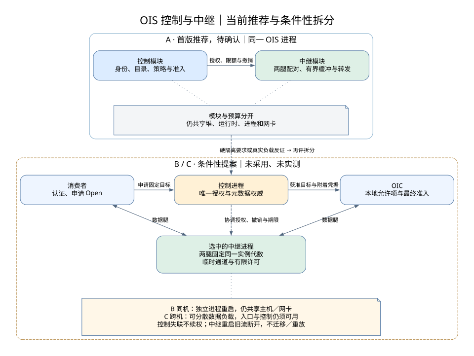

# loom-oi端到端通道：路径策略、中继负载与部署

2026-11-04 · alpha · [DISC-004](../changes/DISC-004.md)方案，[DISC-006](../changes/DISC-006.md)记录H15/C3范围采用 · [#15](https://github.com/wyw-ai/loom-oi/issues/15)共同评审。稳定文件路径保留旧引用；本文原位替代“先决定OIS拆进程”的收窄方案。[项目理念](../concept/loom-oi.md)确定目标与责任，[共同架构](../architecture/alpha-v0.7.md)定义现行对象/接口；本文研究完整通道候选，不另造一套已采用协议。

**主问题是：loom-oi怎样在明确权限、可达和成本边界内，把消费者连接到选定能力，同时控制中心依赖？** 通道路径策略是解决这个问题的研究方向；中继进程拆分是依据实际流量和故障目标推导的部署选项。两者需要共同分析，不能先冻结拆分再将P2P当无关未来项。

**当前推荐：保留已确认R可信中继作为首版实施基线，在同一主问题中设计并验证“新通道按策略选择直连或中继”的候选；现阶段不承诺存量流无损迁移。** 单进程是当前R基线的最小部署建议，不再是脱离路径与场景的首要确认项。没有新产品实验，不以本轮分析批准直连实施。

## 1. 从使用场景推导共同目标

| 场景 | 想得到的结果 | 约束/反例 | 对通道主问题的影响 |
| --- | --- | --- | --- |
| Mac访问两台受限出站ECS | 发现并准确连接选定执行服务 | 不能假设消费者能入站访问OIC；效果后断线结果未知 | R提供明确接入基线；不改投另一个目标或重放请求 |
| 同局域网的大流量能力 | 避免不必要的远端绕路和中心流量成本 | 真实拓扑/带宽未知；直连仍须授权、身份和目标校验 | D/H作为负载问题的对照，不能仅比较中继进程数量 |
| 控制服务失联或中继拥塞 | 清楚哪些访问能建立、哪些流应结束 | 缓存目录不构成许可；拆进程不消除权威或网卡故障 | 控制/数据成本分开；所有路径均保持有限许可和失败语义 |

各场景共同需要：获准主体、固定Exposure/revision、当前代数、有效许可、本地允许项、有界准备及清理。原生服务继续拥有业务权限、会话和结果。首版支持TCP字节流；当前WSS方案不因列出P2P就自动获得NAT穿透、UDP或任意客户端兼容。

## 2. 正确的研究与决策依赖

先确定项目结果/约束与不变量，再比较路径如何影响可达性、信任、撤销和失败；由每条流实际选择的路径推导中继流量、连接/内存、控制负担，最后比较部署与总成本。部署测量也可反向推翻路径建议，这是有反馈的分析，不能变成必须先测完所有P2P方案才允许R开发的审批链。

“中心依赖”还须按责任拆开：目录/策略/新Open是控制权威依赖；实际经OIS的字节才是转发依赖；身份/配置/任期的恢复依赖管理存储；DNS、证书、入口及主机属于设施依赖。D/H可能绕过数据中继，却不自动取消控制授权；B/C可能拆开进程/主机，却不自动修复存储或入口。不同依赖需要对应反例和度量，不以一个“去中心化”词替代方案。

| 研究变量 | 会改变什么 | 必须保持什么 |
| --- | --- | --- |
| R全部中继 / D协调直连 / H按策略选一路 | 中继载荷、双方可达前提、端点暴露、建立耗时与诊断 | 获准身份/目标、准入、有限许可、本地约束 |
| 建连前回退 / 断流后重建 / 存量流迁移 | 业务连接连续性、重复/丢失/顺序与恢复复杂度 | 不把未知执行当未执行，不跨失败隐式重放 |
| 模块/进程/主机分布 | 运行时/资源和故障域、发布运维成本 | 单一策略权威、明确状态所有者与同一公共契约 |

## 3. 完整候选与当前收束

| 候选 | 机制及收益 | 代价/推翻条件 | 状态 |
| --- | --- | --- | --- |
| R：可信中继基线 | 两端出站到受信中继，协调后成对转发；只需先覆盖一种接入路径 | 所有业务载荷经过中继；信任、网卡及中继故障成本。真实局域网/中心流量或隐私约束可要求重评 | H8已确认方向；协议/部署/预算细节仍待评审 |
| H：受策略约束的新通道路径选择 | 同一身份/目标下，部署策略允许时有界尝试D，未满足条件则准备R；每个Open只激活一路 | 新增端点可达、候选验证、对端认证、选择竞争与诊断；可能增加Open尾延迟和OIC入站面。仅中继CPU饱和不证明H更划算 | H15/C3已确认研究边界；具体H机制/生产支持未采用；D是其一个路径选项 |
| M：存量Channel跨路径迁移 | 在逻辑通道内更换承载，希望业务连接不断 | 必须持有与路径无关的逻辑流状态、序号/确认、重传去重、有界缓存、路径代数和单一活动发送路径；与当前可丢弃socket映射有额外状态成本 | 已展开约束但不推荐首版；没有协议/实现/验证，不承诺无损 |

推荐以R作可实现和可对照基线，H先限定**新通道选择及未打开前的失败回退**；默认当前R，不暗设“所有通道都先P2P”。真实网络、策略和负载决定是否值得启用D，不能从P2P这个词推出节省比例。M若出现不可中断长流的明确需求，再以H的共同身份/授权及真实传输结果展开；当前不投入迁移实现。

## 4. 通道“升级/切换”的三个不同范围

| 范围 | 可评审建议 | 失败/代价 |
| --- | --- | --- |
| 准备阶段D失败→R，或按策略只选R | 同一次访问意图、同一目标/版本；每次尝试有独立attempt/路径代数，废弃旧候选，再完成一次最终准入；ChannelReady前不交付业务载荷 | 拨号本身也可能有副作用；不得用准备回退宣称Exactly-once。旧候选迟到不能激活两路 |
| 已打开通道中断→新通道选另一路 | 关闭/失效旧绑定，重新授权后建立新Channel；向消费者报告旧流中断 | 不自动复制旧业务字节；会话恢复/操作重试由原生协议决定，不承诺业务连接无感 |
| 同一存量流R↔D迁移 | 仅作M候选；须先定义端到端确认、顺序、去重和路径提交/回滚，再选择传输技术 | 当前DATA/FIN/ABORT和socket绑定不足以证明迁移安全；不能仅改路由地址 |

以上澄清用于解释“P2P升级到中继等”，不把路径价值排出主问题，也不默认中继是直连的高级版本。**多路径能力和存量迁移是不同承诺**；它们必须在loom-oi整体状态/失败目标中分别衡量。

## 5. H候选如何保持同一个loom-oi契约

以下为候选草图，尚未替换现行R接口；机制名不表示已有公共API。

1. 消费者申请固定目标/版本，OIS控制权威检验主体、策略、当前接入代数和允许路径；OIC再次核对本地允许项。目录缓存/网络地址都不能自行授权。
2. 默认R；仅策略与部署支持D时，由OIS协调受信端点候选和角色绑定的短期许可。候选须属于获准OIC/目标，双方认证对端并校验路径/尝试代数；不得把任意用户URL当可探测地址。初期可只研究明确可直达环境，不能声称已提供穿透。
3. 每个Open先串行、有界准备一条候选；仅路径不可达或该路径不适用、且共同授权仍有效时，清理后尝试另一条获准路径。身份/目标版本失效、权限撤销、有效NotReady等共同拒绝必须终止本次Open，不能靠换路绕过。若以后并行竞速，须另定义唯一提交者、竞争清理和资源上限；当前不默认并行。
4. OIC仍执行本地目标拨号和最新准入；两侧承载齐全后复核策略、目标版本、epoch/generation、许可和额度。只有本次获准的一个路径attempt可进入Open，旧attempt即使迟到也不得接受业务数据；状态提交与检查必须由实现保证并测试。
5. 数据按所选路径走。R由中继配对；D由两端直接传送，仍校验同一主体/目标/许可，不能依赖“中继看见流量”完成其唯一权限检查。OIS保持控制权威，OIC在失联时执行有限许可到期；未经确认不扩大离线自治期限。
6. 目标版本/权限失效或已打开路径失败时，旧通道按共同规则结束；请求换路必须重新授权建新通道。以“ECS已执行命令但响应丢失”为反例：不能为了R回退成功而重发命令，业务结果仍可能未知。

此设计把可达性和承载从目标身份分离，同时保留双方接入、授权与业务分责。具体候选交换、NAT/防火墙支持、密钥/凭据、时钟与过期算法仍需细化；H15/C3仅批准H的研究/评审范围，首版R中继采用没有被扩大为H实现批准。

## 6. 由路径推导实际负载，再讨论部署

先按场景区分控制请求率、建连/握手率、并发流数、每流双向字节率、长短流、慢消费及撤销。若全部流的双向载荷率为B，实际经中继的部分为B_R，则载荷层中继入站约B_R、出站约B_R；全部走R时B_R=B。H可能降低B_R，但其比例必须按实际字节量测量，不能按“直连成功连接数占比”推算。TLS/网络头/重传、探测/握手以及客户端/OIC成本另计；直连不会消除这些端侧成本。

N_R个已建中继Channel通常对应2N_R个数据socket；每方向用户缓冲上限b时，该分项约2N_Rb，不含内核/TLS/运行时及准备连接。以上是**模型，零新增实测**，不是OIS容量或全双工网卡容量承诺。

| 部署选项 | 在什么问题下有意义 | 仍不解决什么 |
| --- | --- | --- |
| A：同进程分模块/调度预算 | 当前R最小部署；先有界控制/握手/转发、明确容量失败 | 共同堆/运行时/进程退出；不能凭模块划分保证控制尾延迟 |
| B：同机控制与中继分进程 | 明确要求中继退出后控制存活，或同路径同预算下A仍有不能接受的争用 | 主机/网卡和控制/DB故障；不会减少B_R |
| C：跨机中继池 | 实际剩余中继量超过单机容量，或要求分散中继节点故障 | 控制权威、数据库、入口可用性；跨机部署不自动等于HA |

若选B/C，控制权威为一次Channel固定同一中继实例/代数，分别签发身份和数据腿角色绑定的一次性凭据；两腿不得被入口散列到不同中继。内部链双向认证，中继不能自续权/改目标/另建策略权威。最终准入、有限许可、实例重启拒绝旧票据和有界排空沿现有方案保留；控制失联停止新Open/续权，已有流到期结束。拆分和H可组合，但必须对组合再检验，不能认为两个候选各自合理便证明组合可用。

## 7. 验证按整体问题组织

| 验证 | 对照与反例 | 会改变什么建议／缺口 |
| --- | --- | --- |
| PATH-V1 | 在受限出站、明确直达、路径变化三类拓扑对照R与H；同功能/权限/目标/TLS要求，记录路径成功、Open总耗时、实际B_R、双方与控制成本 | 判断H是否值得引入，而非只测打洞；缺真实实现、版本固定拓扑/客户端和预算 |
| PATH-V2 | D准备失败转R、旧attempt迟到、撤销/版本变化与提交竞争、错误端点、控制失联；记录未授权/错路/双路提交和有限期限 | 判断共同契约能否跨路径成立；缺候选/最终提交实现和可核实故障驱动 |
| CR-V1 | 对所选路径及代表负载，再比较A/B同总资源下的控制/撤销延迟、CPU/RSS/FD/流量、失败和队列 | 判断进程拆分；不能预设R占比来代表所有拓扑。缺可比实现/负载/判定预算 |
| CR-V2 / CR-V3 | 实例退出/暂停、旧票据、控制分区；选择C才增加跨主机、入口和排空对照 | 判断部署故障范围，跨权威恢复仍归#4/G6；缺隔离环境与实现 |
| M-V1 | 只有M被纳入范围后才预注册迁移中的丢失/重复/顺序、FIN、回滚和有界缓存 | 不用业务重试伪装迁移成功；当前无规格/实现，不作为R/H独立研究前置 |

先声明同等契约和判别预算，再测量；本表不是完整实验包，当前runner不能直接运行真实OI/NAT场景。#11集中跟进缺口与资源验证，已关闭#8只作Go决议来源，#3/#4提供准入/权威/许可契约。没有新增产品run/实验包；例行保真复算没有改变旧样本结论，不制造重复ITER，不提升G0–G7。官方[RFC 8445 §5.1.1](https://www.rfc-editor.org/rfc/rfc8445.html#section-5.1.1)和[RFC 8656 §1](https://www.rfc-editor.org/rfc/rfc8656.html#section-1)仅支持候选/中继机制的区别（2026-11-03已核对），不证明当前WSS支持ICE/TURN或实际可达。

## 8. 收束回loom-oi及确认范围

保持获准目标连接、业务状态外置、有限许可和准确绑定；把路径选择纳入“降低中心依赖与承载成本”的共同研究，再推导部署。OIS控制权威与实际业务载荷路径分开；OIC对本地资源和授权的执行责任不随绕过中继消失。Mac/ECS受限出站仍有R基线，同网高流量场景也有具体H候选；没有将产品扩成Agent/业务托管平台。

H15/C3现已确认的范围是：**按R基线＋H新通道选择/准备回退这一完整候选推进设计和实验准备，存量流迁移单列有条件范围；进程部署由所选路径、负载与硬故障要求共同决定。** 用户已明确要求将方向2纳入方向1并回到项目主体，该工作要求立即执行；这里的具体H机制、参数、支持矩阵与实现投入仍待#15准确评审；研究范围不再重复询问。[观察清单](../evidence/implementation-readiness-004.md#observations)把实际路径/负载/失败与维护代价一起跟踪。原来只问A/B进程选择的确认点已被替代，原评论与旧文档保留在Git。
