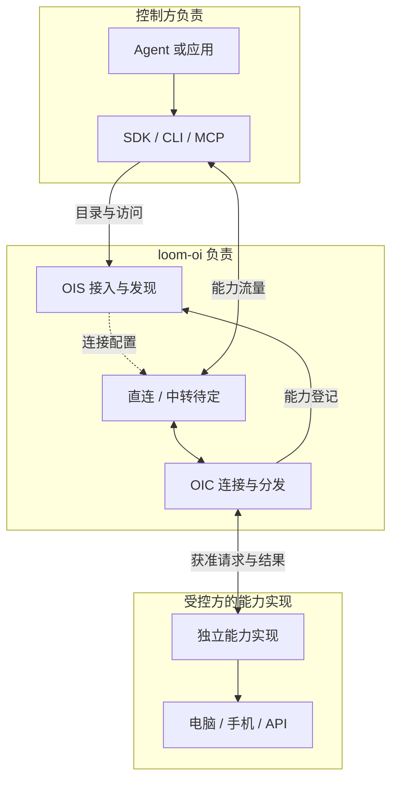
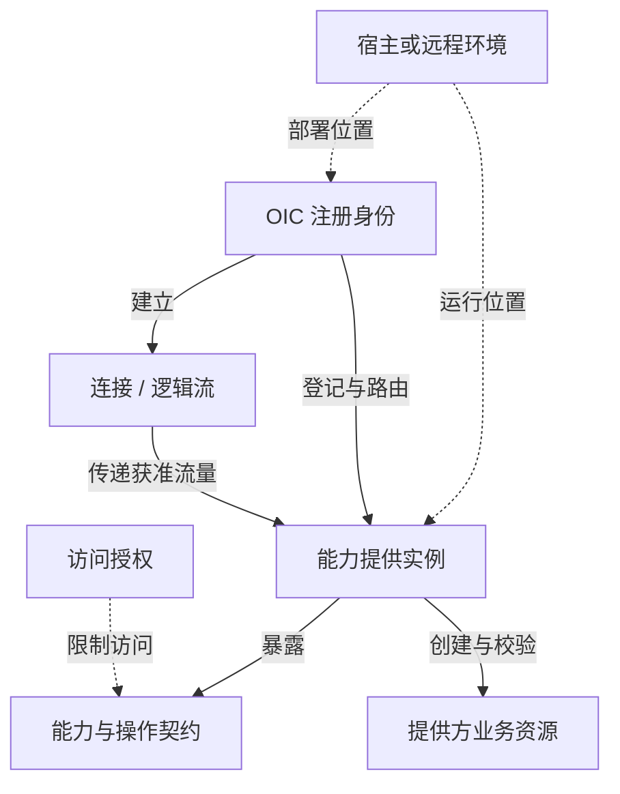
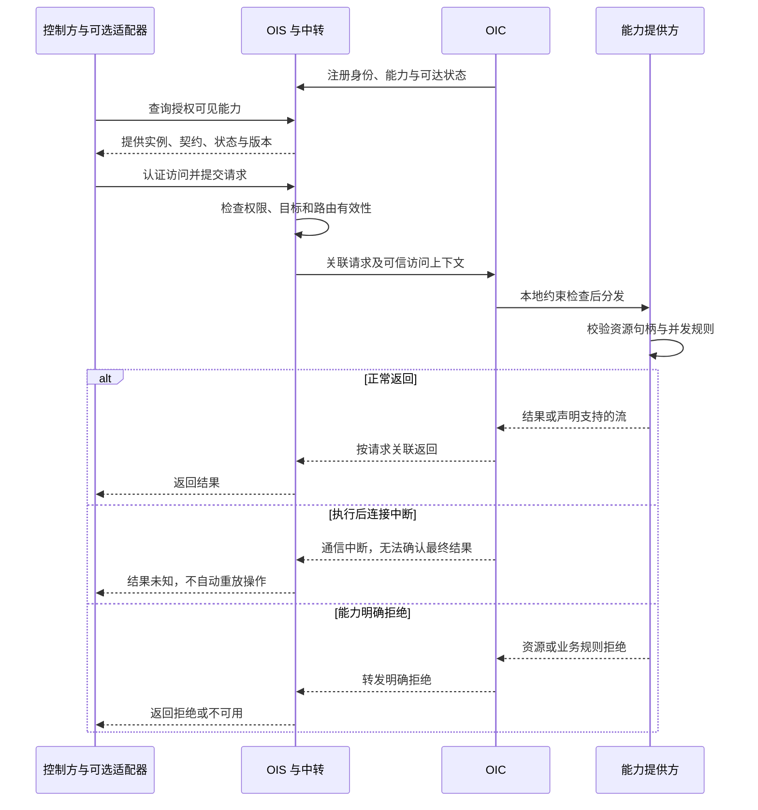
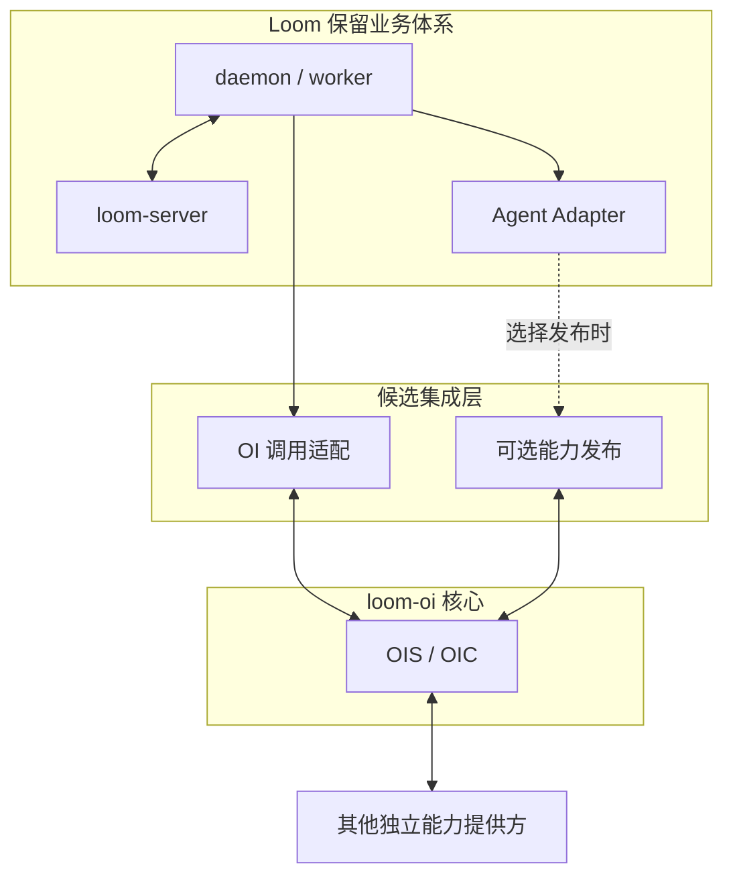

# loom-oi 分布式能力架构 · alpha 探索稿

| 项目 | 内容 |
| --- | --- |
| 状态 | Architecture Partner / Draft alpha.2，方案待用户判断 |
| 日期 | 2026-11-02 |
| 分支与基线 | `alpha`，从 `main@63c1db9` 开始 |
| 主要输入 | 2026-10-31 至 2026-11-01 微信讨论，详见[讨论蒸馏](alpha-discussion.md) |
| 代码现状 | loom-oi 尚无实现；Loom 仅参考本地 `58b7178` 快照，非最新主干审计 |
| 正式决议 | 本轮未新增；本文不可直接视作已冻结的实现规格 |
| 方案与问题 | [方案 v2](proposals/alpha-solution-design.md) 与 [Issue 规划](alpha-issues.md)；已展开机制/反例，仍无新的人类架构决议 |

本文直接演进原架构文档，收回原稿未经讨论确认的 Session、调度、Agent Runtime 管理等职责。旧内容保留在 Git 历史，不把旧 AI 扩写当作团队承诺。

文中 **【共同方向】** 指聊天双方明确相互认可的意图，不等于用户已批准本稿；**【待决策 Dn】** 指仍有分歧或只出现单方提议；**【AI 建议】** 指本轮推演。除明确列出的共同方向外，组件拆分、接口和实验均为 AI 建议。

## 1. 产品目标与范围

### 1.1 共同方向

**loom-oi 连接能力的提供方和使用方，使受控能力能够被登记、发现并跨网络访问。**

- 聚焦能力接入与连接，不拥有 Agent 的推理循环、上下文或业务会话。[C1、C2](alpha-discussion.md#3-已识别的共同方向)
- 能力实现独立于 OI；Loom 或 Magpie 可以接入，但不成为核心必需依赖。[C3](alpha-discussion.md#3-已识别的共同方向)
- 目录登记的是提供方暴露的能力，不意味着 OIS 自己经营模型、工具或 MCP Server 平台。[C4](alpha-discussion.md#3-已识别的共同方向)
- 小规格机器可以只运行轻量接入端，不要求同时部署 OIS。[C5](alpha-discussion.md#3-已识别的共同方向) “轻量”对应哪些层级与部署成本仍待讨论。

AI 可以是调用者；脚本、CLI 和普通应用也可以。OI 的基础管理、发现和连接不需要调用 LLM。

### 1.2 本轮不纳入核心职责的内容

Agent 生命周期、模型选择、业务任务调度、Channel / Thread、Agent Session、上下文记忆和工作流由上层系统或具体能力实现拥有。运行一个 Agent CLI 的适配器可以作为能力接入，这不使 OI Core 成为 Agent 平台。

原稿中的自动能力组合、多组织联邦、全局成本优化、通用 Artifact / Workspace / Checkpoint 平台缺少本轮讨论依据，移出本次候选范围；是否以后研究另由用户决定。

**【待决策】** 本地能力进程的启动/停止、官方 MCP 入口、透明通道之外的统一调用适配，不能仅凭“不碰业务”四个字决定去留。见 D1、D4、D5。

## 2. 职责与总体结构

### 2.1 总体图

**图 1：共同职责边界；内部模块为 AI 建议。** OIS / OIC 沿用聊天中的名称。图表示逻辑分工，不规定服务数量、仓库布局或传输优先级。



OIC 部署在受控环境，仍由 loom-oi 提供。受控方通常只实现具体能力或安装现有适配器。控制方不必为了发起调用而注册成能力提供节点；调用 SDK 与受控 OIC 可以共用库，不必共用所有职责。

### 2.2 开发与运行责任

| 部分 | loom-oi 提供 | 接入方负责 | 边界 |
| --- | --- | --- | --- |
| OIS | 登记、目录、连接协调；候选访问策略接口 | 部署配置、接入组织身份 | 不理解任务目标和 Agent 上下文 |
| OIC | 身份、连接、状态上报、本地分发；候选扩展契约 | 安装、配置允许暴露的能力 | 不默认启动大模型或完整 Agent Runtime |
| 能力实现 | 可选通用示例或官方扩展 | 自定义逻辑、业务错误、句柄及资源并发 | OI 不能凭网络隔离保证业务隔离 |
| 协议适配 | 若采用 D1-B，提供可选适配层 | 声明真实协议、版本与操作 | 不强制把所有协议翻译成同一种业务模型 |
| 控制方集成 | 发现/连接 SDK、CLI；MCP 是否提供待 D5 | 选择目标、规划、上下文、业务重试 | 不把调用方全部对象导入 OIS |

### 2.3 OIS / OIC 的候选最小职责

OIS 保存接入主体、授权可见的能力声明、配置版本和有限的在线状态；协调连接并返回可用访问方式。OIC 注册能力、维持必要通信、把请求交给允许的本地目标，并报告接入与能力健康状态。

连接层可与 OIS 同进程部署，也可单独部署中继。进程合并是部署选择，不改变职责。能力启动管理可成为可选模块；只有登记、连接和状态并不要求附带部署平台。

## 3. 对象模型与命名

### 3.1 先对齐真实事物

**【待决策 D2】** 聊天中的 Node 曾指能力包、逻辑集合、宿主机；Workload 也曾被用于宿主机或独立能力运行体。没有形成稳定对应关系。不能选取其中一句覆盖其他观点。

| 实际事物 | 必须区分的职责 | 候选命名与处理 |
| --- | --- | --- |
| 宿主或可访问环境 | 说明能力运行/可达的位置 | Host；是否同时称 Node 待定 |
| 接入主体 | 谁注册、谁持有连接和身份 | OIC registration；可能映射 Node |
| 能力提供单元 | 一个可独立接入的进程、扩展或外部服务实例 | Provider / Workload / Node，名称待定 |
| 对外能力与操作 | 说明可做什么、输入输出和调用协议 | Capability + Operation，或一个操作一个 Capability |
| 物理连接或逻辑流 | 承载请求与响应 | Connection / Stream，不代表业务 Session |
| 业务资源 | 浏览器 tab、桌面、游戏世界、Agent run | 提供方定义的句柄，不由 OIS 统一建模 |

“App”可以作为用户界面的友好名称，但它不能自动解决一个包、多实例、多机器的身份关系。命名应在实际调用例子跑通后确认。

### 3.2 对象关系候选

**图 2：【AI 建议】用职责表达关系，不冻结 Node / Workload 术语。** 图中“提供单元”是解释用语，暂不增加正式产品对象层。



【AI 推荐 v2】Node 表示接入身份边界，Provider 表示可独立寻址的实例，Workload 仅在托管进程时出现；Host 只作位置元数据，不强制一机一 Node。已展开三场景映射、稳定ID、connection_epoch 与 incarnation 的区别，见 [S2](proposals/alpha-solution-design.md#s2)。另一候选仍是 Node=能力实例；增加 Provider 的术语成本及取舍由 D2 判断。

不论采用哪套命名，都应分别识别声明、实例、位置与连接；“一个对象 ID”不应同时承担这四种身份。

### 3.3 Agent 视角的映射

以下粒度是 **AI 候选**，不是聊天确认的 Capability 定义：

| 用户要做的事 | 控制方需要看到 | 受控方理解 | OI 不需要理解 |
| --- | --- | --- | --- |
| 操作指定电脑 | `desktop-home` + `computer.use` + `click` | 桌面、坐标、焦点和权限 | Agent 为什么点击 |
| 诊断跳板机 | `bastion-1` + `host.inspect` + `connections` | 本机诊断实现与数据范围 | 是否构成攻击、下一步如何处置 |
| 控制虚拟手机 | `phone-1` + `phone.control` + 操作 | 手机实例、应用会话和资源规则 | 微信/QQ 对话上下文与回复策略 |
| 使用已有 HTTP / MCP 服务 | 提供实例 + 协议/契约 | 服务自己的接口和状态 | 上层如何组合业务 |

`computer.use` 可作为能力组，`click` 是操作；也可把每个操作分别注册。两种方案都能成立，但不能在同一份协议里混用。消费方主要选择实例与操作，通常不需要知道底层部署对象。

## 4. 通信与适配边界

### 4.1 两个独立选择

“OI 是否理解工具协议”和“数据是否经中心转发”是两条独立轴。统一工具入口可以走直连，透明协议也可以经中继。不能把它们捆成一项选择。

| 问题 | 候选 A | 候选 B | 影响 |
| --- | --- | --- | --- |
| D1：调用抽象 | 只登记能力/协议端点，提供透明通道 | 透明通道外增加可选工具调用适配 | A 的协议兼容负担小，调用方自行适配；B 接入更方便，但需维护协议版本与错误/流式语义 |
| D3：网络路径 | 首版中转，通过 OIS 协调的中继访问 | 直连优先，不可达时中转 | A 验证链路少但承担带宽与延迟；B 可减少中转流量但增加协商、诊断与回退工作 |

**【AI 推荐 v2】** 调用层采用连接内核与可选适配分离，网络首版采用反向中继并预留 RoutePlan 接口。两项推荐可独立接受或修改，未批准双路径实现。具体调用/版本边界见 [S3](proposals/alpha-solution-design.md#s3)，建连、背压及回退机制见 [S4](proposals/alpha-solution-design.md#s4)。

### 4.2 控制与数据的关系

- 控制信息：注册、配置、能力元数据、健康、访问策略与连接协商。
- 能力流量：请求、响应、流式数据或原生协议字节。
- 业务事件：由能力提供方发出，接收和触发 Agent 的逻辑归调用方；OI 不因此成为工作流引擎。

逻辑分离不要求一开始独立部署服务，也不要求把旧稿六种 Channel 全部实现。承载流式数据不意味着 OI 必须持久化 Agent 事件日志。

### 4.3 透明与可检查的边界

透明中继可以按已验证身份、目标和通道额度管控流量；若载荷端到端加密且中继不解析，就不能声称中继能逐个校验 `click` 等操作。操作级授权必须由能理解协议的适配器或提供方执行，并绑定真实调用主体。

若采用统一工具适配层，它可以解析协议、校验 Schema、映射错误和流式响应，但不接管业务状态。注册一个 MCP 接口和运营通用 MCP 工具平台是不同范围。

### 4.4 外部服务接入

已有 HTTP / MCP 服务无需安装 OIC 到服务本身；可由有网络访问权限的连接器登记并访问。该连接器可以运行在 OIC 所在环境，或其他获准的网关环境。

这是一种已有服务的接入方式，不表示远程服务没有运行实体，也不使 OI 自动拥有其启动、升级和重启权限。能力端点由管理员配置或受控注册，不能接受调用方任意指定内网 URL。

## 5. 状态与隔离

### 5.1 区分四种状态

| 状态 | 例子 | 候选归属 | 是否可因“不管 Session”而删除 |
| --- | --- | --- | --- |
| 管理状态 | 注册、配置、能力声明、访问策略 | OIS 持久化，OIC 应用/上报 | 否 |
| 通信状态 | 连接、路由、流控、重连、在途请求 | 连接层与 OIC，通常短期 | 否 |
| 提供方状态 | 进程是否就绪、协议会话、资源句柄、操作锁 | 提供方；适配器保留必要协议状态 | 否，但不要求 OIS 拥有全部状态 |
| Agent/业务状态 | 对话、任务步骤、规划、业务检查点 | 控制方或具体业务服务 | 不属于 OI Core |

**【共同方向 C2】** 不管理 Agent 会话。**【AI 建议】** 同时撤销原稿通用 `Execution Session` 的必需地位：普通调用不必先创建 OI Session。需要长任务或恢复的提供方可返回自己的任务/资源句柄，由控制方按能力契约继续访问；OI 仅路由和传输。

### 5.2 关于 MCP 的事实核对

聊天中“今年改成无状态”有对应依据：MCP `2026-07-28` 移除了协议级 Session；`2025-11-25` 仍允许服务端分配 Session ID。适配器须声明支持版本，不能假设所有存量服务同时升级。[MCP 2026 规范](https://modelcontextprotocol.io/specification/2026-07-28/basic/transports/streamable-http)、[MCP 2025 规范](https://modelcontextprotocol.io/specification/2025-11-25/basic/transports)。

新协议仍支持请求内的 SSE 流；官方说明也明确允许应用用显式句柄保留状态。因此“无协议 Session”不推出“没有长连接”或“所有工具无状态”。[官方版本说明](https://blog.modelcontextprotocol.io/posts/2026-07-28/)。这是技术校核，不是替团队选择 OI 协议。

### 5.3 隔离要对准故障来源

| 要隔离什么 | 可能机制 | 不能保证什么 |
| --- | --- | --- |
| 某次请求阻塞 | 独立队列、超时、有界并发/流控 | 不能隔离进程崩溃 |
| 能力进程崩溃 | 独立子进程/外部服务和监督策略 | 不隔离宿主故障，也不自动隔离桌面资源 |
| 单条连接故障 | 重连、连接池、按容量拆分 | 不保证在途副作用未发生 |
| 同一桌面/游戏世界被并发操作 | 提供方按真实资源串行、互斥或拒绝冲突 | 独立 TCP/QUIC 流或不同 request ID 都不能替代资源控制 |

【AI 建议】默认可独立接入的能力实现；是否由 OIC 托管子进程见 D4。进程内插件可以更省部署步骤，但必须明确共享崩溃边界。所谓“非阻塞 extension”不是进程隔离的证明。

UDP / P2P 并不自动消除共享故障。QUIC 可多路复用流，但仍有连接级状态和流控；不能把它当成任意业务隔离的保证。[RFC 9000 §2、§4、§5](https://www.rfc-editor.org/rfc/rfc9000.html)。

### 5.4 授权与资源占用分开

原稿 Lease 混合了访问许可和独占资源锁。**【AI 建议】** 普通调用只要求有效访问授权；需要独占的能力由提供方按资源键实施互斥、租期或 fencing。是否提供通用辅助库见 D6，不设统一租约为所有调用的前置步骤。

`tab_id` / `desktop_id` 可以定位资源，但 ID 本身不证明所有权，也不会自动阻止两个调用者同时操作。同一资源被多个能力进程访问时，互斥需要在真正共享的资源边界执行。

## 6. 候选契约

本节为 **AI 建议，非可执行 API 或已实现配置**。D1 / D2 尚未决定，因此不冻结字段名、URL 和二进制格式。

### 6.1 登记信息

| 信息 | 用途 |
| --- | --- |
| 注册身份、所有者、提供实例 ID | 区分谁接入、谁提供能力、谁可管理 |
| 协议名称与版本 | 声明透明连接或适配器所需的协议 |
| 能力说明与操作 Schema（若支持） | 可发现、可描述；避免只给一个模糊名称 |
| 配置/契约版本与有效期 | 控制目录缓存过期和变更 |
| 本地目标引用 | 由接入端解析；不向调用方暴露底层凭证 |
| 接入在线、能力健康、就绪状态 | 区分连接存在与能力可用 |
| 访问策略及提供方并发声明 | 支持允许/拒绝和资源限制；声明不等于执行保证 |

候选配置示意：

```yaml
design_status: alpha-proposal
registration_id: access-home
providers:
  - id: desktop-home
    target_ref: local-desktop-service
    lifecycle: external
    protocol: example-desktop-rpc/v1
    capabilities:
      - name: computer.use
        operations: [screenshot, click]
    concurrency_owner: provider
```

`external` 表示 OI 不拥有该服务的进程生命周期。声明支持 `click` 不代表已经授予任意调用者桌面写权限。配置不包含 Provider API key 或聊天内容。

### 6.2 调用或连接入口

- 共同需要：发现、读取契约、请求获准的访问方式、建立连接、关闭连接。
- D1-A：调用方拿到获准通道后，使用提供方原生协议。
- D1-B：适配层额外提供统一调用入口，可承载下面的路由元数据。

```json
{
  "design_status": "alpha-proposal",
  "request_id": "req-001",
  "target": {
    "provider_id": "desktop-home",
    "capability": "computer.use",
    "operation": "click",
    "contract_version": "1"
  },
  "timeout_ms": 5000,
  "input": {
    "resource_handle": "desktop-handle-7",
    "x": 120,
    "y": 80
  }
}
```

这是 OI 候选信封，不是 MCP 标准报文。身份从认证连接/凭证得出，不能信任用户自填 `caller`。超时由服务端限幅；资源句柄由提供方验证与调用主体的关系。`request_id` 用于关联响应，除非另有持久化去重协议，否则不保证幂等。

### 6.3 目录缓存与路由

控制方可以缓存授权范围内的目录或按需查询。不能将“启动时下载所有工具”写成强制行为：能力会离线、契约会改变、权限会撤销，过期目录也不能继续作为授权依据。

OIS 负责控制面可见性和访问决策；实际执行处仍需落实有效授权与本地限制。直连下的短期凭证、在线校验或撤销传播方案及其撤销时延，需要随 D3 一起确定，当前不承诺瞬时撤销。

### 6.4 协议与凭证

具体传输、序列化、认证方案暂不选型。可评估 HTTP、WebSocket、QUIC 等，但不能仅因使用 UDP 就声称完成 NAT 穿透。连接协商、网络可达性与权限校验分别验证。

提供方的模型账户、应用凭证保留在提供方或获准连接器。OI 可以持有它自身的接入身份与访问凭证，两者不能混为共享模型凭证池。

## 7. 调用与故障处理

### 7.1 代表性调用时序

**图 3：【AI 建议】中转 + 工具适配的一条示例路径，非首版路径决议。** 为控制参与者数量，将可选适配器与调用方画在同一参与者中；中转模块与 OIS 合并展示，不要求同进程。



若采用透明通道，流中传递原生协议，OI 不负责识别每次业务操作。若采用直连，OIS 完成发现/访问协调后，能力流量由调用端直达接入端；同样需要提供方鉴权，不能绕过本地约束。

### 7.2 路由稳定性不等于业务成功

| 情况 | OI / 适配层行为建议 | 控制方 / 提供方行为 |
| --- | --- | --- |
| 未交付到目标 | 返回离线、路由失效或拒绝 | 允许按显式策略重新发现/尝试 |
| 请求已发出，响应丢失 | 报告结果未知；保留有限关联信息 | 查询提供方操作状态，不能直接再点一次 |
| 连接重建 | 重新认证、登记并刷新路由 | 不自动重建业务上下文 |
| 契约版本变化 | 返回不匹配，刷新描述 | 更新工具输入，不猜参数 |
| 提供方失败 | 标记该实例不可用 | 是否重启由生命周期所有者决定 |
| 流中断 | 报告流中断 | 仅在提供方支持时按其游标/句柄恢复 |
| 访问被撤销 | 按选定授权机制拒绝后续访问 | 已生效的业务副作用无法由撤销自动回滚 |

中转切直连或直连切中转只能改变后续路径，不应隐式重放在途副作用操作。若原生透明协议无法判断“是否交付”，只能报告通道中断，不能伪造精确执行状态。

【AI 建议】区分 `target_unavailable`、`forbidden`、`contract_mismatch`、`outcome_unknown` 等错误；不提供笼统的“失败就重试”。持久化操作状态、业务补偿和 exactly-once 不属于普通隧道自动具备的保障。

## 8. 部署与场景映射

### 8.1 轻量与独立部署

讨论中的小机器目标是 **1 核 1 GB 环境可以只放 OIC**，不是要求该机器同时运行 OIS、大模型和桌面服务。语言、二进制大小、RSS、CPU、连接数与重连开销需要测量，当前没有性能承诺。

【AI 建议】以独立 OIC + 外部能力作为验证形态；如需要嵌入式 SDK 或进程托管，再逐项比较收益。SDK 形态、独立 CLI、同进程部署和逻辑分层并不互斥，但首版同时实现所有形态会增加维护面。

### 8.2 现实场景

| 场景 | OI 承担 | 具体能力/上层承担 |
| --- | --- | --- |
| 跳板机排查 | 找到接入端、建立获准访问、传输结果 | 诊断命令及权限、AI 判断、监控界面 |
| Computer Use + File Use | 分开登记和路由，验证互不阻塞的机制 | 桌面焦点、文件一致性、共享资源锁 |
| HTTP / MCP 外部服务 | 通过可达连接器登记与访问 | 原生协议、凭证、业务状态和部署生命周期 |
| 虚拟手机上的微信/QQ机器人 | 暴露手机/应用控制能力及必要事件通道 | Hook、消息语义、触发 Agent、上下文与回复逻辑 |
| 新闻收集 | 可连接已有收集能力，作为多实例讨论的例子 | 抓取、去重、订阅、调度及通知产品 |

虚拟手机是记录中明确依赖 OI 的场景；不能由此推导 OI 要内置微信/QQ机器人。新闻产品与自定义 App 愿景只提供消费端上下文，不进入本轮 OI 需求清单。

## 9. 与 Loom 及已有服务的集成

### 9.1 源码所显示的事实

参考 `wyw-ai/loom@58b7178` 本地快照：

| 位置 | 可核对事实 | 对本轮的影响 |
| --- | --- | --- |
| [daemon.rs](https://github.com/wyw-ai/loom/blob/58b7178/crates/cli/src/cmd/daemon.rs) 的 `reconcile_agents` | 依据 Agent 配置启动/停止 worker，并涉及 actor 清理 | daemon 不是纯连接器，不能整体改名为 OIC Core |
| [agent_serve.rs](https://github.com/wyw-ai/loom/blob/58b7178/crates/cli/src/cmd/agent_serve.rs) 的 worker、路径及 prompt 处理 | 包含作用域、工作区、会话目录和调用 Adapter 的逻辑 | 属于 Loom 集成或运行能力实现的候选保留位置 |
| [adapter.rs](https://github.com/wyw-ai/loom/blob/58b7178/crates/agent-runtime/src/adapter.rs) | `AdapterPrompt` 携带 scope、cwd、env 等；接口包含启动、提示、取消和模型配置 | 不能用这套业务接口充当 OI 通用能力协议 |
| [server handlers](https://github.com/wyw-ai/loom/blob/58b7178/crates/server/src/handlers/mod.rs) | 处理 channel、thread、task 等协作方法 | 保持这些对象在 Loom 一侧 |

该快照的 `docs/architecture.md` 写 server 不链接 `agent-runtime`，但 Cargo.toml 实际仍声明该依赖，`main.rs` 用于 tracing 初始化。不能据旧文档断言物理依赖已经完全剥离，也不能仅凭该依赖就断言 server 运行 Agent 推理循环。

### 9.2 集成边界候选

**图 4：【AI 建议】展示未来职责，不代表已完成迁移。** 本轮不改 Loom 仓库、不确定单仓/多仓、不删除 daemon。



【AI 建议】先让 Loom 通过小型适配层调用一个外部能力，证明 OI 可以独立工作；再判断 daemon 中哪些纯接入代码值得复用。即使未来提供官方 Agent Runtime 扩展，它的业务状态也留在扩展/原运行时，不进入 OI Core。

### 9.3 Magpie 等现有服务

聊天确认不将 Magpie 耦合进 OI。它可作为已有服务的接入样例；实际能力、端点、认证和协议版本须按接入时源码/API 验证。本轮未重新审计 Magpie，因此删除原稿未经核实的固定 `model.catalog / model.routing` 接口承诺，也不规定必须由 OI 启动它。

本轮不选型或实现 open-connector 集成；聊天中的仓库链接只是候选线索，不能自动变成依赖。

## 10. 验证顺序与验收建议

**【AI 建议】下列是待批准的实验清单，尚未执行，也不是承诺排期。**

| 顺序 | 要回答的问题 | 可检验的结果 |
| --- | --- | --- |
| 1 | 没有 Agent / LLM 能否使用 OI | 脚本发现并调用一个低风险能力，收到明确结果 |
| 2 | 目录、权限与目标状态是否一致 | 未授权目标不泄露；撤销和离线按声明时限生效；缓存过期可识别 |
| 3 | 两个独立能力是否互相拖累 | 阻塞/杀死测试能力 A，测量 B 的延迟、错误率与宿主影响 |
| 4 | 共享业务资源由谁保证 | 两调用者操作同一模拟桌面，提供方明确串行或拒绝；OI 不制造两个“隔离桌面”的假象 |
| 5 | 在途故障是否导致重复操作 | 执行后丢响应，观察 `outcome_unknown` 或原生通道错误，不自动重放 |
| 6 | 小机器接入成本多大 | 在 1C1G 环境分别记录 OIC 与能力进程的大小、RSS、CPU、连接及重连资源消耗 |
| 7 | 中转和直连收益如何 | 同局域网、跨 NAT、受限出口下比较建连率、p50/p95 延迟、吞吐、中转流量与诊断成本 |
| 8 | 集成是否侵入业务核心 | Loom 或另一个控制方接入时，无需把 Actor/Channel/Session 加进 OI 核心模型 |

D1/D2 决定接口和模型后才能冻结调用规格；D3 决定首版传输验收；D4/D6 决定故障与资源隔离承诺。没有证据时不设置 99.9%、固定内存上限或“零改造接入”等产品承诺。

## 11. 本轮变更与继续讨论

本轮将“统一执行平台”的旧稿收敛为围绕接入、目录和连接的探索文档；四张旧图已替换为上述可编辑关系图。保留业务无关的基础机制，移出未经讨论确认的平台职责，分开通道、调用与业务状态。

但 **透明通道还是可选工具适配、对象命名、传输优先级和托管范围尚未决定**。后续按[待决策清单](alpha-discussion.md#6-待决策清单)逐项推进；用户确认前不写 Accepted ADR、不合并 main，也不据此启动全面实现。

### 11.1 方案、Issue 与知识联动

v2 已把研究待办深化为可评审方案。下面的设计全部为 AI 提案，已有31个正常/反例的纸面推演，未运行网络、资源或副作用实验；确认与运行验证仍需分别记录。不会因更新文档而默认选定架构。

| 架构内容 | 当前具体解法 | 方案 / Issue |
| --- | --- | --- |
| §3/§6.1 对象和登记 | 稳定接入/实例身份，重连epoch与进程incarnation分开；可选Workload | [S2](proposals/alpha-solution-design.md#s2) / [#2](https://github.com/wyw-ai/loom-oi/issues/2) |
| §2/§4/§6 调用和入口 | Discover/Authorize/Connect内核，外置可选适配与能力支持矩阵 | [S3](proposals/alpha-solution-design.md#s3) / [#3](https://github.com/wyw-ai/loom-oi/issues/3) |
| §4/§6.4 网络 | OIC反向登记/连接，中继首版，按流与节点限额，路径固定到关闭 | [S4](proposals/alpha-solution-design.md#s4) / [#4](https://github.com/wyw-ai/loom-oi/issues/4) |
| §4.3/§6 授权与撤销 | 目标绑定短期授权，执行侧校验；长流到期与在线/有界离线语义 | [S5](proposals/alpha-solution-design.md#s5) / [#5](https://github.com/wyw-ai/loom-oi/issues/5) |
| §5.1/§6.2/§7 失败 | 通道/尝试/操作分开，unknown不重放，提供方去重与崩溃缝隙明确 | [S6](proposals/alpha-solution-design.md#s6) / [#6](https://github.com/wyw-ai/loom-oi/issues/6) |
| §5.3–5.4 生命周期/并发 | Provider独立额度，资源网关串行或拒绝，监督器可选 | [S7](proposals/alpha-solution-design.md#s7) / [#7](https://github.com/wyw-ai/loom-oi/issues/7) |
| §8.1 轻量 | 可裁剪独立OIC，流/节点全局预算，进程分开计量 | [S8](proposals/alpha-solution-design.md#s8) / [#8](https://github.com/wyw-ai/loom-oi/issues/8) |
| §9 Loom集成 | 业务侧consumer bridge，先脚本低风险闭环，保留daemon职责 | [S9](proposals/alpha-solution-design.md#s9) / [#9](https://github.com/wyw-ai/loom-oi/issues/9) |

详细机制只在对应提案维护；Issue 保持可独立讨论的摘要与实时进展。[统一 prompt](prompts/architecture-partner.md) 规定求解方法，[KB](../kb/README.md)维护来源与状态，[决策台账](../kb/decisions.md)追踪人类确认。更新时检查旧图、契约、索引和关联 Issue 的影响，不复制成另一套正式架构。
