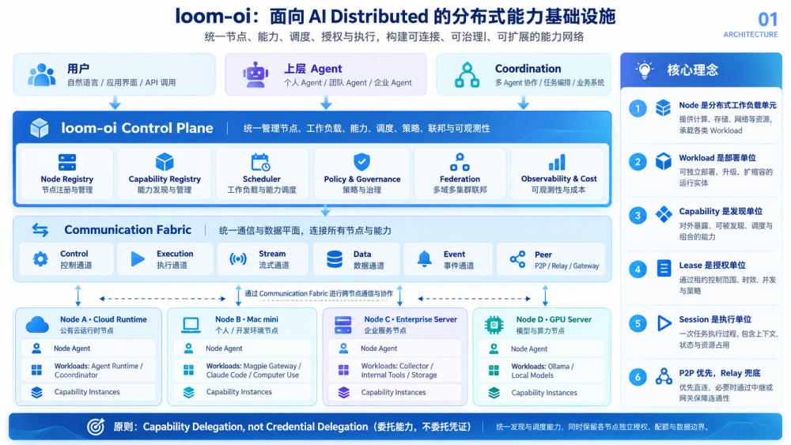
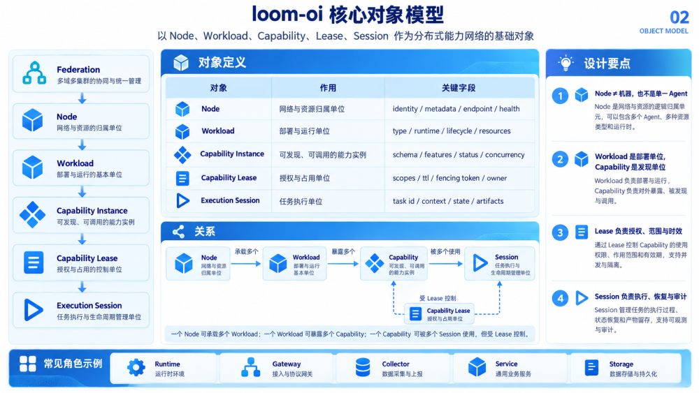
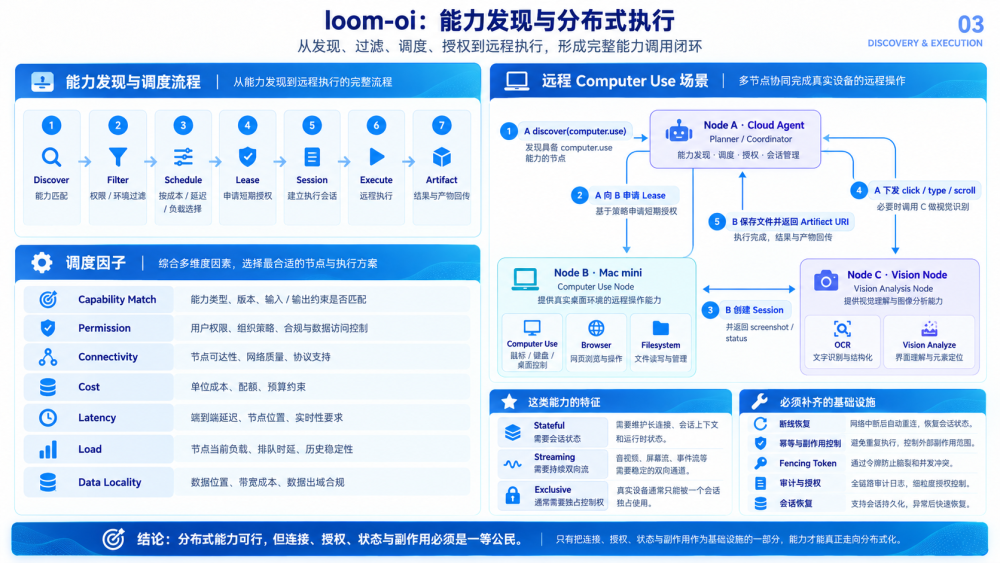
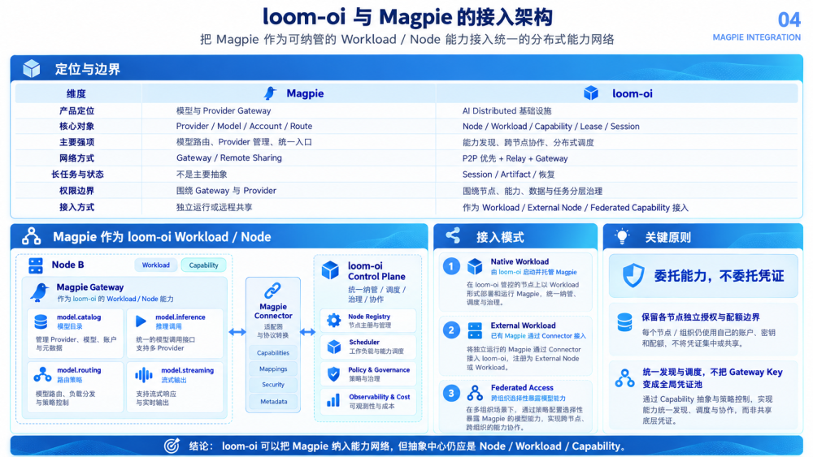
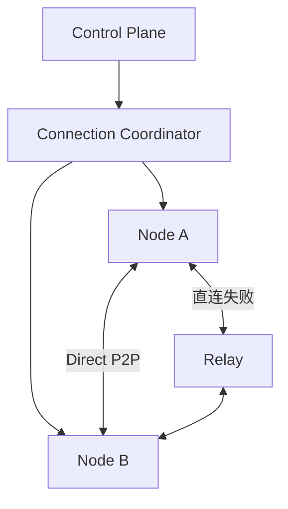
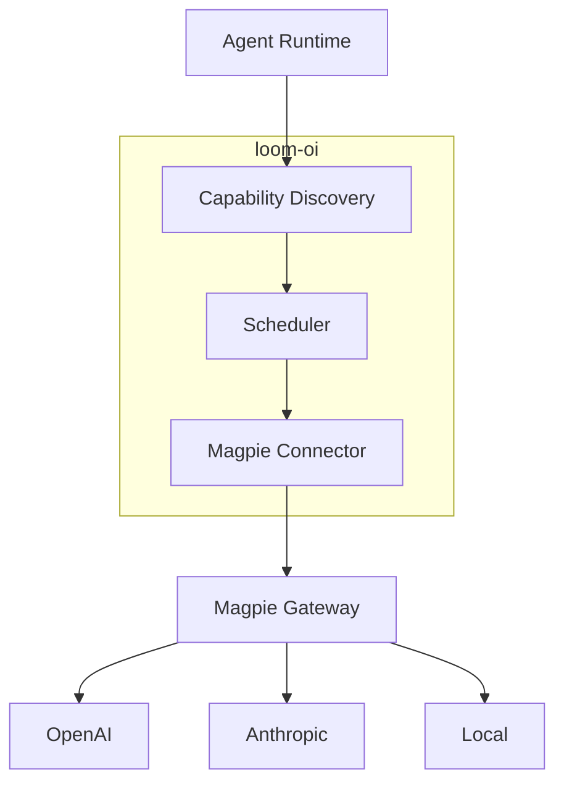

# loom-oi 分布式能力架构与 Magpie 接入结论

本文收录《对比AI分布式架构与Magpie【备份】》所关联的《loom-oi_架构细节说明_正式合并版.docx》，保留完整方案正文、示例和附录，并在文首先归纳结论。

| 文档信息 | 内容 |
| --- | --- |
| 来源 | loom-oi_架构细节说明_正式合并版.docx |
| 源文档版本 | Draft v0.2 |
| 整理日期 | 2026-10-31 |
| 性质 | 备份讨论的架构方案记录，非已实现功能说明 |
| 整理范围 | 保留技术内容；合并续篇衔接与重复段；恢复代码缩进；将文本关系图转换为表格、列表或 Mermaid |

## 结论摘要

该方案将 loom-oi 定义为面向异构 AI 能力的分布式基础设施。其目标是让不同机器、网络、运行环境与供应商中的能力可以被发现、连接、授权和调用。

1. **对象分工明确。** Node 是网络和资源归属单位；Workload 是部署和运行单位；Capability 是发现和调用单位；Lease 是授权和占用单位；Session 是执行和恢复单位。
2. **控制与数据传输分离。** Control Plane 维护目录、策略、调度和状态视图；Communication Fabric 承载控制、执行、流、数据、事件与节点互联；实际能力由 Distributed Nodes 提供。
3. **Magpie 作为 Gateway Workload 接入。** 支持由 loom-oi 管理的 Native Workload、已有服务的 External Workload，以及跨组织开放的 Federated Capability。
4. **保留模型网关职责。** 按该方案的分工，Magpie 负责 Provider 管理、模型路由和模型调用；loom-oi 负责实例发现、节点选择、授权与跨节点连接。具体接口与功能仍以接入时的实际能力为准。
5. **委托能力，不转交凭证。** 供应商凭证和配额保留在能力提供方；执行必须同时满足中心授权与本地策略，网络可达不代表具有调用权限。
6. **直连优先，中继保证回退路径。** 节点主动接入控制面，节点间尝试 P2P；无法直连时使用 Relay 或 Gateway，不假设所有 NAT 环境都能打洞成功。
7. **执行状态与副作用需要单独治理。** Session、事件日志、Artifact、Checkpoint、幂等和 Fencing Token 用于跟踪及恢复。第三方 Runtime 不支持恢复时，不能承诺恢复其原有执行上下文。
8. **分阶段验证。** 首先打通云端 Agent 调用 Mac mini 上 Magpie、Claude Code、Computer Use 的链路；完整联邦、自动能力组合、全局调度和共享文件系统属于后续范围。

## 与仓库既有文档的关系

仓库已有的 [OIC/OIS 总体架构](architecture.md)、[OI 技术评审](oi-technical-review.md) 和 [Loom 集成方案](integrations/loom.md) 聚焦受控端管理。本文保留备份方案更广的分布式能力设计，不将两种范围合并为同一套已确定的实现规格。

| 维度 | 本文收录的备份方案 | 既有 OIC/OIS 方案 |
| --- | --- | --- |
| 主要范围 | 能力发现、连接、授权、调度与执行 | 受控端纳管、能力暴露、授权绑定、配置与状态 |
| 核心对象 | Node / Workload / Capability / Lease / Session | Endpoint / Capability / Binding |
| 执行职责 | 定义分布式 Execution Session、事件和产物模型 | Agent、Task、Run 和协作执行由 loom-server 等集成平台负责 |
| 连接职责 | Control Plane、Peer、Relay、Federation | OIC 连接 OIS，集成层可复用 Loom 传输 |

本文中的任务生命周期、Session、事件路由和自动能力组合属于备份方案的设计内容，不能据此视为已决定由 OIS 接管 loom-server 的 Agent、频道或任务体系。后续实现需要明确采用范围及对象映射。

## 阅读导航

- [项目定位](#1-项目定位)与[核心对象模型](#3-核心对象模型)
- [分布式通信](#6-communication-fabric分布式通信基础设施)与[协议体系](#7-协议体系与兼容层)
- [Magpie 接入架构](#11-magpie-接入架构)
- [实施路线](#17-实施路线)与[最终架构总结](#21-最终架构总结)
- [核心架构决策](#附录-c核心架构决策architecture-decision-records)与[v0.1 最小可行架构](#附录-ev01-最小可行架构)

## 源文档架构图

以下四图随源文档收录；图中文字沿用原方案，具体语义以正文说明为准。









Architecture Design & Technical Specification

| **文档属性** | **内容**                                                    |
|--------------|-------------------------------------------------------------|
| 项目名称     | loom-oi                                                     |
| 文档类型     | 总体架构设计与技术解构                                      |
| 架构版本     | Draft v0.2                                                  |
| 核心定位     | AI Distributed Infrastructure                               |
| 核心原则     | Capability Delegation, not Credential Delegation            |
| 核心对象     | Federation / Node / Workload / Capability / Lease / Session |

## 1. 项目定位

### 1.1 建设目标

loom-oi 是面向 AI Distributed 的分布式能力基础设施。

它将分散在不同机器、网络、运行环境和供应商中的 AI 能力统一纳入一个可发现、可连接、可调度、可授权、可执行的能力网络。

这些能力包括但不限于：

- AI 模型及模型供应商。
- Agent Runtime 和 Coding Agent。
- MCP Server 和 Tool。
- Computer Use、Browser Automation。
- GPU 算力及本地模型。
- 文件系统、Workspace、Memory。
- IM Listener、Webhook、MQ Consumer。
- 企业内部服务和业务系统。

loom-oi 不要求这些能力采用相同的运行时、操作系统、模型供应商或部署方式。

它通过统一的 Node、Workload、Capability 和通信协议，将异构能力纳入统一管理。

### 1.2 核心目标

1.  **统一纳管：** 将不同机器、不同运行环境中的工作负载注册到统一网络。
2.  **能力发现：** 让 Agent 能够发现其他节点提供的能力，而不需要提前知道其具体地址和实现。
3.  **分布式调用：** 允许能力跨机器、跨网络、跨组织进行调用和协作。
4.  **统一治理：** 提供身份、权限、配额、审计、调度和生命周期管理。
5.  **开放兼容：** 通过 Connector 和 Adapter 接入已有 Agent、模型网关、工具及服务，不要求重写现有系统。

### 1.3 核心设计原则

#### Node 是资源归属单位

Node 是网络中的逻辑工作负载单元，可以承载多个 Workload。

Node 不等同于物理机器，也不等同于 Agent。

#### Workload 是部署单位

Workload 是可以独立部署、运行、升级、停止和监控的运行实体。

#### Capability 是发现单位

Capability 是 Workload 对外暴露的标准化能力接口。

#### Lease 是授权单位

Lease 用于控制调用者对某个 Capability 的临时使用权，包括权限范围、有效期、并发和资源占用。

#### Session 是执行单位

Session 代表一次具体的执行过程，负责管理任务上下文、运行状态、事件和产物。

#### P2P 优先，Relay 兜底

节点之间优先建立直接连接。无法直连时，通过 Relay 或 Gateway 保证通信。

#### 委托能力，不委托凭证

loom-oi 统一发现和调度能力，但不默认接管能力提供者的身份凭证、订阅账号和配额。

## 2. 总体架构

loom-oi 由 Control Plane、Communication Fabric 和 Distributed Nodes 三个主要部分组成。

### 2.1 Control Plane

Control Plane 是整个能力网络的管理和决策中心。

主要模块：

| **模块**             | **职责**                       |
|----------------------|--------------------------------|
| Node Registry        | Node 注册、身份和生命周期管理  |
| Workload Registry    | Workload 部署和运行状态管理    |
| Capability Registry  | 能力注册、发现、版本和状态管理 |
| Scheduler            | 工作负载和能力调度             |
| Policy & Governance  | 身份、权限、策略、配额和审计   |
| Federation           | 多域、多集群之间的能力联邦     |
| Observability & Cost | 日志、指标、调用追踪和成本统计 |

Control Plane 负责管理和协调，不要求所有业务数据、Agent 消息和模型调用都经过中心转发。

### 2.2 Communication Fabric

Communication Fabric 是整个分布式网络的数据通信基础设施。

它负责连接 Control Plane 与各个 Node，以及 Node 与 Node 之间的通信。

包含六种逻辑通道：

| **Channel**       | **职责**                            |
|-------------------|-------------------------------------|
| Control Channel   | 注册、配置、生命周期、健康状态      |
| Execution Channel | RPC、Tool Call、任务委派、Handoff   |
| Stream Channel    | Token、事件、实时状态、双向流       |
| Data Channel      | 文件、Artifact、Workspace、数据传输 |
| Event Channel     | Pub/Sub、Webhook、Trigger、事件分发 |
| Peer Channel      | P2P、NAT 穿透、Relay、节点互联      |

六种通道可以共享底层连接，但需要保持独立的通信语义、权限和 QoS。

### 2.3 Distributed Nodes

Distributed Nodes 是实际提供计算、存储、模型、工具及执行能力的节点。

每个受管理的 Node 可以运行 Node Agent，也可以由 External Connector 接入。

节点可以位于：

- 用户个人电脑。
- 企业内网服务器。
- 公有云。
- GPU 服务器。
- 第三方云平台。
- 边缘设备。
- 其他 loom-oi 网络。

节点之间不要求处于同一个局域网，也不要求具有统一的网络拓扑。

## 3. 核心对象模型

loom-oi 的架构围绕 Federation、Node、Workload、Capability Instance、Capability Lease 和 Execution Session 六个核心对象展开。

### 3.1 Federation

Federation 表示多个独立能力网络之间的联邦关系。

一个组织可以拥有自己的 loom-oi 网络，并通过 Federation 向其他组织开放部分能力。

负责：

- 跨组织身份信任。
- 跨网络能力发现。
- 能力暴露范围。
- 跨组织调用授权。
- 配额与计量。
- 跨域审计。
- 信任关系撤销。

Federation 不意味着多个组织共享完整的 Control Plane。

各组织仍然保留自己的节点、凭证、策略和数据管理权。

### 3.2 Node

Node 是分布式网络中的逻辑资源归属单位。

一个 Node 可以代表一台物理机器、虚拟机、云端运行环境、远程服务实例或一个独立能力提供者。

主要属性：

| **属性**     | **说明**                |
|--------------|-------------------------|
| node_id      | 全局唯一身份            |
| owner        | 节点所属用户或组织      |
| metadata     | 标签、平台、区域等信息  |
| endpoint     | 控制面和数据面连接信息  |
| resources    | CPU、Memory、GPU 等资源 |
| health       | 在线状态和健康状态      |
| workloads    | 当前承载的 Workload     |
| capabilities | 当前暴露的能力实例      |
| trust        | 节点信任等级及认证信息  |

Node 生命周期：

`PENDING → REGISTERING → ONLINE → DEGRADED → OFFLINE → RECOVERING → ONLINE`

节点状态需要通过心跳、连接状态和健康探测共同判断，不能只依赖一次心跳结果。

### 3.3 Workload

Workload 是 Node 上实际运行的部署实体。

Workload 不限定具体技术栈。

| **Workload 类型** | **示例**                          |
|-------------------|-----------------------------------|
| Runtime           | Claude Code、Codex、Agent Runtime |
| Gateway           | Magpie、模型代理、协议网关        |
| Collector         | IM Listener、MQ Consumer、Webhook |
| Service           | MCP Server、业务 API              |
| Storage           | Artifact Server、Memory Server    |
| Compute           | Ollama、GPU 推理服务              |

Workload 负责部署和运行、配置管理、健康检查、资源管理、生命周期管理、日志和事件输出、Capability 暴露。

两种管理模式：

**Native Workload**

由 loom-oi 管理其启动、停止、升级和资源分配。

**External Workload**

由外部系统独立管理，loom-oi 通过 Connector 接入并监控。

### 3.4 Capability Instance

Capability 是能力发现和调用的基本单位。

Capability Definition 定义能力契约，Capability Instance 表示某个 Node 上实际可用的能力实例。

一个 Workload 可以暴露多个 Capability。

例如 Magpie：

- model.catalog
- model.inference
- model.routing
- model.streaming

例如 Computer Use：

- computer.screenshot
- computer.click
- computer.type
- computer.scroll
- computer.keyboard

Capability 应包含：

| **属性**      | **说明**         |
|---------------|------------------|
| capability_id | 能力实例唯一标识 |
| name          | 能力名称         |
| version       | 能力版本         |
| schema        | 输入输出 Schema  |
| features      | 支持的具体功能   |
| protocol      | 调用协议         |
| status        | 当前可用状态     |
| concurrency   | 并发能力         |
| requirements  | 执行环境要求     |
| permissions   | 所需权限         |
| owner         | 所属节点或组织   |

Capability 不应只是一个工具名称，而应当是一份完整的、可机器读取的调用契约。

### 3.5 Capability Lease

Lease 是能力使用权的临时授权凭证。

它解决两个问题：

1.  谁可以调用某个 Capability？
2.  在什么范围和时间内可以调用？

建议包含：

- lease_id。
- capability_instance_id。
- subject。
- scopes。
- issued_at。
- expires_at。
- concurrency_limit。
- fencing_token。
- policy_version。
- status。

Lease 生命周期：

`REQUESTED → APPROVED → ACTIVE → RENEWED → RELEASED / EXPIRED / REVOKED`

Lease 应支持短期授权、续租、主动释放和撤销。

对于 Computer Use 等独占资源，需要通过 fencing token 避免旧 Lease 持有者在授权过期后继续执行操作。

### 3.6 Execution Session

Session 是一次具体的执行过程。

它不仅是一个 RPC 请求，而是具有生命周期的任务执行上下文。

Session 包含：

| **属性**   | **说明**        |
|------------|-----------------|
| session_id | 会话唯一标识    |
| task_id    | 关联任务        |
| caller     | 调用者身份      |
| target     | 目标 Capability |
| lease_id   | 授权关系        |
| context    | 执行上下文      |
| state      | 执行状态        |
| events     | 事件序列        |
| artifacts  | 执行产物        |
| checkpoint | 恢复检查点      |
| timestamps | 生命周期时间    |

Session 状态：

`CREATED → ACCEPTED → RUNNING → WAITING_INPUT → SUSPENDED → COMPLETED / FAILED / CANCELLED`

Session 必须支持事件回放、断线恢复、状态查询和结果获取。

恢复 Session 不等于重新执行所有操作。对于存在外部副作用的任务，必须有幂等控制和执行检查点。

## 4. Node 内部架构

每个受管理的 Node 可以运行 Node Agent。

Node Agent 是 loom-oi 在节点侧的基础设施代理，负责把本地运行环境接入全局能力网络。

### 4.1 Node Agent 组件

| **组件**           | **职责**               |
|--------------------|------------------------|
| Identity Manager   | 节点身份、证书和密钥   |
| Connector Manager  | 控制连接、P2P 和 Relay |
| Workload Manager   | Workload 生命周期      |
| Capability Manager | 能力注册、发现和状态   |
| Runtime Adapter    | 对接不同 Agent Runtime |
| Tool Gateway       | 暴露本地工具           |
| Resource Monitor   | 监控 CPU、内存、GPU    |
| Workspace Manager  | 管理文件与工作空间     |
| Session Manager    | 管理本地执行会话       |
| Policy Engine      | 执行本地权限策略       |
| Recovery Manager   | 连接与执行恢复         |

### 4.2 Node 与 Workload 的关系

| 层级 | 组件 |
| --- | --- |
| Node | Node Agent |
| Node Agent | Identity Manager、Connector Manager、Workload Manager、Capability Manager、Session Manager、Resource Monitor |
| Workload Manager | Workload A: Magpie；Workload B: Claude Code；Workload C: Computer Use |

Node Agent 不承担 Agent 的推理循环。

它负责管理、连接和执行环境，而 Agent Runtime 负责自身的模型调用、上下文管理、工具选择和推理过程。

### 4.3 Workload 管理模式

对于 Native Workload，Node Agent 可以通过 Process、Container 或其他 Runtime Adapter 启动工作负载。

对于 External Workload，Node Agent 只负责连接、注册和健康管理。

这样既支持统一管理，也不会强迫所有第三方系统采用 loom-oi 自己的运行时。

## 5. 能力发现与调度

Capability Discovery 是 loom-oi 最核心的功能之一。

它需要解决从能力描述到实际执行节点选择的完整过程。

### 5.1 发现流程

1. Agent Request
2. Capability Discovery
3. Capability Registry
4. Capability Filtering
5. Scheduler
6. Lease Acquisition
7. Session Creation
8. Remote Execution
9. Artifact Delivery

### 5.2 静态发现

静态发现由 Capability Registry 提供。

它负责回答：

- 哪些节点存在？
- 哪些 Workload 提供目标能力？
- 能力的输入输出契约是什么？
- 支持哪些协议和功能？
- 能力属于哪个组织？

静态注册信息不应该承担实时可用性判断。

### 5.3 动态发现

动态发现负责获取：

- Node 是否在线。
- Workload 是否健康。
- Capability 是否 Ready。
- 当前负载。
- 并发占用。
- 当前排队情况。
- 网络连接状态。
- 资源是否满足要求。

动态状态需要通过心跳、事件和健康检查更新。

### 5.4 上下文发现

上下文发现负责根据当前任务过滤能力。

例如：

```yaml
capability: computer.use

requirements:
  platform: macos
  features:
    - screenshot
    - click
    - type

constraints:
  network_access: true
  interactive_session: true
  permission_required: true
```

Registry 可以找到能力，但 Scheduler 还需要判断该能力是否适合当前任务。

### 5.5 调度因子

| **调度因子**     | **说明**                     |
|------------------|------------------------------|
| Capability Match | 能力类型、版本和 Schema 匹配 |
| Permission       | 用户、组织和策略权限         |
| Connectivity     | 节点可达性和网络质量         |
| Cost             | 调用成本和预算               |
| Latency          | 端到端延迟                   |
| Load             | 当前负载和排队时间           |
| Data Locality    | 数据位置及出域约束           |
| Reliability      | 节点历史稳定性               |
| Availability     | 当前资源可用情况             |

调度不应该只选择距离最近的节点。

例如，某个数据必须留在企业内网，那么即使云端节点性能更高，也不能把数据直接发送到云端。

### 5.6 显式能力组合

不同 Capability 可以被组合成一个更高层能力。

例如：

`computer.use` 组合 `computer.screenshot`、`vision.analyze` 和 `filesystem.write`。

第一阶段建议采用显式组合，由 Agent 或 Coordination Definition 指定组合关系。

后续再考虑自动能力组合、动态规划和组合优化。

## 6. Communication Fabric：分布式通信基础设施

Communication Fabric 是 loom-oi 实现真正分布式化的基础。

它不仅需要传递消息，还要负责远程执行、持续连接、数据传输和节点发现。

核心设计目标：

1.  节点可以在公网、NAT、企业内网等不同网络环境下接入。
2.  节点不需要暴露公网入站端口。
3.  节点之间可以直接建立安全连接。
4.  无法直连时可以自动切换 Relay。
5.  控制面和业务数据面相互解耦。
6.  长任务和实时交互能够在网络波动时恢复。

### 6.1 Control Channel

Control Channel 负责节点与 Control Plane 之间的管理通信。

主要职责：

- Node 注册和注销。
- Node 身份认证。
- Workload 状态上报。
- Capability 注册与更新。
- 配置同步。
- 健康状态和心跳。
- 调度指令接收。
- Lease 更新和撤销通知。
- 连接协商信息交换。

建议采用：

- HTTPS：注册、配置、查询等短请求。
- WebSocket 或 gRPC Bidirectional Streaming：节点与 Control Plane 的持续双向通信。

#### 6.1.1 连接模型

Node Agent 主动向 Control Plane 建立出站连接。

Node A、B、C、D 的 Node Agent 分别主动连接 Control Plane。

Control Plane 不需要主动访问每个 Node 的公网地址。

节点通过长连接接收控制指令，并主动上报状态。

这种模式可以适应：

- NAT 网络。
- 企业防火墙。
- 动态公网 IP。
- 家庭网络。
- 云端运行环境。
- 移动网络。

#### 6.1.2 控制消息模型

建议统一控制消息信封：

```json
{
  "message_id": "msg_001",
  "type": "node.heartbeat",
  "source": "node_a",
  "target": "control_plane",
  "timestamp": 1793400000,
  "sequence": 1024,
  "payload": {}
}
```

消息应包含：

- 唯一消息 ID。
- 消息类型。
- 来源和目标。
- 时间戳。
- 序列号。
- 协议版本。
- 消息 Payload。

控制消息需要支持幂等处理，避免重连和重试造成重复注册、重复调度或重复授权。

#### 6.1.3 心跳与健康检查

建议区分三个状态：

| **状态**  | **含义**                  |
|-----------|---------------------------|
| Connected | 控制连接正常              |
| Healthy   | Node 和 Workload 健康     |
| Ready     | Capability 可以接受新请求 |

三者不能混为一谈。

一个 Node 可能控制连接正常，但某个 Workload 已经崩溃。

一个 Workload 可能正常运行，但其 Computer Use 实例当前没有可用桌面会话。

因此健康检查应当细化到 Node、Workload 和 Capability Instance。

### 6.2 Execution Channel

Execution Channel 是实际执行能力调用的通道。

它负责将调用方的请求传递到目标 Capability，并管理调用过程。

主要职责：

- Capability Invoke。
- RPC。
- Tool Call。
- Agent Handoff。
- Task Dispatch。
- Task Cancel。
- Task Resume。
- 执行结果返回。

#### 6.2.1 调用模型

建议同时支持两种执行模式。

**同步调用**

适用于短时间、无复杂状态的能力。

1. Caller 发出 `capability.invoke`。
2. Remote Node 执行目标 Capability。
3. Capability 将 result 返回 Caller。

例如：

- OCR。
- 简单计算。
- 搜索。
- 查询数据库。
- 模型短请求。

**异步调用**

适用于长时间运行的能力。

1. Caller 向 Remote Node 发出 `task.create`。
2. Remote Node 返回 `task.accepted` 并创建 Execution Session。
3. Session 持续报告 `task.running`、`task.waiting_input` 等状态。
4. 完成后以 `task.completed` 将结果返回 Caller。

例如：

- Claude Code 编码任务。
- Codex 自动修复。
- Computer Use。
- 长时间模型推理。
- 多 Agent 协作任务。

#### 6.2.2 统一调用接口

建议提供统一的能力调用接口：

```text
capability.discover
capability.describe
capability.invoke

lease.acquire
lease.renew
lease.release
lease.revoke

session.create
session.get
session.cancel
session.resume
session.subscribe

artifact.get
artifact.list
```

这些接口是 loom-oi 的逻辑 API，不要求底层必须采用某一种 RPC 技术。

#### 6.2.3 调用上下文

每次执行请求都应该携带完整的调用上下文：

```json
{
  "request_id": "req_001",
  "task_id": "task_001",
  "caller": {
    "node_id": "node_a",
    "workload_id": "agent_a"
  },
  "target": {
    "node_id": "node_b",
    "capability_id": "computer.use"
  },
  "lease_id": "lease_001",
  "session_id": "session_001",
  "input": {},
  "timeout": 300
}
```

这样可以实现跨节点调用追踪、授权检查和审计。

### 6.3 Stream Channel

Stream Channel 负责持续性的双向数据流。

AI 系统与传统 RPC 系统最大的区别之一，是执行过程具有持续性。

一次 Agent 执行可能持续数分钟甚至数小时。

因此不能只采用请求响应模式。

#### 6.3.1 主要传输内容

- LLM Token。
- Agent Message。
- Tool Call。
- Tool Result。
- Run Event。
- Progress Event。
- Screenshot。
- 实时桌面状态。
- 执行日志。
- Artifact 增量。

#### 6.3.2 流式消息格式

建议采用统一事件信封：

```json
{
  "event_id": "evt_001",
  "session_id": "session_001",
  "sequence": 100,
  "type": "run.append",
  "timestamp": 1793400000,
  "payload": {
    "content": "..."
  }
}
```

事件类型建议包括：

| **事件**          | **含义**     |
|-------------------|--------------|
| session.created   | 会话创建     |
| session.started   | 会话开始     |
| message.delta     | 消息增量     |
| tool.started      | 工具开始执行 |
| tool.completed    | 工具执行完成 |
| run.progress      | 进度更新     |
| artifact.created  | 产物创建     |
| session.waiting   | 等待外部输入 |
| session.completed | 会话完成     |
| session.failed    | 会话失败     |

#### 6.3.3 断线续传

Stream Channel 必须支持断线恢复。

例如：

| Sequence | Event |
| --- | --- |
| 100 | run.started |
| 101 | message.delta |
| 102 | tool.started |
| 103 | tool.completed |
| 104 | message.delta |
| 105 | run.completed |

如果客户端收到 102 后断线，重新连接时可以携带：

```text
session.subscribe(
  session_id = "session_001",
  after_sequence = 102
)
```

服务端从 103 开始继续推送。

这要求服务端保留一定时间的事件日志，不能只依赖内存中的 WebSocket 连接。

建议采用：

- Sequence ID：保证事件顺序。
- Event Log：保存事件。
- Cursor：标记消费位置。
- Replay：重新播放历史事件。
- Snapshot：必要时恢复完整状态。

#### 6.3.4 流式传输的 QoS

不同事件需要不同的传输策略。

| **数据类型**      | **传输要求**             |
|-------------------|--------------------------|
| Tool Call         | 可靠、有序、不可静默丢失 |
| Tool Result       | 可靠、有序               |
| Token Delta       | 有序，允许客户端批量处理 |
| Progress          | 可合并，允许丢弃旧值     |
| Screenshot        | 可以只保留最新帧         |
| Artifact Metadata | 可靠                     |
| Session State     | 可靠、可恢复             |

不应该对所有 Stream Event 使用同一种可靠性策略。

### 6.4 Data Channel

Data Channel 负责跨节点传输实际的数据资源。

它与 Stream Channel 有明确区别：

Stream 负责执行过程中的实时数据，Data 负责文件、产物、工作空间和持久化数据。

#### 6.4.1 数据类型

- Artifact。
- Workspace。
- File。
- Memory。
- Structured Data。
- Dataset。
- Runtime Checkpoint。

#### 6.4.2 传输策略

| **数据类型**       | **建议传输方式**   |
|--------------------|--------------------|
| 小型结构化数据     | RPC                |
| 普通文件           | HTTPS              |
| 大型文件           | 对象存储、分片上传 |
| 实时共享状态       | KV / 数据库 / CRDT |
| Workspace          | 按需同步、远程挂载 |
| 执行产物           | Artifact URI       |
| Session Checkpoint | 持久化存储         |

文件不应该直接通过 WebSocket 承载。

对于大型文件，应支持：

- 分片上传。
- 断点续传。
- 内容哈希。
- 文件完整性校验。
- 访问授权。
- 生命周期管理。

#### 6.4.3 Artifact 模型

建议 Artifact 作为独立对象存在。

```json
{
  "artifact_id": "artifact_001",
  "session_id": "session_001",
  "name": "invoice.pdf",
  "content_type": "application/pdf",
  "size": 102400,
  "checksum": "sha256:...",
  "storage_ref": "storage://node_b/artifact_001",
  "access_policy": {
    "owner": "node_b",
    "readers": ["node_a"]
  }
}
```

Artifact URI 不应该等同于永久公开下载链接。

访问 Artifact 时仍需要进行权限验证，必要时通过短期签名 URL 或数据代理完成下载。

#### 6.4.4 Workspace 共享

Workspace 是 Agent 协作中非常重要的资源。

但不建议将 Workspace 默认设计成全局共享文件系统。

建议支持三种模式：

1.  **Local Workspace：** Workspace 只存在于所属 Node。
2.  **Remote Access：** 其他节点通过授权 API 访问指定目录。
3.  **Shared Workspace：** 多节点协作访问，通过锁、版本控制或一致性机制解决并发。

跨节点共享 Workspace 时，应明确：

- 文件所有权。
- 读写权限。
- 冲突解决。
- 版本管理。
- 同步策略。
- 数据保留期限。

### 6.5 Event Channel

Event Channel 负责分布式事件的发布、订阅和路由。

它让 loom-oi 从主动调用系统扩展为事件驱动系统。

#### 6.5.1 事件来源

- Node 状态变化。
- Workload 生命周期。
- Capability 状态变化。
- Session 生命周期。
- GitHub Webhook。
- IM 消息。
- MQ 消息。
- 定时任务。
- 外部业务系统事件。

#### 6.5.2 事件模型

建议统一 Event Envelope：

```json
{
  "event_id": "event_001",
  "event_type": "node.online",
  "source": "node_a",
  "timestamp": 1793400000,
  "trace_id": "trace_001",
  "payload": {}
}
```

#### 6.5.3 事件订阅

例如：

```yaml
Topic: github.pull_request.created

Subscribers:
  - CodeReview Agent
  - Security Agent
  - Test Agent
```

支持：

- Topic。
- Filter。
- Subscription。
- Consumer Group。
- Retry。
- Dead Letter。
- Event Replay。

#### 6.5.4 事件可靠性

事件系统建议以 At-least-once Delivery 为主要交付模式。

即允许重复投递，但要求消费者能够识别重复事件。

对于重要事件：

- 事件需要持久化。
- 消费者需要记录消费进度。
- 失败需要重试。
- 超出重试次数进入 Dead Letter。
- 关键操作需要幂等处理。

对于高频状态更新，可以采用合并和覆盖策略，避免不必要的事件堆积。

### 6.6 Peer Channel

Peer Channel 是 loom-oi 实现真正跨网络分布式化的关键。

它负责建立 Node 与 Node 之间的直接连接，尽量避免所有通信都经过中心服务器。

#### 6.6.1 设计目标

1.  Node 不需要暴露公网入站端口。
2.  支持不同 NAT 环境。
3.  支持 P2P 直连。
4.  无法直连时支持 Relay。
5.  支持节点身份认证。
6.  支持连接加密。
7.  支持连接迁移和恢复。
8.  支持多个逻辑 Channel 共享底层连接。

#### 6.6.2 连接模型

建议采用：

**Control Plane + Connection Coordinator + Peer Connection + Relay。**



Control Plane 负责节点发现和连接协商。

Connection Coordinator 负责连接建立过程。

真正的业务数据优先通过 Peer Connection 传输。

#### 6.6.3 NAT 穿透

建议采用成熟的 ICE/STUN/TURN 体系。

连接建立过程：

1. Node A 注册网络候选地址
2. Node B 注册网络候选地址
3. A 请求连接 B
4. Coordinator 交换连接信息
5. 双方进行 ICE Connectivity Checks
6. 尝试建立 P2P Direct Connection
7. 直连失败时切换 TURN / Relay
8. 建立加密通信

注意：

NAT 穿透并非在所有网络环境下都能成功。

对称型 NAT、企业防火墙、UDP 封锁等情况都可能导致直连失败。

因此 Relay 是必要的基础设施，不是可有可无的备用功能。

#### 6.6.4 连接优先级

建议：

1. P2P Direct
2. Enterprise Gateway
3. Relay
4. Public Service Fallback

实际选择需要结合网络策略。

例如企业可能禁止任意 P2P 连接，此时应直接使用企业 Gateway，而不是反复尝试直连。

#### 6.6.5 连接复用

一个 Peer Connection 应该能够复用多种逻辑通信通道。

例如：

一条 Peer Connection 可复用 Control Stream、Execution Stream、Event Stream、Data Stream 和 Session Stream。

建议底层优先评估 QUIC。

QUIC 支持多路复用、加密和连接迁移，适合跨公网的长连接场景。

WebRTC DataChannel 适合实时 P2P 通信和 NAT 穿透场景。

不需要强制所有业务都使用同一种底层传输协议。

#### 6.6.6 Relay 设计

Relay 不应该拥有业务执行逻辑。

它只负责：

- 节点连接。
- 身份校验。
- 通道转发。
- 流量控制。
- 连接生命周期。
- 限流和计量。

Relay 不需要解析模型调用内容，也不需要知道 Agent 的上下文。

对于端到端加密的 Peer Channel，Relay 只应处理加密后的传输数据。

## 7. 协议体系与兼容层

loom-oi 不应该要求所有 Workload 实现相同的内部协议。

它需要一套统一的外部能力契约，以及多个协议适配层。

### 7.1 协议分层

建议分为五层：

| **层级**         | **职责**       | **协议或技术**                      |
|------------------|----------------|-------------------------------------|
| Identity Layer   | 身份与认证     | mTLS、OIDC、短期 Token              |
| Discovery Layer  | 节点与能力发现 | Registry API、Capability Schema     |
| Invocation Layer | 能力调用       | HTTP、gRPC、MCP、A2A                |
| Transport Layer  | 数据传输       | QUIC、WebSocket、WebRTC DataChannel |
| Storage Layer    | 数据持久化     | SQL、Object Storage、Event Log      |

各层独立演进。

例如，一个 MCP Server 可以通过 HTTP 接入，一个 Claude Code Runtime 可以通过本地 Adapter 接入，一个 Magpie 可以通过 HTTP Connector 接入。

它们最终都可以向 loom-oi 暴露统一的 Capability。

### 7.2 统一协议与适配器

建议 loom-oi 定义自己的逻辑协议，即 Loom Protocol。

Loom Protocol 不需要重新实现 HTTP、gRPC 或 MCP，而是定义统一的对象语义、消息信封、调用生命周期和错误模型。

核心协议包括：

| **协议模块**        | **主要接口**                            |
|---------------------|-----------------------------------------|
| Node Protocol       | register、heartbeat、update、unregister |
| Workload Protocol   | deploy、start、stop、restart、status    |
| Capability Protocol | register、discover、describe、invoke    |
| Lease Protocol      | acquire、renew、release、revoke         |
| Session Protocol    | create、get、subscribe、cancel、resume  |
| Artifact Protocol   | create、upload、download、delete        |
| Event Protocol      | publish、subscribe、ack、replay         |
| Peer Protocol       | connect、negotiate、accept、close       |

这些接口是逻辑契约，底层可以通过不同传输协议实现。

#### 7.2.1 Protocol Adapter

Protocol Adapter 负责将外部协议转换为 Loom Protocol。

| 统一入口 | 适配层 | 外部服务 |
| --- | --- | --- |
| Loom Protocol / Adapter Gateway | MCP Adapter | MCP Server |
| Loom Protocol / Adapter Gateway | A2A Adapter | Agent Server |
| Loom Protocol / Adapter Gateway | HTTP Adapter | REST API |

建议第一阶段支持：

1.  HTTP / REST。
2.  WebSocket。
3.  MCP。
4.  A2A。
5.  OpenAI Compatible API。
6.  Anthropic Messages API。
7.  自定义 Native Adapter。

适配器应当只处理协议转换，不应该将外部系统的业务状态全部复制到 Control Plane。

#### 7.2.2 Adapter 的标准接口

建议统一 Adapter 生命周期：

1. `initialize()`
2. `connect()`
3. `discover()`
4. `register_capabilities()`
5. `invoke()`
6. `subscribe_events()`
7. `health_check()`
8. `close()`

Adapter 应实现以下能力：

- 协议识别。
- 能力描述转换。
- 输入输出 Schema 转换。
- 认证信息注入。
- 调用上下文传递。
- 流式数据转换。
- 错误映射。
- 健康状态映射。
- 事件映射。

#### 7.2.3 能力契约

建议 Capability 使用 JSON Schema 描述输入和输出。

例如：

```yaml
apiVersion: loom-oi.dev/v1
kind: CapabilityDefinition

metadata:
  name: computer.use
  version: "1.0"

spec:
  protocol: loom-rpc

  input:
    type: object
    properties:
      action:
        type: string
        enum:
          - screenshot
          - click
          - type
          - scroll

  output:
    type: object
    properties:
      status:
        type: string
      artifact:
        type: string

  execution:
    mode: stateful
    streaming: true
    concurrency: 1

  permissions:
    scopes:
      - desktop.read
      - desktop.input
```

需要注意，Capability Definition 描述的是能力契约，而 Capability Instance 描述的是具体节点上的实际可用实例。

前者可以跨节点复用，后者具有独立状态和授权关系。

### 7.3 统一消息信封

所有跨节点通信建议采用统一消息信封。

```json
{
  "protocol_version": "1.0",
  "message_id": "msg_001",
  "message_type": "capability.invoke",

  "source": {
    "node_id": "node_a",
    "workload_id": "agent_a"
  },

  "target": {
    "node_id": "node_b",
    "workload_id": "magpie",
    "capability_id": "model.inference"
  },

  "context": {
    "trace_id": "trace_001",
    "task_id": "task_001",
    "session_id": "session_001",
    "lease_id": "lease_001"
  },

  "payload": {}
}
```

建议所有消息统一支持：

- 消息唯一标识。
- 协议版本。
- 来源和目标。
- Trace ID。
- Task ID。
- Session ID。
- Lease ID。
- 时间戳。
- Payload。
- 错误信息。

这样可以保证不同协议适配器接入后，仍然具备统一的调用追踪和权限检查能力。

### 7.4 错误模型

分布式环境下，错误不仅来自业务执行，还可能来自网络、权限、协议和资源。

建议统一错误分类：

| **错误类别**         | **示例**          | **处理策略**       |
|----------------------|-------------------|--------------------|
| Discovery Error      | Capability 不存在 | 重新发现           |
| Authentication Error | 身份无效          | 重新认证           |
| Authorization Error  | Lease 无权限      | 重新申请           |
| Connectivity Error   | 节点不可达        | 尝试 Relay         |
| Timeout Error        | 执行超时          | 查询 Session 状态  |
| Resource Error       | 资源不足          | 重新调度           |
| Protocol Error       | Schema 不兼容     | Adapter 处理或拒绝 |
| Execution Error      | Workload 执行失败 | 根据幂等性决定重试 |
| Policy Error         | 策略拒绝          | 不允许绕过         |

建议错误响应包含：

```json
{
  "code": "CAPABILITY_UNAVAILABLE",
  "message": "Target capability is unavailable",
  "retryable": true,
  "retry_after": 5,
  "trace_id": "trace_001"
}
```

重试必须区分可安全重试和存在副作用的调用。

## 8. 身份、安全与权限体系

loom-oi 的节点分布在不同机器、网络和组织中，不能默认所有节点互相信任。

身份、授权和数据边界必须成为基础设施的一部分。

### 8.1 身份体系

建议建立四级身份：

| **身份**              | **代表对象** | **作用**         |
|-----------------------|--------------|------------------|
| Organization Identity | 组织         | 组织级信任和策略 |
| Node Identity         | Node         | 节点认证         |
| Workload Identity     | Workload     | 工作负载身份     |
| Session Identity      | Session      | 单次执行身份     |

身份应当具有明确的归属关系。

例如：

Organization A 包含 Node A；Node A 承载 Workload A；Workload A 下有 Session A1 和 Session A2。

Workload 不能默认继承 Node 的全部权限。

Session 也不能因为由某个 Agent 创建，就自动获得该 Agent 所拥有的全部资源访问权限。

### 8.2 认证机制

建议支持：

- mTLS：节点间双向身份认证。
- OIDC：用户和组织身份认证。
- Workload Identity：工作负载身份。
- Short-lived Token：短期调用授权。
- Certificate Rotation：证书轮换。

节点首次注册时，需要完成身份绑定。

后续节点通信应基于证书或短期凭证，不应使用长期共享密钥作为唯一认证方式。

### 8.3 授权模型

建议采用 RBAC + ABAC + Capability Scope 的组合模式。

RBAC 负责角色权限。

ABAC 负责基于属性的策略判断。

Capability Scope 负责具体能力的操作范围。

例如：

```yaml
subject:
  node_id: node_a
  workload_id: agent_a

target:
  node_id: node_b
  capability: computer.use

permissions:
  - desktop.read
  - desktop.input

constraints:
  expires_in: 300
  concurrency: 1
  approval_required: true
```

权限判断至少需要考虑：

- 调用者身份。
- 目标节点所有权。
- Capability 权限。
- 数据访问范围。
- Lease 有效期。
- 组织策略。
- 风险等级。
- 人工审批要求。

### 8.4 本地策略与中心策略

建议将策略分为两层。

**Control Plane Policy**

负责组织级策略、节点准入、调用关系、资源限制和跨域授权。

**Node Local Policy**

负责本地敏感资源、桌面操作、文件系统、凭证和执行权限。

最终授权需要同时满足中心策略和本地策略。

中心授权不应该自动覆盖节点所有者的本地限制。

### 8.5 凭证隔离

loom-oi 不应该成为所有 Provider 凭证的集中持有者。

建议采用 Credential Reference 模型：

```yaml
provider:
  name: anthropic
  credential:
    type: secret_reference
    owner: node_b
    reference: local-secret://anthropic
```

调用方只知道目标 Capability，不应该获得底层凭证。

对于 Magpie、Claude Code、Codex 等已有系统：

- 不默认提取其私有认证文件。
- 不将个人订阅转换成通用凭证池。
- 不跨组织共享 Gateway Key。
- 不自动转移供应商账号权限。
- 由能力提供方负责实际认证和授权。

核心原则：

**Capability Delegation, not Credential Delegation。**

### 8.6 安全审计

所有跨节点调用需要记录：

- 调用者。
- 目标节点。
- Capability。
- Lease。
- Session。
- 执行时间。
- 数据访问范围。
- 调用结果。
- 资源消耗。
- 策略决策。

对于 Computer Use、支付、生产环境变更等高风险操作，应支持人工审批和操作审计。

## 9. Node Federation：跨网络能力联邦

Federation 让不同组织、不同 Control Plane 的 loom-oi 网络可以互相发现和调用部分能力。

### 9.1 设计目标

Federation 不要求所有参与方共享一个中心控制面。

每个组织保留自己的：

- Node Registry。
- Capability Registry。
- Policy Engine。
- Credential Store。
- Session 管理。
- 审计系统。

通过联邦关系选择性暴露能力。

### 9.2 联邦结构

| 组织 | 独立控制面 | 节点 |
| --- | --- | --- |
| Organization A | Loom-oi Control Plane A | Node A1、Node A2、Node A3 |
| Organization B | Loom-oi Control Plane B | Node B1、Node B2、Node B3 |

Organization A 与 Organization B 通过 Federation 建立互联关系。

### 9.3 联邦能力发现

组织 B 可以选择向组织 A 暴露部分 Capability。

例如：

```yaml
federation:
  peer: organization_b

exposed_capabilities:
  - model.inference
  - vision.analyze

denied_capabilities:
  - filesystem.read
  - terminal.execute

policy:
  require_approval: true
  max_concurrency: 5
  data_export: restricted
```

组织 A 只能发现被组织 B 明确开放的能力。

不能通过能力发现反向推断 B 的全部内部资源。

### 9.4 联邦调用流程

1. Organization A 发起 Capability Discovery。
2. 请求通过 Federation Gateway。
3. Organization B Policy 检查策略。
4. Lease Approval 确认授权。
5. 调用 Remote Capability。
6. 返回 Execution Result。

联邦调用需要双边策略确认。

A 允许调用，不代表 B 必须接受。

B 暴露能力，也不代表所有 A 的节点都自动获得调用权限。

## 10. Scheduler：分布式能力调度

Scheduler 负责将调用请求映射到最合适的 Capability Instance。

### 10.1 调度流程

1. Capability Request
2. Capability Registry
3. Candidate Selection
4. Policy Filtering
5. Resource Evaluation
6. Connectivity Evaluation
7. Node Selection
8. Lease Acquisition
9. Session Creation

### 10.2 调度策略

建议支持：

| **策略**         | **说明**             |
|------------------|----------------------|
| First Available  | 选择第一个可用节点   |
| Least Loaded     | 选择负载最低的节点   |
| Lowest Cost      | 选择成本最低的节点   |
| Lowest Latency   | 选择延迟最低的节点   |
| Data Locality    | 优先选择数据所在节点 |
| Capability Match | 优先匹配能力特征     |
| Affinity         | 优先选择指定节点     |
| Failover         | 当前节点失败后切换   |

不同 Capability 可以使用不同的调度策略。

例如：

模型推理通常关注成本、延迟、配额和模型能力。

Computer Use 通常关注桌面会话、用户授权、节点位置和独占资源。

代码执行通常关注 Workspace 位置、依赖环境、CPU 和内存资源。

### 10.3 调度与能力组合的区别

Scheduler 负责选择已经存在的 Capability。

Coordination 负责定义多个 Capability 如何组合完成任务。

两者不应该混淆。

例如：

Coordination 分别执行 Discover Computer Use、Discover Vision 和 Discover Storage。

Scheduler 分别选择这些能力的执行节点。

Coordination 决定执行顺序、条件和协作关系。

## 11. Magpie 接入架构

Magpie 是一个模型与 Provider Gateway，可以作为 loom-oi 的独立 Workload 接入。

loom-oi 不需要重新实现 Magpie 的模型路由和 Provider 管理能力。

### 11.1 接入定位

Node B 承载 Workload: Magpie Gateway，后者暴露 `model.catalog`、`model.inference`、`model.routing` 和 `model.streaming`。

Magpie 对外提供统一模型入口。

loom-oi 通过 Magpie Connector 将这些接口映射为 Capability。

### 11.2 接入方式

#### Native Workload

loom-oi 在 Node 上启动和管理 Magpie。

负责进程生命周期、健康检查和配置管理。

#### External Workload

Magpie 已经独立运行。

loom-oi 通过 Connector 接入，并定期同步模型目录和健康状态。

#### Federated Capability

组织 B 的 Magpie 可以选择向组织 A 暴露部分模型能力。

调用仍然由 B 的 Magpie 完成，B 保留自己的 Provider 认证和额度管理。

### 11.3 Magpie Connector

建议包含：

| **模块**             | **职责**            |
|----------------------|---------------------|
| Endpoint Discovery   | 发现 Magpie Gateway |
| Model Catalog Sync   | 同步模型列表        |
| Protocol Mapping     | 转换调用协议        |
| Credential Reference | 管理本地授权引用    |
| Streaming Adapter    | 转换流式响应        |
| Health Monitor       | 健康检查            |
| Usage Collector      | 统计使用量          |
| Error Mapper         | 错误转换            |

### 11.4 模型能力映射

例如：

```yaml
capability:
  name: model.inference

  provider:
    workload: magpie

  protocol:
    external: openai-compatible
    internal: loom-rpc

  features:
    - chat
    - streaming
    - tool-calling

  constraints:
    credential_owner: node_b
    quota_owner: node_b
```

这里的协议和功能应以 Magpie 实际提供的接口为准，不能假定所有 Provider 都支持相同特性。

### 11.5 与模型网关的边界

loom-oi 不应该成为另一个模型网关，也不应该重新实现 Magpie 已经具备的 Provider 管理、模型路由和模型协议转换能力。

两者的职责边界如下：

| **能力**           | **Magpie** | **loom-oi**      |
|--------------------|------------|------------------|
| Provider 管理      | 负责       | 不负责           |
| 模型目录           | 负责       | 发现与索引       |
| 模型路由           | 负责       | 选择 Magpie 节点 |
| 模型 API 转换      | 负责       | 协议适配         |
| 模型调用           | 执行       | 调度和授权       |
| Agent Runtime 管理 | 不负责     | 负责             |
| Node 管理          | 不负责     | 负责             |
| 跨节点发现         | 不负责     | 负责             |
| 跨节点连接         | 不负责     | 负责             |
| 任务生命周期       | 非主要职责 | 负责             |
| 能力联邦           | 不负责     | 负责             |

两者形成上下层关系：



loom-oi 负责选择哪个 Magpie 实例、何时调用以及调用权限。

Magpie 负责选择实际模型供应商、执行模型调用和处理 Provider 相关逻辑。

这种分工避免两个系统重复实现相同能力。

## 12. 典型分布式场景

本章通过典型场景验证 loom-oi 的架构完整性。

### 12.1 远程 Computer Use

#### 场景描述

云端 Agent 需要操作用户个人电脑上的浏览器。

云端节点没有用户的桌面环境，但用户的 Mac mini 已经运行 loom-oi Node Agent，并提供 Computer Use Capability。

#### 节点结构

| **Node** | **Workload**         | **Capability**          |
|----------|----------------------|-------------------------|
| Node A   | Agent Runtime        | Agent Planning          |
| Node B   | Computer Use Runtime | Screenshot、Click、Type |
| Node C   | Vision Runtime       | OCR、Vision Analyze     |
| Node D   | Storage Service      | Artifact Storage        |

#### 执行流程

1. Agent A 调用 `discover(computer.use)` 查询 Capability Registry。
2. Registry 返回 Node B。
3. Agent A 向 Node B 请求 `lease.acquire`。
4. 通过 `session.create` 创建 Computer Use 会话。
5. Computer Use 执行 `screenshot` 并返回 Agent A。
6. Agent A 分析截图并决定操作。
7. Agent A 向 Node B 发送 `click / type / scroll`。
8. Node B 执行并返回状态。
9. 必要时请求 Node C 视觉分析。
10. 保存文件到 Artifact Storage。
11. 向 Agent A 返回 Artifact URI。

#### 设计要求

Computer Use 属于 Stateful、Streaming、Exclusive 类型的能力。

需要重点保证：

- 同一桌面会话的状态连续性。
- 鼠标和键盘操作的执行顺序。
- 桌面操作的独占控制。
- 截图与操作之间的状态一致性。
- 网络断开后的会话恢复。
- 用户授权和高风险操作审批。
- 本地文件系统的访问边界。

特别需要注意：远程调用 Computer Use 不意味着远程 Agent 可以无条件操作用户电脑。

本地 Node 必须保留最终权限控制权。

### 12.2 远程 Agent Runtime

#### 场景描述

Node A 上的 Agent 需要使用 Node B 上的 Claude Code 或 Codex 完成代码修改。

Node A 不需要安装对应的 Agent CLI，也不需要持有其供应商凭证。

Node B 提供 Native Agent Runtime Capability。

#### 节点结构

| 节点 | 结构 |
| --- | --- |
| Node A | Workload: Agent Coordinator，包含 Capability Discovery、Task Coordination、Session Manager |
| Node B | Node Agent 管理 Workload: Claude Code、Workload: Codex、Workload: Workspace |

#### 执行流程

1.  Agent A 发现代码修改能力。
2.  Scheduler 选择 Node B。
3.  A 申请对应 Capability Lease。
4.  Node B 创建 Runtime Session。
5.  Node B 在本地 Workspace 启动 Agent。
6.  Agent 执行过程中通过 Stream Channel 返回进度。
7.  任务结束后生成 Artifact。
8.  Node A 获取结果并继续后续协作。

#### 设计要求

Agent Runtime Adapter 应负责：

- CLI 启动和管理。
- 输入输出转换。
- Session 映射。
- 事件采集。
- 产物收集。
- 中断与恢复。
- 运行时权限限制。

不同供应商的 Agent Runtime 不要求具有相同内部实现。

loom-oi 只要求它们对外提供兼容的 Capability Contract。

### 12.3 分布式模型能力

#### 场景描述

不同节点运行不同模型网关和本地模型。

Agent 不关心模型实际运行在哪台机器，只根据任务需求发现模型能力。

| 调用方 | 发现入口 | 能力节点 | 实际模型 |
| --- | --- | --- | --- |
| Node A: Agent Runtime | Model Discovery | Node B: Magpie | Cloud Models |
| Node A: Agent Runtime | Model Discovery | Node C: Magpie | Cloud Models |
| Node A: Agent Runtime | Model Discovery | Node D: Ollama | Local Models |

#### 调度维度

- 模型名称及版本。
- 上下文窗口。
- 多模态支持。
- Tool Calling。
- Streaming。
- 成本。
- 延迟。
- Provider 配额。
- 节点可用性。
- 数据驻留要求。

需要注意：模型目录中存在某个模型，不代表该模型当前可以被调用。

最终可用性仍然需要通过 Workload 健康状态、Provider 配额和实际调用能力判断。

### 12.4 分布式 Collector

#### 场景描述

用户希望在不同位置运行轻量级事件监听程序，将 IM、GitHub、MQ 等事件接入 loom-oi。

Collector 不需要拥有完整 Agent Runtime。

它只负责收集、过滤、转换和转发事件。

1. External Systems 产生事件。
2. Collector Node 通过 IM Listener、GitHub Webhook、MQ Consumer 采集事件。
3. 事件进入 Event Channel。
4. loom-oi Router 将事件路由到 Agent A、Agent B 或 Workflow。

Collector 可以运行在：

- 用户本地电脑。
- 企业内网。
- 云服务器。
- 边缘设备。

对于需要自定义处理的场景，可以支持 Lua 等轻量级处理脚本。

建议将 Collector 的事件接收、脚本执行和事件投递分离，并对脚本实施资源限制和权限隔离。

### 12.5 跨组织能力协作

#### 场景描述

组织 A 的 Agent 需要调用组织 B 提供的某项能力。

组织 B 不需要开放整个内部环境，只开放经过授权的 Capability。

1. Organization A 中的 Agent A 发起请求。
2. 请求经过 Federation Gateway。
3. Organization B Policy 进行策略校验。
4. 申请 Capability Lease。
5. 调用 Remote Workload。
6. 返回 Execution Result。

双方独立维护身份、权限、配额和审计。

跨组织调用必须显式建立信任关系，不能通过知道远程节点地址就自动获得调用权限。

## 13. Observability & Cost

分布式系统必须具备统一的可观测性。

loom-oi 需要能够回答：

- 哪个 Agent 发起了调用？
- 调用了哪个 Node？
- 使用了哪个 Capability？
- 经过了哪些通信节点？
- 执行花费了多长时间？
- 是否经过 Relay？
- 是否发生重试？
- 消耗了多少模型 Token 和资源？
- 最终产生了哪些 Artifact？

### 13.1 日志

建议统一采集：

- Node Agent Log。
- Workload Log。
- Capability Invocation Log。
- Session Event Log。
- Peer Connection Log。
- Policy Decision Log。
- Audit Log。

日志应支持 Trace ID、Node ID、Workload ID、Session ID 关联查询。

### 13.2 Metrics

建议建立以下指标。

| **指标**               | **说明**           |
|------------------------|--------------------|
| node_online_count      | 在线节点数量       |
| workload_ready_count   | 可用 Workload 数量 |
| capability_ready_count | 可用能力实例数量   |
| invocation_total       | 能力调用总量       |
| invocation_latency     | 调用延迟           |
| invocation_error_rate  | 调用失败率         |
| relay_traffic_bytes    | Relay 流量         |
| p2p_connection_rate    | P2P 连接成功率     |
| session_duration       | Session 持续时间   |
| lease_active_count     | 活跃 Lease 数量    |
| artifact_storage_bytes | Artifact 存储量    |

### 13.3 Distributed Tracing

建议每次跨节点调用生成 Trace ID。

例如：

Trace `trace_001` 覆盖 Agent A 的 Discovery、Scheduler、Lease Acquisition、Peer Connection，以及 Remote Node B 上的 Workload、Capability、Session 和 Artifact。

建议采用 OpenTelemetry 作为可观测性数据模型和采集标准。

### 13.4 Cost Management

成本管理不仅针对模型 Token。

还需要考虑：

- 模型 API 费用。
- GPU 使用成本。
- 节点计算资源。
- Relay 流量。
- Artifact 存储。
- 网络带宽。
- Workload 运行时间。

成本统计需要区分：

- 能力提供者成本。
- 调用者成本。
- 组织成本。
- 单次任务成本。

不同节点可以拥有不同的计费策略。

## 14. 可靠性与故障恢复

公网分布式环境下，节点离线、网络波动、进程崩溃和服务不可用是常态。

loom-oi 不应该假设节点永远在线。

### 14.1 故障类型

| **故障**               | **处理方式**                         |
|------------------------|--------------------------------------|
| Node Offline           | 标记不可用，重新调度                 |
| Workload Crash         | 由 Node Agent 恢复                   |
| Capability Unavailable | 重新发现候选实例                     |
| P2P Failure            | 切换 Relay                           |
| Relay Failure          | 选择备用 Relay                       |
| Session Disconnect     | 恢复订阅和执行状态                   |
| Control Plane Failure  | 保持已有执行，待控制面恢复后重新同步 |
| Storage Failure        | 重试或使用副本                       |
| Provider Failure       | 根据策略切换其他 Provider            |

### 14.2 重试机制

建议区分三类操作：

**可安全重试**

例如查询模型列表、查询 Node 状态。

**需要幂等控制的重试**

例如创建 Session、上传 Artifact、创建任务。

**不可盲目重试的操作**

例如鼠标点击、提交订单、支付、生产环境发布。

第三类操作需要先确认原操作是否已经执行，再决定是否继续。

### 14.3 Session Recovery

Session 恢复需要依赖：

- Session State。
- Event Log。
- Checkpoint。
- Artifact Reference。
- Lease Status。

恢复流程：

1. Session Interrupted
2. Check Session State
3. Validate Lease
4. Recover Checkpoint
5. Replay Events
6. Reconcile Side Effects
7. Resume / Wait / Fail

不是所有 Runtime 都支持从检查点继续执行。

对于不支持恢复的第三方 Agent，应明确标记为只能恢复观察状态，不能承诺恢复原有执行上下文。

### 14.4 高可用

建议 Control Plane 采用多实例部署。

Node Agent 采用主动连接和自动重连。

Registry 和 Event Log 使用持久化存储。

Relay 采用多实例和多区域部署。

核心目标是：控制面短暂不可用时，已经获得授权且正在运行的 Session 尽可能继续执行；恢复后重新同步状态。

## 15. 部署架构

loom-oi 应支持从单机部署到多组织联邦的渐进式部署。

### 15.1 单机模式

适用于个人开发者和早期试验。

Single Machine 同时部署 Control Plane、Node Agent、Magpie、Agent Runtime 和 Computer Use。

Control Plane 和 Node Agent 可以部署在同一台机器。

### 15.2 多节点模式

适用于个人设备与云端协作。

| 控制面 | 节点 | 环境 |
| --- | --- | --- |
| Control Plane | Node A | Cloud |
| Control Plane | Node B | Mac mini |
| Control Plane | Node C | GPU Server |
| Control Plane | Node D | Home Server |

节点通过公网连接加入同一个能力网络。

### 15.3 企业模式

适用于组织内部多个团队和多个网络环境。

| Organization 内部组件 | 环境或职责 |
| --- | --- |
| Control Plane | 控制面 |
| Enterprise Gateway | 企业网关 |
| Node A | Internal Server |
| Node B | Development Machine |
| Node C | GPU Cluster |
| Node D | Collector |

企业可以选择：

- 自建 Control Plane。
- 自建 Relay。
- 私有节点注册。
- 企业级身份认证。
- 内部策略和审计。
- 限制外部网络连接。

### 15.4 联邦模式

多个组织分别部署独立的 loom-oi 网络，通过 Federation 进行有限能力互联。

Organization A 部署自己的 Control Plane 和 Nodes，再通过 Federation 与 Organization B、Organization C 建立互联关系。

不同组织不需要共享底层数据库和凭证。

## 16. 核心技术选型建议

以下是建议评估的技术方向，不代表已经确定的实现依赖。

| **模块**              | **候选技术**               | **选型考虑**           |
|-----------------------|----------------------------|------------------------|
| Control API           | Go / Rust                  | 稳定性、并发、部署体积 |
| Node Agent            | Go / Rust                  | 跨平台、低资源占用     |
| Control RPC           | gRPC / HTTP                | 接口定义和流式能力     |
| Persistent Connection | WebSocket / QUIC           | 网络兼容性和连接迁移   |
| P2P                   | WebRTC / ICE               | NAT 穿透               |
| Relay                 | TURN / 自定义 Relay        | 中继和流量治理         |
| Registry              | PostgreSQL                 | 元数据持久化           |
| Cache                 | Redis                      | 状态缓存和临时数据     |
| Event Bus             | NATS / Kafka               | 事件分发与持久化       |
| Artifact Storage      | S3 Compatible              | 文件和产物存储         |
| Observability         | OpenTelemetry              | 日志、指标和链路追踪   |
| Policy                | OPA / 自定义 Policy Engine | 细粒度授权             |

技术选型应遵循一个原则：

**先定义 Loom Protocol 和对象模型，再根据各通道的实际需求选择传输技术。**

不应该因为选择了某个通信框架，就让整个架构被该框架的抽象限制。

## 17. 实施路线

建议采用分阶段建设，优先验证核心架构假设，而不是一开始实现完整的分布式操作系统。

### Phase 1：Node Foundation

目标：建立节点接入和基础管理能力。

实现：

- Node Identity。
- Node Registration。
- Node Agent。
- Node Heartbeat。
- Node Registry。
- Workload Registration。
- External Workload。

验收标准：

不同机器可以加入同一个 loom-oi 网络，并且能够被统一发现和管理。

### Phase 2：Capability Fabric

目标：建立统一能力发现和调用模型。

实现：

- Capability Definition。
- Capability Instance。
- Capability Registry。
- Capability Discovery。
- Capability Invoke。
- Protocol Adapter。
- Magpie Connector。

验收标准：

一个节点能够发现并调用另一个节点上的 Magpie 模型能力。

### Phase 3：Remote Execution

目标：实现真正的跨节点远程执行能力。

实现：

- Capability Lease。
- Execution Session。
- Execution Channel。
- Stream Channel。
- Session Event。
- Session Recovery。
- Artifact。
- 远程 Agent Runtime Adapter。
- 远程 Computer Use Adapter。

重点验证：

一个 Agent 能够发现其他 Node 提供的能力，申请授权，建立远程 Session，持续获取执行进度，并最终获得执行结果和 Artifact。

验收标准：

1.  Node A 可以发现 Node B 的 Computer Use。
2.  Node A 可以申请并获得 Node B 的 Capability Lease。
3.  Node B 可以创建独立的 Execution Session。
4.  Node A 可以实时获取执行事件。
5.  Node A 可以远程控制 Node B 的桌面。
6.  Session 断线后能够恢复事件订阅。
7.  执行结果能够以 Artifact 形式返回。
8.  不同调用方之间的权限和 Session 相互隔离。

### Phase 4：Peer Network

目标：建立公网分布式通信能力。

实现：

- Peer Discovery。
- Connection Coordinator。
- ICE。
- STUN。
- TURN / Relay。
- Direct P2P。
- Connection Multiplexing。
- Connection Recovery。
- Node Authentication。
- Peer Routing。

重点验证：

Node 不需要开放公网入站端口，也能够被其他节点发现和调用。

验收标准：

1.  两个 NAT 后的 Node 可以尝试建立 P2P 连接。
2.  直连失败时能够自动切换 Relay。
3.  Relay 不需要理解业务 Payload。
4.  连接断开后能够重新协商。
5.  多个逻辑 Channel 可以复用底层连接。
6.  连接建立后仍然能够独立执行权限校验。
7.  企业网络可以选择强制使用 Gateway 或 Relay。

### Phase 5：Distributed Scheduling

目标：实现多节点能力调度。

实现：

- Capability Filtering。
- Resource Discovery。
- Multi-node Scheduler。
- Affinity / Anti-affinity。
- Load Balancing。
- Cost-aware Scheduling。
- Data Locality。
- Failover。
- Capability Composition。

重点验证：

同一种能力可以在多个节点上存在，Agent 不需要提前指定具体 Node，Scheduler 能够根据策略选择实际执行实例。

验收标准：

1.  多个 Node 可以提供同一种 Capability。
2.  Scheduler 可以筛选不满足要求的实例。
3.  可以根据成本、延迟和负载选择节点。
4.  支持指定节点和节点亲和性。
5.  节点不可用时可以选择其他候选实例。
6.  具有外部副作用的任务不会因为调度失败而盲目重复执行。

### Phase 6：Federation

目标：建立跨组织、跨独立能力网络的联邦机制。

实现：

- Federation Identity。
- Trust Establishment。
- Remote Capability Discovery。
- Federation Policy。
- Cross-domain Lease。
- Cross-domain Audit。
- Quota Management。
- Federation Gateway。

重点验证：

组织 A 可以发现组织 B 主动开放的能力，但无法访问 B 未授权的内部资源。

验收标准：

1.  两个独立 Control Plane 可以建立信任关系。
2.  可以选择性暴露 Capability。
3.  可以限制不同组织的调用范围。
4.  可以独立管理双方身份和凭证。
5.  可以撤销联邦关系。
6.  跨组织调用具有完整审计记录。

### Phase 7：Autonomous Capability Network

目标：让 Agent 能够根据任务需求动态发现、选择和组合分布式能力。

实现：

- Semantic Capability Discovery。
- Capability Composition。
- Dynamic Coordination。
- Capability Recommendation。
- Policy-aware Planning。
- Dynamic Resource Allocation。
- Capability Formation。

重点验证：

Agent 不仅可以使用已知能力，还可以根据任务目标发现未知能力，形成新的协作关系。

例如：

任务示例：完成一次网站订单核对。

1. Agent 发现 Browser Automation、Computer Use、Vision Analysis、Database。
2. 形成 Coordination Plan。
3. 进行 Distributed Execution。
4. 返回 Final Result。

这一阶段才真正让 loom-oi 从分布式能力调用基础设施演进为分布式能力网络。

## 18. 核心设计约束

本章明确 loom-oi 在实现过程中必须遵循的架构约束，避免后续不同模块演进时破坏整体设计。

### 18.1 Node 不应该与机器绑定

Node 是逻辑资源归属单位，不是物理机器的简单映射。

一台机器可以承载多个 Node，不同机器也可以组成一个逻辑资源节点。

但是，每个 Node 必须有独立身份、资源边界和生命周期。

### 18.2 Node 与 Workload 必须解耦

Node Agent 不应该直接承担所有业务执行逻辑。

Workload 可以由不同运行时实现。

例如：

- Docker。
- Process。
- Kubernetes Pod。
- Serverless Function。
- 第三方云端服务。
- 外部 Agent Runtime。

loom-oi 只管理 Workload 的生命周期和能力暴露契约，不强制统一底层执行技术。

### 18.3 Capability 不应该等同于 Tool

Tool 是一种能力实现形式。

Capability 是更高层的能力描述。

例如：

Computer Use 不只是 click、type、screenshot 三个 Tool 的集合。

它还包括：

- 桌面环境。
- 会话状态。
- 用户授权。
- 独占资源。
- 实时交互。
- 执行恢复。

因此 Capability 应当描述完整的调用语义，而不仅仅是函数签名。

### 18.4 Control Plane 不应该成为数据转发瓶颈

Control Plane 负责：

- 身份。
- 注册。
- 发现。
- 调度。
- 授权。
- 策略。

Data Plane 负责：

- 实际执行。
- 消息传输。
- 文件传输。
- 实时流。
- Peer 通信。

两者需要解耦。

正常情况下，Control Plane 不应该参与每一条业务消息的转发。

### 18.5 网络连接与能力调用必须解耦

知道 Node B 的地址，不意味着能够调用 Node B 的能力。

能够建立 P2P 连接，也不意味着具有执行权限。

必须分别处理：

1.  节点发现。
2.  网络连接。
3.  身份认证。
4.  能力授权。
5.  Session 创建。
6.  实际执行。

任何一个步骤失败，都不能绕过后续安全检查。

### 18.6 凭证不能跨节点自动继承

Node A 调用 Node B 的能力，不意味着 Node A 获得了 Node B 的所有凭证。

Node B 仍然使用自己的 Provider、账户和资源授权。

对于第三方 Agent Runtime，应保留其原生认证和使用边界。

### 18.7 不保证所有能力都可以恢复

不同 Workload 的恢复能力存在差异。

例如：

| **能力**      | **恢复方式**            |
|---------------|-------------------------|
| 无状态 OCR    | 重新执行                |
| 模型查询      | 根据幂等策略重试        |
| Agent Runtime | 依赖 Runtime Checkpoint |
| Computer Use  | 需要恢复桌面和会话状态  |
| 文件上传      | 根据分片和校验信息续传  |
| 支付操作      | 必须核对外部副作用状态  |

loom-oi 应该明确声明每个 Capability 支持的恢复等级。

不能将 Session Resume 简单理解为所有执行任务都能从中断点继续运行。

### 18.8 Capability Contract 必须版本化

Capability Definition 的输入、输出和执行语义可能发生变化。

因此必须支持：

- 版本管理。
- Schema 校验。
- 兼容性检查。
- 废弃通知。
- 版本协商。

不能仅凭相同的 Capability 名称就认为两个实例完全兼容。

## 19. 非功能性要求

### 19.1 可用性

需要分别衡量 Control Plane、Communication Fabric、Node Agent 和 Workload 的可用性。

建议目标：

| **组件**      | **初期目标**       |
|---------------|--------------------|
| Control Plane | 99.9%              |
| Registry      | 99.9%              |
| Relay         | 99.9%              |
| Node Agent    | 尽可能持续运行     |
| Workload      | 由具体服务等级定义 |

这些是建议目标，不代表当前实现已经达到。

### 19.2 延迟

不同通道应采用不同的性能目标。

- Control Channel：允许秒级状态同步。
- Execution Channel：根据能力类型确定响应要求。
- Stream Channel：优先低延迟和持续传输。
- Data Channel：优先吞吐量和可靠性。
- Peer Channel：优先连接成功率和稳定性。

不要为了追求统一协议而牺牲不同通信类型的性能特征。

### 19.3 扩展性

架构需要支持：

- 大量 Node 注册。
- 大量 Capability 实例。
- 大量并发 Session。
- 多个 Control Plane。
- 多个 Relay。
- 跨组织 Federation。
- 多种 Workload Adapter。

Registry、Scheduler 和 Relay 应能够独立扩展。

### 19.4 可观测性

所有跨节点操作必须具备统一 Trace ID。

应支持从 Agent 调用一直追踪到最终 Workload 执行和 Artifact 生成。

### 19.5 可移植性

Node Agent 应支持主要桌面和服务器操作系统。

Workload Adapter 应采用插件化结构，避免操作系统和具体 Runtime 的差异影响核心协议。

## 20. 关键风险与技术验证

loom-oi 的主要风险不是能否注册节点，而是复杂公网环境下的连接可靠性、异构能力的统一表达，以及跨节点执行的状态一致性。

建议重点验证以下问题。

| **风险**          | **影响**             | **验证方案**             |
|-------------------|----------------------|--------------------------|
| NAT 穿透失败      | Node 无法直连        | ICE / Relay 测试         |
| 企业防火墙限制    | Peer 通信不可用      | Gateway 模式测试         |
| 节点频繁离线      | 能力不可用           | 自动重连和恢复           |
| 能力描述不统一    | 无法正确发现         | Schema 和 Adapter 测试   |
| Session 状态丢失  | 长任务无法恢复       | Event Log 和 Checkpoint  |
| 重复执行          | 产生外部副作用       | 幂等和 Fencing Token     |
| 权限传递过度      | 安全边界失效         | Lease 和本地 Policy      |
| Provider 限制     | 模型能力无法合法复用 | 原生授权和供应商条款验证 |
| Relay 成本过高    | 网络成本增长         | P2P 优先策略             |
| Registry 状态过期 | 调度到不可用节点     | TTL 和动态健康检查       |

### 20.1 优先验证的三个技术实验

#### 实验 A：公网节点互联

搭建：

- 一台公网云服务器。
- 一台家庭 NAT 后的 Mac。
- 一台企业 NAT 后的服务器。

验证：

- 节点注册。
- NAT 穿透。
- P2P 直连。
- Relay 回退。
- 长连接恢复。

#### 实验 B：异构能力接入

接入：

- Magpie。
- Claude Code。
- MCP Server。
- Computer Use。

验证：

不同实现可以通过 Adapter 暴露统一 Capability，并被其他 Node 发现和调用。

#### 实验 C：跨节点任务闭环

由云端 Agent 发起任务：

1.  发现远程 Computer Use。
2.  申请 Lease。
3.  建立 Session。
4.  执行操作。
5.  调用远程 Vision。
6.  生成 Artifact。
7.  返回任务结果。
8.  断线后恢复执行状态。

这三个实验基本可以验证 loom-oi 的核心架构是否成立。

## 21. 最终架构总结

loom-oi 不是单纯的 Agent 集群管理平台，也不是模型统一代理网关。

它是一套面向异构 AI 能力的分布式基础设施。

其核心架构可以概括为：

**Control Plane 管理能力网络，Communication Fabric 连接能力网络，Distributed Nodes 提供能力，Scheduler 选择能力，Lease 控制能力使用权，Session 管理实际执行。**

核心对象关系：

| 对象 | 关联对象 |
| --- | --- |
| Federation | Node |
| Node | Workload |
| Workload | Capability Instance |
| Capability Instance | Capability Lease |
| Capability Lease | Execution Session |
| Execution Session | Event、Artifact、Checkpoint |

核心执行链路：

1. Agent
2. Capability Discovery
3. Scheduler
4. Lease Acquisition
5. Peer Connection
6. Session Creation
7. Remote Execution
8. Stream / Event
9. Artifact
10. Result

核心通信体系：

Communication Fabric 包含 Control Channel、Execution Channel、Stream Channel、Data Channel、Event Channel 和 Peer Channel。

核心架构原则：

1.  Node 是分布式资源归属单位。
2.  Workload 是部署和运行单位。
3.  Capability 是能力发现和调用单位。
4.  Lease 是能力授权和占用单位。
5.  Session 是执行和恢复单位。
6.  Control Plane 与 Data Plane 解耦。
7.  P2P 优先，Relay 兜底。
8.  能力发现与能力执行分离。
9.  能力委托与凭证委托分离。

10. 通过 Adapter 兼容异构 Agent、Provider、Tool 和 Service。

### 21.1 产品最终形态

从使用者视角，loom-oi 应该让用户不再关心能力具体运行在哪台机器。

用户只需要描述任务和能力要求。

loom-oi 负责：

- 找到合适的能力。
- 找到实际运行节点。
- 判断权限和可用性。
- 建立通信连接。
- 创建执行会话。
- 处理状态和事件。
- 获取执行结果。
- 管理产物和审计。

对于能力提供者，只需要将自己的 Workload 接入 loom-oi，并声明能够提供什么能力。

对于能力消费者，只需要通过统一接口发现和调用能力。

**最终目标：让分散在全球不同网络、机器、供应商和运行环境中的 AI 能力，成为一张统一的、可发现、可连接、可调度、可治理的分布式能力网络。**

## 附录 A：术语表

| **术语**               | **定义**                          |
|------------------------|-----------------------------------|
| loom-oi                | AI Distributed 分布式能力基础设施 |
| Federation             | 多个独立能力网络之间的联邦关系    |
| Node                   | 分布式网络中的资源归属单位        |
| Node Agent             | 节点侧管理和通信代理              |
| Workload               | Node 上的部署与运行实体           |
| Capability             | 可被发现和调用的能力契约          |
| Capability Instance    | 实际运行中的能力实例              |
| Lease                  | 临时能力授权和占用凭证            |
| Session                | 一次完整执行过程                  |
| Artifact               | 执行产生的持久化产物              |
| Checkpoint             | 执行状态恢复检查点                |
| Control Plane          | 控制与管理平面                    |
| Data Plane             | 业务数据与执行平面                |
| Communication Fabric   | 分布式通信基础设施                |
| Peer Channel           | 节点间点对点通信通道              |
| Relay                  | 节点间通信中继                    |
| Connector              | 外部系统接入适配器                |
| Adapter                | 协议与能力转换组件                |
| Capability Discovery   | 能力发现                          |
| Capability Scheduling  | 能力调度                          |
| Capability Composition | 多个能力的组合                    |
| Node Federation        | 跨网络节点联邦                    |

## 附录 B：架构设计的核心判断

loom-oi 的价值不在于统一所有 AI 系统的内部实现，而在于建立一层能够让异构系统互相协作的基础设施。

它不要求所有节点运行相同的 Agent，不要求所有模型采用相同的 Provider，也不要求所有工具使用相同的 Runtime。

它只要求：

- 能力可以被描述。
- 节点可以被发现。
- 连接可以被建立。
- 调用可以被授权。
- 执行可以被追踪。
- 结果可以被交付。

在此基础上，任何一个现有系统都可以成为 loom-oi 的节点。

Magpie 可以提供模型能力，Claude Code 可以提供编码能力，Computer Use 可以提供桌面操作能力，Collector 可以提供事件采集能力，GPU Node 可以提供本地推理能力。

它们不需要变成同一种软件。

它们只需要能够进入同一张能力网络。

**loom-oi 的核心不是统一运行时，而是统一分布式能力的发现、连接、授权和执行。**

## 附录 C：核心架构决策（Architecture Decision Records）

loom-oi 在进入正式实现之前，需要对几个影响整体架构的关键问题形成明确决议。

这些决策涉及对象模型、网络传输、能力协议、执行状态和系统边界。

### C.1 Node 与 Workload 的边界

**待决策问题：Node 是否必须对应一个独立运行的 Node Agent？**

建议：Node 是逻辑资源归属单位，Node Agent 是可选的节点管理组件。

需要支持三种接入形态：

| **接入类型**  | **说明**                           | **管理方式**   |
|---------------|------------------------------------|----------------|
| Managed Node  | 运行 Node Agent 的节点             | 完整管理       |
| External Node | 已有远程服务或运行环境             | Connector 管理 |
| Virtual Node  | 由其他 Node 或服务抽象出的逻辑节点 | 代理管理       |

一个 Node 可以承载多个 Workload，一个 Workload 也可以由外部系统管理。

例如：

| Node | 接入组件 | Workload |
| --- | --- | --- |
| Mac mini | Node Agent | Magpie、Claude Code、Computer Use |
| Remote Magpie | External Connector | Magpie Gateway |

**决策建议：Node 不强制绑定物理机器，也不强制绑定 Node Agent，但所有 Node 都必须具备可验证的身份和明确的资源归属。**

### C.2 通信底座

**待决策问题：是否使用 QUIC 作为统一通信底座？**

建议不要强制所有协议使用同一种传输技术。

可以采用分层组合：

| **场景**    | **推荐技术**                      |
|-------------|-----------------------------------|
| Control API | HTTP / gRPC                       |
| Node 长连接 | WebSocket / QUIC                  |
| RPC         | gRPC / HTTP                       |
| 实时双向流  | QUIC Streams / WebRTC DataChannel |
| NAT 穿透    | ICE / STUN                        |
| 中继        | TURN / 自建 Relay                 |
| 大文件传输  | HTTPS / Object Storage            |

建议优先验证 QUIC 在节点长连接、多路复用、网络切换和断线恢复方面的表现。

WebRTC 可以承担需要 ICE 协商和 NAT 穿透的场景。

两者不需要互相排斥。

**决策建议：统一 Loom Protocol 的通信语义，底层允许多种 Transport 实现。**

### C.3 Capability 是否需要统一调用协议？

**待决策问题：所有 Capability 是否必须实现 Loom Protocol？**

建议：所有能力必须遵循统一 Capability Contract，但不要求底层实现相同协议。

例如：

Capability Contract 通过 Protocol Adapter 兼容 MCP、A2A、HTTP、gRPC、Native Runtime 和 Magpie。

这样可以避免为了接入 loom-oi 而修改已有系统。

**决策建议：统一能力描述、调用语义和生命周期；底层协议通过 Adapter 兼容。**

### C.4 Session 与 Workload 的状态归属

**待决策问题：Session 状态应该由 Control Plane 保存，还是由执行节点保存？**

建议采用分层状态管理：

| **状态**         | **主要归属**                   |
|------------------|--------------------------------|
| Node 状态        | Control Plane                  |
| Workload 状态    | Node Agent + Control Plane     |
| Capability 状态  | Capability Provider + Registry |
| Lease 状态       | Lease Manager                  |
| Session 执行状态 | Session Owner                  |
| Session 事件     | Event Log                      |
| Artifact         | Storage Node                   |
| Checkpoint       | 执行节点或持久化存储           |

Control Plane 保存必要的索引和状态摘要，不需要保存所有执行上下文。

Session 的实际执行状态由所属执行节点负责，持久化事件和检查点用于恢复。

**决策建议：状态归属分布式化，控制面维护可查询的全局视图。**

### C.5 Relay 是否需要成为独立 Node？

**待决策问题：Relay 是否属于普通 Node？**

建议：Relay 可以部署在 Node 上，但应拥有独立的 Workload 类型和网络身份。

例如：

Node: Relay Server 部署 Workload: Relay；Relay 包含 Connection Manager、Stream Multiplexer、Traffic Controller 和 Authentication。

Relay 不应该参与 Agent 推理和业务任务调度。

它是通信基础设施的一部分。

**决策建议：Relay 是一种 Gateway Workload，可以独立部署、扩容和替换。**

### C.6 Capability 是否允许动态生成？

**待决策问题：Agent 能否根据自身运行状态动态暴露新的 Capability？**

建议允许。

例如，一个 Agent 在执行过程中创建了一个临时 HTTP 服务，那么可以将其注册为临时 Capability。

但需要满足：

- 明确的 Owner。
- 明确的输入输出 Schema。
- 明确的有效期。
- 明确的调用权限。
- 明确的生命周期。
- 可撤销的访问授权。

临时 Capability 可以在 Session 结束后自动销毁。

长期稳定的 Capability 可以通过 Formation 机制固化为 Established Capability。

**决策建议：支持 Ad-hoc Capability 和 Established Capability 两种生命周期。**

## 附录 D：建议冻结的核心对象关系

建议将以下关系作为 loom-oi v0.1 的基础模型：

| **对象**              | **核心职责** | **是否持久化**   |
|-----------------------|--------------|------------------|
| Federation            | 跨域信任     | 是               |
| Node                  | 资源归属     | 是               |
| Workload              | 部署和运行   | 是               |
| Capability Definition | 能力契约     | 是               |
| Capability Instance   | 实际能力实例 | 是，动态更新     |
| Capability Lease      | 临时授权     | 是，具有过期时间 |
| Execution Session     | 执行过程     | 是               |
| Event                 | 状态变化     | 按策略持久化     |
| Artifact              | 执行产物     | 是               |
| Checkpoint            | 执行恢复     | 按需持久化       |
| Peer Connection       | 网络连接     | 否，运行时状态   |
| Connector             | 协议适配     | 配置持久化       |

核心对象关系：

| 对象 | 关联对象 |
| --- | --- |
| Federation | Node |
| Node | Workload |
| Workload | Capability Definition、Capability Instance |
| Capability Instance | Lease |
| Lease | Session |
| Session | Events、Artifacts、Checkpoints |

需要特别注意：

Peer Connection 不应该被当作 Capability 的一部分。

一个 Capability 可以通过不同连接路径被调用，例如 P2P、Relay 或 Gateway。

网络连接与能力本身应该保持独立。

## 附录 E：v0.1 最小可行架构

为了避免第一阶段建设范围过大，建议将 v0.1 控制在以下范围。

### E.1 必须实现

- Node Registry。
- Node Agent。
- Workload Registry。
- External Workload。
- Capability Definition。
- Capability Instance。
- Capability Discovery。
- Capability Invoke。
- Capability Lease。
- Execution Session。
- Control Channel。
- Execution Channel。
- Stream Channel。
- 基础 Data Channel。
- Relay。
- Magpie Connector。

### E.2 暂不要求实现

- 完整的多组织 Federation。
- 自动 Capability Composition。
- 全局资源优化调度。
- 通用 Workspace 分布式文件系统。
- CRDT 多节点协同编辑。
- 全自动 Agent Runtime 恢复。
- 完整的 Serverless Workload 调度。
- 自动能力形成和固化。

这些能力可以在基础协议稳定后逐步增加。

### E.3 v0.1 验收场景

建议以一个端到端场景作为第一个完整版本的验收标准：

**云端 Agent 通过 loom-oi 发现并调用用户 Mac mini 上的 Magpie、Claude Code 和 Computer Use。**

具体过程：

1.  Mac mini 注册为 Node。
2.  Node Agent 注册 Magpie、Claude Code、Computer Use 三个 Workload。
3.  各 Workload 注册对应 Capability。
4.  云端 Agent 发现这些 Capability。
5.  Agent 申请 Lease。
6.  loom-oi 建立 P2P 或 Relay 连接。
7.  Agent 创建远程 Session。
8.  远程执行产生实时事件。
9.  执行产物通过 Data Channel 返回。

10. Session 结束并释放 Lease。

如果这条链路可以完整跑通，loom-oi 的核心架构就得到了初步验证。

## 附录 F：最终架构原则

loom-oi 的建设应当始终围绕以下原则展开：

1.  **能力优先：** 以 Capability 为核心，而不是以模型或 Agent 品牌为核心。
2.  **节点自治：** 每个 Node 保留自身运行环境、资源和本地权限。
3.  **异构兼容：** 不同 Agent、Provider 和 Tool 可以采用不同运行时。
4.  **控制数据分离：** Control Plane 不承担所有业务流量。
5.  **连接优先：** 让不同网络中的节点能够建立稳定通信。
6.  **P2P 优先：** 直连优先，Relay 保证可达性。
7.  **授权独立：** 网络可达不等于能力可调用。
8.  **状态可恢复：** Session、Event 和 Artifact 具有明确的生命周期。
9.  **协议开放：** 通过 Adapter 接入现有生态。

10. **能力联邦：** 不同组织可以在独立治理的前提下共享能力。

**最终定义：**

loom-oi 是一套面向异构 AI 能力的分布式基础设施，通过统一的 Node、Workload、Capability、Lease 和 Session 对象模型，以及跨网络的 Communication Fabric，实现 AI 能力的发现、连接、授权、调度、执行与协作。

它让不同供应商、不同 Agent、不同机器和不同网络中的能力成为一个统一的分布式能力网络。

## 来源校验

源 Word 文件 SHA-256：`7e38625ed7f5a0fbf9f5b5e9e0344e1250ef295209e7ae44bea01db47bfa7daa`。此摘要用于确认本次转换的来源版本。
