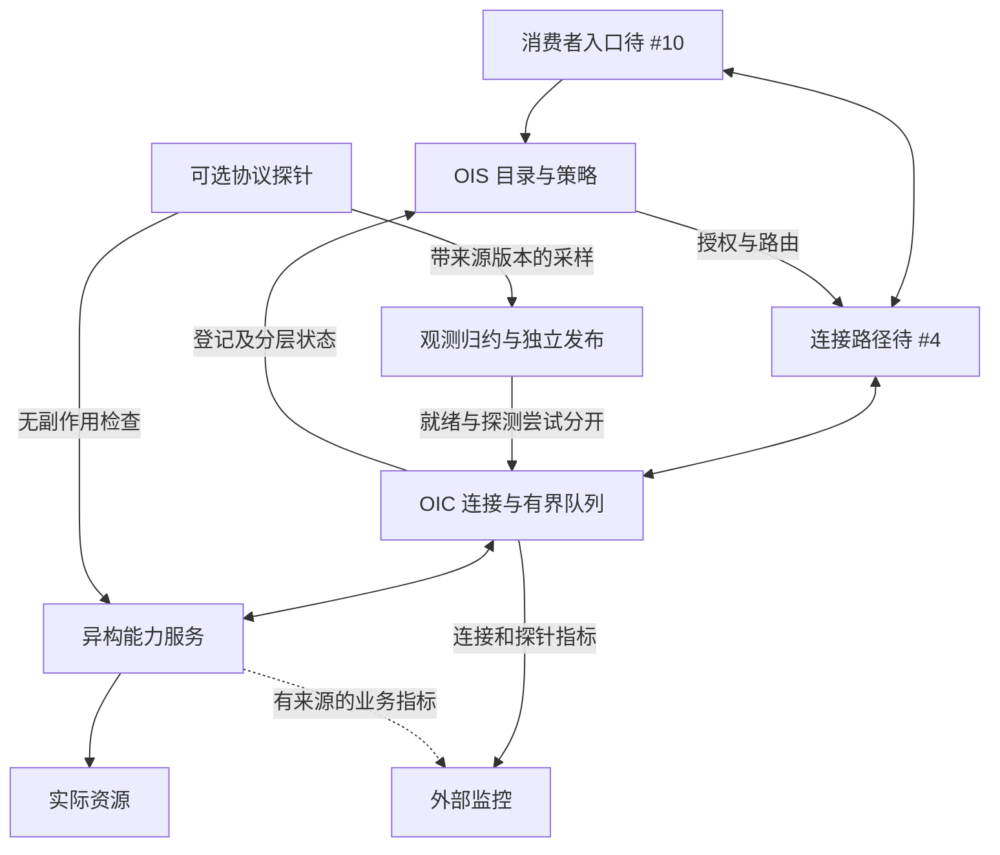
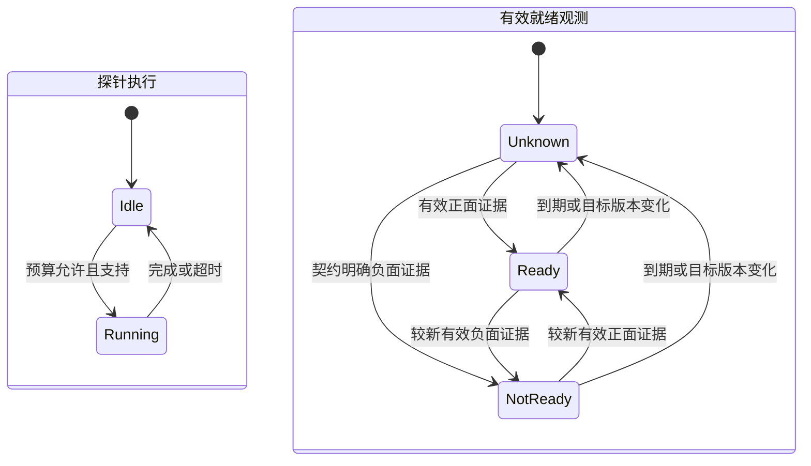
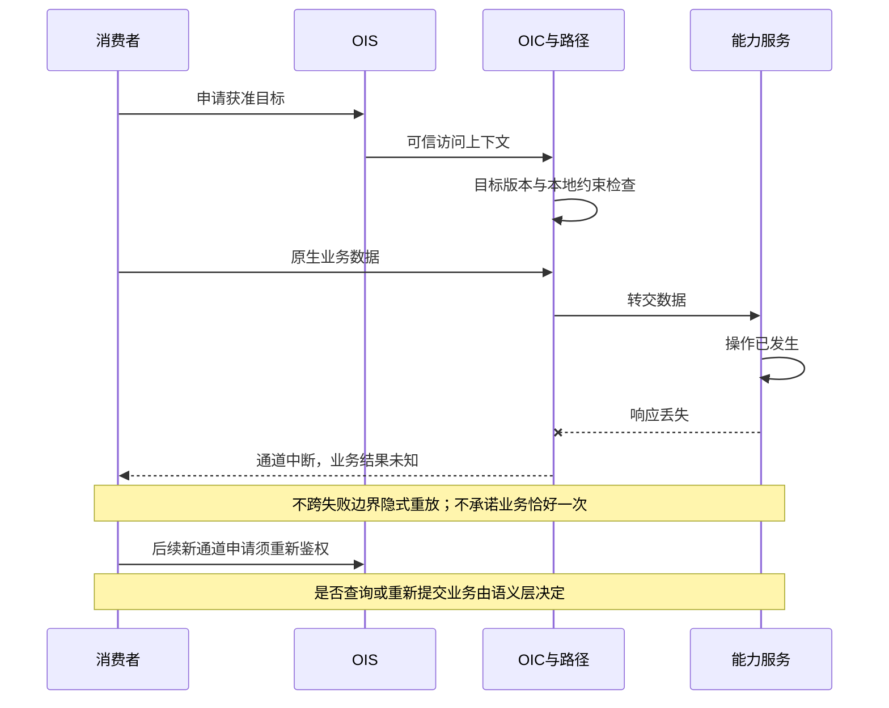
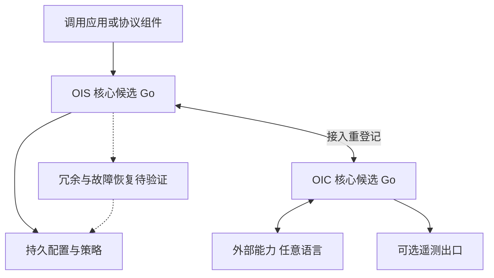

# loom-oi 分布式能力架构 · alpha 探索稿

| 项目 | 内容 |
| --- | --- |
| 状态 | Draft alpha.5；局部边界已确认，核心架构仍为提案 |
| 日期/分支 | 2026-11-02 / 用户指定的 alpha；main 基线 63c1db9 |
| 实现现状 | 尚无 OIS/OIC 产品实现；已有隔离机制fixture及原始数据，不等于产品测试 |
| 已确认范围 | H1：暂不接 Loom、OI 不依赖 Loom、未来由 Loom 端适配；H2/H5：功能与质量目标驱动选型；H3/H4要求产品前置和深场景；H6授权关闭#9。Go推荐仍Pending |
| 权威来源 | [决策台账与原评论](../kb/decisions.md)、[原始讨论蒸馏](alpha-discussion.md) |
| 方案入口 | [整体推导](proposals/alpha-solution-design.md)、[当前 Issue 结构](alpha-issues.md) |

本文保存当前架构边界与状态；具体机制、备选、证据链和反例集中在整体提案。v2 的八项局部推荐不再是可以分别冻结的组件清单，历史见 [d680386](https://github.com/wyw-ai/loom-oi/tree/d6803867cf22ed46b5794e10b99ee2a1ea6a2035)。

本轮[ITER-001综合结论](evidence/alpha-synthesis-001.md)将可复现反例收敛为共同约束：online不等于ready；结果未知不等于未执行；内核不跨失败边界隐式重放。推荐有界连接、可选观测、消费语义分责；这不是A/B/C或Go已获采用。

## 1. 产品目标与范围

**共同意图**：登记、发现并连接分散环境中的受控能力；控制方可以是脚本、应用或 Agent。OI 不拥有推理循环、Agent Session、业务规划和业务资源状态；提供方仍拥有实际能力。[C1–C5](alpha-discussion.md#3-已识别的共同方向) 支持这个方向，不表示具体 API 已批准。

**人类明确决定 H1**：本阶段不接入 Loom，OI 的构建、部署和验收不能依赖 Loom；未来适配由 Loom 端承担。OI 不为这一未来集成预先建设业务 bridge 或 Actor/Channel 映射。普通脚本独立闭环是 AI 验收建议，尚未运行。

当前不纳入通用任务调度、Agent Runtime、Artifact/Checkpoint、联邦和自动工具组合。透明通道与统一调用的产品边界仍要选择；“不碰业务”不能替代该取舍。

## 2. 职责与总体结构

[#10 产品前置](https://github.com/wyw-ai/loom-oi/issues/10) 先收敛承诺和首批消费者。当前 **能力描述/目录 + 受控原生协议通道** 仅作最小机制验证基线，原因与反证见 [整体候选比较](proposals/alpha-solution-design.md#packages)。相较 v2，不再默认要求首版带一项统一调用适配器。一个独立 HTTP 示例能力不等于 OI HTTP 适配层。

图为未冻结的逻辑责任，不规定进程数或已选传输；探针可由协议组件实现，无支持时描述Unsupported、就绪Unknown；观测归约是逻辑职责而非必增进程。外部监控不成为OIC内置数据库。OIS 处理目录/策略/协调，OIC 处理登记/本地受控目标/连接，提供方处理原生协议与业务。统一网关 B、外置可选调用组件 C 仍是完整候选；若首批消费者必须统一 Invoke，应重审推荐。

## 3. 对象模型与命名

[#2](https://github.com/wyw-ai/loom-oi/issues/2) 联合对象、生命周期和能力自治，吸收 #7 的反例。不能用聊天中反复变化的 Node/Workload 含义直接冻结层级。

| 职责对象草图 | 变化与所有者 | 当前处理 |
| --- | --- | --- |
| 接入登记 access_id | OIC 的登记身份；网络重连不改变它 | 一个登记下可有多个暴露项；不是一机一 Node 的决议 |
| 暴露项 exposure_id | 独立获准目标及其协议/能力说明；OIC 配置拥有者控制 | 目标替换改变 revision；不能把旧授权静默移给新目标 |
| 连接 generation / stream | 通信生命周期 | 旧清理不得删除新路由；不等于业务会话或服务重启代数 |
| 独立服务与真实资源 | 服务管理者和提供方 | 不强制增加 Provider/Workload 产品对象；不虚构未知服务 incarnation |

该两类长期标识是 AI 推荐，正式术语未定。多服务、外部服务、重连、目标替换、多路径暴露的映射和备选层级见 [S2](proposals/alpha-solution-design.md#s2)。若要求 OI 托管进程或自动服务漂移，就需重新设计对象与状态，不只增加名字。

v4将模型放入[多维节点场景](proposals/consumer-scenarios.md)检验：HTTP/MCP/stdio、桌面、设备网关、事件源和重资源服务具有不同生命周期与探测能力。建议可选协议/交互形态、ProbeSpec、Observation、监测能力及依赖引用；正式对象层级仍待场景证据。

## 4. 通信与适配边界

**两条选择轴**：A/B/C 决定谁理解调用语义；R/D/H 决定可信中继、协调直连或双路径。它们相关但不能互相推导。

当前网络建议为 R，前提是现场能出站到中心并接受可信中心与中继成本；没有拓扑实测。局域网高带宽、中心不可信、失联持续可用的要求都会改变推荐。[S4](proposals/alpha-solution-design.md#s4) 联合设计可达、身份、撤销和失败，#5/#6 为其专项。

Opaque 不代表端到端加密；分段 TLS 的中继仍可能看到载荷。若要求中继不可读，可由原协议在通道内加密并校验目标，或另设计端到端通道。操作级策略需要能理解协议的提供方/适配器；原生服务凭证不得直接等同于 OI 通道许可。

## 5. 状态与隔离

接入在线、目标可达、业务就绪、资源忙是不同维度。C01有局部反例支持；ProbeSpec/Observation的具体实现仍是推论。无探针是Unsupported能力/Unknown观测；只有符合探针契约的明确负面响应才映射NotReady，超时不是该类证据。

v5将探针执行和就绪观测拆为正交状态。以下仅为候选设计，TTL/版本/发布行为未实测：

开始检查不直接改变有效观测；超时/权限不足记录本次attempt，旧观测保持原有效期，到期成为Unknown，心跳不续期。准入策略与观测分离：是否要求Ready才能访问由#10/#3确定。时钟差、乱序和generation写入约束尚待定义/实现；不能只靠墙钟时间判断较新。

[LAB-001](evidence/alpha-lab-round1.md)证明局部TCP/HTTP证据不同及串行等待；没有证明上述状态机、独立发布和有界公平性。C02推荐每目标有界调度与独立发布结果，资源预算由#8纳入；外部服务失败不授权OIC重启它。

OI只能直接统计连接、流量、队列、探针结果等；业务成功/工具调用数/资源状态需要提供方或适配器证据。指标标签与导出队列有界，不将请求ID或用户ID无限放入指标。详情见[监控责任](proposals/consumer-scenarios.md#4-监控统计的责任边界)。

独立流不隔离进程，独立进程不隔离共享桌面；真实资源执行者负责互斥。无关能力探测/统计不能串行阻塞控制面，但这种生产公平性仍待LAB-005验证。MCP等协议按版本核对，原生服务状态不因协议无Session而消失。

## 6. 候选契约

以下仅为方案 A 的草图：`Discover -> exposure descriptors`、`Open(exposure_id, expected_revision) -> channel`、`Close`。描述含能力说明、协议兼容、目标/配置版本、状态及来源；操作 Schema 可选。身份来自认证链路，不信任自填 caller。

R 中 OIS 在线审批，OIC 核验可信路由上下文、本地目标/revision、主体约束与预算；无需先实现离线授权平台。长流需有效期限/续权和撤销处理。D/H 才额外展开离线访问依据、客户端绑定、重放防护和撤销窗口。具体凭证格式、时限和传输协议未定。

B/C 额外定义 Invoke/Stream/Cancel 支持矩阵和适配版本；不能把本草图误当已冻结的 MCP 或 OI 标准。详见 [S3](proposals/alpha-solution-design.md#s3)、[S5](proposals/alpha-solution-design.md#s5)。

## 7. 调用与故障处理

下图为R路径的候选业务故障链；LAB-002仅实测右侧“服务效果发生后丢响应”的机制，不是整条OI链已经实现。

[LAB-002](evidence/alpha-lab-round1.md)的无幂等HTTP计数器在“不重放”5次试验各增加1次，在“盲重放一次”各增加2次；效果只在内存，不是持久事务。该反例支持连接中断不等于未执行，不能证明所有重试都不安全。

建连前拒绝仅说明本次未建立；已传载荷后的关闭/撤销不回滚副作用；重建路径重新鉴权且不重发旧业务字节。completed/unknown、去重和补偿只由有证据的原生服务或适配器提供。不重放也不保证端到端At-most-once；消费者仍可能重试。此限制不禁用可靠传输协议内部的丢包恢复，见[C03分层解释](evidence/alpha-synthesis-001.md#3-失败契约恢复连接与恢复业务分开)。#4/#5/#6保持共同契约，真实撤销和HA仍待验证。

## 8. 部署与场景映射

**当前AI推荐Go作为OIS/OIC首版统一核心语言，待人类确认**。理由与Rust/混合备选及翻转条件见[语言比较](proposals/oic-language-tradeoffs.md)。没有Go/Rust性能实验；Python机制时间不能用于语言排名。

图中Go是推荐、冗余是候选，不是已采用/已实现。HA需要明确持久/临时状态、路由权威、故障恢复及有界容量，不能只增加副本。首版可通过重登记建立新通道恢复访问；在途操作仍可能未知，不承诺会话无损迁移。

1C1G只约束目标OIC机器，能力服务和OIS分开计量。本轮实验环境8GiB/8CPU额度且无Go/Rust工具链，不能替代目标容量测量。能力扩展优先版本化协议与独立服务，灵活性由边界/兼容策略提供；不因AI相关就强制动态进程内插件。

## 9. 与 Loom 及已有服务的集成

H1 已确认：**暂不做 Loom 接入；未来由 Loom 端发起适配。** 当前不保留 Loom 集成阶段、bridge 模块或源码钩子作为 OI 验收前置。[#9 原回复](https://github.com/wyw-ai/loom-oi/issues/9#issuecomment-6561327484)。

此前 Loom daemon/Adapter 的源码核对仍是 [E07/E08](../kb/evidence.md) 的历史事实，只能说明那些代码的业务职责，不支持当前选语言或必须复用它。其他 HTTP/MCP 服务可由有访问权限的 OIC 绑定受控目标，不要求 OI 拥有其生命周期。Magpie 仍不耦合核心；没有重新审计它的 API，也无新增集成承诺。

## 10. 验证顺序与验收建议

#10先提供消费者/承诺证据，#3据此比较产品形态；#2扩展节点/探针/监测场景，#4联动信任与失败；#8给出具体项目推荐并保留质量目标验证。独立闭环验收归#3/#10，#9只作已关闭边界决议。

已执行LAB-001/002为窄机制证据；完整状态机、真实MCP/stdio、监控规模、Go/Rust、1C1G、跨网络和HA仍待测。见[实验目录](../experiments/README.md)、[原始证据报告](evidence/alpha-lab-round1.md)。没有用模拟器替代真实消费者证据或生产承诺。

## 11. 本轮变更与继续讨论

[#1](https://github.com/wyw-ai/loom-oi/issues/1)维护#10前置、#3/#2/#4主线、#5/#6/#7专项和#8选型；#9按用户授权关闭。核心架构与Go推荐未自动Accepted。

### 11.1 方案、Issue 与知识联动

每次回复/实验证据都沿[产物联动表](architecture-artifacts.md)同步正文、关系/状态/时序/部署图、Issue、KB和验收。本轮按C01–C06修改总体责任、正交状态和故障时序；Go/HA部署图因无新实证保持候选，实验室是设计方法，不是运行架构的新产品组件。alpha仍由用户决定何时结束并合并主线。
