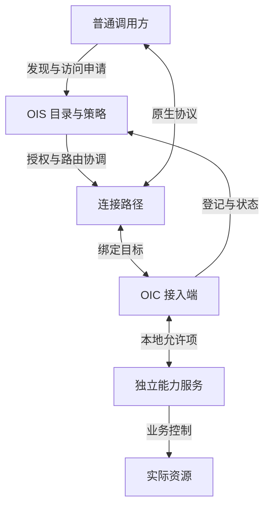

# loom-oi 分布式能力架构 · alpha 探索稿

| 项目 | 内容 |
| --- | --- |
| 状态 | Draft alpha.3；局部边界已确认，核心架构仍为提案 |
| 日期/分支 | 2026-11-02 / 用户指定的 alpha；main 基线 63c1db9 |
| 实现现状 | 尚无 OIS/OIC 代码；本轮为设计与 Issue 维护 |
| 已确认范围 | H1：暂不接 Loom、OI 不依赖 Loom、未来由 Loom 端适配；H2：补充 Go/Rust 比较，语言未定 |
| 权威来源 | [决策台账与原评论](../kb/decisions.md)、[原始讨论蒸馏](alpha-discussion.md) |
| 方案入口 | [整体推导](proposals/alpha-solution-design.md)、[当前 Issue 结构](alpha-issues.md) |

本文保存当前架构边界与状态；具体机制、备选、证据链和反例集中在整体提案。v2 的八项局部推荐不再是可以分别冻结的组件清单，历史见 [d680386](https://github.com/wyw-ai/loom-oi/tree/d6803867cf22ed46b5794e10b99ee2a1ea6a2035)。

## 1. 产品目标与范围

**共同意图**：登记、发现并连接分散环境中的受控能力；控制方可以是脚本、应用或 Agent。OI 不拥有推理循环、Agent Session、业务规划和业务资源状态；提供方仍拥有实际能力。[C1–C5](alpha-discussion.md#3-已识别的共同方向) 支持这个方向，不表示具体 API 已批准。

**人类明确决定 H1**：本阶段不接入 Loom，OI 的构建、部署和验收不能依赖 Loom；未来适配由 Loom 端承担。OI 不为这一未来集成预先建设业务 bridge 或 Actor/Channel 映射。普通脚本独立闭环是 AI 验收建议，尚未运行。

当前不纳入通用任务调度、Agent Runtime、Artifact/Checkpoint、联邦和自动工具组合。透明通道与统一调用的产品边界仍要选择；“不碰业务”不能替代该取舍。

## 2. 职责与总体结构

当前条件性推荐是 **能力描述/目录 + 受控原生协议通道**，原因与反证见 [整体候选比较](proposals/alpha-solution-design.md#packages)。相较 v2，不再默认要求首版带一项统一调用适配器。一个独立 HTTP 示例能力不等于 OI HTTP 适配层。

图为方案 A 的逻辑责任，不规定进程数或已选传输。OIS 处理目录/策略/协调，OIC 处理登记/本地受控目标/连接，提供方处理原生协议与业务。统一网关 B、外置可选调用组件 C 仍是完整候选；若首批消费者必须统一 Invoke，应重审推荐。

## 3. 对象模型与命名

[#2](https://github.com/wyw-ai/loom-oi/issues/2) 联合对象、生命周期和能力自治，吸收 #7 的反例。不能用聊天中反复变化的 Node/Workload 含义直接冻结层级。

| 职责对象草图 | 变化与所有者 | 当前处理 |
| --- | --- | --- |
| 接入登记 access_id | OIC 的登记身份；网络重连不改变它 | 一个登记下可有多个暴露项；不是一机一 Node 的决议 |
| 暴露项 exposure_id | 独立获准目标及其协议/能力说明；OIC 配置拥有者控制 | 目标替换改变 revision；不能把旧授权静默移给新目标 |
| 连接 generation / stream | 通信生命周期 | 旧清理不得删除新路由；不等于业务会话或服务重启代数 |
| 独立服务与真实资源 | 服务管理者和提供方 | 不强制增加 Provider/Workload 产品对象；不虚构未知服务 incarnation |

该两类长期标识是 AI 推荐，正式术语未定。多服务、外部服务、重连、目标替换、多路径暴露的映射和备选层级见 [S2](proposals/alpha-solution-design.md#s2)。若要求 OI 托管进程或自动服务漂移，就需重新设计对象与状态，不只增加名字。

## 4. 通信与适配边界

**两条选择轴**：A/B/C 决定谁理解调用语义；R/D/H 决定可信中继、协调直连或双路径。它们相关但不能互相推导。

当前网络建议为 R，前提是现场能出站到中心并接受可信中心与中继成本；没有拓扑实测。局域网高带宽、中心不可信、失联持续可用的要求都会改变推荐。[S4](proposals/alpha-solution-design.md#s4) 联合设计可达、身份、撤销和失败，#5/#6 为其专项。

Opaque 不代表端到端加密；分段 TLS 的中继仍可能看到载荷。若要求中继不可读，可由原协议在通道内加密并校验目标，或另设计端到端通道。操作级策略需要能理解协议的提供方/适配器；原生服务凭证不得直接等同于 OI 通道许可。

## 5. 状态与隔离

| 状态 | 当前所有者提案 | 关键限制 |
| --- | --- | --- |
| 登记/策略/配置版本 | OIS 与 OIC 配置拥有者 | 目录缓存不能充当当前许可 |
| 路由/流/缓冲/重连 | 连接层 | 不恢复业务执行，不提供 Exactly-once |
| 服务就绪/原生会话/资源 | 能力服务；OIC 仅上报有来源探针 | OIC online 不等于 ready，无探针/过期为 Unknown |
| Agent/业务上下文 | 消费者/业务服务 | 不进入 OI 通用模型 |

每暴露项队列与全局预算防止无限资源占用，但不能隔离进程崩溃；独立进程不能隔离共享桌面。真实资源的串行/互斥必须在实际执行处生效。[S7](proposals/alpha-solution-design.md#s7) 记录反例。外部服务由其管理者启停；监督器和通用锁不再默认列为首版组件。

MCP 等协议的状态应按具体版本核对，旧核对来源保留于 [E11](../kb/evidence.md)。即使协议没有 Session，也不意味着原生服务无状态；本轮不据此绑定 MCP 或实现统一协议适配。

## 6. 候选契约

以下仅为方案 A 的草图：`Discover -> exposure descriptors`、`Open(exposure_id, expected_revision) -> channel`、`Close`。描述含能力说明、协议兼容、目标/配置版本、状态及来源；操作 Schema 可选。身份来自认证链路，不信任自填 caller。

R 中 OIS 在线审批，OIC 核验可信路由上下文、本地目标/revision、主体约束与预算；无需先实现离线授权平台。长流需有效期限/续权和撤销处理。D/H 才额外展开离线访问依据、客户端绑定、重放防护和撤销窗口。具体凭证格式、时限和传输协议未定。

B/C 额外定义 Invoke/Stream/Cancel 支持矩阵和适配版本；不能把本草图误当已冻结的 MCP 或 OI 标准。详见 [S3](proposals/alpha-solution-design.md#s3)、[S5](proposals/alpha-solution-design.md#s5)。

## 7. 调用与故障处理

同一端到端路径：管理员登记允许暴露的服务 → 调用方认证发现 → 当前策略审批 → OIC 目标/版本/本地许可检查 → 原生协议使用 → 关闭释放。完整逐步输入/输出和失败保证见 [闭环推演](proposals/alpha-solution-design.md#flow)。

| 观测证据 | OI 保证 | 不保证 |
| --- | --- | --- |
| 建连前拒绝 | 本次未建立通道 | 所有历史操作都未执行 |
| 已传载荷后断线 | 通道中断且 OI 不隐式重放 | 远端操作失败、已取消或可安全重试 |
| 撤销/截止 | 按选定规则拒绝新访问并结束流 | 回滚已有副作用、无时延全网撤销 |
| 路径重新建立 | 新鉴权、新通道 | 恢复原生业务会话或重做旧操作 |

业务 completed/unknown、幂等/补偿/操作状态查询由原生服务或明确支持的适配器提供。不得在透明内核里虚构统一操作结果。见 [S6](proposals/alpha-solution-design.md#s6)。

## 8. 部署与场景映射

1C1G 指 OIC 所在环境，OIS 和能力进程分开计量。小机器目标不等于已选 Rust 或已承诺 RSS。用户 H2 要求按功能比较 Go/Rust，见 [语言设计](proposals/oic-language-tradeoffs.md)；语言和部署形态均 Pending。

首个建议场景是脚本经 OI 访问只读诊断服务；另用同 OIC 两服务、共享桌面、内网直达/受限出口作反例。提供方实现语言与 OI 核心语言独立；外部能力的 OS/FFI 要求不能自动投射成 OIC 的语言要求。

## 9. 与 Loom 及已有服务的集成

H1 已确认：**暂不做 Loom 接入；未来由 Loom 端发起适配。** 当前不保留 Loom 集成阶段、bridge 模块或源码钩子作为 OI 验收前置。[#9 原回复](https://github.com/wyw-ai/loom-oi/issues/9#issuecomment-6561327484)。

此前 Loom daemon/Adapter 的源码核对仍是 [E07/E08](../kb/evidence.md) 的历史事实，只能说明那些代码的业务职责，不支持当前选语言或必须复用它。其他 HTTP/MCP 服务可由有访问权限的 OIC 绑定受控目标，不要求 OI 拥有其生命周期。Magpie 仍不耦合核心；没有重新审计它的 API，也无新增集成承诺。

## 10. 验证顺序与验收建议

先用 #3 的边界在 #2/#4 中走通对象与连接契约，再按同一功能范围进行 #8 的语言验证；#9 承载独立闭环检查。研究可继续，协议冻结依赖相应人类选择。

最小实验候选：无 Loom 的发现/访问；旧目录与目标替换拒绝；服务卡住不污染另一暴露项；模拟副作用后丢响应不重放；慢消费者下缓冲/控制延迟；相同功能的 Go/Rust 资源对比。全部尚未运行，不以文件或纸面场景数量代替证据。

## 11. 本轮变更与继续讨论

[#1 总入口](https://github.com/wyw-ai/loom-oi/issues/1) 追踪三条主线 #3/#2/#4、条件专项 #5/#6/#7、语言 #8 和已确认边界 #9。旧单保留 open、历史可追溯；整合不是关闭、解决或获批。

### 11.1 方案、Issue 与知识联动

核心依赖：[证据 → 约束 → 机制 → 取舍 → 下游影响](proposals/alpha-solution-design.md#dependencies)。收到反馈时沿链更新，不将单项接受扩大到全套。H1/H2 的边界已同步，其余 D1–D6 等仍 Pending。用户决定结束探索与合并主线；当前只维护已有 alpha。
