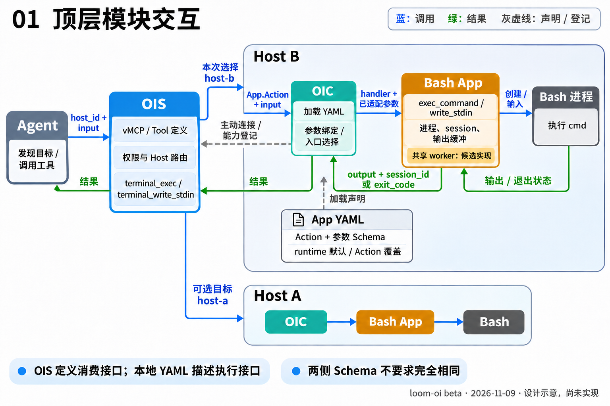
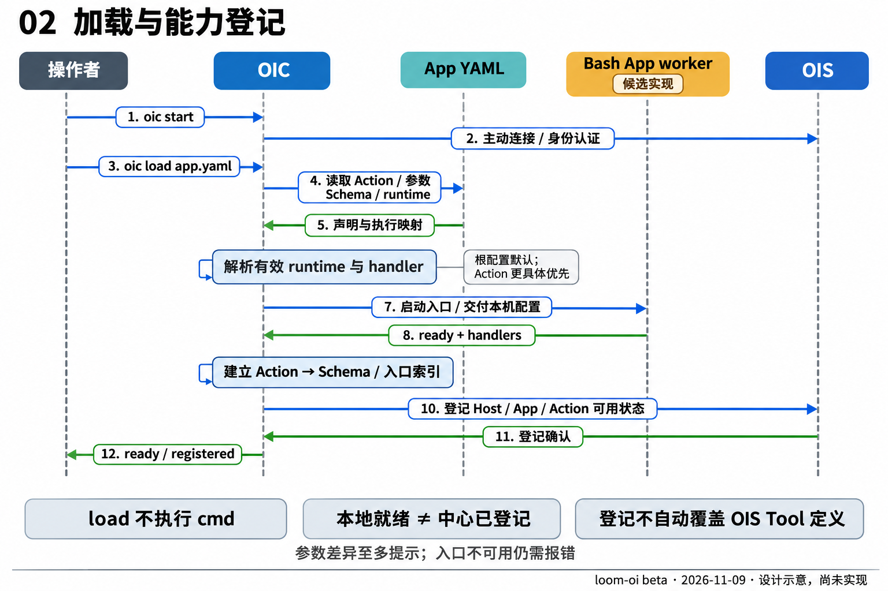
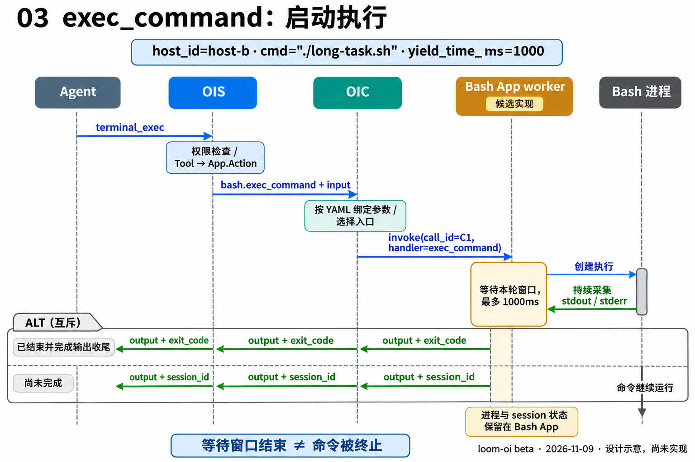
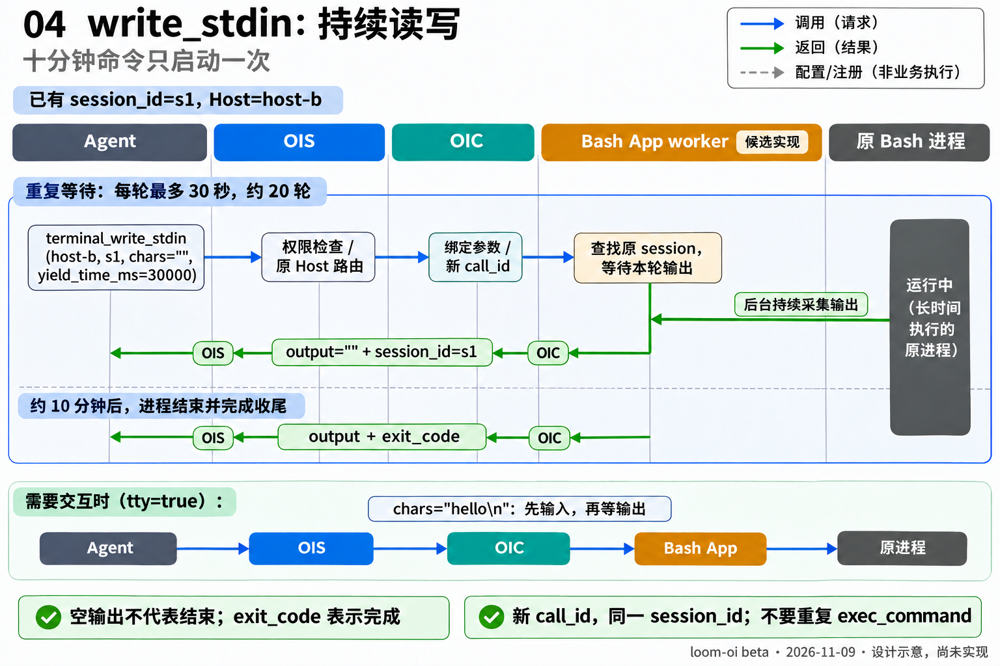
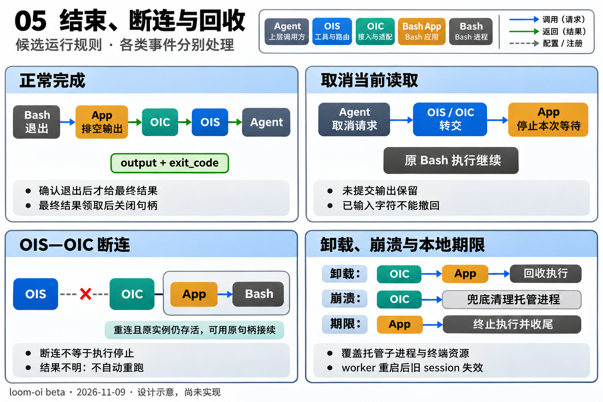

# loom-oi beta：模块交互与 Bash 生命周期图集（历史版本）

**本图集已退出当前首版设计。** 用户随后明确取消多 Host 路由，改为 Tool 预先绑定 Action 和通道的直接调用链。请以[首版固定调用链图](../2026-11-09-v2/README.md)及最新文字设计为准；本页保留当时的图和说明用于回看讨论，不能继续据此实现 Host 选择、目标发现或多目标合并。

日期：2026-11-09。使用内置 image_gen 生成并逐张检查，按“顶层 → 加载 → 启动 → 持续读写 → 结束与异常”的顺序阅读。

已确认的主干包括 OIS 的工具定义与路由、OIC 根据本地 YAML 的 Action/参数 Schema/runtime 适配并转交、runtime 根默认与 Action 优先，以及 exec_command/write_stdin 两动作模型。图中的共享 worker、具体消息字段、1000/30000 毫秒等待示例、约 20 轮等待、输出与回收细则属于当前候选设计，不代表已经实现或冻结。

图中缩写用于解释交互，不是完整 API 报文。Agent 看到的是 OIS 配置的 terminal_exec / terminal_write_stdin；实际 App Action 为 exec_command / write_stdin。Bash 进程的输出和退出状态先由 App 组织成结果，再经 OIC、OIS 返回。call_id 对应每次调用，session_id 对应同一次持续执行。

## 01 顶层模块交互

展示一个共享工具集合如何选择 Host A 或 Host B，以及 YAML、OIC、Bash App 和实际 Bash 进程的边界。OIC 主动连接和登记与业务调用方向分开绘制。App YAML 是声明输入，不参与实际命令执行。

## 02 加载与能力登记

oic load 解析 Action、参数 Schema 和有效 runtime，准备本地入口并登记可用能力。在本图的共享 worker 候选中，初始化 worker 不等于执行 cmd。登记不会自动覆盖 OIS 的 Tool 定义。

## 03 启动执行

调用先经过 OIS 权限和路由，再由 OIC 绑定参数、选择 handler。App 创建执行并等待：已完成返回 output/exit_code；未完成返回 output/session_id。这两个分支互斥，等待窗口到期不会终止命令。

## 04 持续读写

十分钟任务只启动一次，Agent 随后用原 Host/session_id 分段调用 write_stdin。图中每次最多等待 30 秒、约 20 轮只是时间示例；命令提前完成时可以提前返回。每次调用都有新的 call_id，OIS 生成关联标识并随调用转交，OIC 不创建新的 Bash 执行。空输入等待读取；终端模式的非空输入先写后读。

## 05 结束、断连与回收

分别呈现正常完成、取消当前读取、OIS—OIC 断连和本地回收。取消读取不等于终止原执行，断连不等于执行停止；重连后接续还要求原实例存活、句柄有效且权限仍允许。worker 重启不恢复旧 session。

生成过程：五次初始生成；01、04、05 定向修订返回路径及文字，01 再修正一个多余箭头。采用最终选用的五张 PNG，原生成文件保留在 Codex 的生成目录；未选用版本未加入项目。

完整生成与修订提示词见 [prompts.md](prompts.md)。文字契约见 [Bash Action、参数与执行机制](../../bash-action-design.md)，确认边界见[当前设计共识](../../../../../current/beta/design.md)。
