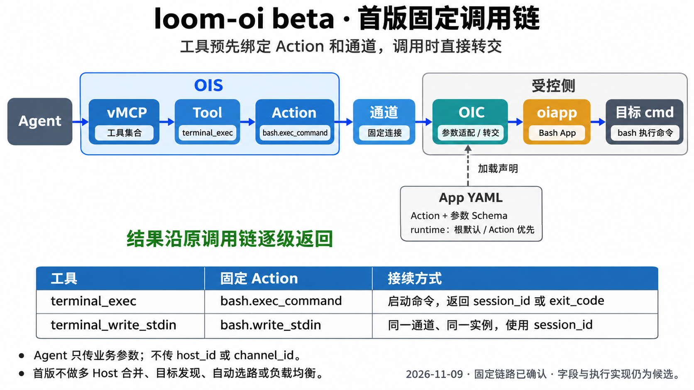

# loom-oi beta：首版固定调用链

2026-11-10 说明：本图保留为单组固定链的概念示意。当前验收已确定为同一 vMCP 中 Linux Bash、Windows PowerShell 两组四工具；图中旧工具名和单 Bash 配置不作为部署清单，具体绑定及两端验收以[首版验收规格](../../../../../current/beta/acceptance.md)为准。

日期：2026-11-09。用户已明确本版不做多 Host 路由，当前链路为：

```text
Agent → vMCP → Tool → Action → 通道 → OIC → oiapp → 对应目标 cmd
```



每个 Tool 预先绑定一个 App.Action 及通道。Agent 只提供业务参数，通道将调用送至对应 OIC；OIC 依据 App YAML 的 Action、参数 Schema 与 runtime 做必要适配并转交实际实现，结果沿原调用链返回。

Bash 的两个 Tool 固定进入同一通道、同一执行后端。exec_command 创建执行，write_stdin 使用已有 session_id 继续读写，不让 Agent 再选择宿主机或连接。

图中的 Action 框表示 OIS 配置引用的目标动作，不是另一个业务执行服务；通道表示对接 OIC 的通信环节，不是新增调度模块。固定调用链与不做多 Host 路由已确认，具体通道标识、字段、协议和进程实现仍为候选。

[旧版多 Host 图集](../2026-11-09-v1/README.md) 保留为讨论历史，不作为当前首版架构依据。本图使用内置 image_gen 生成，原图与实际完整提示词保留；[提示词](prompts.md)、[Bash 详细设计](../../bash-action-design.md)、[当前共识](../../../../../current/beta/design.md)。
