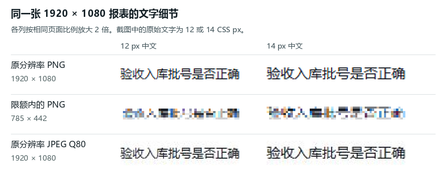

# 图像预览预算与小字可读性复核

2026-11-19。这里保留促成最终设计的比较实验。表中的缩图尺寸来自此前固定 PNG、超过 384 KiB 即缩小的方案。最终方案采用 384 KiB 软目标，并已同步到[图像接口](../../../current/oiapp-expansion/design.md)和[验收项](../../../current/oiapp-expansion/acceptance.md)。

## Codex 实际怎样返回图片

| 已核对的层 | 观察与证据 |
| --- | --- |
| 本机 Codex Desktop 26.1111.2228.0 所带的 CLI 0.169.0-alpha.11.1 | 开源实现中，`view_image` 读取文件，以原字节构建内联 data URL。常规工具输出为 `InputImage`，Code Mode 返回 `image_url`，按模式可附 detail。最终构建模型请求时可内联，也可使用附件引用。本次实际用工具读取 1280×720、2,768,824 字节的高熵 PNG，返回 data URL 的 PNG 尺寸、字节数与校验和均与输入相符。[原图进入工具结果](https://github.com/openai/codex/blob/226fa88979b1a9d76dc36f339ee9c5fbdb2c8e7f/codex-rs/core/src/tools/handlers/view_image.rs#L175-L203) · [两种工具结果](https://github.com/openai/codex/blob/226fa88979b1a9d76dc36f339ee9c5fbdb2c8e7f/codex-rs/core/src/tools/handlers/view_image.rs#L238-L267) · [模型输入处理](https://github.com/openai/codex/blob/226fa88979b1a9d76dc36f339ee9c5fbdb2c8e7f/codex-rs/core/src/image_preparation.rs#L367-L422) |
| 同版本的模型输入准备 | `high` 预算是最长边 2048 px、最多 2500 个 32×32 图块。`original` 或适用的统一预算是最长边 6000 px、最多 10000 个图块。按两边分别向上取整的块数乘积检查。1920×1080 占 60×34＝2040 块，满足 high 的两个约束。源码另有 1 GiB 异常输入保护，分别检查 Base64 和解码长度，不能作为交付目标。服务端视觉处理还取决于模型。[尺寸预算](https://github.com/openai/codex/blob/226fa88979b1a9d76dc36f339ee9c5fbdb2c8e7f/codex-rs/utils/image/src/lib.rs#L68-L84) · [图块计算](https://github.com/openai/codex/blob/226fa88979b1a9d76dc36f339ee9c5fbdb2c8e7f/codex-rs/utils/image/src/lib.rs#L345-L351) · [字节检查](https://github.com/openai/codex/blob/226fa88979b1a9d76dc36f339ee9c5fbdb2c8e7f/codex-rs/utils/image/src/lib.rs#L284-L303) · [模型小字与缩放说明](https://developers.openai.com/api/docs/guides/images-vision#limitations) |
| 本机桌面 Browser 插件 26.1111.21308 | 显式 `tab.screenshot()` 默认按 CSS 视口取图，CDP 捕获为 JPEG，质量 80，可选 clip/fullPage。服务拿到 Base64，客户端解码为 Uint8Array，`nodeRepl.emitImage` 把它作为 MCP 图像内容交付。显式截图路径没有 384 KiB 目标或按编码字节反复降宽的逻辑。插件另有历史预览路径，其阈值不能套到显式截图。[随包截图指引](C:/Users/c6321/.codex/plugins/cache/openai-bundled/browser/26.1111.21308/docs/screenshots.md) · [随包服务实现](C:/Users/c6321/.codex/plugins/cache/openai-bundled/browser/26.1111.21308/scripts/browser-service.mjs) · [随包 API 声明](C:/Users/c6321/.codex/plugins/cache/openai-bundled/browser/26.1111.21308/docs/api.json) |
| 本机 Node REPL 的图像返回层 | 用两张 1280×720 合成图直接测试真实 MCP 服务的 emitImage。JPEG Q80 为 615,862 字节，PNG 为 2,769,398 字节，两者 MCP image 块解码后的 SHA-256、MIME 和尺寸均与输入相符。这个试验验证字节到达 MCP 接收端。 |

## 在同一页面上比较保留像素和缩整屏

在本机 Windows 使用 Chrome 157.0.8103.79、Playwright 1.62.1、DPR 1、CSS px、微软雅黑。右侧 60% 放 12/14 px 中文及表格。改变左侧 40% 面板为浅色、系统示例照片或固定种子的 RGB 噪声。照片是 Windows Spotlight 的 img14.jpg（SHA-256 a37491a5e479e191cfe547b484426037455ce8aacff7ab15f91925330c24864f）。每张图均来自本地静态测试页。

旧方案先抓完整 PNG，超 384 KiB 就从同一原始帧按长边 0.8 倍逐档双线性缩小，使用 pngjs 7.0.0 编码，最后一档不低于 min(原长边,768)。JPEG 列为 Chromium 在同一静态页面、相同视口直接编码的 Q80。表中大小均为 Base64 之前的图像字节数。1 KiB = 1024 B。

| 视口与左侧内容 | 原尺寸 PNG | 旧方案的 PNG 结果 | Chromium 原尺寸 JPEG Q80 |
| --- | ---: | --- | ---: |
| 1280×720，浅色 | 139.9 KiB | 原尺寸 | 91.8 KiB |
| 1280×720，照片 | 518.7 KiB | 819×461，330.9 KiB | 140.4 KiB |
| 1920×1080，浅色 | 259.5 KiB | 原尺寸 | 159.5 KiB |
| 1920×1080，照片 | 1016.9 KiB | 785×442，290.1 KiB | 242.8 KiB |

在两张图文页，原来 12 px 的字分别只剩约 7.7 px 和 4.9 px 的字号尺度。下图从真实输出中取同一句中文，按同一页面比例放大 2 倍，便于直接比较。1920 宽下只取文字区的原分辨率 PNG（1112×166）为 18.7 KiB。压力对照中，1920 宽的噪声页即使保留原尺寸改用 JPEG Q80 仍需 680.8 KiB；编码切换也有边界。

另做一组识读检查。取 1920 图文页的六行 14 px 中文，每行十字。用页面坐标截回对应区域，统一放大至同样显示尺度，Tesseract 5.5.0 中文简体模型、单行模式识读。按每行实际结果计算字符编辑距离并求和，原尺寸 PNG 为 14，缩到 785 宽的 PNG 为 60，原尺寸 JPEG Q80 为 7。该数值只说明这张测试页在该 OCR 引擎上的差异。单张截图的 OCR 结果无法代表所有页面、字体、JPEG 色差或具体视觉模型的准确率。

最终方案的同帧编码也已独立验证。使用选定的 `pngjs 7.0.0` 和 `jpeg-js 0.4.4`，从同一张 1920×1080 PNG 得到的原尺寸 JPEG Q80 为 380,760 B（371.8 KiB），示意完整 worker 帧为 508,148 B。编码器不同，大小会与上表的 Chromium 直接编码结果不同。正式验收以实际编码、完整帧及解码尺寸为准。[编码与打包记录](browser-packaging.md)

## 已采纳的调整

1. 保留 384 KiB 作为默认传输目标。默认 768 KiB 的 worker 完整帧中，纯 Base64 在没有其他字段时最多可容纳 576 KiB 原始编码，实际可用量必然更低。按实际序列化帧和连接预算判断。1280 的 518.7 KiB PNG 的 Base64 约 691.5 KiB，在有足够余量时原尺寸无损图有机会直接通过。[通道硬上限](../../../../../internal/protocol/protocol.go)
2. Browser 优先保留 CSS 像素。整屏先尝试原尺寸 PNG，放不下再从同一帧编码原尺寸 JPEG Q80，两者都放不下才缩成概览。调用方可通过 `screenshot(clip)` 单独请求视口内的原像素无损 PNG。局部图仍放不下时提示缩小矩形。成功结果记录实际 MIME、区域及尺寸。
3. Filesystem 的显式 `crop` 在方向校正后的原图上取像素，按选区尺寸返回无损 PNG。整图在源图安全限额、实际帧及提供方硬限制内优先保持原尺寸。原先 1600 px 的默认长边限制已经取消，整图缩放时元数据给出实际尺寸。
4. 图文混排的小字已纳入发布验收。两种视口都校验原像素与传输字节数，在真实视觉客户端逐字读出只在像素里出现的中文短句、批号和数字。此次实验使用代理 OCR 与独立浏览器。正式 App 的 API/MCP 端到端运行留待实现后验证。
