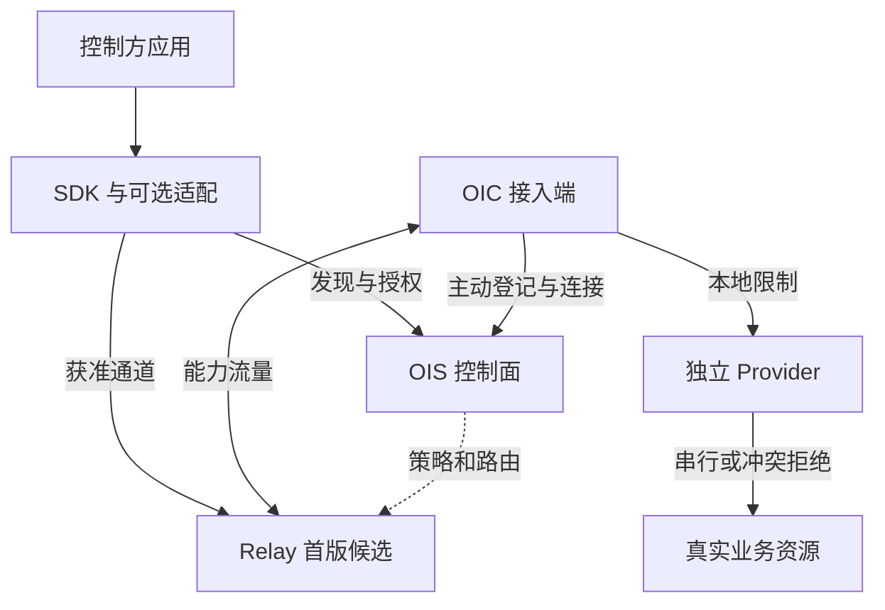

# alpha：可评审解决方案 v2

2026-11-02。全部内容为 **AI 推荐方案 + 纸面场景推演**，尚无用户产品决议，未实现 OIS/OIC、未运行网络/资源/故障实验。基线为 `8abc35f`；证据与局限见 [KB](../../kb/evidence.md)。本稿深化当前架构中的候选，不取代人类最终方向。

目录：[S2](#s2) · [S3](#s3) · [S4](#s4) · [S5](#s5) · [S6](#s6) · [S7](#s7) · [S8](#s8) · [S9](#s9)

## 统一设计主张

推荐以“可获准连接的能力实例”为最小消费对象：连接内核保持原生协议，可选适配提供调用便利；首版用反向中继建立闭环，采用执行侧授权与保守失败语义。具体业务资源由提供方控制；先外部服务、可裁剪接入端，再做普通脚本和 Loom 消费闭环。

这是一组相互兼容的 **AI 候选组合**，不是将若干未决选项悄悄合成团队共识。用户可只接受其中部分；例如 D3 选直连仍可沿用 S2/S5/S6，D1 选纯通道则移除 S3 适配承诺但保留同一连接接口。

图示只展示推荐的中继路径。直连、监督器及 MCP facade 未在图中被暗示为首版必需。源码与协议依据只支持各自事实，组合设计由 AI 提出。

## S2 · 确定接入身份、能力实例与可选 Workload 的最小对象模型

对应 [Issue #2](https://github.com/wyw-ai/loom-oi/issues/2)；决策范围：D2；状态：Proposed / 纸面推演 / Pending。

**问题与目标：** 身份、宿主、能力包和运行实例混用会使重连、外部服务接入与权限归属不稳定。目标是让使用者能选到一个稳定能力实例，同时保留必要生命周期层级。

**范围：** 登记、发现、路由所需的最小实体；覆盖电脑、外部服务、虚拟手机。不增加调度器或 Agent Session。

**来源：** E04、E05；原始讨论 L1399–1553；架构 §3/§6.1。

**AI 推荐：** 推荐 Node 表示受管理的接入身份边界，Provider 表示可独立寻址的能力实例，Capability 描述接口；仅当 OIC 获准托管进程时才创建 Workload。Host 是位置元数据，不强制一台物理机对应一个 Node。

**理由与推翻条件：** 把稳定身份、可调用实例与可选托管分开，可以保留团队需要的独立能力层，又不要求外部服务伪造部署对象。代价是引入 Provider 术语并维护关联；若使用者始终只接入独立能力而没有环境管理需求，应改用 Node=Provider 的更扁平模型。

### 候选与取舍

| 方案 | 收益 | 代价/限制 | 适用条件 |
| --- | --- | --- | --- |
| A 扁平 Node=能力实例 | 注册路径短、每能力独立授权 | 同机身份/配置重复，共享接入需额外关联 | 只有独立能力接入的产品 |
| B 接入 Node + Provider + 可选 Workload（推荐） | 连接、实例和托管分别演进 | 多一个明确对象与关联约束 | 多能力宿主与外部服务并存 |
| C 每个能力强制 Workload | 部署视图一致 | 外部服务没有可管理进程，产生空壳对象 | 产品明确要统一部署管理时 |

### 具体机制

1. Node: node_id + principal_ref + config_revision；node_id 在安装登记时产生并保存。凭证轮换不改变 ID；身份遗失或重新登记不能凭旧名称认领原 Node。
2. Provider: provider_id + node_id + endpoint_ref + contract_revision + lifecycle_owner。其稳定 ID 由登记配置分配，不取 PID、连接号或可变地址。能力操作放在 Capability.operations；不同时把 click 既当组又当操作。
3. 目录路由键为 (node_id, provider_id)。同包两实例生成不同 provider_id；同一外部服务被两个连接器登记时先当两条接入路由，不猜测它们是同一业务实例。
4. 连接重连更换 connection_epoch；新路由注册成功后替换旧 epoch，旧连接迟到的离线通知不能覆盖新记录。Provider 真正重启更换 incarnation，影响资源句柄；仅网络重连不更换 incarnation。
5. OIC、Provider、可选监督器分别报告接入在线、能力健康与托管进程状态。外部服务健康不能从 OIC 在线推定；不清楚时标 unknown。

### 本轮已完成的场景推演

以下是设计层推演结果，不是运行测试。

| 场景/反例 | 按方案将如何处理 | 得出的设计结论/局限 |
| --- | --- | --- | --- |
| 同电脑 desktop 与 files 两进程 | 一个 Node、两个 Provider；仅 desktop 重启则其 incarnation 改变，files 路由不动 | 层级可以解释独立故障；这不是已实现隔离 |
| 已有 HTTP 服务经连接器访问 | 一个 Provider 指向受控 endpoint_ref，lifecycle_owner=external，无 Workload | 可登记不代表有重启远程服务的权限 |
| 同主机两台虚拟手机 | 两个 Provider；手机资源句柄由提供方管理，Host 只表位置 | Node 不充当手机会话 |
| 旧连接断线通知迟于新连接登记 | 删除前比较 connection_epoch，不匹配则忽略旧通知 | 避免纸面模型中的在线状态倒退 |

**仍需验证：** 后续用固定登记桩依次模拟重连、进程重启、重复登记和跨连接器同一服务；观察稳定 ID、epoch、incarnation 是否按不同事件变化。检查越权认领旧 ID 被拒绝。

**人类决策点：** 请判断是否接受 B 的语义及 Provider 这个新增明确名称；若坚持 Node 只表示物理宿主，需要另定同机多安全边界如何表示。能力组+操作粒度也需明确接受。

**验收：**

- [x] 三个真实场景、实体身份和重连/重启区别已完成纸面映射
- [ ] 登记/路由桩验证乱序事件与身份认领约束
- [ ] 用户确认 D2 的名称、粒度及生命周期归属
- [ ] 更新正式对象图和配置示例，仍不自动合并主线

## S3 · 确定连接内核、可选调用适配与首版消费入口

对应 [Issue #3](https://github.com/wyw-ai/loom-oi/issues/3)；决策范围：D1、D5；状态：Proposed / 纸面推演 / Pending。

**问题与目标：** 控制方需要可用的调用体验，核心又不能成为工具业务平台。目标是在保留原生协议的同时，让常见使用者无需重复写连接和调用胶水。

**范围：** 内核接口、适配边界与 SDK/CLI/MCP 入口；不运营工具市场、不管理模型或业务状态。

**来源：** E03、E04、E11；原始讨论 L986–1004、L1555 起；架构 §2/§4/§6.2。

**AI 推荐：** 推荐连接内核 + 可独立关闭的协议适配。首版交付发现/授权/连接 SDK 与小型 CLI，并给一个 HTTP 能力参考适配；MCP facade 作为独立消费适配，只有真实消费场景需要时进入首版。

**理由与推翻条件：** 把团队两种诉求安排在不同责任层：核心只保证获准连接，适配器提供可直接调用体验。代价是能力描述和适配器版本兼容；如果首批用户均使用原生协议且没有重复胶水，先只交付内核，保留接口即可。

### 候选与取舍

| 方案 | 收益 | 代价/限制 | 适用条件 |
| --- | --- | --- | --- |
| A 仅连接内核 | 范围最小、原生协议无损 | 消费方实现错误/调用包装 | 调用方都已有协议客户端 |
| B 内核 + 可选外置适配（推荐） | 常见调用便利，原生通道保留 | 需维护适配契约和兼容矩阵 | 普通脚本与 Agent 并存 |
| C 所有协议统一 Invoke 网关 | 消费体验单一 | 把版本、取消、流等语义集中到核心 | 团队愿意长期经营网关平台时 |

### 具体机制

1. 内核示意契约：Discover(filter) 返回获准可见的 descriptor；Authorize(target, mode) 返回访问授权；Connect(target, grant, expected_contract_revision) 返回通道。名称仅为设计伪接口，不是现有 CLI 或 MCP 方法。
2. Descriptor 只需身份、端点绑定类型/版本、健康和可选 operation 描述。纯 TCP/HTTP 服务可没有操作 Schema；没有描述时只能原生连接，不能假装支持统一 invoke。
3. 适配器通过同一 Connect API 使用通道，在调用方侧或独立服务中解析原生协议、暴露 invoke/stream/cancel。关闭适配器后核心的发现和连接仍可用。若放在 OIC 环境，也独立于内核业务模块。
4. 入口分工：SDK 给连接与授权基础 API；CLI 给 list/describe/connect 等管理访问入口；invoke 是安装适配器后可选命令。MCP facade 只包装声明支持的能力与协议版本，不悄悄降级丢失流/取消语义。
5. 适配器声明支持矩阵（协议版本、流、取消、状态句柄、操作鉴权）。不支持时返回 unsupported 或原生通道选择，不强行翻译成成功；敏感参数/凭证不写目录。

### 本轮已完成的场景推演

以下是设计层推演结果，不是运行测试。

| 场景/反例 | 按方案将如何处理 | 得出的设计结论/局限 |
| --- | --- | --- | --- |
| 脚本读一个 HTTP 诊断能力 | Discover→Authorize→Connect→原生请求；有参考适配则使用同目标的 invoke | 调用便利性来自可选层，核心不需要懂诊断内容 |
| 未知双向协议接入 | 只有 endpoint binding；SDK 得到字节通道 | 可连接但不能保证工具级调用/鉴权 |
| 旧版 MCP 有协议状态而 facade 不支持 | 版本矩阵拒绝或交原生客户端，不删会话字段伪装兼容 | 可选适配维护成本真实存在 |
| 用户关闭所有适配器 | 同样的发现/授权/连接链仍成立 | 这是内核独立性的可检查边界 |

**仍需验证：** 用同一个只读能力写原生调用与参考适配两套最小消费代码，比较调用步骤、错误/流/取消差异；关闭适配器重跑原生链路。MCP 接入只对明示版本测兼容，不假定所有服务最新。

**人类决策点：** D1 是否接受 B、适配器是否属于官方可选组件；D5 首版是否只含 SDK/CLI 与参考适配，还是已有必须接入的 MCP 消费端需要 facade。两项可分别选择。

**验收：**

- [x] 内核/适配/消费端责任与两个消费流程已展开
- [ ] 原生通道与参考适配验证同一能力且能独立运行
- [ ] 用户分别确认 D1 和 D5 范围及维护责任
- [ ] 据选择收敛图1/图3与入口承诺，不将可选层写成必需

## S4 · 设计反向中继首版与可插拔直连的连接路径

对应 [Issue #4](https://github.com/wyw-ai/loom-oi/issues/4)；决策范围：D3；状态：Proposed / 纸面推演 / Pending。

**问题与目标：** 受控端常不可入站，首版双路径会放大协商与排错面；仅中转又有延迟/带宽代价。目标是先获得明确可实现闭环，并保留在证据支持时加入直连的边界。

**范围：** 连接建立、反向中继、路由选择、流控和故障回退；不构建完整 P2P 产品或做跨运营商性能承诺。

**来源：** E04、E10；原始讨论 L723–807；架构 §4/§6.4/§7。

**AI 推荐：** 推荐首版 OIC 主动向 OIS/Relay 建立受认证出站连接，控制方通过同一入口获准访问；RoutePlan 接口预留 direct 候选，但首版仅实现 relay。后续增加直连时复用授权与通道 API。

**理由与推翻条件：** 为不可入站接入提供单一路径与统一诊断，不同时实现两套策略。代价是中心带宽/可用性和额外往返；若目标环境离线局域网要求独立工作或中继成本不可接受，则应提前选择直连方案。出站策略仍可能阻断中继，不宣称所有网络通用。

### 候选与取舍

| 方案 | 收益 | 代价/限制 | 适用条件 |
| --- | --- | --- | --- |
| A 中继首版 + 路由接口（推荐） | 交付/运维面小，调用方路径一致 | 中心流量与可用性依赖 | 先验证跨网络接入价值 |
| B 首版直连优先+中继回退 | 可减少中转流量 | NAT/协商/诊断和两路径测试成本 | 目标场景已有明确高流量需求 |
| C 仅内网原生直连 | 最少中继成本 | 不覆盖不可入站场景 | 产品限定同可达网络 |

### 具体机制

1. 控制面处理登记、目录、策略与 RoutePlan；数据面建立授权流。可同机部署 OIS/Relay，但为控制信息保留独立队列/连接配额，防止大响应挤掉心跳。
2. OIC 出站登记时提交 node_id、connection_epoch 与 Provider 描述；Relay 只路由到当前 epoch。控制方选 provider，取得 grant，再发起 Open(target, revision, grant, mode)。OIC 验证后连接本地固定 endpoint_ref。
3. 流 ID 仅关联通信，Open/Data/Credit/Close/Reset 为示意帧。每流与每 Node 均有字节/并发上限；消费慢则停止读取或显式拒绝，不堆无限缓冲。可优先复用已有可靠传输实现；本轮不冻结 WebSocket/QUIC。
4. 每次 Connect 固定一条路径直到关闭。relay 失败结束当前流，SDK 为后续新连接重新取路由；不能将尚不确定是否执行的业务请求换路后重放。可靠传输内部重传字节与发起新业务请求不同。
5. 未来 direct 的 RoutePlan 带路径能力和授权约束，执行侧仍校验相同目标与主体。若直连建连失败但尚未交付业务字节，可为同一次访问另建 relay；开始交付后按 #6 处理未知。

### 本轮已完成的场景推演

以下是设计层推演结果，不是运行测试。

| 场景/反例 | 按方案将如何处理 | 得出的设计结论/局限 |
| --- | --- | --- | --- |
| 不可入站电脑但允许到 Relay 的出站 | OIC 常驻出站连接，调用端经 Relay 访问其已登记 Provider | 不要求开放受控端入站端口 |
| 出口代理连中继也阻断 | 连接层报告 route_unavailable 和受阻阶段 | 不能把连接失败藏成能力离线或自动绕过网络政策 |
| 大文件流压满队列 | Credit 暂停该流读取，保留控制面配额；达到上限返回背压/拒绝 | 有界资源方案成立，但单传输内头阻塞仍需测量 |
| 点击已发出后 relay 断线 | 当前操作结果未知；新路由只能承载新决定的操作 | 可恢复连接不等于可重试副作用 |

**仍需验证：** 后续在局域网/跨 NAT/受限出口记录建连率、样本数、p50/p95、吞吐、中转字节和排错步骤。先验证 relay，再按实测收益决定是否提前 direct；新增路径前跑 #5/#6 同一安全/失败用例。

**人类决策点：** 是否接受 D3 的“首版只实现 relay、保留 direct 接口”；如果直接要求首版直连，需接受双路径与撤销一致性验证成本。TLS/封装库另在选定路径后评估。

**验收：**

- [x] 连接时序、路径固定与有界流控策略已完成纸面推演
- [ ] 在三个网络条件记录结果及缺失环境，不造性能数字
- [ ] 用户确认 D3 首版覆盖与直连进入条件
- [ ] 验证回退不触发隐式应用重放

## S5 · 设计目标绑定授权、执行侧校验与有界撤销

对应 [Issue #5](https://github.com/wyw-ai/loom-oi/issues/5)；决策范围：授权契约（约束 D1/D2/D3）；状态：Proposed / 纸面推演 / Pending。

**问题与目标：** 发现目录、建立连接与允许操作是不同权限；透明中继无从解释加密操作。目标是在直连/中转中保持相同授权边界，并明确撤销何时对新访问和已有流生效。

**范围：** 身份、目标、操作（有执行点时）、撤销和受控外部端点；不做完整组织权限产品，不共享业务账号凭证。

**来源：** E03、E04；架构 §4.3/§6；此具体机制为 AI 新提案，非已发生事故的修复。

**AI 推荐：** 推荐签名、短期且绑定调用主体与目标的访问授权，由 OIC/资源侧验证。透明模式只承诺通道授权；操作级权限必须由识别协议的可信适配器或提供方执行。提供 strict-online 与 bounded-offline 两种明确语义，敏感操作优先 strict-online。

**理由与推翻条件：** 把授权落到最终允许连接/执行的位置，不信任目录缓存或调用方自填身份；保持原生通道可用。代价是密钥/时钟/策略版本维护及在线依赖。若服务不能接收可信主体上下文且要求逐操作区分用户，必须增加可信网关，否则只能拒绝这种权限承诺。

### 候选与取舍

| 方案 | 收益 | 代价/限制 | 适用条件 |
| --- | --- | --- | --- |
| A 所有访问实时询问 OIS | 撤销检查集中 | 可用性/延迟受控制面影响，仍有在途竞争 | 强在线要求的少量敏感能力 |
| B 短期目标授权+执行侧校验（推荐） | 适配直连/中继，责任明确 | 有效期窗口、时钟和续期必须管理 | 需要多路径和有限断连容忍 |
| C 仅登记时授权/长期 token | 接入简单 | 撤销与目录漂移无明确边界 | 不推荐用于此远控范围 |

### 具体机制

1. 授权示意字段：issuer、subject、audience(node_id/provider_id)、contract_revision、mode、可选 operations、policy_epoch、expires_at、授权ID、client_binding。算法/格式尚未选定；验签方持有受信任签发者配置。
2. OIS 按当前策略过滤发现结果并签发授权；OIC 在 Open 校验签名、主体绑定、目标、版本、时间、mode 和已知 epoch，再解析允许的 endpoint_ref。调用者不能传任意内网 URL 替换目标。
3. 操作级控制由可信适配器/提供方解析并校验 operations；其与 OIC 之间使用认证本地 IPC 或等价受保护通道传主体，不转发用户自填 caller 为可信身份。原生服务无法识别主体时，只能通道授权或前置可信网关。
4. 撤销提高 policy_epoch 并向在线执行点推送，收到更新后拒绝旧授权并终止相应流。推送可能失败，因此已有长流也必须在授权到期时停止或完成重新授权，不能仅 Open 时检查一次。
5. bounded-offline 最坏失效窗口按剩余授权期限+允许时钟偏差+本地检查延迟计算，依赖可靠计时；无法判断时间则拒绝新访问。strict-online 每次 Open/敏感操作要取新许可，控制面不可达则 fail closed；已获准/已开始操作不能因撤销被承诺回滚。

### 本轮已完成的场景推演

以下是设计层推演结果，不是运行测试。

| 场景/反例 | 按方案将如何处理 | 得出的设计结论/局限 |
| --- | --- | --- | --- |
| 缓存目录仍含已撤销能力 | 目录本身不授予访问；Open 的当前授权/epoch 校验拒绝或受明确有效期限制 | 缓存可陈旧，执行许可不能由缓存替代 |
| 透明加密流请求只允许 screenshot | 中继不能确认流内是 screenshot；要求适配执行点，缺失则拒绝操作级承诺 | 不伪造逐操作鉴权 |
| OIC 与 OIS 断联但数据路径还在 | strict-online 拒绝新敏感操作；bounded-offline 到期强制断流 | 离线可用性与撤销窗口必须择一明确 |
| 凭证复制到另一调用端 | client_binding 与认证对端不匹配，Open 拒绝 | 绑定实现仍需真实认证链验证 |

**仍需验证：** 后续以撤销发生在目录查询后/Open后/操作开始前后为故障点，记录可执行的最后时间；测旧连接是否在到期关闭，并测试伪造主体、目标替换、时钟不确定与缺少操作执行点。

**人类决策点：** 确认能力默认采用 strict-online 还是允许声明 bounded-offline，以及可接受撤销窗口；确认原生不识别主体的服务是否只能做通道级授权。所有具体期限仍待用户与场景约束确定。

**验收：**

- [x] 主体传递、权限执行点和长流到期机制已有具体设计
- [ ] 通过伪造主体/过期/撤销/旧流/目标替换测试
- [ ] 用户接受撤销窗口与断联可用性的取舍
- [ ] 将确认范围写入契约，风险不因设计稿完成而自动关闭

## S6 · 设计调用结果状态、取消与安全重试契约

对应 [Issue #6](https://github.com/wyw-ai/loom-oi/issues/6)；决策范围：失败语义（约束 D1/D3）；状态：Proposed / 纸面推演 / Pending。

**问题与目标：** 丢响应无法证明操作没有执行，重连和回退可能引发重复副作用。目标是明确每层知道什么，让调用方能决定查状态、结束或安全重试。

**范围：** 调用关联、结果未知、超时/取消与可选提供方去重；不实现统一事务、补偿或通用 exactly-once。

**来源：** E09；架构 §5.1/§6.2/§7。

**AI 推荐：** 推荐通信状态与业务结果分开：内核只报告通道建立/中断；可选适配层在有证据时报告拒绝、完成或结果未知。未知默认不自动重放；只有提供方显式声明并实现幂等/去重契约才允许同操作重试。

**理由与推翻条件：** 明确保留不确定性，比制造成功/失败二值结论更可操作。代价是某些调用需人工或上层查询后才能继续；若提供方已具备可靠操作日志，可在其范围内增强重试，但不把这种能力推广到任意工具。

### 候选与取舍

| 方案 | 收益 | 代价/限制 | 适用条件 |
| --- | --- | --- | --- |
| A 所有失败自动重试 | 调用方最省事 | 可能重复点击/命令，不可接受 | 仅无副作用且语义已验证操作 |
| B 结果未知+显式重试能力（推荐） | 不隐式扩大副作用，跨原生协议可用 | 消费方需处理未知 | 通用能力接入 |
| C OI 统一持久化操作事务 | 希望统一恢复体验 | 无法原子控制任意外部副作用，范围膨胀 | 只对受控事务资源才可另议 |

### 具体机制

1. 分别使用 logical_operation_id（只有提供方支持时稳定跨尝试）、attempt_id（每次实际尝试）和 stream_id（通信）。单个 request_id 只做关联，不假定去重。
2. 有证据的适配层可见状态：not_dispatched（当前尝试未交付）、rejected（提供方明确拒绝）、completed、outcome_unknown。曾有未知旧尝试时，即使新尝试未交付也不能声称逻辑操作未发生。
3. 调用开始后超时/通道中断默认 outcome_unknown。透明模式只发 channel_interrupted，不猜原生请求边界。路径重新建立不自动重新提交操作。
4. Cancel 为尽力请求：只有提供方明确确认未执行/已停止才能更新终态；发送取消、收到取消请求ACK和撤销已完成副作用不同。取消与完成竞争时保留实际终态或未知，不宣称回滚。
5. 可选提供方去重必须定义 key_scope、payload_hash、保存期限、重复入参冲突和状态查询。若副作用成功但结果日志未落盘，恢复后保留 unresolved/unknown 并拒绝盲目重做；只有副作用与记录具备原子边界时才讨论更强保证。

### 本轮已完成的场景推演

以下是设计层推演结果，不是运行测试。

| 场景/反例 | 按方案将如何处理 | 得出的设计结论/局限 |
| --- | --- | --- | --- |
| 计数器增1后响应丢失 | 副作用可能已发生；适配层返回 unknown，SDK不增加第二次请求 | 纸面结果最多一次自动提交，不等于 exactly-once |
| 连接建立前本地校验拒绝 | 当前 attempt 为 not_dispatched/rejected，可更正条件后新尝试 | 仍需检查是否有旧的未知逻辑操作 |
| cancel与完成同时到达 | 提供方返回完成则保留完成；无可靠结果则未知 | 取消不是反向事务 |
| dedup日志写 running 后副作用发生、进程崩溃 | 重启查询显示 unresolved；不再次执行同key，待提供方恢复判定 | 堵住“有日志就能exactly-once”的错误推断 |

**仍需验证：** 用低风险计数器桩注入执行前断线、执行后丢响应、取消竞争、崩溃于副作用与日志之间；记录实际增量和 SDK 自动提交次数。每个结果必须对应可观察证据，不把纸面走查记为运行测试。

**人类决策点：** 是否接受 unknown 作为正常契约结果与默认不自动重放；哪些首版能力值得实现可查询/可去重的提供方契约。

**验收：**

- [x] 通道/尝试/逻辑操作与取消语义已分别定义
- [ ] 故障注入验证没有隐式第二次副作用提交
- [ ] 用户确认默认重试边界与提供方扩展范围
- [ ] 同步错误模型和调用时序，不保证未被验证的exactly-once

## S7 · 设计提供方生命周期与真实资源上的并发控制

对应 [Issue #7](https://github.com/wyw-ai/loom-oi/issues/7)；决策范围：D4、D6；状态：Proposed / 纸面推演 / Pending。

**问题与目标：** 分进程能隔离部分崩溃，不能阻止两个进程争抢同一桌面；统一强制 Lease 又会让核心承担业务锁。目标是分别解决故障扩散、进程所有权和资源互斥。

**范围：** 外部能力、可选监督、进程内扩展及共享资源的执行责任；不建立沙箱平台或通用分布式锁服务。

**来源：** E03、E05、E10；讨论 L1026–1397；架构 §5.3–5.4。

**AI 推荐：** 推荐首版能力独立外部运行，OIC 采用按 Provider 有界队列/超时/并发上限。桌面等资源由唯一提供方或资源网关串行执行；可选监督器后续独立增加，通用互斥辅助只在出现重复需求后提取。

**理由与推翻条件：** 兼顾独立能力与轻量核心，资源控制落在真能阻止写入的一层。代价是提供方需负责部署和并发规则；如果首批用户强需一键启动，可加入可选监督器，但不把它混作业务资源隔离。

### 候选与取舍

| 方案 | 收益 | 代价/限制 | 适用条件 |
| --- | --- | --- | --- |
| A 全部进程内扩展 | 部署简单 | 共享崩溃边界，强依赖插件质量 | 可信、极轻能力且接受共享失败 |
| B 外部服务+资源侧执行（推荐） | 故障和资源责任可解释 | 接入方负责部署/锁 | 现有服务与桌面能力并存 |
| C OIC监督+统一强制Lease | 管理入口统一 | 生命周期/锁语义膨胀，仍可能锁不到真实资源 | 明确需要平台托管再讨论 |

### 具体机制

1. Provider 自主启动/升级/重启，OIC 只探测并路由；A超时会使A队列拒绝或熔断，B保留独立额度。宿主CPU/内存仍共享，不能宣称强隔离；需要硬限制由操作系统/容器配置提供。
2. 若引入监督器，明确 process_spec、restart_budget、backoff、readiness 与 stop_deadline；仅监督自己启动的进程，external 永远不被自动重启。Workload 只对应这段受托生命周期。
3. 接入online与Provider的ready/not_ready/unknown分开；Provider定义无副作用就绪检查，OIC按独立预算探测并报告，OIS只汇总通用状态。结果绑定实例/连接代次、探测序号与有效窗口，过期或弱探测只能unknown，心跳不能续期ready。反复失败暂拒新访问、有限探测恢复，不重放旧请求、不重启external。
4. 资源提供方使用 canonical_resource_key（如 desktop:<physical-target>）汇聚访问，按资源串行或明确拒绝冲突；资源句柄必须绑定真实授权主体。不同 Provider 访问同一桌面时应共用资源网关或同一锁执行点。
5. 资源租约若需要，必须由资源执行点校验 epoch/fencing；只有协调器发token但驱动不验证无效。无法fence的真实桌面可采用唯一常驻执行进程，在旧操作无法确认停止时拒绝新占用，接受可用性损失。
6. 默认不为每个 Agent 创建一套连接/进程/桌面。隔离需求若真是独立桌面，应由提供方创建实际桌面实例并返回不同句柄，不能通过两个 stream_id 假装完成。

### 本轮已完成的场景推演

以下是设计层推演结果，不是运行测试。

| 场景/反例 | 按方案将如何处理 | 得出的设计结论/局限 |
| --- | --- | --- | --- |
| 文件能力A长时间阻塞，桌面能力B正常 | A额度耗尽后局部拒绝，B有自己的队列/配额 | 仍须验证共享宿主压力，非硬隔离证明 |
| 两个Provider同时点击同一桌面 | 都经资源网关同资源队列，或第二请求明确busy | 仅有独立连接/进程时仍会冲突 |
| 持租约旧进程暂停后恢复 | 有fencing的执行点拒绝旧epoch；没有执行点则不承诺自动夺锁安全 | TTL本身不能停止旧进程 |
| external服务崩溃 | OIC报告该Provider不可用，部署所有者处理 | 不会把“不健康”变成未经授权重启 |

**仍需验证：** 后续同时注入 A阻塞/A崩溃、共享桌面双写、旧持有者恢复；记录 B延迟、实际写顺序和旧epoch拒绝。分别评估监督带来的安装收益与资源成本。

**人类决策点：** D4 首版是否只接入外部服务，是否确有必须托管的能力；D6 是否接受资源侧串行与不提供通用Lease，还是要为具体场景补可选辅助。

**验收：**

- [x] 进程生命周期、队列和真实资源控制已分别设计
- [ ] 故障与竞争验证覆盖旧持有者和共享宿主限制
- [ ] 用户分别确认 D4/D6，不相互代替
- [ ] 按确认更新监督/资源契约并保留 external 接入路径

## S8 · 设计可裁剪 OIC 部署形态与有界资源预算

对应 [Issue #8](https://github.com/wyw-ai/loom-oi/issues/8)；决策范围：轻量部署（约束 D4）；状态：Proposed / 纸面推演 / Pending。

**问题与目标：** 1C1G只是目标环境，不能靠“选Rust/单二进制”证明轻量。目标是在结构上限制接入端开销，并定义达到什么证据才能声称适用该机器。

**范围：** OIC 接入端本身、连接/队列/目录缓存与安装形态；能力进程单独计量，不把 OIS/模型/桌面塞入预算。

**来源：** E06；讨论 L1704–1760；架构 §8.1。

**AI 推荐：** 推荐默认一个常驻 OIC 进程，只含身份、登记、健康、连接和有界路由；适配器/监督器按需独立，先不做每 Agent 一实例。首版提供独立 CLI 运行形态，再按实际嵌入需求抽 SDK。

**理由与推翻条件：** 成本来自已开启能力而非完整平台常驻，独立进程便于测量和升级。代价是外置服务的安装步骤与IPC；若实际大量嵌入产品不能接受额外进程，则用同一核心库提供SDK，但保留资源限额而不复制生命周期管理。

### 候选与取舍

| 方案 | 收益 | 代价/限制 | 适用条件 |
| --- | --- | --- | --- |
| A 极简进程内SDK | 嵌入方便、可减少进程 | 宿主集成/升级耦合 | 已有宿主承担生命周期 |
| B 独立可裁剪OIC（推荐） | 部署/升级边界清楚，可独立测量 | 额外进程与配置 | 小机器/已有服务接入 |
| C 全功能一体进程 | 安装入口少 | 常驻依赖和共享失败面大 | 能力极少且测量证明确实更低成本 |

### 具体机制

1. 配置显式限制 max_streams、per_stream_buffer、node_buffer_budget、max_inflight、directory_entries、log_retention；达到限额背压/拒绝，不用无界队列补偿慢提供方。数值以实验确定。
2. 粗略内存模型：RSS ≈ Rbase + Σconnection_overhead + Σstream_buffer + directory_cache + inflight_metadata + runtime_reserve；必须给全局buffer上限，不能只有每流上限却允许无限并发。
3. 接入端单独统计RSS/CPU/连接/句柄与重连峰值；能力进程、监督器和宿主基线单列，避免通过拆进程把成本隐藏。
4. 控制面连接与数据面可分配独立预算；重连采用有上限退避与抖动，成功稳定后重置。目录缓存有大小/有效期，日志有轮转；策略时间失效按 #5 拒绝访问。
5. 预算推演示例：若全局流缓冲预算为8 MiB且每流上限256 KiB，最多32条流可同时占满缓冲；这是上限模型而非实测RSS，运行时及协议开销另计，数值不是产品默认值。

### 本轮已完成的场景推演

以下是设计层推演结果，不是运行测试。

| 场景/反例 | 按方案将如何处理 | 得出的设计结论/局限 |
| --- | --- | --- | --- |
| 许多慢消费流同时占满buffer | 全局预算阻止第33份满额256KiB分配，触发背压/拒绝 | 8MiB是示意配置，可界定某项开销，不能证明总RSS达标 |
| OIS暂时不可达 | 重连退避且次数/队列不无限累积；外部能力不被重启 | 接入故障与能力生命周期分离 |
| 同机加载桌面能力内存升高 | 分别报告OIC与能力RSS及宿主余量 | 不通过拆进程宣称成本消失 |

**仍需验证：** 有原型后在1C1G记录空闲、固定小响应负载、慢消费和断连恢复场景；分别列OIC/能力/宿主RSS与CPU。采样时长、并发、payload、版本和余量由场景确定；禁止据模型填写实测结果。

**人类决策点：** 是否采用独立可裁剪 OIC 作为首版默认形态；初始真实机器上的余量和负载目标是什么。具体阈值需实测后再确认，不因1C1G总内存直接拍RSS上限。

**验收：**

- [x] 已提供部署切分、全局预算公式和背压机制
- [ ] 原型数据覆盖空闲/负载/慢流/重连并区分进程成本
- [ ] 用户确认可接受的负载/余量及安装形态
- [ ] 达到数据支持后才对外承诺1C1G适用性

## S9 · 设计 Loom 消费桥接与无 Agent 依赖的参考闭环

对应 [Issue #9](https://github.com/wyw-ai/loom-oi/issues/9)；决策范围：集成边界（依赖 D1/D2/D5）；状态：Proposed / 纸面推演 / Pending。

**问题与目标：** 整体迁入 daemon 会把 Agent生命周期/工作区/会话带入 OI，但只做代码清单又无法证明产品能用。目标是给出业务侧桥接位置与独立可用的最小端到端设计。

**范围：** 调用方集成接口、凭证绑定、结果/取消映射及分阶段示范；本轮不改 Loom 代码、不删除 daemon、不决定单仓/多仓。

**来源：** E07、E08；固定 Loom@58b71782fc51069a78a41964113959a0b5f81a87；架构 §9。

**AI 推荐：** 推荐 Loom 业务侧增加 OI consumer bridge，通过发现/授权/连接使用一个只读诊断能力；先让普通脚本走同一闭环，再接 Loom。daemon 保持 Agent 管理，OI 核心只认识外部调用主体、目标与通道。

**理由与推翻条件：** 先证明 OI 的独立价值，再验证 Loom 集成是否需要侵入业务；避免迁移先于边界验证。代价是多一层工具接入映射；若现有 Agent runtime 已能原生调用 OI SDK/CLI，则减少 bridge 封装，但仍需业务侧身份委托和错误映射。

### 候选与取舍

| 方案 | 收益 | 代价/限制 | 适用条件 |
| --- | --- | --- | --- |
| A daemon 整体改 OIC | 表面复用量大 | 带入actor/scope/workspace，破坏边界 | 不推荐作为当前核心 |
| B Loom侧consumer bridge（推荐） | 边界小、可先用脚本验证 | 需要接入现有工具链且适配点待核实 | 保留现有Loom业务体系 |
| C 把Agent runtime作为OI提供方 | 可暴露运行能力 | 扩大首版到执行Agent、与消费OI不同 | 独立后续需求才考虑 |

### 具体机制

1. Loom 侧将已认证的人/Agent权限映射为可委托的 OI principal/credential，不能把 actor_id 字符串当鉴权。映射、Channel/Thread和业务上下文留在 Loom；OI 只验证受信任的访问身份和能力范围。
2. Bridge 示意接口 discover_capabilities(context)、open_capability(target)、optional invoke、cancel_attempt。context只在Loom内部决定权限，发送给OI的是grant及目标，不发完整prompt/workspace/session。真正接入点需根据选定runtime工具机制验证，Adapter.send_prompt本身不是通用远程工具调用钩子。
3. 最小链路：只读诊断Provider→OIC登记→OIS目录→普通脚本获准访问→返回结果；随后Loom通过相同桥接读取并展示结果。虚拟手机/ComputerUse在身份、资源与副作用规则准备后作为第二场景。
4. 取消在Loom侧映射到一次attempt/通道终止，并遵守 #6 的未知结果；不把取消Agent推理与已执行远程操作回滚混为一谈。
5. 可复用候选限定为认证连接、重连、基础日志等与Loom业务类型解耦后的代码；源码中 reconcile_agents、actor删除、AgentPaths、AdapterPrompt必须留在Loom或显式业务扩展，不能作为OI核心契约。

### 本轮已完成的场景推演

以下是设计层推演结果，不是运行测试。

| 场景/反例 | 按方案将如何处理 | 得出的设计结论/局限 |
| --- | --- | --- | --- |
| 普通脚本调用只读host.inspect | 不用Agent/Channel/Session也可发现和访问 | 概念闭环可以独立成立，尚无运行实现 |
| Loom中两个权限不同的Agent选同目标 | bridge使用不同获准身份或拒绝越权，OI按grant校验 | 共享worker不意味着共享业务权限 |
| 替换成整段AdapterPrompt发给OI | 引入scope/cwd/model等业务字段 | 构成边界反例，应拒绝该通用协议设计 |
| 未知runtime没有自定义工具钩子 | 可先通过获准CLI调用验证；不能宣称现有Adapter已具备hook | 实际接入点仍须源码/运行验证 |

**仍需验证：** 后续先实现/验证低风险脚本闭环，再选一个明确支持工具调用的Loom runtime接入，检查OI模型/日志中没有业务会话与工作区；比较新增依赖与真正复用模块，记录版本。

**人类决策点：** 是否接受“脚本独立闭环→Loom消费→第二场景”的顺序；消费桥接优先接哪个实际runtime工具入口。此选择不授权迁移daemon或改仓库布局。

**验收：**

- [x] 固定源码中的保留/可复用边界与端到端草图已展开
- [ ] 普通脚本真实闭环通过，运行证据可查看
- [ ] 选定Loom工具入口验证身份/错误/取消映射
- [ ] 用户确认集成边界与后续实施范围，再建立可执行工程子任务

## 推进方式

#3 与 #2 先评审核心消费契约/对象；#4 的路径选择不替代调用抽象。#5/#6/#7 对推荐组合做权限、失败与资源边界校核；#8/#9 用部署和消费场景检验它。各单可以继续补证据，只有依赖具体选型的生产实现等待对应决定。

本轮没有创建工程子任务。用户确认相关范围后，再以具体行为增量拆 Implementation：身份/登记/通道最小闭环、参考适配、故障用例、Loom消费接入等；不得把这里的例子视为已承诺排期。
