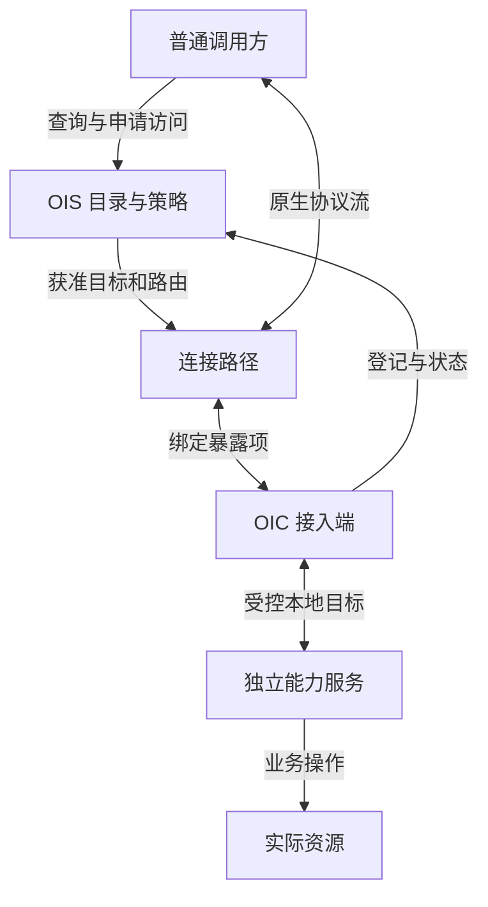

# alpha 整体架构推导与方案

候选推导记录 · 更新至v0.7，2026-11-02。现行收束结果见[架构与实现方案](../architecture/alpha-v0.7.md)；本页保留完整候选和来源，正文有不同表述时以v0.7当前推荐及最新人类决定为准。除明确的人类确认与标注的局部实验观测外，其余均为 **AI 提案与纸面推演**，没有 OIS/OIC 产品实现或语言性能实测；已有[局部机制实验](../evidence/alpha-lab-round1.md)，证据范围单独标明。旧 v2 保存在 [d680386](https://github.com/wyw-ai/loom-oi/tree/d6803867cf22ed46b5794e10b99ee2a1ea6a2035)；旧 S2–S9 锚点保留，但不再代表八个并列、可分别冻结的设计。

阅读顺序：[输入](#inputs) → [端到端闭环](#flow) → [整体候选](#packages) → [推导和依赖](#dependencies) → [#3](#s3)、[#2](#s2)、[#4](#s4) → [语言](#s8)。#5/#6/#7 是对应主线的专项记录，避免重复决策。

本轮[综合结论C01–C06](../evidence/alpha-synthesis-001.md)提出共同收敛：有界受控连接内核、可选有来源观测、原生或显式适配消费语义。online即ready、丢响应即未执行已被反例排除；有界并发、状态归约、具体对象层级仍是设计推论。产品形态和采用与技术事实分开，不再把所有结论笼统标为“尚无结论”。

## 1. 已知输入、缺口与架构驱动

| ID | 来源及其支持的内容 | 约束/价值 | 不能据此推出 |
| --- | --- | --- | --- |
| H1 | 用户 [#9 回复](https://github.com/wyw-ai/loom-oi/issues/9#issuecomment-6561327484)：暂不接入 Loom；Loom 不能是必需依赖；将来由 Loom 端适配 | 当前验收必须独立；消费契约不能包含 Actor/Session/Adapter；后续适配责任明确 | 用户选择了 SDK、CLI、HTTP 适配、Rust，或永远不接 Loom |
| H2 | 用户 [#8 回复](https://github.com/wyw-ai/loom-oi/issues/8#issuecomment-6561546252)：按功能需求比较 Go/Rust，Rust 未定 | 语言重新作为开放选择；先明确 OIC/OIS 实际负担 | Go 已获选、两种语言都必须实现完整产品 |
| R1 | 原聊天 L635–673、L1555–1585，[E03/E04](../../kb/evidence.md)：不管 Agent Session，连接与业务分开；调用例与“洞内业务自定”并存 | 核心能被普通应用消费；不能偷偷接管执行语义 | 透明模式已经获批；调用适配必须存在 |
| R2 | 原聊天 L986–1004、L1399–1553，[E04/E05](../../kb/evidence.md)：要找到具体能力，能力可独立生活；对象词义仍变动 | 不只连到一台机器，还要定位获准暴露项；区分接入与能力变化 | 必须有 Node→Provider→Workload 三层 |
| R3 | 原聊天 L723–807，[讨论§2.3](../alpha-discussion.md#23-网络路径与能力调用抽象交织)：跨网络与内网直达都有诉求 | 需要说清可达前提、中心故障和流量成本 | 已测 NAT 分布、必须 P2P 优先或中继优先 |
| R4 | 原聊天 L1704–1760，[E06](../../kb/evidence.md)：1C1G 只放 OIC | OIC 成本独立测量，能力服务和 OIS 分开计算 | 固定 RSS 门槛、某语言必胜、运行能力服务的成本为零 |
| R5 | 原聊天 L1026–1397，[讨论§2.5](../alpha-discussion.md#25-无状态的诉求与隔离的担心都要保留)：多使用者干扰与故障隔离 | 分清通道公平性、进程故障、真实资源冲突 | 必须自建通用锁/进程调度/Exactly-once |

缺口：实际首批调用者的协议能力、目标网络拓扑、并发/流量、可接受撤销窗口、团队 Go/Rust 维护经验均未有证据。下面明确采用假设推演，不用“常见最佳实践”补成需求。

## 2. 用同一闭环检验边界

**场景 A（首个验证候选）**：普通脚本发现跳板机上允许暴露的只读诊断 HTTP 服务，经 OI 建立访问并按原 HTTP 协议取回诊断结果。无需 Loom、LLM 或 OI 统一 Invoke。HTTP 服务是测试能力，不因此要求 OI 提供 HTTP 业务适配器。首批场景仍待人类确认。

**场景 B（模型反例）**：同一 OIC 暴露一个桌面服务和一个外部 API；桌面服务重启或停止响应时，API 暴露项仍存在。两个使用者同时操作同一桌面，通道分开不代表桌面分开。

**场景 C（路径反例）**：双方局域网可达，但中心中继远且贵；另一个现场只有受限出站。单一网络路径未必同时满足，需要依据拓扑决定首版覆盖。

图是方案 A 的职责草图。连接路径可以是可信中继或直连；中继是否读取载荷由加密终止点决定。Opaque 表示 OI 不定义内部业务语义，不自动意味着端到端加密。

| 步骤 | 输入 → 输出与所有者 | 本步证明什么 | 失败后能保证什么 |
| --- | --- | --- | --- |
| 1 暴露 | 管理者在 OIC 配置本地/可达目标；OIC 向 OIS 登记暴露项和协议描述 | 目标受控登记，不接受消费者任意 URL | 无获准登记则不可访问；不证明服务已就绪 |
| 2 发现 | 已认证调用方查询；OIS 返回其可见描述及版本 | 可选具体能力，而非只有机器端口 | 目录快照不是后续访问许可 |
| 3 访问 | OIS 按当前主体和暴露项审批；OIC 校验可信路由上下文和本地允许项 | 建立到准确目标的通道 | 本地禁止优先拒绝；不能凭不透明载荷宣称操作级鉴权 |
| 4 使用 | 调用方与能力服务使用原协议；OIC/路径执行流量上限与超时 | 实际结果由能力服务产生和解释 | 连接已建立不等于诊断成功或点击已执行 |
| 5 中断/撤销 | 通道结束；释放流、缓冲与路由状态；是否重试由业务方判断 | OI 不自动重放旧业务字节 | 已发生副作用不能因断开被撤销；重连是新通道 |

这条链同时决定描述字段、授权目标、状态语义和资源预算，不能分别在四张 Issue 中选互不兼容的答案。

## 3. 比较完整方案，而非堆叠局部最佳建议

| 方案 | 完整消费链与责任 | 何时成立 | 代价与失配 |
| --- | --- | --- | --- |
| A 能力目录 + 受控原生通道（当前条件性推荐） | OIS 做能力描述/发现/访问协调；OIC 绑定暴露项并传输；消费者使用原生协议；服务保留资源语义 | 现有 HTTP/MCP/自定义服务已能被消费者理解；当前先验证独立连接价值 | 消费者要懂协议；服务级授权不能冒充操作级；标准化工具体验较弱 |
| B 统一调用网关 | OI 定义操作模型；维护协议适配器、输入校验、流/取消/错误映射；服务仍拥有业务资源 | 首批调用者明确只能使用统一工具入口，且多协议整合收益可证明 | 适配版本、身份传递、取消语义和运行资源都成为产品责任；无法保证所有原生功能无损 |
| C A + 可选调用组件 | 原生通道完整可用；另一个可部署组件消费 A 并提供统一接口 | 已证实有两类消费者，且可以承担两套入口的一致性维护 | 兼顾能力也增加发布矩阵；“可选”仍需维护，不能用它回避范围取舍 |

**v0.7按当前案例推荐A/R作为实施基线，Go统一核心。** 用户已明确#10持续收纳案例、设计按当前材料推进；不等待全部消费者信息齐全。H9已确认不耦合功能实例化，H8已确认R路线；A的具体消费/登记细节及K2仍待评审；B/C在新案例改变消费能力或治理要求时重评。[完整成立条件](consumer-scenarios.md)与[实现细化](../architecture/alpha-v0.7.md#choices)配套。

来源可证明协议与机制，不能替代真实消费者需求；运行HTTP示例也不证明MCP互操作。若消费者仅接受统一工具而提供方异构，B/C有更强理由；若提供方原生接口已经兼容，不自动新增适配平台。产品取舍由人类确认，AI继续给出各分支具体方案。

网络选择是另一条轴：A/B/C 都能中继或直连。资源托管同样是可独立选择，但必须说明增加哪些 OIC 职责，不能从“有 Workload 一词”直接推导监督器。

## 4. 从证据到决策的依赖链

| 推导链 | 当前推论及强度 | 上游改变后必须重审 |
| --- | --- | --- |
| H1 + R1 → 普通消费者闭环 → A可作机制基线；是否需要Invoke须由#10证据决定 | AI候选分支；#10收集真实契约，#3负责形态取舍 | #2 的操作描述、#5 操作鉴权、#6 结果模型、#8 适配成本、#10/#3 验收 |
| R2 + 场景 B → 接入重连与服务变更不同 → 至少区分接入身份和暴露目标 | 由反例推出职责分离；正式名称仍未定，#2 负责 | #4 路由绑定、#5 目标授权、#7 生命周期；不推出强制 Provider/Workload 层 |
| R3 + “现场可向中心出站”假设 → 反向中继可覆盖入站不可达 → 首版只测一种路径 | AI 条件性推荐；拓扑未测，#4 负责 | #5 可信方/撤销、#6 断线、#8 中继与 OIC 各自资源；若局域网/隐私约束优先则重审 |
| A 不理解业务载荷 → 只能证明通道状态 → 执行成功/取消/去重在原协议 | 架构逻辑推论；#6 并入 #4，一旦选 B/C 需增加适配专项 | #3 对外保证、#5 操作授权、#4/#6 故障验收 |
| R5 + 两进程共享一桌面 → 进程/流隔离不能隔离桌面 → 真实资源的执行者负责互斥 | 反例推论；#7 并入 #2，不默认 OI 锁服务 | 若 OI 自己实现桌面控制，则它也成为提供方，必须承担该资源的并发责任 |
| R4 + A 的实际模块 → 有界流/缓冲/登记 → 比较 Go/Rust 的实际代价 | 官方语言事实 + 工程假设，#8 负责；没有赢家实测 | 改 B/C、引入托管/嵌入/多路径后需重新核算 |

**讨论依赖不等于停工**：#3→#2/#4→#8 是收敛顺序；可并行推演分支，冻结字段/协议/选型才需要上游取舍。#5/#6 对 #4、#7 对 #2 提供反例反馈，不构成互相等待的决策环。

## 5. #3 主线：对外能力边界和独立闭环

Problem：若不先定义 OI 向谁提供什么保证，目录、对象和错误模型都会默认套入某种工具平台。Goal：普通调用方通过 OI 定位并使用获准能力，并准确知道 OI 保证到哪里。Scope：合并 D1/D5；不做 Loom 接入、通用 Agent 模型或自动能力组合。

**方案 A 的具体契约草图**：`Discover(filter) -> exposure descriptors`；`Open(exposure_id, expected_revision) -> channel/error`；`Close(channel)`。不是已发布 API。描述最少含稳定目标、可读能力说明、协议及兼容信息、版本、接入/就绪状态的来源与新鲜度。操作 Schema 是可选描述；缺省不等于支持统一调用。

消费者发现目标后使用原生客户端，经本地受控转发端口或等价流接口访问。暴露本地端口的演示工具仅绑定本机、限制其生命周期；不得把获准通道变成其他本地用户随意复用的开放代理。既有服务认证仍由原协议承担；不能把 OI 访问票据直接当作提供方 API key。

B 要额外定义 `Invoke/Stream/Cancel` 的支持矩阵：不支持的功能明确拒绝而非模拟成功，适配器维护相关原生协议状态，取消仅表示已发请求/获确认。C 把同一矩阵放在可独立部署的消费组件中；关闭组件后 A 完整工作。三种方案都不要求消费方先注册为能力提供节点。

**本轮推演**：场景 A 只靠目录+通道+原生 HTTP 即闭环，证明“参考能力”不必是“统一适配器”。反例：仅会统一工具调用的消费者无法使用 A；此时应选 B/C，不能宣称 A 已覆盖它。

**持续输入与取舍**：#10持续补充消费者/承诺与成立条件，当前按已收纳案例提出A/R推荐，不再作为等待齐全的阻塞项。新案例改变消费边界时由本单联动#2/#4/#8评审。最小验证是用一个完全不认识 OI 业务模型的 HTTP 服务和普通脚本走通发现/访问；尚未运行。

## 6. #2 主线：对象、生命周期与能力自治（吸收 #7）

Problem：机器、接入进程、服务、能力说明、连接的变化速度不同，单一 Node 易混淆，堆层级也可能无价值。Goal：同机多服务、外部服务、OIC 重连都能正确定位；Scope：对象及所有权，含 D2/D4/D6 的最小责任，不定义通用部署平台。

v4补充[八类节点与探针/监控矩阵](consumer-scenarios.md#2-多维能力节点矩阵)，检验当前模型是否覆盖stdio、嵌套设备、长流和慢启动。增加可选ProbeSpec/Observation/监测能力与依赖引用的提案；未冻结对象字段。LAB-001支持TCP可达不保证及时应用成功，503与超时未知分别记录；状态过期规则仍只是模型。

**从场景推出来的推荐模型**：长期标识只先保留“接入登记 access_id”和“暴露项 exposure_id”；协议/能力是暴露项描述，实际服务是外部拥有的目标。内部连接有 generation，暴露配置有 revision。当前草图假设一个接入登记只有一个权威控制 generation，同代可承载多个传输连接；多活接入不在已解决范围。实例重启与凭证更新另按身份策略处理。这些是草图名，Node/Workload 正式词汇待定，撤回 v2 将 Node=身份、Provider=实例、Workload=托管直接当作优选词典的做法。

| 现实变化 | 保持 | 变化/处理 | 为什么 |
| --- | --- | --- | --- |
| 同一 OIC 同时暴露桌面和 API | 一个接入登记 | 两个独立暴露项，各有目标/状态/额度 | 服务之一不可用不能移除另一项 |
| OIC 仅网络重连 | 接入和暴露项 ID | 新连接 generation；旧连接清理不能删新路由 | 传输生命期不等于能力身份 |
| 目标地址/身份被替换 | 可保留逻辑 exposure_id | revision 更新，旧访问上下文拒绝或重协商 | 授权旧目标不可静默转给新服务 |
| 外部服务重启 | 暴露项可不变 | 原生会话/句柄由服务判定；OI 不臆造服务 incarnation | 不拥有进程就未必观测到准确重启代数 |
| 一服务经多接入发布 | 每个暴露路径各自可寻址 | 先不自动合并为一个逻辑可漂移实例 | 去重、故障转移需额外服务身份和安全重试证据 |

**生命周期方案**：当前 A 下由用户/已有服务管理器启动能力；OIC 配置目标、登记、连接、上报有来源的状态。OIC 在线只证明接入在线；没有就绪探针时标 Unknown。可选无副作用探针带来源、时间/顺序与revision。执行Idle/Running和就绪Unknown/Ready/NotReady分开；检查开始不清除仍有效旧观测，一次超时写attempt且不续期，旧样本到期或目标变更后Unknown。较新有效正/负证据替换判断；跨主机时钟与乱序处理尚待实现。心跳不刷新就绪，探针不保证未来请求成功。v0.7建议best_effort缺省、require_ready可配；有效NotReady两模式均拒绝，Unknown才区分策略，详细采用由#3承载并随持续案例台账变化重评；机制细化见[当前架构](../architecture/alpha-v0.7.md#observation)，原证据见[C01/C02契约](../evidence/alpha-synthesis-001.md#2-观测契约进一步修正状态图)。

**资源责任**：OI 控制每暴露项/全局流和缓冲；能力服务控制桌面、文件等真实资源。两条通道去同一桌面仍冲突。服务不能保证互斥时，描述为“不支持并发写/需外部管理”，不能把 OIC 队列说成跨多个服务入口的全局锁。

**合理备选**：扁平“一接入=一能力”部署最简单，但同机两服务需两份身份/连接，配置与撤销重复；显式 Provider/Workload 层可表达托管实例和多路径服务身份，但需要新增所有权/状态同步。若用户要求 OI 启停/升级服务，后者更合理，应把监督器、探针、重启预算及其资源纳入 #8，不能只添名词。

**本轮反例结论**：独立连接不能保证服务独立进程；独立进程不能保证不同桌面；两级登记也不能表达自动服务迁移。三种限制都应出现在能力声明/边界，而非承诺未做的隔离。

**待人类取舍**：是否接受按独立变化建模、暂不强制托管层？若需首版托管，具体是哪类服务启动责任？验证为同 OIC 两暴露项、一个离线、接入重连晚到清理、替换目标 revision 四种轨迹；目前仅纸面推演。

## 7. #4 主线：同一连接的可达、信任与失败契约（吸收 #5/#6）

Problem：网络路径决定谁能校验什么、断网还能否使用、撤销多久生效；拆开选“中继”“短期票据”“调用重试”可能拼不成一致系统。Goal：说清从申请通道到关闭的保证和成本。Scope：D3 与通道级授权/失效/流控；业务权限、任务恢复留给原协议。

| 完整路径方案 | 权限执行与故障行为 | 成本/前提 |
| --- | --- | --- |
| R 可信反向中继（条件性首版推荐） | OIC 主动连 OIS/中继；中心在线审批；OIC 只接受可信路由及本地允许项；中心连接丢失则关联通道断开 | 两端可到中心；中继占带宽、可见其终止加密后的流量；中心故障影响可用性 |
| D 协调后直连 | OIS 发有界、目标绑定的访问依据；OIC 独立核验；已有连接在控制面失联时按截止时间结束 | 需要实际直达或穿透机制、客户端绑定/重放防护、撤销窗口；不是“用了 UDP 就成功” |
| H 两条路径 | 同一暴露身份和授权语义，建连时选择一路，失败后新建；在途数据不跨路隐式重放 | 覆盖更广，但实现、诊断、状态组合和测试显著增加 |

推荐 R 的理由是仅需先证明“受控环境主动出站可用”这一条覆盖路径，不是已有数据证明它最快或最通用。若目标主要同 LAN、中心流量成本无法接受或中心不可信，则该前提被推翻，应转 D/H 或加入端到端保护；首版不先搭两套线路再等待需求。

**R 的具体机制**：

1. OIC 以接入凭证建立认证加密控制/反向连接；注册目标 ID/revision 与新 generation。消费者另行认证，不使用 OIC 密钥。
2. OIS 检查当前访问策略和目录版本；把消费者主体、暴露项、revision、通道标识、上限及截止时间通过可信链路送达 OIC。仅凭消息中自填主体无效。独立中继进程也需可验证的控制面指令和通道关联；具体签名/凭证格式未冻结。
3. OIC 校验目标仍匹配本地配置、generation/revision 有效、主体/本地约束和预算允许；拒绝消费者传入任意目标 URL。若 OIC 无法验证许可来源则拒绝建连。
4. R 可在线审批，不必先实现独立离线 Grant 平台。对于长流，需要显式最大存活期限或周期续权，中心撤销触发关闭；不能只在建连时校验一次便无限续命。具体期限取决于服务可用性需求，仍待取舍。
5. 流级与 OIC/中继全局缓冲同时有界；慢消费时背压或拒绝新增；心跳/撤销控制有独立调度预算，避免数据淹没控制。分离逻辑通道不保证底层 TCP 消除队头阻塞，仍需测控制延迟。
6. 控制链路失效停止新建，关联连接按明确失败/期限结束；恢复后重新鉴权和发现。OI 仅报告通道状态，不重发旧载荷。普通续连不是业务恢复。

**信任边界**：这是假设运营方信任 OIS/中继的方案，分段 TLS 不等于提供方端到端保密。若无需信任中继，可由原协议在隧道内 TLS 并校验提供方身份，或另设计通道端到端密钥协商。前者不要求 OI 解析业务，仍需明确认证目标；新增隐私诉求会改变 #3 描述、#4 握手、#5 信任验证、#8 成本。对本机恶意管理员/已攻陷能力服务，本方案不声称提供保护。

**本轮推演**：正常路径完成场景 A；旧目录授权不能越过当前策略；替换目标 revision 不能复用旧上下文；中继丢失响应后只能证明连接中断，不能重做点击；局域网高带宽场景暴露 R 的带宽代价；控制消息被大流阻塞揭示“独立队列”仍需底层验证。

**待人类取舍**：首批是否接受可信中心、出站中继及中心故障终止连接的可用性边界？若要中心不可信/失联继续运行/高带宽直连，要一起讨论其身份、撤销及成本，不单独添加一个路径开关。验证见 #5/#6 和 #10/#3；尚未运行跨网络OI实验。

## 8. #5 专项：授权是 #4 路径设计的约束

工作关系：**Integrated → #4**，W7后已按授权归档，历史讨论保留；不另排“通用授权平台”。原 v2 短期目标绑定 Grant 从默认推荐降为 D/H 的候选机制。

| 层级 | 由谁证明 | 最小保证 | 不能越界的承诺 |
| --- | --- | --- | --- |
| 目录可见性 | OIS 当前主体/策略 | 仅可见获准描述 | 可见不代表任意时候可访问 |
| 通道许可 | R 的 OIS + OIC 本地检查；D 的可验证访问依据 + OIC | 正确主体到正确暴露项/版本 | 不解析载荷就不能授予或阻止某个具体操作 |
| 原生操作权限 | 提供方；或 B/C 中受信任适配器 | 按原生主体/凭证检查 | 不能把所有 OI 主体混成一个高权限服务账户又宣称逐用户隔离 |
| 资源独占 | 真正控制资源的服务/网关 | 按资源协调实际操作 | 票据不提供互斥、撤销不回滚副作用 |

v0.7的R采用在线策略、数据腿身份认证、角色/目标版本/任期绑定的一次性附着票据，以及OIC有限许可期限；这些同样需要重放防护与撤销窗口验证。它不是独立离线Grant平台；D/H另需展开控制面失联时的独立验证。时钟漂移、检测延迟和活动任期共同约束窗口，具体值待P2/P3验证，不能保证即时撤销或已提交操作回滚。

反例：隧道传加密桌面流，中继看不到 click；只能撤通道，不能承诺精准禁止 click 而继续 screenshot。若产品必须操作级策略，需提供方原生鉴权或 B/C 适配，回到 #3，不让 #5 暗中改变产品边界。

Acceptance：#4 选定可信方/在线性后，本专项给出目标替换、伪造主体、撤销长流三条可验证轨迹；未定期限不能写“即时撤销”。现阶段授权撤销仍仅推演，无相应OI实测，未获架构接受。

## 9. #6 专项：通道错误与业务结果的证据边界

工作关系：**Integrated → #4**，反向校验#3；W7后已归档，剩余采用取舍由#4承接。撤回“全核心统一 completed/unknown 调用状态机”的默认读法，按可观测层定义保证。

| 观测 | OI 能报告 | 原生业务方仍需判断 |
| --- | --- | --- |
| Open 前权限拒绝 | 本次通道未建立，原因是访问拒绝 | 不推出之前另一通道没有执行 |
| Open 后提供方连接失败 | 连接失败/不可用；若能证明没有写任何业务字节可注明 | 不能仅凭超时推断业务未执行 |
| 已写载荷后链路中断 | channel interrupted，取消本地传输等待 | 操作成功/失败/部分发生仍可能未知 |
| 关闭或超时 | 传输结束 | 远端操作是否停止、补偿或回滚 |

B/C 下适配器可在原生协议提供证据时增加业务拒绝/完成/结果未知；不得伪造 unsupported Cancel。自动重试只能由语义层在能证明安全或原生协议保证幂等/持久去重时决定；未交付载荷也不证明连接本身没有副作用。不隐式重放指失败后重新提交业务，不禁用可靠传输内部的丢包恢复，也不承诺端到端At-most-once。request_id 只是关联，不是事务。能力端先执行后写日志仍有崩溃缝隙；此问题不因增加 OI 操作账本消失。[协议佐证 E09](../../kb/evidence.md)。

反例：服务递增计数后丢响应，OI 不重放，消费者观察中断而非“未执行”；若消费者想得到结果，可使用服务自己的查询句柄。LAB-002已用本地HTTP计数器实际运行该反例；5次不重放各计1，5次盲重放各计2。它只验证内存效果/响应丢失，不是OI或持久去重测试，见[原始报告](../evidence/alpha-lab-round1.md)。

本轮C03据实测反例收紧契约：只有可证明本次尚未向目标转交载荷，才报告本次未转交；其余中断不推断业务结果。重新建连重新鉴权，业务查询/安全重试归原生或适配语义层。

Acceptance：#3 对外保证与 #4 路径失败一致；按层明确取消/重试所有者；故障测试能证明 OI 不隐式重放。上游选 B/C 时再细化适配协议，不能让本专项单独批准统一 Invoke。

## 10. #7 专项：生命周期和隔离的反例，归入 #2

工作关系：原**Integrated → #2**；W7后#2/#7均归档，产品范围由#3、资源验证由#8承接。原“监督器 + readiness + 资源网关”不是三个首版必建组件；它们分别响应进程托管、可观测性、共享资源冲突，触发条件不同。

| 触发条件 | 责任与当前推荐 | 需要增项的反证 |
| --- | --- | --- |
| 已有服务可独立运行 | 服务管理者拥有启动/退出，OIC 只接入 | 明确要求 OI 安装启动服务，才展开可选监督器与重启预算 |
| OIC 在线但能力卡住 | 接入 online 与能力 ready 分开；无探针/过期则 Unknown；请求超时有限 | 若要求 OI 保证主动健康判定，需要协议特定、无副作用探针及成本 |
| 多流共享一个 OIC | 每暴露项和全局限额，防无限排队 | 需要崩溃隔离时再比较进程边界，逻辑队列不提供它 |
| 多个服务入口操作同一桌面 | 提供方/统一资源执行入口串行或拒绝；未支持则明确限制 | 若首版必须保证跨入口互斥，需要真实可执行 fencing 的资源所有者，不能只添通用 Lease |

本轮推演：旧就绪结果不得被心跳续期；没有探针不能伪造 NotReady；外部服务卡住不能擅自重启；不同通道仍指向同一桌面。上述结论约束 #2 的状态字段与能力声明，不独立冻结进程模型。LAB-001增加了真实TCP/HTTP/超时及局部调度观测；TTL/revision、进程和真实资源隔离未实测。

Acceptance：#2 对每种状态说明所有者、来源、过期与重启行为；#8 只计入被选中的监测/监督成本；#3 有至少一个服务故障不污染另一暴露项的独立验证。上述完整验证仍未执行；LAB-001仅为局部机制证据，C01–C02的完整状态/发布方案仍待实现。

## 11. #8：项目质量目标下的Go/Rust推荐

用户要求可用性、维护性、扩展/灵活性进入选型。当前AI推荐Go作为OIS/OIC首版统一核心语言，Rust保留为有明确翻转条件的备选；这不是人类采用决议。具体功能、HA边界、协议扩展方式与维护成本依据见[语言比较](oic-language-tradeoffs.md)。

LAB-003因无Go/Rust工具链与目标环境而Blocked。已运行的Python探针/故障夹具不支持语言性能排名。#10/#3改变消费承诺、#2加入托管/探针、#4改变路径/HA时都须重审成本。

## 12. #9：已完成的独立性边界

H1保持Accepted：暂不接Loom、OI不依赖Loom、未来由Loom端适配。用户[明确允许关闭](https://github.com/wyw-ai/loom-oi/issues/9#issuecomment-6562311062)，本轮已关闭该边界单。

此前未完成的独立闭环与故障验收移到活动主线：#10定义消费者/承诺，#3承载独立消费闭环，#4/#5/#6承载权限和故障，#8承载语言/部署。关闭不证明实验通过或产品实现。未来集成仍由人类重启、Loom侧适配。
