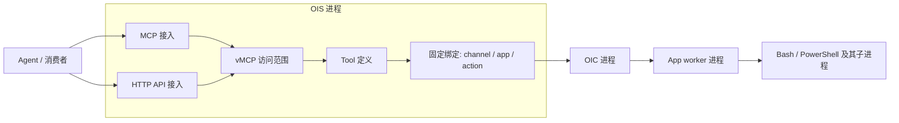

# 系统结构与交互

oi 当前通过 OIS、OIC 和独立终端 App 连接消费者与受控能力，采用固定调用关系。消费侧已支持 HTTP API 和 MCP，本版以 MCP 验证完整使用流程，未来可扩展更多消费方式。术语见[概念模型](../concepts/model.md)，本版交付边界见[目标](../goals/beta.md)。

## 调用链与进程边界

vMCP、Tool 和 Action 引用是 OIS 中的逻辑定义，不是分别部署的网络服务。OIC 主动向 OIS 建立 WS/WSS 长连接；图中的调用方向不表示 OIS 主动连接受控机。OIC 通过 JSON Lines 与 worker 通信，业务结果沿原链返回。

| 模块 | 承担的状态与责任 | 实现位置 |
| --- | --- | --- |
| OIS | 持久通道/Tool/vMCP 配置、在线连接和登记快照、单次调用关联、消费访问检查 | `cmd/ois`、`internal/ois` |
| OIC | 本机配置、App 加载记录、有效 runtime、worker、参数适配和中心登记 | `cmd/oic`、`internal/oic` |
| 主工程协议 | OIS/OIC 的业务无关消息封装、错误、可信 context | `internal/protocol` |
| Bash App | Linux 命令会话、PTY、输入输出、执行期限和结果 | `apps/bash` 独立模块 |
| PowerShell App | Windows 命令会话、ConPTY、输入输出、执行期限和结果 | `apps/powershell` 独立模块 |
| OIC 进程托管 | worker 进程组、后代监督与生命周期清理兜底 | `internal/procgroup` |
| CLI 运行管理 | 后台启动、本地回环控制、PID、状态与停止 | `internal/servicecmd` |

Linux Bash 和 Windows PowerShell 各自拥有 YAML、worker、依赖、测试和构建入口，可以整体移出主工程后独立构建。App 的会话及子进程管理代码也归各自所有；它们通过相同的 JSONL 线协议接入 OIC，不引用主工程 Go 包。OIS/OIC 不翻译命令语法；两种 App 保持相同的两 Action 契约，本机 `app_config` 分别配置 shell 路径与执行限制。

`apps/` 是本仓库收录独立 App 的位置，不是 OIC 插件编译目录；第三方 App 可从任意目录加载，无须修改 OIC。当前各 App 自有少量协议类型与进程管理实现，未来是否提供公共 SDK 另行决定。开发与交付入口见 [apps](../../../apps/README.md)。

### 已封板的 Filesystem 与 Browser 扩展

通过 HTTP 或 MCP 调用的路径仍是 vMCP → 固定 Tool 绑定 → OIC → 本地 worker。Filesystem 的 Go worker 持有根句柄和写入锁。Browser 的 Node.js worker 启动随包 Chromium，维护页面、会话、事件和 profile。两者可独立安装，普通业务结果沿用现有 JSON 通道。[扩展目标](../goals/oiapp-expansion.md) · [两个 App 的技术参考](../reference/oiapps/README.md)

对于两项图像 Action，扩展版 worker 在受控端编码预览，OIC 在 worker 握手和 OIS 连接两处核对结果能力，OIS 负责将同一有界结果映射到 HTTP 或 MCP。图像字节在调用响应中通过 OIS，文件和浏览器持久状态由受控机管理。Windows 的正常调用及混合版本测试见[开发验证](../../reports/oiapp-expansion/verification.md)。[宿主协议](../reference/app-runtime.md) · [消费端映射](../reference/ois-api.md)

## 启动、加载和发现

1. `ois start` 读取启动配置。首次运行导入 channels/tools/vmcps；以后加载持久配置，管理 API 更新不会被旧初始化 YAML 覆盖。
2. `oic start` 读取 Host/通道/连接配置，恢复已保存的 App 加载记录，并主动连接 OIS。OIS 核对通道与 Host 绑定；该通道启用 Token 时同时校验凭据。
3. `oic load app.yaml` 解析 Action、Schema 和有效 runtime，启动所需 worker，发送 `start` 并等待 `ready`。所有本地入口成功后才发布完整 App；部分初始化失败回收本次资源。
4. OIC 上报 Host、App、Action 和就绪状态。OIS 更新管理视图，但不因此创建或覆盖消费侧 Tool 定义。本地 ready 与中心 registered 分别显示。
5. 管理者配置 Tool 的固定 source，并将 Tool 加入 vMCP。消费者可通过 MCP 初始化、发现工具并调用，也可通过 HTTP API 指定 vMCP 和 Tool 调用；工具名称已决定执行位置。本版验收采用前一种消费流程。

准确的 CLI 与字段分别见 [CLI](../reference/cli.md)、[配置](../reference/configuration.md)和 [App runtime](../reference/app-runtime.md)。

## 一次命令与持续执行

OIS 校验 vMCP 访问与 Tool 成员关系，取得当次固定绑定，生成 `call_id`，通过在线通道发送 `invoke`。OIC 按本地定义适配输入并转给相应 worker；可信身份在独立 context 中传递。

worker 执行 `exec_command`，在本次等待窗口结束时返回输出。命令已结束时返回退出码；仍在执行时返回 `session_id`。消费者继续调用同组 `write_stdin`，每轮是新的调用，但操作同一个命令执行。空 `chars` 用于读取后续输出，非空输入需要原执行具有交互终端。

终端输出由 App 持续采集并分批交付，不使用专用 stdout 订阅或 MCP Tasks。结果载荷对 OIS/OIC 保持业务透明；终端结果字段和取消语义见[终端参考](../reference/terminal-actions.md)。

## 断连、卸载和重启

| 事件 | 责任与边界 |
| --- | --- |
| 通道断开 | OIS 停止向其投递新调用；交付后未获结果的调用可能返回 `CALL_RESULT_UNKNOWN`。不缓存离线命令等待执行。 |
| OIC 重连 | 使用原通道配置重连并重新登记；旧连接的迟到消息不能覆盖新状态。若原 worker 仍活着，已知执行句柄可按原身份范围接续。 |
| 重复 load | 相同有效定义不重复启动；定义变化须先卸载。无文件监听热更新。 |
| unload | 拒绝新调用、撤登记、回收 App 执行并移除加载记录。 |
| OIC stop / worker 退出 | 回收其托管资源；stop 保留加载记录，worker 崩溃不自动重启。 |
| OIC 再次 start | 重新加载已保存记录；新的 worker 不恢复旧执行句柄。 |
| OIS 重启 | 加载持久配置，在线视图由重新连接与登记恢复；不承诺旧在途调用恢复。 |

Linux 使用 PTY 和私有 subreaper 监督普通后代，Windows 使用 ConPTY 和 Job Object。它们负责当前托管范围内的资源回收；不是对恶意程序的隔离沙箱。

## 管理、消费与本地控制

OIS 管理 API 修改中心定义并查询登记；MCP/REST 消费入口使用 vMCP 绑定和访问规则；OIC CLI 的 load/unload 管理本地接入。当前没有从 OIS 远程上传 App 或替用户执行 `oic load` 的管理接口。

OIS/OIC CLI 使用独立的本地回环管理接口，其自动生成的控制凭据与公开 OIS 的可选 Token 分开。默认关闭公开 Token 并不关闭内部回环控制认证。

业务参数不能更改固定来源或 runtime；同 Tool 不原位换绑，配置变更仅影响后续请求。配置、登记、命令状态的持久化边界各自独立，不能把“配置可恢复”理解成“执行可恢复”。
