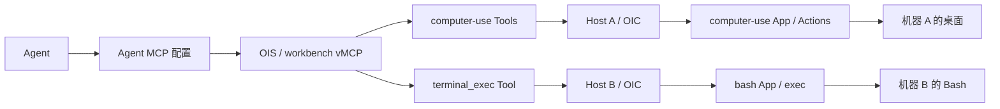

# loom-oi beta：从 App YAML 到 Agent 调用

本文用一个完整场景说明建议的产品形态：**机器 A 提供 computer-use，机器 B 提供 Bash，用户在 OIS 中组合一个 vMCP，Agent 连接这个入口后，能够明确选择机器并调用能力。**

已确认的骨架是 Host、App、Action、Tool、vMCP，以及“一个 App 一份 YAML，配套 actions 目录，OIC 加载执行，OIS 映射和组合”。下文把尚未确定的部分补成一套可讨论的方案。**具体字段、目录、CLI、认证方式和执行约定均为候选设计，尚未实现或整体采纳；示例不是当前可执行的安装教程。** 本文也不把 Bash 与 computer-use 同时纳入 beta 首版的范围视为已定。

## 1. 产品最终让用户配置什么

建议把配置分成四层，每层回答一个问题：

| 配置 | 谁维护 | 回答的问题 |
| --- | --- | --- |
| App YAML 和 actions 代码 | App 开发者 | 这个 App 提供哪些 Action，参数是什么，如何执行？ |
| OIC 本机配置 | Host 管理者 | 这是哪台机器，连接哪个 OIS，App 在本机使用什么环境？ |
| OIS 的 Tool / vMCP 配置 | 能力使用者或管理员 | 哪些 Action 对外开放，叫什么，允许在哪些 Host 上执行？ |
| Agent 的 MCP 配置 | Agent 使用者 | 连接哪个 vMCP，以什么凭据访问？ |

其中，App YAML 是可复用的能力定义；机器地址、目标选择和 Agent 的接入信息分别放在对应层。App 开发者不必知道最后会有多少个 vMCP，也不必提前填写对外 Tool 名称。



调用沿图向右，结构化结果和截图沿原路返回。vMCP 是 OIS 提供的逻辑 MCP 入口，不要求为每个 vMCP 启动一份独立服务进程。

本例采用三个标识定位执行入口：`host_id + app_code + action`。例如 `host-b + bash + exec`。Host 指实际宿主机；未来负载池应有自己的概念，不能继续用 Host 同时表示一组机器。

为了先把流程讲清，本例限定每台 Host 每个 App code 只有一个加载实例。以后同一 Host 需要两套 Bash 工作环境时，再设计实例标识；不要现在让 `app.code` 同时充当 App 名和实例名。

## 2. 推荐的目录组织

App 开发者交付普通目录即可。这里统一将描述文件命名为 `app.yaml`；命名为 `bash.yaml` 或 `computer-use.yaml` 也可以，OIC 根据文件内容识别 App，不根据文件名推断能力。

```text
app-examples/                       # 可放在项目的 examples/apps/ 下
  bash/
    app.yaml                       # 一个 App 的全部 Action 定义
    actions/
      exec.py                      # Bash 执行逻辑
    README.md                      # 环境要求、安装方法、行为说明

  computer-use/
    app.yaml                       # 同时定义截图、点击、输入文字
    actions/
      screenshot.py
      click.py
      type_text.py
      desktop.py                   # 共享桌面访问、坐标转换等内部逻辑
    README.md
```

只有 YAML 中声明的 Action 会被登记；`desktop.py` 是内部模块，放在 actions 目录不意味着自动成为一个可调用 Action。

部署到机器以后，建议保持 App 与宿主配置分开：

```text
host-a/                            # 实际位于机器 A
  oic.yaml
  apps/
    computer-use/
      app.yaml
      actions/...
      README.md
  .oic/                            # OIC 自动维护，不手工编辑
    loaded.json                    # 已加载 App 路径及本机状态
    logs/

host-b/                            # 实际位于机器 B
  oic.yaml
  apps/
    bash/
      app.yaml
      actions/...
      README.md
  .oic/
    loaded.json
    logs/

ois-deployment/                    # OIS 所在环境
  ois.yaml                         # 服务配置、Host 接入、Tool 与 vMCP 配置
  data/                            # 服务自己的运行状态

agent-workspace/                    # Agent 所在环境
  .vscode/
    mcp.json                       # 本文选用 VS Code 本地 Agent 举例
```

这是部署目录示意，不要求所有目录都位于同一个仓库，也不是 OIS/OIC 源码的工程目录。Python 只是脚本例子：第一版若选择 Rust 可执行程序，同样可以把 `run` 指向对应程序。具体桌面后端、依赖清单及安装器在选定运行平台后补充。

## 3. Bash App：一份 YAML，一个执行入口

建议的 `bash/app.yaml`：

```yaml
version: 1
app:
  code: bash

config_schema:
  type: object
  additionalProperties: false
  properties:
    shell_path: {type: string, minLength: 1}
    default_cwd: {type: string, minLength: 1}
  required: [shell_path, default_cwd]

actions:
  exec:
    input_schema:
      type: object
      additionalProperties: false
      properties:
        script: {type: string, minLength: 1}
      required: [script]
    output_schema:
      type: object
      additionalProperties: false
      properties:
        stdout: {type: string}
        stderr: {type: string}
        exit_code: {type: integer}
      required: [stdout, stderr, exit_code]
    run: ["python", "./actions/exec.py"]
```

这些字段有明确的边界：

- `version` 是 YAML 格式版本，不是 App 发布版本。
- `app.code` 是可复用 App 的身份。它不包含 Host ID 或 vMCP 名称。
- `config_schema` 定义安装到某台机器时所需的本地配置；值由 OIC 配置提供。
- `input_schema` 定义每次调用的业务参数。系统路由字段 `host_id` 不属于这里。
- `output_schema` 校验执行完成后的业务 `result`，公共状态和错误由统一结果约定表达。
- `run` 是程序和参数数组。相对脚本路径以 App YAML 所在目录解析；程序名称由 OIC 所处环境解析。本示例要求已经安装可由 `python` 命令调用的解释器。

`exec.py` 需要实现的逻辑很集中：读取结构化输入，取到 `script`、`shell_path` 和 `default_cwd`，用指定 Bash 执行脚本，收集 stdout、stderr、退出码，再按统一格式返回。

建议这个首个 Action 是**单次 Bash 执行**：调用中的 `cd`、变量和子命令在本次执行内有效；下一次调用从配置的默认目录开始。持久终端会话应在之后单独设计，不能让 Agent 误以为两次 `exec` 天然共享 shell 状态。

`default_cwd` 只定义初始工作目录，不等于文件访问隔离。Bash 使用 OIC 的执行账户所具备的系统权限。

## 4. Computer-use App：一份 YAML，多个 Action

computer-use 建议先用三个 Action 表达完整交互：`screenshot` 看屏幕，`click` 点击，`type_text` 向当前焦点输入文本。它们属于同一个 App，共享同一个受控桌面约定。

下面的 YAML 使用两个锚点减少重复：桌面标识的 Schema、操作完成结果的 Schema。它们只是 YAML 的复用语法，不是额外运行机制。

```yaml
version: 1
app:
  code: computer-use

config_schema:
  type: object
  additionalProperties: false
  properties:
    display: {type: string, minLength: 1}
  required: [display]

actions:
  screenshot:
    input_schema:
      type: object
      additionalProperties: false
    output_schema:
      type: object
      additionalProperties: false
      properties:
        desktop_id: &desktop_id_schema {type: string, minLength: 1}
        width: {type: integer, minimum: 1}
        height: {type: integer, minimum: 1}
        image_id: {type: string, minLength: 1}
      required: [desktop_id, width, height, image_id]
    run: ["python", "./actions/screenshot.py"]

  click:
    input_schema:
      type: object
      additionalProperties: false
      properties:
        desktop_id: *desktop_id_schema
        x: {type: integer, minimum: 0}
        y: {type: integer, minimum: 0}
        button: {type: string, enum: [left, right, middle]}
      required: [desktop_id, x, y, button]
    output_schema: &applied_schema
      type: object
      additionalProperties: false
      properties:
        applied: {type: boolean}
      required: [applied]
    run: ["python", "./actions/click.py"]

  type_text:
    input_schema:
      type: object
      additionalProperties: false
      properties:
        desktop_id: *desktop_id_schema
        text: {type: string}
      required: [desktop_id, text]
    output_schema: *applied_schema
    run: ["python", "./actions/type_text.py"]
```

具体实现责任如下：

| 文件 | 要实现什么 |
| --- | --- |
| `screenshot.py` | 捕获所配置桌面的指定显示器，返回图像及宽高、桌面上下文 ID。 |
| `click.py` | 检查桌面上下文有效、坐标在范围内，将截图像素坐标转换为系统输入坐标，执行点击。 |
| `type_text.py` | 检查桌面上下文有效，将文本输入到当前焦点；不声称输入完成就等于页面保存成功。 |
| `desktop.py` | 访问实际桌面后端，统一显示器选择、缩放关系及桌面上下文识别，供三个入口复用。 |

本例先固定一个已登录桌面和一个显示器。`display: primary` 是选择本机主显示器的候选配置，`desktop_id` 是 App 返回的当前桌面上下文标识，两者不是同一个字段。

`desktop_id` 必须能跨 Action 调用校验。桌面登录会话、显示器或影响坐标的布局发生变化时，旧 ID 应失效，让 Agent 重新截图。可以由共享后端或 App 自己的本地状态实现，不能每个脚本随意生成一个无法验证的新字符串。

坐标统一按返回图像的像素空间表达，左上角为 `(0, 0)`。App 负责系统缩放换算，OIS 不再静默缩放图片。如果未来引入压缩缩放，必须同时返回可用的坐标映射。`desktop_id` 也不保证画面内容没有变化；Agent 仍需观察当前截图，并在操作后再次检查。

因此，“逐次启动脚本”与“持续控制同一桌面”可以共存。持续存在的是实际桌面和 App 能识别的上下文，不要求每个 Action 独自维护一套桌面会话。若选定后端确实需要常驻进程，再增加相应托管能力；这不改变一个 App 多个 Action 的组织方式。

## 5. OIC 怎样驱动这些脚本

建议先采用一个简单的统一运行约定：**每次调用启动入口程序，stdin 输入一份 UTF-8 JSON 后关闭；stdout 输出一份 UTF-8 JSON 结果；入口自己的诊断写到 stderr。** 输出按进程结束收集，第一版不在这里混入流式事件。

例如，OIC 调用 Bash 入口时交付：

```json
{
  "call_id": "call-001",
  "input": {"script": "ls -l"},
  "config": {
    "shell_path": "/bin/bash",
    "default_cwd": "/srv/workspace"
  }
}
```

OIC 已经根据路由选择好入口。脚本不需要解释 Tool 名称、Host ID、OIS 地址或 Agent 凭据。

正常执行完毕的结果：

```json
{
  "status": "completed",
  "result": {
    "stdout": "total 0\n",
    "stderr": "",
    "exit_code": 0
  },
  "attachments": []
}
```

Bash 的原始输出必须被 `exec.py` 捕获到结果字段，不能直接混进入口 stdout。Bash 返回非零 `exit_code` 时，仍然表示一次已经完成的业务执行，保留它的输出和退出码让 Agent 判断。

可识别的执行失败使用另一种结果：

```json
{
  "status": "failed",
  "error": {
    "code": "DESKTOP_UNAVAILABLE",
    "message": "The configured desktop is not available."
  }
}
```

入口正常输出任一合法结果后，自身以退出码 0 结束。入口启动失败、崩溃、非零退出或输出非法 JSON，由 OIC 生成执行器错误，不能和 Bash 业务退出码混为一谈。公共 `failed` 结果不按 Action 的业务 `output_schema` 校验。

截图则在公共 `attachments` 中携带图像内容：

```json
{
  "status": "completed",
  "result": {
    "desktop_id": "desktop-a-01",
    "width": 1920,
    "height": 1080,
    "image_id": "screen-001"
  },
  "attachments": [
    {
      "id": "screen-001",
      "type": "image",
      "mime_type": "image/png",
      "data_base64": "<PNG bytes encoded as base64>"
    }
  ]
}
```

图像字段中的文字是占位符。OIC 验证附件引用、类型和大小，再把实际内容交给 OIS；OIS 将元数据保留为结构化结果，将图片转换为 MCP 的图像内容。MCP Tool 结果可以包含 image 内容块以及结构化数据，图像不必伪装成普通文本。[MCP Tools 规范](https://modelcontextprotocol.io/specification/2026-07-28/server/tools)

这里采用内联图片，是为了首个流程不再引入文件服务器。必须规定输入、输出及图片的大小上限，并对超限返回明确错误；具体限额待平台验证后确定。只返回机器 A 上的文件路径，Agent 并不能看到截图。

通用机制由 OIC 实现：加载校验、输入输出交付、进程管理、结果验证和调用状态。Bash/CU 作者只实现业务逻辑及约定适配。以后可抽取一个很薄的辅助库减少 JSON 读写重复，不以先做大型 SDK 作为接入前提。

超时和取消也属于这个共同边界：停止包装脚本不等于 Bash 子进程已停止。OIC 与 App 必须协作管理实际执行，不能把“收到取消请求”报告成“已停止”。断连后的执行结果可能未知，尤其 Bash 和点击不应自动重试。

## 6. 在机器 A 和机器 B 上配置 OIC

先准备运行环境：机器 A 具备所选 CU 后端支持的已登录桌面，OIC 以可访问该桌面的用户身份运行；机器 B 安装 Bash 并准备 `/srv/workspace`。两个环境都安装本例入口所需的 Python。后台运行不自动意味着安装为系统服务，CU 尤其需要保留正确的桌面访问上下文。

机器 A 的 `oic.yaml`：

```yaml
version: 1
host:
  id: host-a
  name: 我的桌面电脑
ois:
  url: https://ois.example.com
  credential_env: OIC_HOST_A_TOKEN
state_dir: ./.oic
app_config:
  computer-use:
    display: primary
```

机器 B 的 `oic.yaml`：

```yaml
version: 1
host:
  id: host-b
  name: 我的开发服务器
ois:
  url: https://ois.example.com
  credential_env: OIC_HOST_B_TOKEN
state_dir: ./.oic
app_config:
  bash:
    shell_path: /bin/bash
    default_cwd: /srv/workspace
```

`app_config` 按 App code 提供本机配置，OIC 在加载时按该 App 的 `config_schema` 校验。它本身不代表已经加载 App。`state_dir` 相对 OIC 配置文件解析，CLI 的相对加载路径则相对当前命令目录解析。

凭据以指定环境变量的值提供。`credential_env` 是本候选配置读取规则，不表示任意 YAML 字符串都会自动插值。每台 Host 使用自己的接入凭据；OIS 应将其绑定到对应 Host ID，不能仅凭调用者自报 `host-a` 就接受身份。

建议 OIC 一个程序同时提供常驻宿主与管理命令。以下命令从各自部署目录运行，语法为产品草案：

```sh
# 机器 A
oic --config ./oic.yaml start
oic --config ./oic.yaml load ./apps/computer-use/app.yaml
oic --config ./oic.yaml apps
```

```sh
# 机器 B
oic --config ./oic.yaml start
oic --config ./oic.yaml load ./apps/bash/app.yaml
oic --config ./oic.yaml apps
```

建议 `start` 启动本机唯一宿主进程并连接 OIS；后续管理命令通过本地控制通道找到它。如何实现控制通道、操作系统服务安装和 OIS—OIC 的通信协议，仍需另行设计。

`load` 完成的事情应当可观察：

1. 读取 App YAML，校验格式、App code、Action Schema 和本地配置。
2. 解析入口路径，检查解释器和脚本可用，建立本地 `App.Action → run` 索引。
3. 持久保存加载记录，使 OIC 重启时可重新校验并恢复；文件已经失效时报告不可用，不沿用过期的 ready 状态。
4. 向 OIS 登记 Host 下的 App、Actions 和接口结构，等待登记结果。
5. 分别报告本地加载状态与 OIS 登记状态，例如 `loaded / registered`，或者 `loaded / pending`。

推荐 OIS 暂时不可达时保留本地加载记录并重试登记，但不要将它显示为 Agent 已可调用。入口文件存在也不证明屏幕可捕获；可用性最终还要通过真实调用验证。

`load` 不运行 `exec`、`click` 等业务 Action，也不自动创建对外 Tools。再次加载同一 App、同一有效定义可返回当前状态；定义有变化时应要求显式更新，避免旧 Tool 在后台被替换成不兼容接口。具体更新命令留待设计。

## 7. 在 OIS 组合“机器 A 的 CU + 机器 B 的 Bash”

OIS 至少管理三类信息：接入 Host 的身份，Action 到 Tool 的映射，以及 vMCP 的工具集合和访问者。以下用一份 `ois.yaml` 表达这个模型；未来也可以由界面或管理 API 创建同样的对象，内部不必照着文件结构存储。

```yaml
version: 1
server:
  public_url: https://ois.example.com

hosts:
  host-a:
    credential_env: OIC_HOST_A_TOKEN
  host-b:
    credential_env: OIC_HOST_B_TOKEN

tools:
  terminal_exec:
    description: 在指定 Host 上执行一次 Bash 脚本；各次调用不共享 shell 状态。
    source: {app: bash, action: exec}
    allowed_hosts: [host-b]

  desktop_screenshot:
    description: 获取指定 Host 的桌面截图及 desktop_id，供后续桌面操作使用。
    source: {app: computer-use, action: screenshot}
    allowed_hosts: [host-a]

  desktop_click:
    description: 使用最近截图的 desktop_id 和图像像素坐标，在同一 Host 上点击。
    source: {app: computer-use, action: click}
    allowed_hosts: [host-a]

  desktop_type_text:
    description: 在同一 Host 和 desktop_id 的当前焦点中输入文本；必要时先点击目标输入框。
    source: {app: computer-use, action: type_text}
    allowed_hosts: [host-a]

vmcps:
  workbench:
    path: /mcp/workbench
    system_tools: [list_targets]
    tools:
      - terminal_exec
      - desktop_screenshot
      - desktop_click
      - desktop_type_text
    access:
      credential_env: WORKBENCH_AGENT_TOKEN
```

`ois.yaml` 不再重复写一遍 `script`、`x`、`y` 等业务输入结构。OIS 从已登记的 App Action 获取结构，构造 Tool 参数，并维护面向 Agent 的名称和说明。第一版建议保持业务结构原样，不加入任意字段转换表达式。

本例的两个 Host 接入凭据和一个 Agent 凭据承担不同身份。部署者分别生成并设置它们：Host A 的值交给 A 和 OIS，Host B 的值交给 B 和 OIS，Agent 的值只授予使用 `workbench` 的客户端。这只是说明首个闭环的凭据关系，不等于已经确定完整账号和授权产品。

推荐的配置与启用顺序是：

1. 准备 Agent 和两台 Host 都能访问的 OIS 地址。示例域名需要替换为实际地址，HTTPS 和网络可达性由部署环境准备；`public_url` 本身不会配置 DNS 或证书。
2. 在 OIS 建立 Host 身份和接入凭据，启动 OIS。候选命令为 `ois start --config ./ois.yaml`。映射可以先保存为待验证状态。
3. 在 A/B 配置凭据，执行上一节的 `start`、`load`，确认 Host 在线且 Actions 已登记。
4. OIS 校验每个 Tool 引用的 App、Action、Host 和 Schema；确认四个 Tool 的可执行目标符合配置。
5. 校验通过后发布 `workbench`，得到 MCP 地址 `https://ois.example.com/mcp/workbench` 和 Agent 接入配置。
6. Agent 连接并刷新工具列表，进行一次 Bash 调用和一次桌面观察—操作—再观察验证。

“保存配置”“Host 已登记”“vMCP 已发布”应有不同状态。文件写完不能直接当作端到端已可用。后续 Host 离线时，Tools 的定义可以保留，但目标查询应显示不可用，实际调用应失败，不能换到另一台机器执行。

如果后来机器 A 也提供兼容的 `bash.exec`，用户只需要加载它，再将 `terminal_exec.allowed_hosts` 改为 `[host-a, host-b]`。Agent 仍看到一个 `terminal_exec`，每次用 `host_id` 明确选择。合并前至少要求输入、输出结构一致且执行语义符合 Tool 说明；同名不能自动代表兼容。

## 8. Agent 如何连接和发现目标

建议 vMCP 对 Agent 提供远程 MCP 入口。MCP 的标准传输包含 Streamable HTTP；OIS—OIC 采用什么协议是另一个边界，不由这个选择推定。[MCP 传输规范](https://modelcontextprotocol.io/specification/2026-07-28/basic/transports)

不同 Agent 的配置文件格式并不完全一样。这里选 **VS Code 的本地 Agent 会话**，在 `.vscode/mcp.json` 中连接：

```json
{
  "inputs": [
    {
      "type": "promptString",
      "id": "loom-token",
      "description": "loom-oi workbench access token",
      "password": true
    }
  ],
  "servers": {
    "loomWorkbench": {
      "type": "http",
      "url": "https://ois.example.com/mcp/workbench",
      "headers": {
        "Authorization": "Bearer ${input:loom-token}"
      }
    }
  }
}
```

这个客户端支持 `servers`、HTTP URL、自定义 headers 和输入变量。启动连接时提供 `WORKBENCH_AGENT_TOKEN` 对应的值，并按客户端界面启用工具。输入变量并非所有远程 Agent 或 harness 都能转发，因此 OIS 未来应按客户端生成配置，不能把这一份 JSON 当作 MCP 的通用配置格式。[VS Code MCP 配置参考](https://code.visualstudio.com/docs/agents/reference/mcp-configuration)

Agent 配置只记录 OIS 入口及认证信息，不填写两台机器的 IP，也不加载 Bash/CU 的 YAML。Host 目标属于运行时发现与调用参数。

MCP 的 `tools/list` 用于发现工具定义；本文额外建议 OIS 提供一个系统 Tool `list_targets`，查询“当前访问者能对哪些 Host 使用某个 Tool”。这个工具是 loom-oi 的发现能力，不是 MCP 标准方法，也不是某个 App 的 Action。[MCP 工具发现规范](https://modelcontextprotocol.io/specification/2026-07-28/server/tools)

例如其调用参数为：

```json
{"tool": "terminal_exec"}
```

业务结果为：

```json
{
  "targets": [
    {
      "host_id": "host-b",
      "name": "我的开发服务器",
      "available": true
    }
  ]
}
```

查询 `desktop_screenshot` 则返回允许使用的 `host-a`。查询范围限定在当前 vMCP 和访问者权限内，不泄露整个 OIS 的 Host 清单。查询结果不是后续执行的保证；调用时 OIS 仍需检查权限、在线状态及映射有效性。

所有 App 映射出来的 Tool 统一使用下面的参数分层：

```json
{
  "host_id": "host-b",
  "input": {"script": "ls -l"}
}
```

`host_id` 和 `input` 都必填，即使当前只有一个目标。OIS 将 App 的 `input_schema` 放在外层 `input` 属性下，并加入路由字段。这样将来业务本身恰好有一个叫 `host_id` 的参数，也不会与系统路由冲突。

对本例，Agent 看到的是五个工具：一个目标发现工具、一个 Bash 工具、三个 CU 工具。对外 Tool 集合由 OIS 控制，加载 App 本身不等于让全部 Agent 自动获得能力。

## 9. 完整走一次实际使用流程

假设用户向 Agent 提出：“看一下开发服务器的工作目录，再打开桌面电脑上的目标输入框，输入 hello，并确认画面。”

以下 JSON 是 Tool 的调用参数或业务结果片段，不是完整 MCP 网络报文；网络封装由客户端和 OIS 处理。输出内容用于说明形状，不代表已经执行。

### 第一步：发现工具与机器

Agent 通过 MCP 获取工具列表，再分别调用 `list_targets` 查询 `terminal_exec` 和 `desktop_screenshot`，知道开发服务器是 `host-b`、桌面电脑是 `host-a`。它从发现结果取 ID，不根据名字自行猜一个设备 ID。

### 第二步：在机器 B 执行 Bash

调用 `terminal_exec`：

```json
{
  "host_id": "host-b",
  "input": {"script": "pwd; ls -l"}
}
```

OIS 根据当前 vMCP 的 Tool 映射查到 `bash.exec`，验证 `host-b` 在允许目标中，将这次调用发给 B 的 OIC。OIC 校验业务输入，找到 `bash/actions/exec.py`，将本地配置和输入交给它。

脚本在 `/srv/workspace` 执行 Bash，结果经 OIC、OIS 返回。Agent 得到 stdout、stderr、exit_code，才能判断目录内容和命令是否成功。OIS 可以同时返回结构化数据与便于客户端展示的文本摘要。

### 第三步：查看机器 A 的桌面

调用 `desktop_screenshot`：

```json
{
  "host_id": "host-a",
  "input": {}
}
```

A 的 screenshot Action 返回图像及 `desktop_id: desktop-a-01`、`width: 1920`、`height: 1080`。OIC 将真实图像内容传回，OIS 转成 MCP 图像结果，Agent 能够实际看见桌面。

### 第四步：根据截图定位、点击并输入

假定 Agent 从截图中确认目标输入框位于 `(600, 350)`，调用 `desktop_click`：

```json
{
  "host_id": "host-a",
  "input": {
    "desktop_id": "desktop-a-01",
    "x": 600,
    "y": 350,
    "button": "left"
  }
}
```

点击成功并确认焦点合适后，调用 `desktop_type_text`：

```json
{
  "host_id": "host-a",
  "input": {
    "desktop_id": "desktop-a-01",
    "text": "hello"
  }
}
```

必要时在点击后补一次截图验证焦点。两次操作都必须指向 A 上同一个 CU App 的有效桌面；如果上下文已变化，返回明确错误并重新观察。

### 第五步：再次截图核对结果

再次调用 `desktop_screenshot`，检查输入框是否出现 hello。`applied: true` 只表示输入动作已经执行；Agent 的任务是否完成，需要依据返回画面和用户要求判断。

这就闭合了完整链路：

```text
用户目标
  → Agent 发现工具、查询允许的 Host
  → 调用 Tool(host_id, input)
  → OIS 检查映射并路由
  → 对应 Host 的 OIC 选择 App.Action
  → Action 脚本操作 Bash 或桌面
  → 结构化结果 / 图像经 OIC、OIS 返回
  → Agent 判断结果并继续下一步
```

## 10. 用这个流程检验设计是否成立

在实现阶段，至少应能观察到以下结果：

- A/B 分别加载自己的 App，OIS 显示准确的 Host、App、Action 关系。
- `workbench` 只暴露配置的四个业务工具与一个发现工具。
- Bash 调用确实发生在 B，CU 调用确实发生在 A；缺少或错误的 `host_id` 被拒绝。
- Bash 非零退出仍保留业务输出；入口故障能与之区分。
- Agent 收到实际截图，并能用相同桌面上下文完成点击、输入和再次观察。
- Host 离线、Action 不存在、接口不兼容、桌面失效和结果超限均有明确结果，不静默切换目标或重复执行。

本文推荐先用这套形态讨论和验证：**App YAML 描述动作，脚本实现动作，OIC 提供统一运行与登记，OIS 决定对外工具和目标范围，Agent 通过 vMCP 发现并调用。**

下一步需要收束的是统一执行约定、OIC 加载与恢复语义、首个桌面平台，以及 OIS—OIC 的投递与调用状态规则。完整版本管理、多实例、持久终端、负载均衡和无 Host 的远程 App 暂不嵌入这个示例；它们可以在基础关系稳定后扩展。

相关文档：[已确认共识](../../../current/beta/design.md)、[候选设计总稿](design.md)、[沟通笔记](notes.md)。
