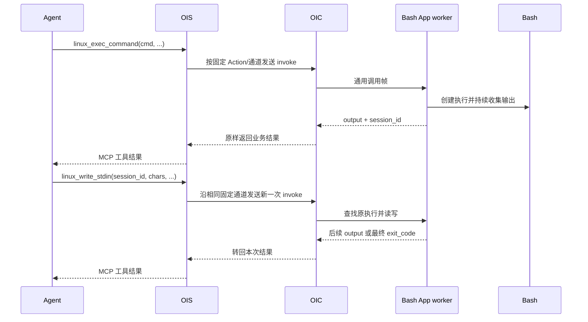
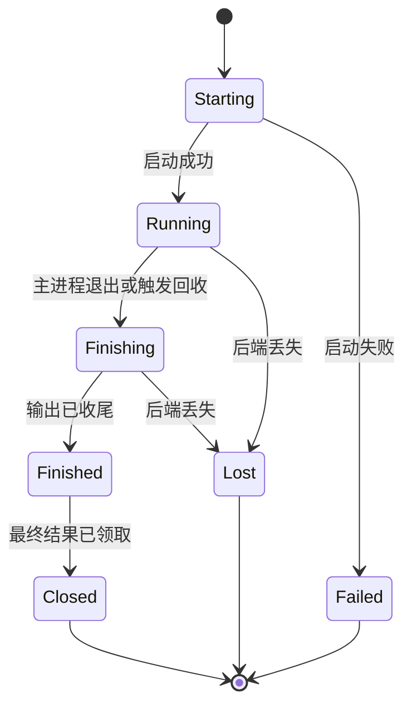

# loom-oi beta：Bash / PowerShell Action、参数与执行机制

状态：首版执行设计，包含 2026-11-10 新确认的默认 HTTP/WS、无 Token 及可选访问配置。Linux151 部署 OIS/Linux OIC，Windows 本机部署 OIC，从同一 vMCP 调用 Bash/PowerShell。两动作、限额、runtime、输出、托管和生命周期保持原基线；本文不声称复现 Codex 内部源码。此前 HTTPS+Token 下的验收记录是历史启用配置，新默认迁移单独验证。权威范围见[验收规格](../../../current/beta/acceptance.md)，配置见[访问配置](../../../../docs/access-configuration.md)。

首版交互目标：短命令直接得到结果；长命令得到执行句柄；Agent 用同一个句柄继续读输出或输入，最终得到退出状态。链路固定为 Agent → vMCP → Tool → Action → 通道 → OIC → oiapp → 目标 cmd。workbench 包含 Linux、Windows 各一对固定绑定工具，分别进入 linux-151 和 windows-local 通道；Agent 选择工具并提交业务参数，不增加同一 Tool 下的 Host 选择或调度。执行状态保留在原实现实例。

图示参考：[固定调用链早期示意](diagrams/2026-11-09-v2/README.md)，其单 Bash 环境及旧工具名以本文和验收基线覆盖。历史参考：[多 Host 旧版模块交互与 Bash 生命周期图集](diagrams/2026-11-09-v1/README.md)。旧图包含已退出首版的 Host 选择与路由，只保留作讨论历史，不能作为当前直接调用链的实现依据。

## 当前方案总览

YAML 是 oiapp 的接入声明：它说明有哪些 Action、各自接收什么参数、使用什么运行入口。OIC 加载并解释这份声明，收到 OIS 的调用后完成通用适配，再交给目标实现。

| 内容 | 表达的含义 | 当前状态 |
| --- | --- | --- |
| App / Action | 一组能力及其中的具体操作；Bash、PowerShell 分别提供启动和后续读写 | 首版基线 |
| Action 参数 Schema | 本地实现接收的参数信息，供 OIC 识别和适配 | 首版使用 input_schema 等本文字段 |
| 根 runtime / Action.runtime | 默认执行配置与更具体的入口配置 | 本文的顶层覆盖和实例规则已采纳 |
| handler | Action 到实际处理入口的名称映射 | 同名可省略已确认 |
| input_mapping | 参数名不同情况下的显式改名 | 可选字段，不重复 Schema 的类型定义 |
| 共享 worker | 每个命令 App 保存跨调用执行状态 | Bash、PowerShell 各自使用共享 worker，不规定所有未来 oiapp 的形态 |

完整机制按四个阶段理解：

1. **加载**：OIC 解析 Action、参数 Schema、有效 runtime 和 handler，建立本地索引；对应 App 的共享 worker 在此阶段初始化，不运行 cmd。
2. **调用**：OIS 根据 Tool 的固定绑定，经指定通道转交 Action 和业务参数；OIC 查加载索引，按声明改名、补固定默认、轻量转换，再送给目标实现。
3. **执行**：对应 App 创建或操作 Bash / PowerShell 进程，按等待窗口返回本批 output，以及仍可继续的 session_id 或最终 exit_code。
4. **继续**：Agent 使用 session_id 调用同组 write_stdin 工具，仍沿固定通道进入原实现；每次工具请求有新的 call_id，实际执行保持同一份状态。

本地 Schema 服务于实现接入，OIS Schema 服务于消费接口，不自动相互覆盖，也不以完全一致作为加载门槛。运行入口的优先级与进程实例共享分别设计。完整 App YAML 和目录见第 11 节，加载及本地消息见第 12 节；参数、结果、输出和失败细则在后文展开。

## 1. 组件边界

| 组件 | 负责 | 不依赖的业务细节 |
| --- | --- | --- |
| OIS | 工具定义、vMCP、消费方权限、Tool 到 Action/通道的固定绑定、MCP 结果转换 | 具体 shell 的 PID、终端、输出缓冲、session 表 |
| OIC | 主动连接 OIS、加载 Action/Schema/runtime、解析有效执行入口、按声明做通用参数绑定并转交、管理托管进程、传递可信调用上下文 | Bash / PowerShell 语法、session_id 的格式、业务 Action 的名字 |
| Bash / PowerShell App | 各自的两个 Action、shell 适配、实际进程、终端、执行句柄、输出和资源回收 | MCP 协议、Tool 展示名称、其他 App 的实现 |

两个命令 App 各自让两个 Action 继承根 runtime，访问本 App 的共享 worker，由其创建和保留本地 shell 进程；两端不共享同一个 worker。YAML 也允许 Action 自己配置 runtime，不由“一份 App YAML”推定所有入口必须同进程。OIC 实现通用声明解析、绑定与转交，不出现按 bash/powershell 或其 Action 名称执行 shell、读取业务输出的分支。

普通无状态 App 的逐调用程序形式留待后续接入。本期命令 App 使用共享 worker 保存跨调用的进程状态，不要求应用作者自建常驻 HTTP 服务。



## 2. 两个 Action 与固定通道

| App Action | 示例 Tool 名称 | 用途 |
| --- | --- | --- |
| bash.exec_command | linux_exec_command | 经 linux-151 创建一次 Bash 执行 |
| bash.write_stdin | linux_write_stdin | 经 linux-151 接续原 Bash 执行 |
| powershell.exec_command | windows_exec_command | 经 windows-local 创建一次 PowerShell 执行 |
| powershell.write_stdin | windows_write_stdin | 经 windows-local 接续原 PowerShell 执行 |

Tool 名由 OIS 配置，App 只识别自己的 Action 名。每个 Tool 固定绑定一个 App.Action 和通道；公开调用直接提供业务参数，Linux 示例为：

```json
{
  "cmd": "pwd; ls -l",
  "workdir": "/srv/workspace"
}
```

通道先理解为 OIS 到指定 OIC 的通信入口，不是新的调度服务。Agent 不传 host_id 或 channel_id，也不需要目标发现工具；首版不做同 Tool 多目标合并、目标选择或自动切换。OIS 按固定绑定转交，OIC 验证 App/Action 是否已加载启用，再做已约定的基础参数适配。业务参数不能改写通道、执行入口或调用者身份。

每组的两个 Tool 绑定同一个通道、同一个 App 的对应 Action，并访问本组共享后端。Linux session 不能交给 Windows 工具接续，反之亦然。公开参数不增加 input 外包装；内部 invoke 消息仍用 input 字段承载这份业务参数，这只是公共消息结构。

## 3. exec_command 参数

以下为两端共同采用的首版默认值，本机配置可调整规定的资源上限；它们不来自对参考工具内部实现的假定。

| 参数 | 目标类型 | 必填/默认 | 规则 |
| --- | --- | --- | --- |
| cmd | string | 必填 | 对应工具的 Bash 或 PowerShell 脚本文本；保留原文，不能是空白内容；不解析为系统自创 DSL |
| workdir | string | 省略使用本机 default_cwd | 绝对路径直接使用；相对路径基于 default_cwd 解析；不展开变量、波浪号或命令替换 |
| tty | boolean | false | false 使用普通管道，true 使用终端模式 |
| yield_time_ms | integer | 10000 | 本次等待输出或完成的窗口，范围 0–30000 毫秒；0 表示启动后立即取得可返回结果 |
| max_output_tokens | integer | 10000 | 本次 output 的近似预算；正整数，本机默认上限 20000，超过上限按上限执行 |

cmd 由对应 App 按所选 shell 的命令参数规则交付，不能把 workdir 或其他字段拼接进脚本文本。workdir 是本次执行目录，不修改 OIC 的默认配置；目录也不构成文件访问沙箱。Linux 与 Windows 使用各自的本机路径规则。

首版不暴露 shell、login、env、执行期限、任意程序入口等额外参数。shell 路径、启动环境、默认目录及资源上限由本机配置提供。Linux Bash 以非登录方式执行 cmd，参数数组为 [shell_path, "--noprofile", "--norc", "-c", cmd]，cwd 由进程 API 单独设置；TTY 不自动增加交互 shell 的 -i 标志。PowerShell 的启动适配见第 16 节，不能照搬 Bash 参数。平台适配层负责进程和终端创建。

每次 exec_command 创建新的执行。上一次 cmd 中的 cd/export 不会自动影响下一次执行。若 cmd 启动了一个持续交互的 shell，后续 write_stdin 操作这个存活进程，其内部状态可以延续。

yield_time_ms 不包含参数绑定、创建进程所需的短时间，不是端到端网络超时，也不是命令最多能运行多久。进程提前结束并收完输出时可提前返回；否则等待窗口到期后返回 session_id。具体实现不需要每出现一个字节就立即结束等待。

## 4. write_stdin 参数

| 参数 | 目标类型 | 必填/默认 | 规则 |
| --- | --- | --- | --- |
| session_id | string | 必填 | 本设计采用不透明字符串句柄；必须来自本对工具固定绑定的同一实现实例所返回的 exec_command 结果 |
| chars | string | 空字符串 | 空字符串只等待读取；非空则原样输入，随后等待读取；不会自动补换行 |
| yield_time_ms | integer | 空输入 5000，非空 250 | 输出等待窗口，范围 0–30000 毫秒；发生在本次输入提交之后 |
| max_output_tokens | integer | 10000 | 与 exec_command 使用相同规则 |

首版 session_id 使用不透明字符串；参考工具曾返回整数，交互模型不依赖其数值类型。句柄使用 s_加随机值一类表达，并带有 worker 运行周期的区分；不能直接使用 PID，也不能在 worker 重启后复用旧句柄。

write_stdin 不接受 cmd、workdir 或 tty：这些属性在创建执行时已经确定。若需要另一目录或终端模式，应创建新的执行。

chars 按 UTF-8 编码写入。需要一行输入时，调用者明确传入换行。例如 hello 后接换行；发送 hello 本身不会替调用者按回车。空字符串不代表 EOF、关闭 stdin 或取消。

## 5. 参数适配：执行时做最小绑定

OIS 的 Schema 描述面向 Agent 的工具输入；App YAML 的参数 Schema 描述本地 Action 实现接收的参数。首版使用 input_schema 的 type/properties/required/default/description 表达基本信息，OIC 根据已加载声明在调用时绑定，再转发到有效 runtime 的实现。不在 load 时要求两侧 Schema 相等，也不在适配前按原始 JSON 类型拒绝可转换的值。参数名称相同时直接对应，确需改名时由独立的 input_mapping 显式指定；不通过类型相似性猜测对应关系。

首版公共绑定辅助函数支持下表，不引入转换表达式或 YAML 规则语言：

| 目标类型 | 可以接受的值 | 不能接受的例子 |
| --- | --- | --- |
| string | 原字符串；整数转十进制字符串 | 对象、数组；不自动将它们转成一段 JSON 文本 |
| integer | 整数；可完整解析的十进制整数字符串；数值上恰为整数的有限数字 | 小数截断、布尔值、对象、数组、无法解析的文字 |
| boolean | 布尔值；字符串 true/false，忽略大小写 | 不能因为一个非空字符串存在就判为 true |

数字和布尔转换可以忽略两端空白；cmd、workdir、chars、session_id 的字符串内容不擅自裁剪。cmd 的空白检查只用于判断是否为空，不改写实际执行文本。

省略可选字段才采用默认值；显式 null 不等于省略。OIC 根据本地 properties 中的声明补齐固定 default、做基本类型转换，随后检查 required；缺少必填字段或不可转换时返回 INVALID_ARGUMENT，固定默认值也走同一转换。未声明的输入默认继续交给实现，不擅自丢弃。Bash Action 仍负责空命令、范围限额、动态默认值和实际入口不能接受的字段，例如 work_dir 不会被猜测成 workdir；实际无法接受时返回 INVALID_ARGUMENT。这些业务语义不在 OIC 中实现成 Bash 专用校验器。这里只承诺基本 Schema 信息及绑定行为，复杂关键字支持范围另行设计，不引入完整跨 Schema 校验体系。

YAML 已声明的固定默认值优先用于本次交付，App 接到具体值就按该值执行；未声明且未传入时才使用 App 的内置默认。workdir 依赖本机 default_cwd，write_stdin 的等待默认依赖 chars，继续由对应 App 处理，不为此在 YAML 中引入表达式。App 提供的默认 YAML 与其入口行为一同发布，但不在 load 时对照中心 Schema 做一致性门禁。

例如 yield_time_ms 为字符串 "1000" 可转换；值为对象时返回错误。错误应在启动命令或写入字符之前发现，不能先产生副作用再报告参数绑定失败。

## 6. 返回结果

两个 Action 共享同一种业务结果。正常返回始终包含 output，并在以下两种形状中选择一种：

```json
{
  "output": "Building...\n",
  "session_id": "s_b1_7ef4",
  "output_truncated": false,
  "omitted_bytes": 0,
  "output_incomplete": false
}
```

```json
{
  "output": "Build finished.\n",
  "exit_code": 0,
  "termination_reason": "exited",
  "output_truncated": false,
  "omitted_bytes": 0,
  "output_incomplete": false
}
```

| 字段 | 含义 |
| --- | --- |
| output | 本次领取的可显示输出；可能为空 |
| session_id | 仍可继续等待或操作的执行句柄；最终结果不再返回它 |
| exit_code | 执行已结束时返回的退出状态；与 session_id 互斥 |
| termination_reason | 最终结果的结束原因，如 exited、signal、runtime_limit、idle_limit、shutdown |
| output_truncated | 本批输出因显示预算或缓冲容量被省略 |
| omitted_bytes | 已知被省略的原始输出字节数，不计截断提示文字 |
| output_incomplete | 输出收集被迫提前关闭，可能还有无法计数的未收集内容 |

截断和结束原因字段属于首版共同结果契约。结果元数据不计入 output 的显示预算，不能因预算小而省略 session_id 或 exit_code。

非零退出码仍是执行完成的正常业务结果，例如命令 exit 2 返回 exit_code 2。入口无法启动、参数无法绑定或 session 不可访问才使用错误结果。若 POSIX 进程直接被信号终止，以 128 加信号编号归一化 exit_code，并同时记录 termination_reason 为 signal 及可选 signal 编号，避免与普通退出混淆。Windows 返回实际进程退出状态，不伪造 POSIX 信号编号；本地超限或管理关闭仍单独记录 termination_reason。

App worker 的协议响应与上述业务结果分别表达：

```json
{
  "type": "result",
  "call_id": "call-001",
  "result": {
    "output": "Building...\n",
    "session_id": "s_b1_7ef4",
    "output_truncated": false,
    "omitted_bytes": 0,
    "output_incomplete": false
  }
}
```

这个 result 表示本次 Action 已返回，不表示其中的 Bash 进程结束。OIS 可以将 result 映射为 MCP structuredContent，并提供文本内容方便模型消费。Bash 的非零退出不自动变成 MCP 协议错误。

## 7. 输出如何持续产生、分批返回和截断

各命令 App 的 worker 从进程启动起持续读取输出，独立于 Agent 是否正在调用 write_stdin。不能等 Agent 轮询才读取，否则管道容量耗尽可能阻塞写入程序。[Linux pipe 手册](https://man7.org/linux/man-pages/man7/pipe.7.html)

每个 session 维护有界的“尚未领取输出”缓冲。普通管道模式收集 stdout/stderr 后按观察到的顺序合成 output；TTY 模式读取终端输出。该接口不保证重建两条独立输出流在程序中的精确全局顺序，也不提供二进制文件传输。

一次 Action 返回时执行以下步骤：

1. 在短临界区内截取当前待输出快照，不停止后台读取。
2. 按本次预算生成 output；超出时保留头尾，中间插入明确的截断提示。
3. 将完整响应按 call_id 暂存，并原子提交这批输出的消费位置。
4. 之后产生的内容留给下一次调用。

**本次快照中因显示预算省略的内容也视为已消费，下次不会补读。** 这是本项目选择的消费语义，不据此推断参考工具的内部缓冲实现；首版不提供公开 cursor 或完整历史日志接口。

max_output_tokens 使用固定、与模型无关的估算：正文预算约为 4 倍参数值的 UTF-8 字节数。它是近似预算，不承诺与所有模型 tokenizer 精确一致。截断时只在完整字符边界切割；提示文字可占少量额外空间。预算极小时保留可容纳的前缀，截断状态仍由元数据说明。

缓冲满时保留最新内容、丢弃最旧的未领取部分，并计入缓冲丢弃量。最终 omitted_bytes 是缓冲丢弃量与本次显示省略量之和；内部记录分别保留来源，便于诊断。尚未完整接收的 UTF-8 字节由增量解码器短暂保留；真正非法的编码用替代字符显示，不因解码失败丢掉整个结果。

进程结束后仍要排空输出。只有确认主进程退出，并且输出通道达到 EOF 或输出排空期限，才形成最终结果；不能只看到进程退出就销毁缓冲。排空期限只能结束输出等待，不能替代进程退出确认；无法确认停止时保留未知状态，不编造 exit_code。管道的 EOF 取决于所有写端是否关闭，子进程保留输出句柄会影响收尾。[Linux pipe EOF 语义](https://man7.org/linux/man-pages/man7/pipe.7.html)

主进程退出后回收其管理范围内仍存活的子进程，给出有限的输出排空窗口；超时强制关闭读端时设置 output_incomplete。两个 App 首版提供命令执行，不承诺让命令通过后台化长期托管服务。

## 8. 普通管道与终端模式

| 行为 | tty=false | tty=true |
| --- | --- | --- |
| 输出 | 收集管道输出并合成一个 output | 返回终端输出，可能包含回显和 ANSI 控制序列 |
| 初始 stdin | 接到空输入，立即 EOF | 保留终端输入端 |
| 空 chars | 等待并读取输出 | 等待并读取输出 |
| 非空 chars | 返回 STDIN_NOT_WRITABLE | 原样发送到终端，再等待输出 |
| Ctrl+C | 不能通过此模式作为取消动作 | 按终端设置解释，可能触发前台进程组中断 |

首版选择“需要后续输入就显式 tty=true”，避免增加普通管道关闭输入工具。Linux PTY、Windows ConPTY 均须实际验收；结果见验收报告，不从设计文本推定通过。控制字符由终端和程序解释，Ctrl+C 不是无条件强制结束，Ctrl+D 不是跨平台关闭 stdin API。[Linux PTY 手册](https://man7.org/linux/man-pages/man7/pty.7.html)、[Microsoft ConPTY 文档](https://learn.microsoft.com/en-us/windows/console/creating-a-pseudoconsole-session)

终端初始尺寸从本机配置读取，默认 120 列、40 行；首版没有 resize Action。是否渲染控制序列由消费端决定，两个 App 均不实现完整终端 UI。

输入采用非阻塞或可超时写入，默认单次写入期限 1000 毫秒。它与 yield_time_ms 分开。若只能写入部分内容后失败，返回 INPUT_WRITE_FAILED 并在已知时说明 input_bytes_written；调用者不能盲目重发整段 chars，否则可能重复输入。

## 9. 会话生命周期与并发

内部状态可以比公开结果丰富，但不增加公开工具：



Running 和尚未完成收尾的 Finishing 对外仍返回 session_id；Finishing 已不可写入时，非空输入返回 STDIN_NOT_WRITABLE。Finished 的下一次空输入调用交付最后输出和 exit_code，随后关闭句柄。结束后未领取结果只短时保留，不作为无限历史存储。

同一个 session 同时只允许一个 write_stdin 操作。第二个并发调用返回 SESSION_BUSY，保证没有写入字符，也没有消费输出。这个操作锁不阻塞后台采集。不同 session 可以并行执行。

call_id 由 OIS 为一次新的工具调用产生，贯穿本次转交；它不同于执行句柄，也不是直接复用 Agent 自报的 MCP 请求编号。多次 write_stdin 各有自己的 call_id，却可以指向同一个 session_id。

去重记录绑定可信访问身份、vMCP、固定通道及原 App/runtime 实例的运行周期。每次先通过当前访问授权，再查对应调用记录；OIC 保留原 Action、原输入、可信上下文及本次采用的 Schema、映射和有效 runtime 快照，并复用首次绑定的结果；worker 核对实际收到的 handler 和绑定后输入。不能让同一 call_id 因声明、默认值或入口变化而重新绑定并执行。内容不同返回 CALL_ID_CONFLICT，不能返回另一次调用的缓存。执行中则关联同一个响应，已返回则复用缓存，不能再次创建命令进程、再次输入或消费另一批输出。同一 session 上的新 call_id 是新动作，不按 chars 内容去重。

正在处理的调用记录不能被已完成响应缓存的容量淘汰规则删除；达到公共在途调用上限时拒绝新调用。响应缓存与已结束 session 的存储分别计数；最终响应缓存到期后，旧句柄不能靠换一个 call_id 重新领取同一结果。

以下本地默认限额是两端共同采用的首版基线，可由配置调整；配置变化按本地加载规则生效：

| 限额 | 默认值 | 用途 |
| --- | --- | --- |
| 并行执行数 | 8 | 达到上限返回 CAPACITY_EXCEEDED，不排离线/后台任务队列 |
| 每个 session 待输出缓冲 | 1 MiB | 满时保留最新内容并明确丢弃量 |
| cmd / 单次 chars 大小 | 各 64 KiB | 防止单次请求无限占用输入空间 |
| 最长执行时间 | 30 分钟 | 独立于 yield_time_ms，可由本机管理者调整 |
| 无调用活动时间 | 10 分钟 | 从创建或上次获准进入 session 操作的继续调用开始计时；拒绝的调用和后台输出不重置，正在合法等待读写时不触发闲置回收 |
| 已结束但未领取的 session | 最多 32 个，保留 10 分钟 | 释放活动执行名额，同时有界保留尾部结果 |
| 已完成响应去重缓存 | 最多 128 个、最多 10 分钟 | 当前 worker 周期内重复帧复用响应，不是跨重启 exactly-once 保证；正在处理的调用另外限额 |
| 退出宽限 | 2 秒 | 请求终止后等待，未停止再按平台方式强制回收管理范围内的执行 |
| 输出排空宽限 | 1 秒 | 完成进程回收后等待 EOF，超时标记 output_incomplete |

会话一旦因限额、管理操作或 App 重启被回收，不能在后续调用时自动重建。普通 cmd 退出码与本地期限触发的结束原因分别报告。对主动脱离所管理进程范围的程序，不宣称上述机制提供了完整系统隔离保证；平台适配器必须明确可管理范围并验证回收行为。

## 10. 身份、实现实例与句柄的绑定

session_id 只是句柄，不是权限凭证。创建时 worker 记录以下可信属性：

- 原 OIC 中本 App 的加载实例及 runtime 运行周期。
- OIS 提供的访问身份和 vMCP 范围。
- 进程、终端模式、实际工作目录及输出状态。

OIS 每次调用检查当前访问者可使用的 Tool，再按该 Tool 的固定通道转交；OIC 只转交当前已启用的 Action，并将可信身份放在 context 中。worker 查句柄并验证归属，不从业务参数接受自报 owner。Agent 不参与选择接续执行的位置。

默认无 Token 时，同一 vMCP 的调用者共享 anonymous:<vmcp_id> 身份，随意填写或更换 Bearer 不会产生新的 owner。access.credential_env 非空时启用该 vMCP 的 Token，引用缺值必须拒绝；两个 Agent 共享凭据仍是同一身份。匿名范围与凭据范围都不宣称提供独立用户隔离。access.require_https 只控制消费连接是否必须为真实 TLS，不改变 worker 的归属检查，也不自动启用 Token。

句柄不属于当前实现实例、身份不符或句柄未知时，统一返回 SESSION_UNAVAILABLE，避免泄漏其他执行的存在。对本身份已知且仍有关闭记录的句柄，可进一步返回 SESSION_CLOSED 或 SESSION_EXPIRED。后端重启后旧句柄失效；修改工具绑定也不会迁移原执行，没有重建或自动切换实现的行为。

## 11. App 目录和 YAML

Linux Bash 采用一个共享托管 worker；Action 文件成为 worker 内的业务模块。Windows PowerShell 采用相同的模块职责，使用独立 App 与平台适配器：

```text
bash/
  app.yaml
  runtime/
    worker.py             # 本地调用帧分发、并发响应及生命周期适配
    executor.py           # session 表、进程/PTY、输出与回收
  actions/
    exec_command.py       # 接收已绑定参数、业务检查和创建执行
    write_stdin.py        # 接收已绑定参数、归属检查和继续读写
  README.md
```

Python 文件名仅用于说明模块职责，语言在工程阶段选择；最终也可以交付编译后的可执行 worker。已冻结的是通用 JSON Lines 协议及模块职责，不是 Python 运行时依赖。协议适配可以复用薄辅助模块，不要求 App 开发者实现网络服务或完整 SDK。

app.yaml 包含 Action、基本参数 Schema 及运行入口。以下是首版字段写法；同名 handler 可以省略，参数声明仍需保留。示例 runtime.command 在工程交付时替换为实际 worker 入口：

```yaml
version: 1
app:
  code: bash
runtime:
  command: ["python", "./runtime/worker.py"]
actions:
  exec_command:
    description: 启动一次 Bash 执行并返回本轮输出。
    input_schema:
      type: object
      properties:
        cmd: {type: string, description: 要执行的 Bash 命令文本}
        workdir: {type: string, description: 本次工作目录}
        tty: {type: boolean, default: false}
        yield_time_ms: {type: integer, default: 10000}
        max_output_tokens: {type: integer, default: 10000}
      required: [cmd]
  write_stdin:
    description: 向已有执行输入，或继续等待并读取输出。
    input_schema:
      type: object
      properties:
        session_id: {type: string}
        chars: {type: string, default: ""}
        yield_time_ms: {type: integer}
        max_output_tokens: {type: integer, default: 10000}
      required: [session_id]
```

actions 的键供 OIS 引用，description 说明本地动作，input_schema 描述实现接收的参数；handler 是实际入口标识，省略时采用 Action 名，显式声明时允许不同名。本地描述不自动覆盖 OIS 的工具名称、说明或消费 Schema。本轮不把 output_schema 增加为必填内容。

### runtime 的默认、覆盖和执行实例

runtime 可以只放在根节点、只放在 Action，或两处同时提供。首版采用根节点默认、Action 更具体配置优先，并按以下规则解析：

1. 从根 runtime 取得默认字段，Action.runtime 的同名顶层字段覆盖默认。
2. command 等数组整体替换，不拼接两份命令；对象字段也整体替换，不作隐式递归合并。省略的字段才继承，null 不作为清空指令。
3. 没有根 runtime 时，Action.runtime 需提供该入口完整的执行配置。最终无法得到可执行配置时，加载报告该 Action 的配置错误。
4. 相对资源统一基于 App YAML 所在目录。进程形式的 command 是程序与参数数组，直接创建目标进程，不经字符串拼接的 shell 间接启动。

仅演示覆盖解析的片段如下，read/write 是假设的无状态示例动作，不加入首版 Bash 工具集合：

```yaml
runtime:
  command: ["python", "./default_worker.py"]
actions:
  read:
    input_schema: {type: object, properties: {}}
  write:
    runtime:
      command: ["python", "./special_worker.py"]
    input_schema:
      type: object
      properties:
        text: {type: string}
      required: [text]
```

read 使用 default_worker.py，write 使用 special_worker.py。覆盖决定如何对接目标实现，不自动建立两个实现之间的共享业务状态，也不意味着所有 oiapp 必须采用 Python 或常驻 worker。

在首版托管 worker 模式中，未提供 Action.runtime 或仅提供空对象的 Action，复用本次 App 加载的根 runtime 实例；非空的 Action.runtime 覆盖使用该 Action 自己的实例。不能仅因两份 command 文本相同就暗中合并实例。

Bash 与 PowerShell App 各自的两个 Action 都继承本 App 根 runtime，因此组内访问同一个执行后端。若改为独立入口，需要它们显式访问共同后端；不能期待另一进程凭 session_id 自动找到前一进程的内存状态。首版不新增共享实例引用语法或第三个命令 Action，也不同时实现其他执行器模式。

### 参数名称不同的时候

Schema 使用本地实现接收的参数名，默认与调用输入同名绑定。必要时单独用 input_mapping 明确改名；例如向 exec_command 增加以下配置片段：

```yaml
input_mapping:
  cmd: command
```

这表示取业务输入中的 command，交付为本地 cmd。类型、必填和默认值仍只写在 input_schema，不在映射里重复 as/required/default。映射仅引用本次业务输入，不读取宿主配置或可信 context。

OIC 从原始输入快照同时取值，先改名，再按本地 Schema 补缺省、转换基本类型、判断必填，全部成功后才转交实现。改名消费的源字段不再次透传；未被消费的字段保持原名交给实现。若来源和同名目标同时出现而造成覆盖歧义，返回 INVALID_ARGUMENT，不静默覆盖。没有 input_mapping 时直接使用同名字段，仍然根据 input_schema 完成绑定。

OIC 配置声明本机使用的固定通道，并提供业务环境与限额：

```yaml
version: 1
host:
  id: linux-151
channel:
  id: linux-151
ois:
  url: http://<Linux151地址>:25100
  credential_env: ""
app_config:
  bash:
    shell_path: /bin/bash
    default_cwd: /srv/workspace
    env:
      LANG: C.UTF-8
    limits:
      max_concurrent_sessions: 8
      session_buffer_bytes: 1048576
      max_cmd_bytes: 65536
      max_input_bytes: 65536
      max_output_tokens: 20000
      max_runtime_ms: 1800000
      idle_timeout_ms: 600000
      finished_session_ttl_ms: 600000
      max_finished_sessions: 32
    terminal:
      columns: 120
      rows: 40
```

本例使用默认 HTTP/WS 和匿名通道；Windows 对应 windows-local、app_config.powershell 及本机路径。Host/channel ID 始终显式配置并匹配 expected_host_id，拒绝重复活动连接；启用通道 Token 后再校验凭据，匿名 ID 匹配本身不是机器认证。运行环境由本机管理员准备；配置了接入凭据时不向命令进程继承。worker 只获得必要运行环境，App 按受控基础环境和 app_config.env 建立命令环境，不复制 OIC 全部环境。

## 12. OIC 加载及本地 worker 协议

首版 load 顺序：

1. 读取 YAML，解析各 Action 的基本信息和参数 Schema，结合根默认及 Action 覆盖计算有效 runtime，检查实际入口可用。
2. 按有效 runtime 及实例规则启动相应 worker，传入本机配置；全部 worker 完成初始化后报告 ready 和可分发的 handler，OIC 确认各 Action 引用的入口存在。两端命令 App 各自的两个 Action 共用本 App 根 worker。
3. 本地全部入口 ready 后原子建立 App/Action → 本地 Schema、有效 runtime 实例、handler 的索引并保存加载记录，本地 load 即成功；再向 OIS 登记 Action 与可用状态。登记不自动覆盖 OIS 的 Tool 定义，也不要求两侧 Schema 相等。
4. 分别显示本地 ready 和中心 pending/registered 状态；OIS 离线不使已就绪的本地加载失败，连接恢复后重新登记，不发布半个 App。

同一 App code、同一有效配置重复 load 为无操作，保留原 worker 和 session。配置变化须先 unload 再 load；首版不自动热更新。有效配置包含解析后的 Action、Schema/映射、runtime/handler 和本地 App 配置；不通过监视代码文件自动替换正在运行的实现。任一入口初始化失败，回收本次加载创建的资源，不保存成功记录、不发布部分 Action，也不改变其他已加载 App。

unload 先停新调用、撤登记并回收该 App 的全部执行，完成卸载后删除加载记录；stop 回收全部托管资源但保留加载记录。start 重校验并重载记录中的 App，失效文件或配置明确报告不可用；不会恢复旧 worker、命令进程或 session。worker 意外崩溃后标记不可用并清理，不自动重启；重新加载需按显式 unload/load 流程执行。

初始化 worker 不等于执行 cmd；load 不启动业务命令，不与中心做强参数匹配。若存在可识别的中心与本地参数差异，最多给出提示。本地程序入口不可用、必要配置无效或 worker 初始化失败，则不能进入 ready；例如 default_cwd 不存在或限额为负数属于本地运行前提错误，不属于中心与本地 Schema 一致性检查。

本地协议采用 UTF-8 JSON Lines：每行一个完整对象，字符串内的换行按 JSON 转义；诊断写 stderr，stdout 只写协议帧。OIC 负责 framing 和关联 call_id，worker 的输出写入器负责避免并发帧交错。公共协议帧默认最大 1 MiB、每个 worker 最多 64 个在途调用；超过限制拒绝新增调用，非法帧导致协议失效时将 App 标记不可用并回收，不能无限读取或堆积请求。

启动帧示意：

```json
{"type":"start","protocol":1,"config":{"shell_path":"/bin/bash","default_cwd":"/srv/workspace"}}
```

```json
{"type":"ready","protocol":1,"handlers":["exec_command","write_stdin"]}
```

调用帧示意：

```json
{
  "type": "invoke",
  "call_id": "call-001",
  "handler": "exec_command",
  "input": {"cmd": "make", "yield_time_ms": 1000},
  "context": {
    "access_identity": "anonymous:workbench",
    "vmcp_id": "workbench"
  }
}
```

OIS 沿 Tool 的固定通道下发原 App Action，OIC 查已加载索引，先按 input_mapping 和本地 input_schema 绑定参数，再选择该 Action 的有效 runtime 实例及 handler，生成以上本地帧；调用记录保留原 App Action、原输入与绑定结果。不能直接采用调用者提供的任意 handler 或 runtime。config 只在启动时由 OIC 交付；每次调用的 input 不能覆盖它。context 来自可信调用链，不由 Agent 自报。

worker 必须并发处理不同调用，不能因为一个 exec_command 等待 30 秒就阻塞所有 session。每个调用只返回一个 result 或 error；异步输出先留在对应 App 的缓冲中，不将命令原始输出混进协议帧。

OIC 关闭 App 时先停止接收新调用，再关闭 worker 的 stdin。EOF 是本协议的关闭信号：worker 停止派发、回收其全部执行、排空输出并退出。OIC 默认给出 5 秒宿主宽限，覆盖 2 秒进程退出和 1 秒输出排空时间；宽限内继续读取 worker stdout/stderr，避免收尾被管道堵塞。宽限后或 worker 崩溃时，平台适配器必须覆盖托管范围内的命令及终端后代进行兜底回收，不能只杀 worker PID 就报告清理完成。EOF、worker 崩溃和管理卸载都要令对应 App 不可用。load 初始化默认 10 秒未全部 ready 即失败并回收本次资源。这些清理行为必须分别在 Linux 和 Windows 实测，当前不宣称已经实现。

## 13. OIS 定义与通信

OIS 在 workbench 中维护四个 Tool 的描述和输入定义，分别固定绑定一个 Action 和通道。Linux、Windows 各一对，直接承接扁平业务参数；下面的 YAML 锚点仅复用相同参数结构，不建立共享执行状态：

```yaml
version: 1
tools:
  linux_exec_command:
    description: 在 Linux151 启动一次 Bash 执行；运行中返回 session_id，结束返回 exit_code。
    source: {app: bash, action: exec_command, channel: linux-151}
    input_schema: &exec_parameters
      type: object
      properties:
        cmd: {type: string}
        workdir: {type: string}
        tty: {type: boolean, default: false}
        yield_time_ms: {type: integer, minimum: 0, maximum: 30000, default: 10000}
        max_output_tokens: {type: integer, minimum: 1, default: 10000}
      required: [cmd]
  linux_write_stdin:
    description: 继续 linux_exec_command 创建的执行；空 chars 等待输出，非空 chars 输入后读取。
    source: {app: bash, action: write_stdin, channel: linux-151}
    input_schema: &stdin_parameters
      type: object
      properties:
        session_id: {type: string}
        chars: {type: string, default: ""}
        yield_time_ms: {type: integer, minimum: 0, maximum: 30000}
        max_output_tokens: {type: integer, minimum: 1, default: 10000}
      required: [session_id]
  windows_exec_command:
    description: 在本机 Windows 启动一次 PowerShell 执行；运行中返回 session_id，结束返回 exit_code。
    source: {app: powershell, action: exec_command, channel: windows-local}
    input_schema: *exec_parameters
  windows_write_stdin:
    description: 继续 windows_exec_command 创建的执行；空 chars 等待输出，非空 chars 输入后读取。
    source: {app: powershell, action: write_stdin, channel: windows-local}
    input_schema: *stdin_parameters
vmcps:
  workbench:
    tools: [linux_exec_command, linux_write_stdin, windows_exec_command, windows_write_stdin]
```

OIS Schema 表达消费输入，本地 input_schema 表达执行输入。OIS 不因为可转换的字符串数字与描述类型不同，就提前阻断执行；OIC 按本地 Schema 做前述基本适配，再交付对应 App 实现。中心 default 不自动成为本地执行默认，OIC 使用本地声明的固定 default，未配置的业务默认由 App 处理。为保持首版轻量，例子没有再声明强制消费输出 Schema，结构化结果仍按公共 JSON 返回。

通道表示 OIS 到指定 OIC 的入口。默认 OIS 在 151 的 25100 提供 HTTP，两个 OIC 通过 WS /api/v1/oic/connect 登记到 linux-151/windows-local。需要时 server.https 提供共享 HTTPS/WSS 监听；通道 Token 独立启用。Host/channel ID 始终核对，重复活动连接拒绝，旧连接关闭后才重接。通道承载登记、invoke、result/error、cancel 和存活消息；Tool 只引用固定通道，不增加目标选择或调度层。

心跳默认间隔 10 秒、连续 30 秒无法确认存活就标记通道不可用；失效连接的迟到消息不能覆盖新连接状态。只投递给固定通道的在线连接，不缓存离线业务请求，也不换到其他通道。worker 未 ready 的 App 不能因为 OIC 已连接就被当作可执行。

Windows 客户端默认连接 http://<Linux151地址>:25100/mcp/workbench，使用 MCP 2025-11-25 Streamable HTTP，无 Token 仍须完成协议握手。require_https=true 时使用共享 HTTPS endpoint，普通 HTTP 返回 403 HTTPS_REQUIRED，转发头不能绕过；Token 按独立配置要求。启用 HTTPS 时管理员提供 CA 签发证书，OIS 不自动签发，客户端验证信任。OIS 请求期限仍为 60 秒，独立于 Action 的 0–30000 毫秒等待窗口，十分钟执行通过后续调用接续。[MCP Transports](https://modelcontextprotocol.io/specification/2025-11-25/basic/transports)

## 14. 失败、断连与重复请求

错误统一使用结构化信息：

```json
{
  "type": "error",
  "call_id": "call-003",
  "error": {
    "code": "INVALID_ARGUMENT",
    "message": "yield_time_ms cannot be converted to an integer.",
    "details": {"field": "yield_time_ms", "expected": "integer", "actual_type": "object"}
  }
}
```

| 错误码 | 含义及副作用边界 |
| --- | --- |
| INVALID_ARGUMENT | 输入无法绑定；该次调用未创建命令或写入字符 |
| WORKDIR_UNAVAILABLE | 目录不能作为执行目录；未启动目标 shell |
| START_FAILED | 目标 shell 启动失败；与启动后非零退出区分 |
| CAPACITY_EXCEEDED | 活动执行数已满；未排队启动 |
| SESSION_UNAVAILABLE | 当前身份在固定通道所连接的 App 实例中找不到可访问句柄 |
| SESSION_CLOSED / SESSION_EXPIRED | 可识别的句柄已结束或被回收，不重建 |
| SESSION_BUSY | 另一读写调用占用此 session；本次未输入、未消费输出 |
| STDIN_NOT_WRITABLE | 管道模式或输入端已关闭；本次未写入 |
| INPUT_WRITE_FAILED | 输入写入失败；可能已有部分输入，尽可能返回已写入字节数 |
| CALL_ID_CONFLICT | 同一归属范围的 call_id 被用于不同 Action 或输入；本次不重复执行 |
| CALL_CANCELLED | 当前 Action 被取消；已经发生的命令或输入副作用不回滚 |
| CHANNEL_UNAVAILABLE / APP_UNAVAILABLE | 固定通道或 App 不可用；是否已投递由调用记录确定 |
| CALL_RESULT_UNKNOWN | 请求可能已执行或输入可能已送达，但无法确定结果；不能当作安全重试信号 |

如果 OIS 在发送前就确认固定通道不可用，可报告未投递。请求发送后未取得结果，不能宣称没有执行；默认不自动重新执行或重新输入，也不自动改投其他通道。调用者再次发起新的 exec_command 是新操作，可能重复产生业务效果。

worker 及 OIC 在当前运行周期内维护处理中记录和有限的最终响应缓存。缓存响应后再提交输出消费，使同 ID 的重复帧返回原结果；不能用新 ID 恢复被省略的历史输出，也不承诺跨缓存淘汰或重启的恰好执行一次。首版不自动重投未确认请求，去重是规定运行周期与保留范围内的防重复措施。

OIS—OIC 暂时断连且 worker 仍存活时，已启动执行按本地期限继续；同一固定通道恢复连接、权限仍有效且 App 实例未变时，已知 session 可以继续使用。Agent 仍调用原接续工具，无须选择通道。worker 崩溃或重启会使旧句柄失效。连接异常不是可可靠送达的取消通知，不能因此声称执行已停止。

### 当前请求取消的范围

普通 MCP Tool 调用承载每一次 Action；连续输出由后续 write_stdin 调用获得，不依赖扩展任务或自定义 stdout 通知。验收冻结为 MCP 2025-11-25：客户端显式发送 notifications/cancelled，OIS 将该 MCP 请求映射到内部 call_id，再按下表处理。该版本不能把 HTTP/SSE 连接中断直接解释为取消；意外网络失联保留未知状态，不自动重试业务操作。已取消请求不另行发送普通 MCP 响应，内部取消结果仍可记录，迟到响应和取消按协议处理。[MCP 2025-11-25 Cancellation](https://modelcontextprotocol.io/specification/2025-11-25/basic/utilities/cancellation)、[该版连接中断语义](https://modelcontextprotocol.io/specification/2025-11-25/basic/transports)

公共调用协议使用仅由宿主发送的取消帧：

```json
{"type":"cancel","call_id":"call-001"}
```

OIS 将取消转给 OIC，OIC 只转给原 worker 和原调用；它不是第三个公开命令 Action，也不能由业务 input 指定任意其他调用。REST 可识别的主动取消及上层 60 秒请求期限到期可尽力转成同一内部 cancel，不从连接异常推断进程已停止。worker 负责该 Action 的取消行为：

| 取消发生的位置 | 首版行为 |
| --- | --- |
| exec_command 尚未创建进程 | 停止启动；返回 CALL_CANCELLED |
| exec_command 已创建进程、响应尚未提交 | 请求回收这次新建的执行，终止本次等待；清理按进程宽限执行，不能宣称已发生的副作用被撤销 |
| write_stdin 响应尚未提交 | 停止本次等待或尚未完成的输入；不结束原 session，不消费尚未提交的输出；已写入内容无法撤销，错误附带已知输入字节数 |
| result/error 已提交 | 保留既有结果及缓存；迟到的取消不撤销输出消费、不终止已经交付句柄的执行 |

取消与结果提交在同一调用状态上串行裁决，以先提交者为准。错误或取消响应本身不消费业务输出；write_stdin 的非空输入即使部分完成也可能已经影响进程。没有收到停止确认，OIS 就不能报告命令进程已经停止；通道已经关闭时，内部可以记录结果，但不能承诺客户端收到它。

这种划分使“取消一次正在等待的读取”与“请求中断已有命令执行”相互独立。后者仍由有效终端的控制输入或本地管理回收完成；首版不增加公开强制停止动作。非 TTY 执行没有单独的公开停止入口，取消丢失、结果与断开竞态产生的孤立执行最终由本地闲置/运行期限或管理卸载回收。这是已采纳的首版体验边界。

## 15. Linux Bash 交互例子

### 短命令

调用 linux_exec_command：

```json
{"cmd":"pwd; ls -l","workdir":"/srv/workspace"}
```

结果可能为：

```json
{"output":"/srv/workspace\ntotal 0\n","exit_code":0,"termination_reason":"exited","output_truncated":false,"omitted_bytes":0,"output_incomplete":false}
```

### 长命令

调用 linux_exec_command 后，再反复调用 linux_write_stdin；每一步都是一次普通 Tool 调用：

```json
{"cmd":"make","yield_time_ms":1000}
```

```json
{"output":"Building...\n","session_id":"s_b1_7ef4","output_truncated":false,"omitted_bytes":0,"output_incomplete":false}
```

```json
{"session_id":"s_b1_7ef4","chars":"","yield_time_ms":5000}
```

```json
{"output":"Build finished.\n","exit_code":0,"termination_reason":"exited","output_truncated":false,"omitted_bytes":0,"output_incomplete":false}
```

### 终端输入

先启动需要输入的 Bash 命令：

```json
{"cmd":"read -r name; printf 'hello %s\n' \"$name\"","tty":true,"yield_time_ms":1000}
```

得到句柄后调用 linux_write_stdin：

```json
{"session_id":"s_b1_9a20","chars":"world\n","yield_time_ms":1000}
```

返回可能同时包含终端输入回显与 hello world；具体换行和回显由终端设置决定。若是长期交互进程，可以继续输入，直到进程结束。需要尝试中断时，向适用的终端发送控制字符，再读取结果确认状态：

```json
{"session_id":"s_b1_9a20","chars":"\u0003","yield_time_ms":1000}
```

最后这个调用仅适用于句柄仍有效的情况，不是在前一个命令已经退出后继续使用已关闭句柄。

## 16. Windows PowerShell 适配与跨平台验收

Windows 本机已只读核对存在 PowerShell 7.6.9（pwsh）。该事实只确定验收环境，不代表 Windows App、ConPTY 或进程清理已实现。Windows App 使用 app.code: powershell，两个 Action 及其基本参数 Schema、共同 result、限额和生命周期与 Linux Bash 相同；本地配置指向该 pwsh 安装的实际可执行文件，使用 Windows 工作目录。可采用与第 11 节相同的模块职责，实际 worker 语言及编译交付形式在工程阶段选择。

PowerShell App 按原生 PowerShell 语法执行 cmd。使用 -NoLogo、-NoProfile 及 -Command 交付完整脚本文本，工作目录由进程 API 设置；普通管道模式可以使用 -NonInteractive，TTY 交互模式不能用它禁止 Read-Host。不得照搬 Bash 的 --noprofile/--norc/-c 或把 PowerShell 文本交给 Bash。输出最终转成公共 UTF-8 文本，中文、换行和非零退出都需要实测；返回的是实际 PowerShell 进程退出码，不擅自将其中任一命令的状态替代为整个进程退出状态。[Microsoft about_Pwsh](https://learn.microsoft.com/en-us/powershell/module/microsoft.powershell.core/about/about_pwsh)

tty=false 仍从创建时关闭 stdin，只支持空 chars 接续读取；tty=true 必须实现并验收 Windows ConPTY，不能用普通管道输入测试冒充终端支持。ConPTY 的建立、输入输出与关闭由 Windows App 的平台适配完成。正常结束、unload、stop、worker 崩溃都须验证受管理进程确实退出；Windows 可使用 Job Object 等平台设施实现分组回收，但必须验证实际归属，不能仅因 worker PID 消失就判通过。[Microsoft ConPTY](https://learn.microsoft.com/en-us/windows/console/creating-a-pseudoconsole-session)、[Job Objects](https://learn.microsoft.com/en-us/windows/win32/procthread/job-objects)

Windows 工具的输入例子：

```json
{"cmd":"Get-Location; Get-ChildItem","yield_time_ms":1000,"max_output_tokens":1000}
```

上例交给 windows_exec_command。交互验收使用 tty=true，例如：

```json
{"cmd":"$name = Read-Host 'name'; Write-Output ('hello ' + $name)","tty":true,"yield_time_ms":1000}
```

随后向 windows_write_stdin 传回该执行的 session_id 和输入，不与 Linux 句柄混用：

```json
{"session_id":"s_ps1_9a20","chars":"loom\n","yield_time_ms":1000}
```

两端十分钟无输出验收从 Windows MCP 客户端分别发起，使用各自的固定工具：Linux 执行 `sleep 600; printf 'done\n'`，Windows 执行 `Start-Sleep -Seconds 600; Write-Output 'done'`。首次短等待取得句柄后，持续用对应 write_stdin 的空 chars 和不超过 30000 毫秒的等待窗口接续。期间 output 可以为空，session 仍有效；实际运行不少于 600 秒后返回 done 和 exit_code 0。不得通过重新 exec、添加业务心跳输出或缩短等待命令替代验收。

这验证的是命令十分钟无输出，不是十分钟没有任何客户端调用。持续合法轮询维持活动；无人继续调用时仍按 10 分钟闲置期限回收。30 分钟最长执行时间独立生效。另测串错工具组的句柄被拒绝、默认预算截断不补读、结束尾部输出及管理回收；具体记录和通过标准以[首版验收基线](../../../current/beta/acceptance.md)为准。

## 17. 首版验收

1. 从 Windows MCP 客户端经 Linux151 OIS 的 workbench 调用两组共四个固定 Tool，分别完成 Linux Bash 与 Windows PowerShell 闭环；无需目标查询、目标 ID 或 input 外包装，后续读写到达原实现实例的原执行。
2. 短命令返回 output/exit_code；长命令返回 session_id，空输入能继续领取新输出。
3. Linux PTY 与 Windows ConPTY 分别通过 tty=true 文本输入验收；tty=false 的非空输入得到明确错误，空输入不关闭任何会话。
4. 本地 YAML 包含 Action 与基本参数 Schema；OIC 根据声明将字符串数字转换后交付，对象转整数失败；加载不要求它与 OIS Schema 完全相同。
5. stdout/stderr 持续被消费，大输出不会因 Agent 没有轮询而无限阻塞；显示截断与缓冲丢弃明确可见。
6. 退出后尾部输出被收尾交付；输出句柄被子进程持有时不会永久挂住；超时收尾报告不完整。
7. 同一 session 并发输入得到 SESSION_BUSY；处理中和规定响应缓存范围内的同 call_id 重复帧不会重复启动或输入；不同身份或不同载荷不能借该 ID 取得旧结果。
8. 非零退出与启动失败可区分；断连后的未知结果不触发自动重跑。
9. App 重启、闲置回收和管理卸载不会把旧 session 指向新进程；目标平台的托管资源回收经过实测。
10. 请求取消与结果提交竞态可判定；取消未提交的读取不消费输出、不终止原 session，部分输入不能被报告成未发送。
11. 根 runtime 默认、仅 Action runtime、Action 覆盖均能解析；command 数组不被错误拼接；每个命令 App 的两 Action 访问本 App 根实例，独立覆盖不会意外串用其他实例的会话。
12. OIS/OIC 中无按 Bash / PowerShell 或其 Action 名称执行 shell、读取业务缓冲的分支；通用接口可用无副作用的测试处理器验证，不实现 CU 来完成首版验收。
13. 两端十分钟无输出、持续轮询、最终退出及跨工具组句柄拒绝均按验收基线完成，保留真实计时和结果记录。
14. 验证同有效配置重复 load 无操作、变化先 unload、多 runtime 初始化失败整批回收、unload 删除记录、stop 保留记录、start 重校验重载及崩溃不自动重启。

上述是已冻结的设计和待执行验收，不是测试结果。本轮不开始实现、部署或远程操作；后续工程阶段选择程序语言并实现平台适配，验收范围以权威基线为准。

相关文档：[已确认共识](../../../current/beta/design.md)、[设计总稿](design.md)、[完整组合文章](app-to-agent-walkthrough.md)、[沟通笔记](notes.md)。
